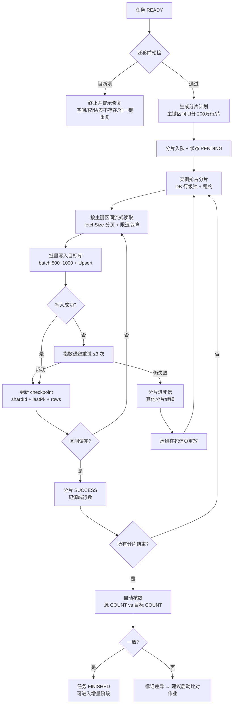
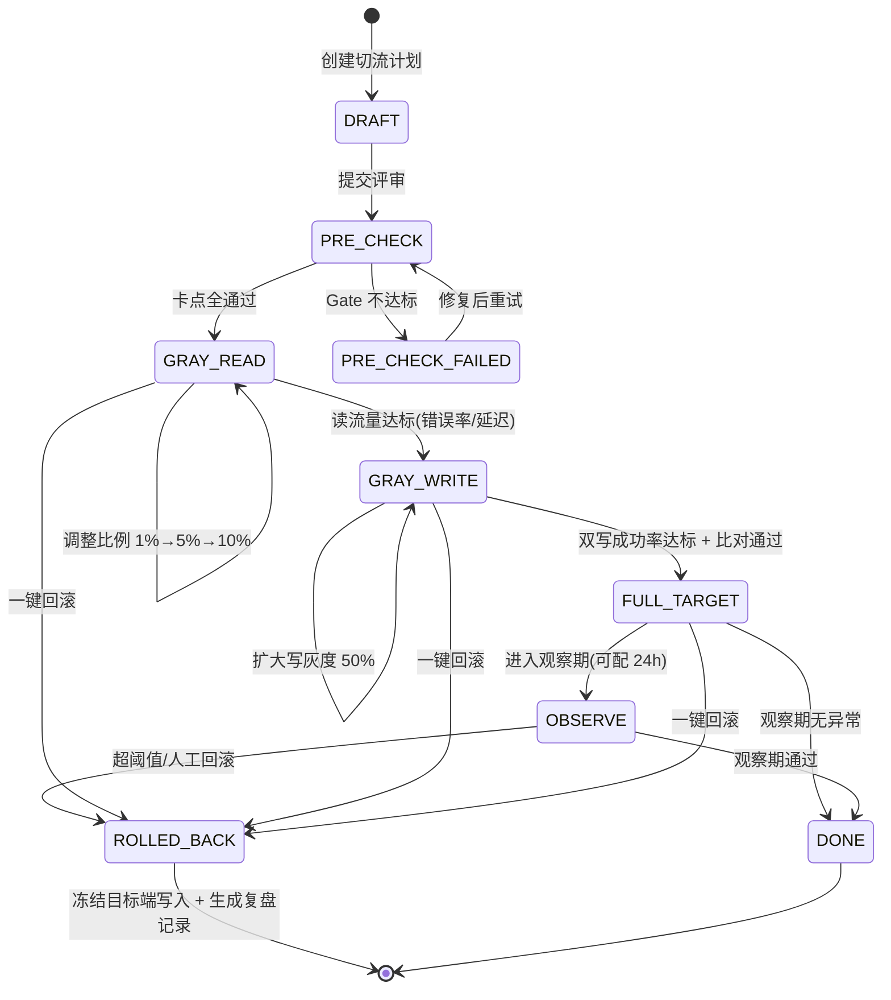

# 异构数据库同步与迁移平台 — 产品需求文档（PRD）

| 项 | 内容 |
|---|---|
| 文档编号 | PRD-DBSYNC-001 |
| 项目代号 | `db-sync-platform` |
| 版本 | v1.0 |
| 作者 | 许清楚（产品经理） |
| 文档语言 | 中文 |
| 目标技术栈 | JDK 17 + Spring Boot 3.x + Maven 多模块 + HikariCP 动态多数据源 + JDBC 原生 |
| 状态 | 待评审（含 7 项待确认问题，见 §12） |

---

## 1. 背景与问题定义

### 1.1 业务背景

某核心业务系统正在执行**数据库国产化替代**：源端为 Oracle 11g/19c、DB2 LUW 11.5、MySQL 8.0，目标端统一收敛到**达梦 DM8** 或 **PostgreSQL 12+**。这类改造的共性约束是：

- **业务几乎不停机**：可接受秒级 ~ 分钟级只读窗口，**不接受小时级停机**。这意味着"停机导数据 + 切换"的传统方案不可行，必须走「存量迁移 + 增量双写 + 全量比对 + 灰度切流」的四段式路径。
- **异构程度高**：五类库在类型系统、标识符大小写、事务与隔离级别、分页语法、批量写入协议、LOB 处理上均不相同，不能靠单一 SQL 方言打通。
- **数据量大**：单表千万 ~ 十亿级，单任务涉及 10 ~ 500 张表，迁移窗口以天计，必须可断点、可暂停、可限速，不能"重跑一次就重头开始"。
- **风险集中在切换那一刻**：切换前无法证明"两边数据一致"，切换后无法快速回退，是这类项目失败的主要原因。因此**比对与切流回滚**必须是产品的一等公民，而不是附属脚本。

### 1.2 现有做法与痛点

| 现有做法 | 痛点 |
|---|---|
| 停机窗口内用 `exp/imp`、`mysqldump`、`pg_dump` 全量导出导入 | 需小时级停机；异构库之间无法直接导入；大表导出中断即重来 |
| 各库私有 CDC（Oracle LogMiner / GoldenGate、MySQL binlog、DB2 CDC） | 需逐库采购/部署/授权，运维成本高，与本次"不依赖私有中间件"的约束冲突 |
| 手写 Java 批处理脚本 | 无断点、无限速、无监控，失败靠人工比对日志；每换一对库重写一遍 |
| 业务侧双写代码硬编码 | 侵入业务代码，顺序与幂等问题各自实现，切换后难以清理 |

### 1.3 产品定位

一个**单体内嵌管理控制台的可执行 Jar**：以 JDBC 原生能力为底座，把「异构结构映射 → 存量并行迁移 → 增量双写 → 分块比对 → 灰度切流」串成一条可编排、可观测、可回滚的流水线；通过数据库行级锁实现多实例水平扩展，不引入额外中间件（Kafka/ZK/调度中心）。

### 1.4 范围（五类数据源两两互通）

| 源端 \ 目标端 | MySQL 8.0 | Oracle 11g/19c | PostgreSQL 12+ | DM8 | DB2 LUW 11.5 |
|---|---|---|---|---|---|
| MySQL 8.0 | — | P1 | **P0** | **P0** | P1 |
| Oracle 11g/19c | P1 | — | **P0** | **P0** | P1 |
| PostgreSQL 12+ | **P0** | P1 | — | **P0** | P1 |
| DM8 | **P0** | P1 | **P0** | — | P1 |
| DB2 LUW 11.5 | P1 | P1 | **P0** | **P0** | — |

> P0 = 首批必交付（国产化替代主路径，共 8 对方向）；P1 = 架构上不阻塞、按同一 SPI 适配即可开通；P2 暂不支持同库自同步（无业务价值）。

---

## 2. 产品目标与成功指标

### 2.1 产品目标

| 编号 | 目标 | 说明 |
|---|---|---|
| G1 | **让"不停机替换数据库"变成一条可执行的流水线** | 用户按向导配置即可完成存量 + 增量 + 比对 + 切流，无需为每对数据库写脚本 |
| G2 | **让"数据一致"可被证明，而不是被相信** | 每次切流前必须产出一份可追溯到分块级别的比对报告，差异可定位到主键 |
| G3 | **让"切错了"可以在 1 分钟内退回去** | 一键回滚 + 状态机编排 + 全程审计，回滚不依赖人工回忆操作顺序 |

### 2.2 成功指标（可量化）

| 维度 | 指标 | 目标值 | 度量方式 |
|---|---|---|---|
| 迁移吞吐 | 单实例存量迁移速率 | ≥ **50,000 行/秒**（宽表 20 列内，批量 500 ~ 1000 行/批）；或 ≥ 80 MB/s | 任务监控大盘 TPS 曲线，取 30 分钟稳态均值 |
| 迁移吞吐 | 1 亿行单表全量耗时 | ≤ **40 分钟**（4 线程，目标库可承接） | 内置基准场景回归 |
| 扩展性 | 水平扩展线性度 | 2 实例 → 吞吐 ≥ 1.7 倍；4 实例 → ≥ 3.0 倍 | 压测对比 |
| 增量延迟 | 端到端同步延迟 | P95 ≤ **3 秒**，P99 ≤ **10 秒**（日志表/SDK 模式，源库 TPS ≤ 2000） | 水位线差值采样 |
| 数据完整性 | 存量迁移行数一致性 | **100%**（源目标 COUNT 完全相等，或差异全部被比对报告解释） | 迁移结束自动核数 |
| 数据完整性 | 切换期数据丢失 | **RPO = 0**（双写通道下，切流前已确认的写入不得丢失） | 切换卡点断言 + 事后对账 |
| 比对准确率 | 真实差异检出率 | **100%**（构造的差异样本必须全部检出） | 差异注入测试集 |
| 比对准确率 | 误报率（假阳性） | ≤ **0.1%**（分块哈希命中后逐行核实前的候选块比例） | 同构无变更数据比对 |
| 比对性能 | 1 亿行表全量比对耗时 | ≤ **15 分钟**（分块 10 万行，8 并发） | 基准回归 |
| 切流 | 单次切流执行时长 | ≤ **60 秒**（不含前置比对） | 切流控制台计时 |
| 切流 | 回滚 RTO | ≤ **30 秒**（从点击回滚到读流量回到源端） | 演练记录 |
| 可用性 | 实例宕机后任务接管时间 | ≤ **30 秒**（无人工介入，任务不丢、checkpoint 不丢） | 杀进程测试 |
| 可恢复性 | 断点续传精度 | 恢复后重复处理行数 ≤ **1 个分片批次**（≤ 1000 行），且因幂等不产生脏数据 | 中断恢复测试 |
| 规模 | 单任务支持表数量 | 10 ~ **500** 张 | 任务配置上限校验 |
| 规模 | 支持单表行数 | 至 **10 亿**行（主键分片下每片 ≤ 500 万行） | 大表场景验证 |

---

## 3. 用户角色与典型场景

### 3.1 角色定义

| 角色 | 主要诉求 | 系统权限 |
|---|---|---|
| **DBA** | 数据源接入、连接与性能调优、切流执行与回滚的最终决策人；关心锁、会话、批量提交大小、目标库压力 | ADMIN |
| **运维工程师** | 7×24 值守：看大盘、收告警、暂停/恢复任务、处理失败重试；关心"现在卡在哪、还差多少、要不要加实例" | OPERATOR |
| **研发负责人** | 配置映射与双写改造、确认字段级语义、评估切流风险、给业务方汇报进度 | OPERATOR（可读全量，可改自己项目的任务） |
| **业务方 / 项目经理** | 只关心"什么时候能切、切了会不会出问题、出问题多久能回"；需要可读的进度与比对结论 | VIEWER |
| **审计 / 安全** | 谁在什么时间对生产库做了什么操作，密码是否加密，敏感数据是否脱敏 | VIEWER + 审计导出 |

### 3.2 典型场景

| 场景 | 描述 | 关键诉求 |
|---|---|---|
| S1 核心账务库 Oracle→DM8 | 320 张表、主表 8 亿行，只允许周末 30 分钟停机，实际希望零停机 | 存量迁移可中断续跑、增量延迟可控、比对可证明一致、切流可回滚 |
| S2 MySQL 分库→PostgreSQL 合库 | 12 个 MySQL 实例合成 1 个 PG 库，涉及同表名冲突与主键冲突 | 结构映射 + 标识符策略 + 冲突策略可配 |
| S3 DB2→DM8 报表库 | 只读报表库，可接受较长只读窗口 | 优先吞吐与限速（不影响生产源库） |
| S4 试运行 / 预演 | 在 UAT 环境把整个切流剧本演练一遍 | 切流 dry-run、演练报告 |
| S5 切换后回归 | 切流后发现业务异常，需 30 秒内退回 Oracle | 一键回滚、回滚后源库数据仍然完整 |
| S6 长期双向并存 | 切流后一段时间内源端仍保留读能力，需反向回写修正数据 | 反向双写通道（P2） |

---

## 4. 核心概念定义

| 概念 | 定义 | 关键属性 |
|---|---|---|
| **数据源（DataSource）** | 一个可连接的目标库实例，含连接信息、库类型、连接池参数 | 类型（5 种）、JDBC URL、加密凭据、环境（PROD/UAT）、最大连接数 |
| **表映射（TableMapping）** | 源表 → 目标表的对应关系及派生规则（DDL、列映射、过滤条件） | 源表、目标表、列级映射、生成 DDL、风险标记 |
| **同步任务（SyncTask）** | 用户视角的最小可管理单元，绑定一对数据源 + 一组表映射 + 四阶段配置 | 状态机（DRAFT/READY/RUNNING/PAUSED/FAILED/FINISHED）、限速、并发度 |
| **迁移作业（MigrationJob）** | 存量迁移的执行实例，按表拆成多个 **分片（Shard）** 并行跑 | 分片范围（主键区间）、checkpoint、进度、重试次数 |
| **分片（Shard）** | 存量迁移的最小调度与断点单位，通常是一个主键左闭右开区间 | `[pkStart, pkEnd)`、`lastPk`、行数、状态 |
| **增量通道（IncrementalChannel）** | 捕获源端变更并投递到目标端的通道，有模式之分 | 模式（SDK_WRITE / TRIGGER_LOG / TIMESTAMP_VERSION）、水位线、延迟 |
| **双写通道（DualWriteChannel）** | 业务侧写源库同时写目标库的通道（SDK 模式的实现载体），强调**同步或准同步** | 写入顺序、幂等键、失败策略（阻断/降级/落补偿表） |
| **水位线 / Checkpoint** | 增量通道已确认处理到的位置；存量迁移中已确认落库的分片位置 | 增量：`(commit_ts, seq)` 或 `log_id`；存量：`(shardId, lastPk, 已提交批次数)` |
| **比对作业（CompareJob）** | 对某张表（或全任务）做分块校验 + 差异定位 + 可选修复 | 分块大小、算法（COUNT/SUM/HASH/逐行）、差异清单、结论（PASS/WARN/FAIL） |
| **切流计划（CutoverPlan）** | 一次读写流量迁移的编排定义，含卡点、步骤、回滚动作 | 状态机、卡点断言、灰度维度、回滚点 |
| **灰度维度（GrayDimension）** | 切流的切片方式 | 按比例（1%/5%/50%/100%）、按表、按主键哈希桶 |
| **卡点（Gate）** | 切流某一步之前必须通过的自动校验 | 比对通过率、增量延迟、错误率、双写成功率 |
| **死信（DeadLetter）** | 重试耗尽仍失败的数据变更/分片，需人工介入 | 原始数据、异常栈、所属任务、重放入口 |

---

## 5. 用户故事

> 分组依据：**四大能力**（存量迁移 / 增量双写 / 全量比对 / 灰度切流）+ 一组底座能力。每条含优先级。

### 5.1 存量全量迁移

| # | 用户故事 | 优先级 |
|---|---|---|
| US-M1 | 作为 **DBA**，我希望系统能按主键自动把大表切成若干区间并行迁移，以便在不影响源库的前提下把 8 亿行的表在可接受时间内搬完 | P0 |
| US-M2 | 作为 **运维工程师**，我希望任务中途被打断（实例重启/网络中断/我手动暂停）后能从断点继续，而不是从头再来，以便迁移窗口不被浪费 | P0 |
| US-M3 | 作为 **DBA**，我希望能为任务设置每秒行数上限和并发线程数，以便迁移不把生产源库的 IO 打满 | P0 |
| US-M4 | 作为 **运维工程师**，我希望在大盘上看到每个分片的进度、当前 TPS、预计剩余时间，以便判断要不要加实例或调参 | P0 |
| US-M5 | 作为 **研发负责人**，我希望迁移结束后系统自动核对源目标行数并给出结论，以便我在给业务方汇报前有一个客观依据 | P0 |
| US-M6 | 作为 **DBA**，我希望迁移前系统能预检目标库空间、字符集、时区、唯一键冲突，以便在开始搬数据之前就发现问题 | P1 |

### 5.2 增量同步 / 双写

| # | 用户故事 | 优先级 |
|---|---|---|
| US-C1 | 作为 **研发负责人**，我希望通过引入一个 SDK 让业务写操作同时写源库和目标库，以便在不改数据库日志配置的情况下获得秒级同步 | P0 |
| US-C2 | 作为 **DBA**，我希望在源库挂一张触发器日志表来捕获变更，以便业务代码完全不改也能做增量同步 | P0 |
| US-C3 | 作为 **运维工程师**，我希望所有写入都是幂等 Upsert，以便重复消费不会产生重复行或错乱 | P0 |
| US-C4 | 作为 **研发负责人**，我希望同一主键的变更严格按产生顺序应用，以便不会出现"旧值覆盖新值" | P0 |
| US-C5 | 作为 **DBA**，我希望冲突策略（源优先 / 目标优先 / 时间戳比较）可按表配置，以便在切流过渡期按业务语义取舍 | P0 |
| US-C6 | 作为 **运维工程师**，我希望看到增量延迟曲线并能设置阈值告警，以便在延迟堆积时第一时间介入 | P1 |
| US-C7 | 作为 **架构负责人**，我希望增量通道预留 CDC 插件扩展点（未来接 Debezium/LogMiner），以便后续不推翻现有模型 | P2 |

### 5.3 全量比对

| # | 用户故事 | 优先级 |
|---|---|---|
| US-V1 | 作为 **DBA**，我希望先按分块做 COUNT/SUM/HASH 校验和比对，只对不一致的块下钻，以便 1 亿行的表也能在十几分钟内出结论 | P0 |
| US-V2 | 作为 **研发负责人**，我希望差异能定位到具体主键和具体列（源值 / 目标值并列），以便我判断是同步问题还是业务问题 | P0 |
| US-V3 | 作为 **运维工程师**，我希望对差异支持"重放到目标"和"反向修复回源"，以便修完数据不用换工具 | P0 |
| US-V4 | 作为 **业务方**，我希望拿到一份可导出、可归档的比对报告（通过率、差异明细、修复记录），以便作为切流评审的输入 | P0 |
| US-V5 | 作为 **研发负责人**，我希望配置忽略规则（大小写、首尾空格、时区、浮点精度、DECIMAL 尾零），以便减少语义等价造成的假差异 | P1 |
| US-V6 | 作为 **DBA**，我希望比对可定时重复执行并保留历史趋势，以便观察"差异数是否在收敛" | P1 |

### 5.4 灰度切流

| # | 用户故事 | 优先级 |
|---|---|---|
| US-T1 | 作为 **DBA**，我希望有一个读写开关矩阵，能明确表达"读源/写源/读目标/写目标"的组合状态，以便切流过程中每一步都清晰可控 | P0 |
| US-T2 | 作为 **业务方**，我希望切流可以按 1%→5%→50%→100% 的比例、或按表、或按主键哈希逐步放量，以便出问题时影响面可控 | P0 |
| US-T3 | 作为 **DBA**，我希望每一步切流前系统自动检查比对通过率、增量延迟、错误率是否达标，不达标就不允许继续，以便把人为误操作挡在门外 | P0 |
| US-T4 | 作为 **DBA**，我希望一键回滚能在 30 秒内把读写流量退回源库，以便业务异常时快速止损 | P0 |
| US-T5 | 作为 **审计**，我希望切流每一步（谁、何时、做了什么、结果）都有留痕，以便事后复盘 | P0 |
| US-T6 | 作为 **运维工程师**，我希望切流可以在 UAT 环境 dry-run 演练一遍，以便提前发现编排漏洞 | P1 |
| US-T7 | 作为 **研发负责人**，我希望灰度观察期内若延迟/错误率超阈值可自动触发回滚，以便无人值守时也能保护业务 | P1 |

### 5.5 底座能力（数据源、结构映射、权限、审计、监控）

| # | 用户故事 | 优先级 |
|---|---|---|
| US-B1 | 作为 **DBA**，我希望一次录入 5 种库的连接信息并能测试连通性，以便在配置任务前确认凭据正确 | P0 |
| US-B2 | 作为 **安全**，我希望数据源密码加密存储且界面上永不回显明文，以便满足等保与内部审计要求 | P0 |
| US-B3 | 作为 **研发负责人**，我希望系统自动读取源表结构并生成目标库可执行的 DDL（类型、主键、索引、默认值、注释），以便不用手写几百张表的建表语句 | P0 |
| US-B4 | 作为 **研发负责人**，我希望类型映射可人工覆盖并能看到每条映射的"降级风险"提示，以便处理 NUMBER 无精度、无符号整型等边界 | P0 |
| US-B5 | 作为 **管理员**，我希望有 ADMIN / OPERATOR / VIEWER 三级权限，以便生产操作只开放给该开放的人 | P0 |
| US-B6 | 作为 **运维工程师**，我希望任务失败时能收到告警（Webhook / 邮件），并能从死信里直接重放，以便夜间也能闭环 | P0 |
| US-B7 | 作为 **DBA**，我希望系统支持多实例部署且任务自动分配，以便扩容只需再起一个 Jar | P1 |

---

## 6. 需求池

> 优先级定义：**P0 = 必须有（缺失则方案不成立）**；P1 = 应该有（首版可降级但需预留）；P2 = 可以有（规划项）。
> 验收标准尽量写成可判定的断言。

### 6.1 数据源管理（DS）

| 编号 | 优先级 | 需求 | 验收标准 |
|---|---|---|---|
| DS-01 | P0 | 支持 5 种数据源（MySQL 8.0 / Oracle 11g·19c / PostgreSQL 12+ / DM8 / DB2 LUW 11.5）的新增、编辑、删除、列表 | 每种库均可保存成功；"测试连接"在凭据正确时返回版本号与当前时间，错误时返回可读错误码（认证失败/网络不可达/驱动缺失/权限不足）四类之一，耗时 ≤ 10 秒 |
| DS-02 | P0 | 凭据安全：密码 AES-256-GCM 加密入库，密钥来自环境变量或外部配置；接口与页面均不回显明文 | 直接查元数据库只见密文；API 响应中密码字段恒为 `******`；密钥缺失时应用启动失败并给出明确提示 |
| DS-03 | P0 | 元数据反向读取：schema / 表清单 / 列（名、类型、长度、精度、可空、默认值、注释）/ 主键 / 唯一键 / 索引 | 对 5 种库读取 500 张表元数据 ≤ 60 秒；读出的主键、列类型与库内 `information_schema`/`all_tab_columns` 等一致（抽样 20 张表人工核对无差异） |
| DS-04 | P1 | 数据源分组、环境标签（PROD/UAT/DEV）、连接池参数（最大连接、最小空闲、超时）可配 | 环境为 PROD 的数据源在切流操作时需二次确认；连接池参数变更后无需重启生效 |
| DS-05 | P1 | 数据源健康巡检：定时探活，异常在大盘标红 | 断网后 ≤ 2 个巡检周期内在数据源列表标记"不可用" |

### 6.2 表结构映射与 DDL 生成（MAP）

| 编号 | 优先级 | 需求 | 验收标准 |
|---|---|---|---|
| MAP-01 | P0 | **内置类型映射矩阵**，覆盖 5×5 方向的常用类型；支持单列人工覆盖并记录覆盖人 | 见 §6.3 映射矩阵；矩阵中每个格子至少有一个"已验证"样例；人工覆盖后生成 DDL 使用覆盖结果，并在风险清单中标注"人工覆盖" |
| MAP-02 | P0 | **标识符大小写与引号策略**：可选 `PRESERVE`（保留原样并加引号）/ `UPPER` / `LOWER`；正确使用各库引号（MySQL 反引号，Oracle/PG/DM/DB2 双引号） | Oracle 源（默认大写、不加引号）→ PG 目标时，默认产出小写无引号标识符且业务 SQL 无需改大小写；选 `PRESERVE` 时产出带双引号原样标识符；含空格/中文/保留字的表名在 5 种目标库均能建表成功 |
| MAP-03 | P0 | **DDL 生成**：列定义、主键、唯一键、普通索引、默认值、注释（表/列）、自增或序列/IDENTITY | 生成脚本在目标库可 100% 执行成功（5 种库各 20 张样例表）；主键、唯一键、索引数量与源端一致；表/列注释写入成功（PG/DM 用 `COMMENT ON`） |
| MAP-04 | P0 | **精度与降级策略**：Oracle `NUMBER(p,s)` / 无精度 `NUMBER`、DB2 `TIMESTAMP`、MySQL 无符号整型、`TEXT/BLOB/CLOB` 等给出明确映射与降级规则，并输出**风险清单** | 见 §6.3；无精度 `NUMBER` → PG `numeric(38,10)`（可配），并在风险清单标记"精度可能截断"；MySQL `INT UNSIGNED` → PG `bigint` + `CHECK (col >= 0)` 或 `bigint`（可配），不允许静默溢出；DB2 `TIMESTAMP` → PG `timestamp(6)` / DM `TIMESTAMP(6)`，微秒不丢 |
| MAP-05 | P0 | **DDL 预览与差异对比**：展示"源表结构 / 生成 DDL / 目标库现有结构"三方对照，标注新增列、类型不一致、缺失索引 | 对已存在的目标表能识别出"缺 2 个索引、1 列类型由 varchar(50)→varchar(100)"；支持导出 `.sql` 文件 |
| MAP-06 | P1 | 映射规则模板：按源库类型保存一套自定义映射，复用到其他任务 | 新建任务时选择模板后，覆盖规则自动带入；模板可导出/导入 JSON |
| MAP-07 | P2 | DDL 自动执行（在目标库建表） | 需 MANUAL_CONFIRM 开关；执行前展示完整脚本与影响表数 |

#### 6.3 类型映射矩阵（P0 核心，摘录）

| 源类型 | → DM8 | → PostgreSQL | 风险与策略 |
|---|---|---|---|
| MySQL `TINYINT/SMALLINT/INT/BIGINT` | 同名整型 | `smallint/int/bigint` | 直接映射 |
| MySQL `INT UNSIGNED` / `BIGINT UNSIGNED` | `BIGINT` / `DECIMAL(20,0)` | `bigint` + `CHECK >= 0` / `numeric(20,0)` | **降级**：无符号上限超出有符号范围，默认升一档；`BIGINT UNSIGNED` 必须用 DECIMAL/NUMERIC，风险清单提示 |
| MySQL `DECIMAL(p,s)` | `DECIMAL(p,s)` | `numeric(p,s)` | 直接映射 |
| MySQL `DATETIME` / `TIMESTAMP` | `TIMESTAMP` | `timestamp` / `timestamptz`（可配） | `TIMESTAMP` 需处理时区；源端 `ON UPDATE CURRENT_TIMESTAMP` **不迁移**（DM/PG 无等价），改为应用层或触发器，列入风险清单 |
| MySQL `TEXT/LONGTEXT/BLOB` | `CLOB/BLOB` | `text/bytea` | 大字段走流式读写，单行 > 1 MB 时降批大小 |
| MySQL `AUTO_INCREMENT` | `IDENTITY(1,1)` | `generated by default as identity` 或 `bigserial` | 迁移存量时需 `OVERRIDING SYSTEM VALUE` / `SET IDENTITY_INSERT`，迁移后重设序列起点 |
| Oracle `NUMBER(p,s)`（s>0） | `DECIMAL(p,s)` | `numeric(p,s)` | 直接映射 |
| Oracle `NUMBER(p,0)` / `NUMBER(p)` | `DECIMAL(p,0)` | `numeric(p,0)` | p ≤ 18 可降为 `bigint`（可配，性能更优） |
| Oracle **无精度 `NUMBER`** | `DECIMAL(38,10)` | `numeric(38,10)` | **降级**：源端可能存 38 位以上或超高精度，默认 (38,10)，可配；风险清单必须提示 |
| Oracle `DATE`（含时分秒） | `TIMESTAMP` | `timestamp(0)` | Oracle DATE 含时间，禁止映射为 `date` |
| Oracle `TIMESTAMP(6) WITH TIME ZONE` | `TIMESTAMP(6) WITH TIME ZONE` | `timestamptz` | 时区语义需业务确认 |
| Oracle `VARCHAR2(n BYTE/CHAR)` | `VARCHAR(n)` | `varchar(n)` | `BYTE` 语义在 UTF-8 下可能超长，按 3 倍预留或走 CLOB，列入风险清单 |
| Oracle `CLOB/BLOB/RAW` | `CLOB/BLOB/VARBINARY` | `text/bytea/bytea` | 流式传输 |
| Oracle `ROWID` | 不迁移 | 不迁移 | 物理地址无业务含义 |
| PG `serial/bigserial` | `IDENTITY` | — | 迁移后重设序列 |
| PG `jsonb/json` | `CLOB`（DM） | `jsonb` | DM 无 jsonb，降为 CLOB/JSON 文本，风险清单提示"失去索引与操作符" |
| PG `uuid` | `VARCHAR(36)` | `uuid` | DM 无 uuid 类型 |
| PG `bytea` | `BLOB` | — | 流式 |
| DM8 `IDENTITY` / `VARCHAR2` / `CLOB` | — | `bigserial/varchar/text` | 与 Oracle 映射近似对称 |
| DB2 `TIMESTAMP`（微秒） | `TIMESTAMP(6)` | `timestamp(6)` | 必须保留 6 位小数，禁止截断到秒 |
| DB2 `DECIMAL(31,x)` | `DECIMAL(31,x)` | `numeric(31,x)` | PG 支持高精度，DM 需确认上限 |
| DB2 `GRAPHIC/VARGRAPHIC` / `DBCLOB` | `VARCHAR/CLOB` | `varchar/text` | 双字节字符集需转 UTF-8 |
| DB2 `GENERATED ALWAYS AS IDENTITY` | `IDENTITY` | `generated always as identity` | 存量导入需绕过 GENERATED ALWAYS |
| 任意 `NULL` 语义 | 保持可空性 | 保持可空性 | 可空性不一致会导致 Upsert 冲突，必须在 DDL 中保留 |

### 6.4 存量全量迁移（MIG）

| 编号 | 优先级 | 需求 | 验收标准 |
|---|---|---|---|
| MIG-01 | P0 | **主键区间分片**：按数值型/时间型主键按行数目标（默认 200 万行/片）切分为左闭右开区间；字符型主键按字典序区间；分片计划在任务启动时生成并可预览 | 8 亿行表切出 ≥ 400 片，每片行数偏差 ≤ ±10%；分片之间无重叠、无遗漏（首尾相接校验通过） |
| MIG-02 | P0 | **多线程并发 + 批量写入**：分片内多线程读取、目标端批量 `INSERT`/`MERGE`；批大小、并发度可配 | 单实例 4 线程 1000 行/批达到 §2.2 吞吐指标；批量写入失败时整批重试，不产生半批脏数据 |
| MIG-03 | P0 | **断点续传**：每批提交后更新 checkpoint（分片 ID + 最后主键 + 已提交行数），重启后从 checkpoint 继续 | 在 50% 进度时 `kill -9`，重启后从最近提交点继续；重复处理 ≤ 1 批；最终行数与源端一致；checkpoint 落库延迟 ≤ 1 秒 |
| MIG-04 | P0 | **失败重试与死信**：分片级指数退避重试（默认 3 次），耗尽后进死信并可单独重放 | 构造网络抖动 5 秒，任务自动恢复且无需人工介入；构造永久性错误（目标列不存在），该分片进死信而其他分片继续跑，重放可单独执行 |
| MIG-05 | P0 | **限速**：全局与任务级 QPS/行数上限，按令牌桶实现 | 设置 10,000 行/秒后，实测 30 分钟均值不超过设定值 +5% |
| MIG-06 | P0 | **进度可视化**：任务 → 表 → 分片三级进度，展示已迁移行数、TPS、平均行宽、预计剩余时长、失败分片数 | 大盘数据滞后 ≤ 5 秒；暂停后进度不再变化；预计剩余时长在完成后归零 |
| MIG-07 | P1 | **无主键/复合主键表降级**：无主键表用全列哈希或物理 ROWID/ctid 分片，并在任务上标注"不可断点精确定位"；复合主键按多列拼接区间 | 无主键表可迁移且行数一致；UI 上有醒目降级提示；复合主键（2~3 列）分片不重不漏 |
| MIG-08 | P1 | **迁移前预检**：目标表是否存在、空间是否足够、字符集/时区是否兼容、唯一键在源端是否真有重复、账号是否有 DDL/DML 权限 | 预检输出"阻断项 / 警告项"两类；存在阻断项时不允许启动任务 |
| MIG-09 | P2 | LOB 流式传输与分块读取调优（`setBinaryStream` / `getBlob` 流式） | 单行 50 MB 的 BLOB 可迁移成功，JVM 堆不超过 1 GB |
| MIG-10 | P2 | 存量迁移与增量双写并行时的"追赶"策略可视化（迁移写入与增量写入的交叠区间标注） | 大盘可标出双写开始时间点之后的分片，允许"迁移结果被增量覆盖"的顺序说明 |

### 6.5 增量同步 / 双写（CDC）

| 编号 | 优先级 | 需求 | 验收标准 |
|---|---|---|---|
| CDC-01 | P0 | **模式一：业务双写 SDK**。提供 `DbSyncWriter`（透明包装 `insert/update/delete/upsert`），业务在写源库后调用，写入落到目标端的"变更队列表"，由后台消费器异步应用 | 业务侧改造 ≤ 3 行代码；目标端最终一致延迟 P95 ≤ 3 秒；SDK 内部失败不阻断业务主流程（落本地补偿表 + 告警），可配置为强一致阻断 |
| CDC-02 | P0 | **模式二：数据库触发器日志表**。在源库为每张表创建 `xxx_SYNC_LOG`（操作类型、主键快照、行快照、commit 时间、顺序号），由平台轮询消费 | 提供 5 种库的触发器 DDL 生成器；插入/更新/删除各 1000 条后，目标端行与源端完全一致；删除能被正确传播（含"删除不存在行"的幂等处理） |
| CDC-03 | P1 | **模式三：时间戳 + 版本号**。以 `update_time`/`version` 增量拉取（含软删除标记），适用于无触发器权限的库 | 轮询间隔可配（默认 5 秒）；边界重叠窗口（回退 1 个轮询周期）保证不丢；乱序由版本号解决 |
| CDC-04 | P0 | **幂等 Upsert**：以主键为幂等键，实现各库方言的 `MERGE`/`ON CONFLICT`/`ON DUPLICATE KEY`/`MERGE INTO`（DM、DB2） | 同一变更重复投递 3 次，目标端仍只有 1 行且值正确；五种目标库均验证通过 |
| CDC-05 | P0 | **顺序保证**：同一主键的变更严格按产生顺序应用；分片/分组内有序，跨分组并行 | 对同一主键连续 1000 次更新（每次递增 1），目标端最终值必须为最后一次值；不允许出现"旧值覆盖新值"（通过 3 轮压测 0 复现） |
| CDC-06 | P0 | **冲突策略可配**（按表）：`SOURCE_WINS` / `TARGET_WINS` / `TIMESTAMP_NEWER` | 三种策略各有单测与端到端用例；`TIMESTAMP_NEWER` 在源端时间早于目标端时跳过写入并记录"被忽略变更"计数 |
| CDC-07 | P1 | **延迟与背压**：水位线延迟监控、消费积压超过阈值时告警并自动降速生产端（SDK 模式）或扩并发（日志表模式） | 人为制造 10 万条积压，延迟曲线正确反映；积压超阈值 60 秒内触发告警 |
| CDC-08 | P1 | **变更可追溯**：每条变更可查"从哪来、何时应用、应用到哪张表哪一行、是否被冲突策略忽略" | 按主键查询可列出该行最近 20 条变更的处理轨迹 |
| CDC-09 | P2 | **CDC 插件扩展点（SPI）**：预留 `ChangeCaptureProvider`，未来可接 Debezium / Oracle LogMiner / DM 逻辑日志 | 接口定义稳定并有 1 个 mock 实现；新增一种 CDC 模式不需改动核心调度代码 |

### 6.6 全量比对（CMP）

| 编号 | 优先级 | 需求 | 验收标准 |
|---|---|---|---|
| CMP-01 | P0 | **分块校验和比对**：同主键区间分块（默认 10 万行），两端分别计算 `COUNT`、`SUM(数值列)`（BigDecimal 防溢出）、`HASH`（行级 MD5/CRC 聚合，列按名称排序标准化） | 1 亿行表 8 并发比对 ≤ 15 分钟；对 3 类注入差异（改值、删行、多行）100% 定位到所在块；无误报（同构无变更时差异块数 = 0） |
| CMP-02 | P0 | **逐行差异定位**：对差异块下钻拉取两端行，按主键做差集（仅源有 / 仅目标有 / 主键同值不同内容），并列出具体差异列（源值 vs 目标值） | 差异清单含表名、主键值、差异类型、差异列、两端值；单块 10 万行下钻 ≤ 20 秒；差异可导出 CSV |
| CMP-03 | P0 | **差异修复**：`REPLAY_TO_TARGET`（把源行重放并 Upsert 到目标）、`FIX_TO_SOURCE`（反向修复，需 ADMIN + 二次确认）；修复前自动备份目标行 | 修复后重跑比对通过率 100%；反向修复需 ADMIN 权限且必须填写原因；备份表可查、可回滚 |
| CMP-04 | P0 | **比对报告**：表级/任务级通过率、差异块数、差异行数、差异分布（按表 Top N）、比对耗时、结论（PASS <0.001% / WARN / FAIL） | 报告可在页面查看并导出 HTML 与 CSV；报告含比对时间、执行人、数据源快照 ID，可归档；结论阈值可配 |
| CMP-05 | P1 | **忽略规则**：按列配置忽略（大小写、trim、时区换算、浮点容差、DECIMAL 尾零）、忽略某些表/列 | 配置忽略金额列末尾 `0.00` 差异后，误报差异归零；忽略规则在报告中显式列出（不得静默忽略） |
| CMP-06 | P1 | **比对历史与趋势**：同一任务多次比对结果留存，展示差异数收敛曲线 | 连续 5 次比对可绘制趋势；差异数下降趋势可视化 |
| CMP-07 | P2 | 抽样比对模式（按百分比/按主键哈希抽样）用于快速巡检 | 抽样比例 1% 时比对耗时 ≤ 全量的 5%；报告中注明"抽样，非全量结论" |

### 6.7 灰度切流（CUT）

| 编号 | 优先级 | 需求 | 验收标准 |
|---|---|---|---|
| CUT-01 | P0 | **读写开关矩阵**：`读源+写源` → `读源+写双` → `读目标+写双` → `读目标+写目标`；每次变更都要落审计并广播给 SDK 客户端（配置中心语义） | 4 种状态可切换；切换后 SDK 侧 ≤ 3 秒内生效；矩阵当前状态在控制台高亮，且不可跳步（必须按顺序前进，回滚可跳步） |
| CUT-02 | P0 | **灰度维度**：按比例（1/5/10/50/100%）、按表白名单、按主键哈希桶（`hash(pk) % 100 < n`） | 按 5% 切读后，SDK 侧实际路由比例落在 5%±1%；同一主键在比例不变时路由稳定（不抖动）；三个维度可组合 |
| CUT-03 | P0 | **切流前卡点校验（Gate）**：比对通过率 ≥ 阈值（默认 99.99%）、增量延迟 ≤ 阈值（默认 5 秒）、双写失败率 ≤ 阈值（默认 0.01%）、无未处理死信 | 任一项不达标时"下一步"按钮置灰并展示不达标原因与实测值；强行跳过需 ADMIN + 填原因（落审计） |
| CUT-04 | P0 | **一键回滚**：回到上一个已知安全状态（读写全回源），并冻结目标端写入 | 点击回滚到业务读取恢复源库 ≤ 30 秒；回滚后源库数据完整（回滚不删数据）；回滚动作自动生成事故记录 |
| CUT-05 | P0 | **切流编排状态机**：`DRAFT → PRE_CHECK → GRAY_READ → GRAY_WRITE → FULL_TARGET → DONE`，任意非终态可 `ROLLED_BACK`；每步有前置条件、执行动作、超时与补偿 | 状态机非法跃迁被拒绝（返回明确错误）；每步执行落审计；中途实例宕机后重启能恢复到一致状态（状态与外部实际一致） |
| CUT-06 | P1 | **观察期自动回滚**：灰度阶段设置观察窗口与阈值，超阈值自动回滚并告警 | 注入 5% 错误率，观察期内自动回滚成功并留痕；可通过开关关闭自动回滚（默认开启） |
| CUT-07 | P1 | **切流演练（dry-run）**：走完整状态机但不真正切换路由，产出演练报告（各卡点实测值、预计耗时） | dry-run 不改变线上路由；报告可导出；演练与真实切流共用同一套 Gate 逻辑 |
| CUT-08 | P2 | **反向双写**：切流后目标为主、源为备，支持把目标端修正数据回写源端 | 反向通道可独立开关；冲突策略复用 §6.5 CDC-06 |

### 6.8 任务编排与调度（ORC）

| 编号 | 优先级 | 需求 | 验收标准 |
|---|---|---|---|
| ORC-01 | P0 | 任务 CRUD 与生命周期状态机（`DRAFT / READY / RUNNING / PAUSED / FAILED / FINISHED / ARCHIVED`），支持暂停、恢复、取消、重跑（可选择"从断点"或"重头"） | 非法状态操作被拒绝并提示；取消后正在跑的分片在 ≤ 10 秒内停止提交；重跑"从断点"不重复已提交分片 |
| ORC-02 | P0 | **多实例任务分片与抢占**：任务/分片通过元数据库行级锁（`SELECT ... FOR UPDATE` / 乐观版本号）抢占，带租约续期与失效接管 | 启动 2 个实例，同一任务的分片被均匀分配且无重复执行；杀掉持有锁的实例后 ≤ 30 秒由另一实例接管；租约到期不产生双跑（通过唯一约束兜底） |
| ORC-03 | P0 | **任务配置向导**：4 步（① 选数据源与表 → ② 结构映射与 DDL → ③ 迁移/增量参数 → ④ 比对与切流策略），每步可保存草稿 | 4 步可回退修改且已填内容不丢；必填校验在每步"下一步"时阻断；≥ 50 张表时可批量套用默认参数 |
| ORC-04 | P1 | 定时调度（Cron 表达式）：定时重跑比对、定时巡检 | Cron 配置错误时保存即报错（给出下次执行时间预览） |
| ORC-05 | P1 | 任务依赖（简单 DAG：任务 B 依赖任务 A 完成） | 依赖未完成时 B 不启动并显示等待原因；A 失败可按配置阻塞或放行 B |
| ORC-06 | P2 | 任务模板与克隆 | 克隆任务后仅数据源与表映射可改，其余参数继承 |

### 6.9 监控告警与可观测性（OBS）

| 编号 | 优先级 | 需求 | 验收标准 |
|---|---|---|---|
| OBS-01 | P0 | **监控大盘**：任务级 & 数据源级指标——迁移 TPS、已迁移行数、增量延迟、双写成功率、失败数、死信数、活跃实例数、各实例分片分布 | 指标口径在文档中明确定义（如 TPS = 最近 60 秒平均提交行数/秒）；数字滞后 ≤ 5 秒；任务停止后指标不再增长 |
| OBS-02 | P0 | **告警规则与渠道**：延迟超阈值、错误率超阈值、任务失败、死信新增、数据源不可用；渠道支持 Webhook（企业微信/钉钉/飞书）与邮件；支持静默与升级 | 构造延迟超阈值，≤ 1 分钟内收到告警（含任务名、当前值、阈值、跳转链接）；同一告警在静默期内不重复发送 |
| OBS-03 | P1 | Prometheus 指标端点（`/actuator/prometheus`）+ 结构化 JSON 日志（含 taskId/shardId/traceId） | 指标可被抓取；日志可按 taskId 检索出完整链路 |
| OBS-04 | P1 | 死信管理页：查看、重放、批量重放、丢弃（需填原因） | 重放后死信状态变 `REPLAYED` 且任务指标更新；丢弃需 OPERATOR 以上并留审计 |

### 6.10 权限、审计与安全（SEC）

| 编号 | 优先级 | 需求 | 验收标准 |
|---|---|---|---|
| SEC-01 | P0 | **三级 RBAC**：VIEWER（只读大盘/报告）、OPERATOR（建任务、暂停恢复、重跑、重放死信）、ADMIN（数据源增删、切流/回滚、反向修复、跳过卡点、用户管理） | 三个角色对 12 个关键动作的权限矩阵有测试覆盖；越权请求返回 403 且落审计 |
| SEC-02 | P0 | **审计日志**：记录操作人、时间、动作、对象、参数摘要、IP、结果；不可界面删除 | 切流、回滚、数据源增删、反向修复、跳过卡点 5 类操作 100% 留痕；审计日志可按时间/人/对象检索并导出 |
| SEC-03 | P0 | **SQL 注入防护**：表名/列名走白名单校验（来自元数据读取结果），值一律参数化绑定；动态拼接处禁止字符串插值用户输入 | 表名参数传入 `t; drop table x` 被拒绝（返回校验错误，不产生任何 SQL 执行）；代码审查覆盖所有动态 SQL 构造点 |
| SEC-04 | P1 | **数据脱敏**：日志、比对报告、差异明细中，按列配置脱敏（手机号/身份证/金额部分掩码） | 配置脱敏后报告中该列显示 `138****1234`；脱敏不可通过导出绕过 |
| SEC-05 | P1 | 会话安全：登录、超时、密码策略；API 鉴权（Token/Session） | 未认证访问管理接口返回 401；会话空闲 30 分钟失效 |
| SEC-06 | P2 | 操作双人复核（切流、反向修复需第二人确认） | 开启后单人无法完成切流；复核记录入审计 |

---

## 7. 非功能需求

### 7.1 性能

| 项 | 要求 |
|---|---|
| 存量迁移 | 见 §2.2（≥ 50,000 行/秒/实例，1 亿行 ≤ 40 分钟） |
| 增量延迟 | P95 ≤ 3 秒，P99 ≤ 10 秒 |
| 比对 | 1 亿行 ≤ 15 分钟 |
| 管理控制台 | 列表页 P95 ≤ 1 秒（1000 任务量级）；大盘接口 P95 ≤ 500 ms |
| 元数据库 | 单表 checkpoint 写入频率可控（默认每批一次，可合并为每 2 秒一次），不对元数据库造成压力 |
| 内存 | 单实例默认堆 2 GB 下可运行 4 并发任务（每任务 4 线程）；不允许全表读入内存（必须游标/流式 + 分页） |

### 7.2 可用性与可恢复性

| 项 | 要求 |
|---|---|
| 无状态化 | 除元数据库外无本地状态；实例可随时重启 |
| 故障接管 | ≤ 30 秒（租约到期 + 抢占） |
| 幂等 | 所有写入路径（存量/增量/修复）必须可重复执行而不产生脏数据 |
| 断点 | checkpoint 持久化，`kill -9` 后可恢复 |
| 优雅停机 | 收到 SIGTERM 后停止拉新分片、等待当前批提交、释放锁（≤ 30 秒） |
| 元数据库不可用 | 任务暂停而非崩溃，恢复后自动续跑 |

### 7.3 可观测性

- 指标：迁移 TPS/行数/进度、增量延迟/积压、双写成功率、比对进度/差异数、切流状态、实例存活与持有分片数。
- 日志：结构化 JSON，必带 `traceId / taskId / shardId / table / phase`。
- 追踪：一次变更可从"产生"追到"应用完成"（CDC-08）。
- 告警：见 OBS-02，明确"什么值超过什么阈值持续多久"才告警（避免抖动）。

### 7.4 安全

| 项 | 要求 |
|---|---|
| 凭据 | AES-256-GCM 加密存储，密钥外部注入，支持轮换；日志中永不打印密码与完整连接串（只打印 host/port/db） |
| 最小权限 | 建议源端只读账号（`SELECT`），目标端 `INSERT/UPDATE/DELETE` + 有限 DDL；触发器模式需源端 `CREATE TRIGGER` 权限并明确告知影响 |
| SQL 注入 | 白名单标识符 + 参数化（SEC-03） |
| 数据脱敏 | 日志/报告/导出三处一致（SEC-04） |
| 传输 | 支持 SSL/TLS 连接参数（各库 JDBC 参数透传） |
| 生产保护 | PROD 数据源的破坏性操作（反向修复、跳过卡点、切流）需二次确认 + ADMIN |

### 7.5 兼容性与部署

| 项 | 要求 |
|---|---|
| 运行时 | JDK 17（LTS），Spring Boot 3.x，单可执行 Jar |
| 部署 | 单机可跑（内嵌控制台）；多实例水平扩展（无中心调度器，靠 DB 行锁） |
| 元数据库 | MySQL 8.0（生产），H2（本地/单测，需保证 SQL 兼容）；启动自动建表/升级 |
| 驱动 | 5 种 JDBC 驱动随包或按需加载；驱动缺失时给出明确错误而非 `ClassNotFound` 堆栈 |
| 浏览器 | Chrome / Edge 最近两个大版本 |
| 字符集 | 全链路 UTF-8；源库非 UTF-8（如 DB2 GRAPHIC、Oracle ZHS16GBK）需转码且可验证 |

### 7.6 交付质量

- P0 需求全部有自动化测试（单测 + 端到端）；核心路径（迁移/增量/比对/切流）有可重复的集成测试。
- 提供 5 种库的 Docker Compose 测试环境（含 DM8 镜像获取方式的说明）。
- 关键算法（分片、哈希、Upsert 方言、冲突策略）有设计说明与样例数据。

---

## 8. 关键流程

### 8.1 存量全量迁移流程



**关键设计约束（验收关注点）**

1. 分片切分必须在**任务启动时一次性生成并落库**，不允许运行中动态扩容（否则无法保证不重不漏）。
2. checkpoint 与业务写入必须解耦：允许"重复一批"，不允许"漏一批"（幂等 Upsert 兜底）。
3. 限速是**读取侧**与**写入侧**双限（源库压力主要来自读，目标库压力来自写）。
4. 单分片失败不阻塞整体——这是"500 张表能跑完"的前提。

### 8.2 增量双写数据流

```mermaid
flowchart LR
    subgraph Biz[业务应用]
        A1[业务写请求]
    end
    subgraph SDK[双写 SDK]
        S1[DbSyncWriter<br/>拦截写操作]
        S2[构造变更事件<br/>pk + op + after + ts + seq]
        S3[同步写源库]
        S4[异步投递变更队列]
        S5[失败落本地补偿表]
    end
    subgraph SRC[(源库 Oracle/DB2/MySQL/PG/DM)]
        R1[业务表]
        R2[xxx_SYNC_LOG 触发器日志表]
    end
    subgraph PLAT[平台增量通道]
        P1[变更队列<br/>元数据库表]
        P2[消费调度<br/>按主键哈希分组保序]
        P3[冲突策略<br/>源优先/目标优先/时间戳]
        P4[幂等 Upsert 方言适配]
        P5[水位线更新<br/>commit_ts + seq]
        P6[死信队列]
    end
    subgraph TGT[(目标库 DM8/PG)]
        T1[目标表]
        T2[备份表/修复记录]
    end

    A1 --> S1 --> S2 --> S3 --> R1
    S2 --> S4 --> P1
    S3 -.失败.-> S5
    R2 -.轮询拉取.-> P1
    P1 --> P2 --> P3 --> P4 --> T1
    P4 --> P5
    P4 -->|重试耗尽| P6
    P6 -->|人工重放| P2
    P4 -.反向修复 P2.-> R1
```

**两种模式的选择判据（写入 PRD 供客户拍板）**

| 维度 | SDK 双写 | 触发器日志表 | 时间戳+版本号 |
|---|---|---|---|
| 业务改造成本 | 中（引包 + 3 行） | 零（业务无感） | 低（需有时间戳/版本列） |
| 源库影响 | 无额外（同一事务外异步） | 每条 DML 多一次写日志（约 +20~40% 写放大） | 轮询查询压力（需索引） |
| 顺序保证 | 强（业务侧 seq） | 强（自增 log_id） | 弱（依赖版本号） |
| 删除捕获 | 显式 delete 事件 | 支持 | 仅软删除 |
| 权限要求 | 无 | `CREATE TRIGGER` | 无 |
| 适用场景 | 能改代码的自家系统 | 老旧系统/无法改代码 | 只读报表、弱一致场景 |

### 8.3 灰度切流状态机



**状态与路由矩阵（同一份定义，页面与 SDK 共用）**

| 状态 | 读路由 | 写路由 | 允许下一步 | 允许回滚到 |
|---|---|---|---|---|
| `DRAFT` | 源 | 源 | PRE_CHECK | — |
| `PRE_CHECK` | 源 | 源 | GRAY_READ | DRAFT |
| `GRAY_READ` | 源 + 目标（按灰度维度） | 源（+ 目标异步） | GRAY_WRITE / ROLLED_BACK | PRE_CHECK |
| `GRAY_WRITE` | 目标为主（可回读源） | 双写（源 + 目标同步） | FULL_TARGET / ROLLED_BACK | GRAY_READ |
| `FULL_TARGET` | 目标 | 目标（+ 异步回写源，P2） | DONE / ROLLED_BACK | GRAY_WRITE |
| `OBSERVE` | 目标 | 目标 | DONE / ROLLED_BACK | FULL_TARGET |
| `ROLLED_BACK` | 源 | 源 | —（需新建计划） | — |
| `DONE` | 目标 | 目标 | — | 需 ADMIN 走新计划 |

---

## 9. 页面设计稿（文字线框）

> 技术栈：Vite + React + MUI + Tailwind CSS；整体布局为左侧导航（6 项）+ 顶部面包屑与实例状态 + 主内容区。
> 导航：`监控大盘 / 数据源 / 同步任务 / 比对 / 切流 / 系统（告警·审计·用户）`

### 9.1 数据源管理

```
┌─────────────────────────────────────────────────────────────────────────┐
│ 数据源                                        [+ 新建数据源]  [批量测试] │
├─────────────────────────────────────────────────────────────────────────┤
│ 筛选: [类型▾ MySQL/Oracle/PG/DM8/DB2] [环境▾ PROD/UAT] [状态▾] [搜索___] │
├──────┬──────────────┬────────┬──────┬──────────┬────────────┬───────────┤
│ 状态 │ 名称         │ 类型   │ 环境 │ 地址      │ 最近探活   │ 操作      │
├──────┼──────────────┼────────┼──────┼──────────┼────────────┼───────────┤
│  ●   │ ora-core-prod│ Oracle │ PROD │ 10.1.2.3 │ 12s 前 ✓   │ 测试 编辑 │
│  ●   │ dm8-core-prod│ DM8    │ PROD │ 10.1.9.7 │ 12s 前 ✓   │ 测试 编辑 │
│  ▲   │ db2-legacy   │ DB2    │ PROD │ 10.1.5.9 │ 30s 前 慢  │ 测试 编辑 │
│  ✕   │ pg-uat-01    │ PG     │ UAT  │ 10.2.0.11│ 连接失败   │ 测试 编辑 │
└──────┴──────────────┴────────┴──────┴──────────┴────────────┴───────────┘
新建/编辑抽屉：
  名称 | 类型(选类型后动态换驱动与 URL 模板) | 主机 | 端口 | 库/SID/服务名
  用户名 | 密码(••••••) [显示明文需二次验证]  | Schema 默认值
  连接池: 最大连接[8] 最小空闲[2] 连接超时[10s]  | SSL[开关]
  [测试连接] → 结果条: ✓ 连接成功 DM8 V8.1.2.100  耗时 210ms
  高级: 会话参数 / fetchSize 默认 / 批量大小默认
```

**布局说明**：列表页保持"状态灯 + 关键连接信息 + 快捷测试"三要素；新建用右侧抽屉（不跳页）以便反复测试连接。PROD 环境数据源在卡片上有 `PROD` 红标。

### 9.2 任务配置向导（4 步）

```
步骤条:  ①数据源与表  ──  ②结构映射与DDL  ──  ③迁移/增量参数  ──  ④比对与切流

① 选择数据源与表
┌ 源数据源 [ora-core-prod ▾]  目标数据源 [dm8-core-prod ▾]  模式(○存量 ●存量+增量) ┐
│ 表搜索 [____]  [ ] 仅显示无主键/有风险表   Schema [APP ▾]                        │
│ ┌──┬──────────┬───────┬────────┬────────┬──────┬──────────────┐                │
│ │☑ │ 表名     │ 行数  │ 主键   │ 风险   │ 目标 │ 已存在       │                │
│ │☑ │ T_ORDER  │ 8.2亿 │ ID     │ -      │ T_ORDER │ 否        │                │
│ │☑ │ T_ACCT   │ 3200万│ ID     │无主键  │ T_ACCT  │ 是(缺索引)│                │
│ │☐ │ T_LOG    │ 41亿  │ -      │降级    │ T_LOG   │ 否        │                │
│ └──┴──────────┴───────┴────────┴────────┴──────┴──────────────┘                │
│ 已选 87 张表，预估 1.2 TB                                          [下一步]     │
└──────────────────────────────────────────────────────────────────────────────┘

② 结构映射与 DDL（三栏对照）
┌ 源列(APP.T_ORDER) ─────┬ 映射/规则 ─────────────┬ 生成DDL ─────────────────┐
│ ID        NUMBER(19)   │ → DECIMAL(19,0)  [改]  │ ID DECIMAL(19,0) NOT NULL│
│ AMT       NUMBER       │ → DECIMAL(38,10)⚠降级  │ AMT DECIMAL(38,10)       │
│ STAT      CHAR(1)      │ → CHAR(1)               │ STAT CHAR(1) DEFAULT '0' │
│ C_TIME    DATE         │ → TIMESTAMP(0)  [改]    │ C_TIME TIMESTAMP(0)      │
│ MEMO      CLOB         │ → CLOB                  │ MEMO CLOB                │
├ 索引: PK(ID) / UK(ORDER_NO) / IDX(C_TIME) → 目标缺失 IDX_C_TIME  [生成]     │
├ 标识符策略: (●)LOWER ( )UPPER ( )PRESERVE   引号: 自动                        │
├ 风险清单(3): AMT 精度可能截断 / T_ACCT 无主键不可精确定位 / T_LOG 降级迁移    │
│  [预览完整SQL] [导出.sql] [应用到全部表]                     [上一步][下一步] │
└──────────────────────────────────────────────────────────────────────────────┘

③ 迁移/增量参数
  迁移: 并发线程[4] 批量大小[1000] 分片行数[200万] 限速[______ 行/秒] 失败重试[3]
  增量: 模式(●SDK双写 ○触发器日志 ○时间戳)  消费并发[8]  轮询间隔[5s]
        冲突策略(●源优先 ○目标优先 ○时间戳比较)  批量[500]
  ☑ 迁移前预检  ☑ 完成后自动核数

④ 比对与切流策略
  比对: 分块行数[10万] 并发[8] 算法[☑COUNT ☑SUM ☑HASH] 结论阈值 PASS<[0.001]%
        定时比对 [每 6 小时 ▾]
  切流: 灰度维度[☑比例 ☑按表 ☑主键哈希]  卡点: 比对≥[99.99]% 延迟≤[5]s 错误率≤[0.01]%
        观察期[24h]  自动回滚阈值 错误率>[1]%
                                                  [保存草稿] [创建任务]
```

**布局说明**：向导固定 4 步，步骤条常显；每步底部固定操作条（上一步/下一步），右侧可展开"帮助与规则说明"抽屉。第 ② 步是项目成败关键，采用**三栏对照 + 风险清单置底**的强制视觉，风险不可折叠隐藏。

### 9.3 迁移监控大盘

```
┌ 大盘  [任务 ▾ T_ORDER全量迁移]   状态 ● RUNNING   [暂停] [限速调整] [查看日志] ┐
├─ KPI 卡（6 个）──────────────────────────────────────────────────────────────┤
│ 已迁移 4.12亿/8.2亿 (50.2%) │ 实测 TPS 52,340 │ 增量延迟 1.2s │ 失败分片 2 │
│ 活跃实例 3 │ 预计剩余 22 分钟                                              │
├─ TPS 曲线（近 1h，按实例堆叠）─────────────────────────────────────────────┤
│  ▁▂▃▅▆▇▇▆▆▅▅▆▇▇▆▅▅▅▆▆▇（实例 A/B/C 三色）                                 │
├─ 分片进度热力（每格一个分片，绿=完成 黄=运行 红=死信 灰=待跑）──────────────┤
│  ▩▩▩▩▩▩▩▩▩▩▩▩▩▩▩▩▩▩▩▩▩▩▩▩▩▩▩▩▩▩▩▩▩▩▩▩▩▩▩▩                                │
│  ▩▩▩▩▩▩▩▩▩▩▩▩▩▩▩▩▩▩▩▨▨▨▨▨▨▨▨▨▨▨▨▨▨▨▨▨▨▨▨                                │
├─ 表级明细（可排序/筛选）────────────────────────────────────────────────────┤
│ 表名     行数    已迁移   进度    TPS    失败  状态    操作                  │
│ T_ORDER  8.2亿   4.12亿  50.2%  32,110   0    RUNNING 暂停/重跑/死信        │
│ T_ACCT   3200万  3200万  100%     -      0    DONE    查看核数              │
│ T_LOG    41亿    120万   0.3%   18,220   2    RUNNING 查看死信(2)           │
├─ 死信抽屉（点击失败数展开）───────────────────────────────────────────────┤
│ 分片#  主键区间           异常               时间       [重放] [丢弃]       │
└──────────────────────────────────────────────────────────────────────────────┘
```

**布局说明**：从上到下是"结论 → 趋势 → 分布 → 明细 → 处置"的认知顺序。KPI 卡数字用等宽字体并标注采样时间；热力图让"是否卡在某一片"一眼可见；所有"失败"都可直接下钻到重放动作，不让运维去别的页面找。

### 9.4 比对报告

```
┌ 比对报告  T_ORDER全量·2026-11-09 14:02  结论: ⚠ WARN  通过率 99.993%  ┐
├ 概要: 比对行数 8.2亿 │ 差异块 12/8200 │ 差异行 5,846 │ 耗时 11m32s      │
│       执行人 alice │ 数据快照: 源@14:02:11 目标@14:02:13               │
├ 差异分布 Top 表                                                     │
│  T_LOG  ████████████████████ 5,102                                  │
│  T_ACCT ████ 744                                                    │
├ 差异明细（表 T_LOG）                              [导出CSV] [仅看差异] │
│ ┌──────────┬────────┬──────────┬────────────┬────────────┬─────────┐│
│ │ 主键     │ 类型   │ 差异列   │ 源值       │ 目标值     │ 操作    ││
│ │ 9920123  │ 值不同 │ MEMO     │ 'abc...'   │ 'abd...'   │ 重放    ││
│ │ 9920124  │ 仅源有 │ -        │ (整行)     │ -          │ 重放    ││
│ │ 9920200  │ 仅目标有│ -       │ -          │ (整行)     │ 反向修复││
│ └──────────┴────────┴──────────┴────────────┴────────────┴─────────┘│
├ 修复: [重放到目标(5,846)] [反向修复(需ADMIN+原因)] [修复后自动重比对]  │
├ 忽略规则: 大小写(关) 浮点容差(0.001) 金额尾零(开)  ← 报告中显式列出     │
└──────────────────────────────────────────────────────────────────────┘
```

**布局说明**：结论徽标（PASS/WARN/FAIL）在最左上，符合"评审会先看结论"的实际用法；差异明细必须"源值/目标值并列"（这是研发判断问题的唯一依据）；隐藏任何忽略规则都不可接受，故单列一行展示。

### 9.5 切流控制台

```
┌ 切流控制台  APP核心库 Oracle → DM8      计划#CUT-20261109-01  ● GRAY_WRITE  ┐
├ 状态机（进度条 + 当前步高亮 + 已耗时）──────────────────────────────────────┤
│  DRAFT ─ PRE_CHECK✓ ─ GRAY_READ✓ ─ [GRAY_WRITE] ─ FULL_TARGET ─ OBSERVE ─ DONE│
├ 读写开关矩阵（当前高亮，不可跳步）──────────────────────────────────────────┤
│          读源   读目标      写源   写目标   写双                                     │
│  当前     40%    60%        ✓      ✓      ✓（灰度50%）                          │
├ 卡点校验 (Gate)  —— 决定"下一步"是否可点 ──────────────────────────────────┤
│  比对通过率   99.993%  ≥ 99.99%   ✓   14:02 比对                             │
│  增量延迟 P95   1.8s   ≤ 5s       ✓   实时                                   │
│  双写失败率    0.004%  ≤ 0.01%    ✓   近 15 分钟                             │
│  未处理死信       0    = 0        ✓                                        │
│  [重新校验]  [跳过卡点(ADMIN+原因)]                                          │
├ 灰度放量: 比例 [1%|5%|10%|50%|100%]  按表[选择]  按主键哈希[__]%  [应用]     │
├ 操作区:  [推进到 FULL_TARGET]  [一键回滚(≤30s)]  [进入观察期]  [dry-run演练] │
├ 操作时间线（审计）：14:12 alice 将读灰度 5%→10%；15:03 bob 写灰度开启 ...     │
└──────────────────────────────────────────────────────────────────────────────┘
回滚二次确认弹窗：
  "将把读流量全部切回 Oracle，并冻结 DM8 写入。影响：100% 读流量。"
  回滚原因[必填]  ☑ 我已确认源库连接正常   [取消] [确认回滚]
```

**布局说明**：这是整个产品风险最高的页面，因此**卡点校验必须以"实测值 vs 阈值 vs 通过与否"三列并排**，让 DBA 不需要记阈值；回滚按钮常驻且视觉突出（红色描边而非实心，避免误点），但确认弹窗要求填原因；时间线让"谁在何时把灰度从 5% 调到 10%"可追溯。

---

## 10. 边界与非目标

### 10.1 明确不做（本期）

| 编号 | 非目标 | 原因 / 替代方案 |
|---|---|---|
| N1 | **跨库在线 DDL 变更同步**（源端加列/改类型自动同步到目标端） | 在线 DDL 语义在 5 种库差异极大，风险高于收益；本期要求"改表须暂停任务、重建映射"，提供 MAP-05 差异对比辅助 |
| N2 | **异构字段级转换 DSL**（如用表达式把 `first_name + last_name` 合成一列、码表翻译） | 本期只做**同列名/同语义直搬** + 可选的静态默认值/常量列；复杂转换通过源端视图（`CREATE VIEW`）实现，由 DBA 掌控 |
| N3 | **完整实时 CDC 解析 redo log / binlog / DM 逻辑日志** | 遵循"不依赖各库私有 CDC 中间件"的约束；本期用双写 SDK / 触发器日志表 / 时间戳三种"应用层或 SQL 层"方案；仅预留 SPI（CDC-09） |
| N4 | **双向实时同步（多主）** | 冲突与环路难以在生产安全收敛；本期只支持"单主 + 必要时反向修复/回写（P2，单向、可关）" |
| N5 | 同构库之间的集群级复制 / 主从搭建 | 有原生工具（MGR、DataGuard、流复制），本平台不做 |
| N6 | 数据库对象全量迁移（存储过程、函数、触发器业务逻辑、包、视图、序列依赖图） | 本期只迁表结构（表/列/主键/索引/注释）。存储过程改造属独立工作量，需单独立项 |
| N7 | 数据血缘、数据质量规则引擎、元数据目录 | 超出迁移诉求范围 |
| N8 | 图形化 SQL 编辑器 / 即席查询 | 控制台不做通用 DB 客户端 |
| N9 | 跨公网/跨云的长距离传输优化（压缩、断点续传协议自研） | 依赖 JDBC + 网络层；超大跨云场景建议先落地到中转库 |
| N10 | 分库分表自动路由与聚合（ShardingSphere 类能力） | 本期按"一表一映射"处理；分库场景由多个任务 + 命名规则覆盖 |

### 10.2 依赖与前提

| 项 | 前提 |
|---|---|
| 源库账号 | 能建触发器（触发器模式）、能建日志表、能读全表；时间戳模式需表上有可靠 `update_time` |
| 目标库账号 | 有 DDL（建表/建索引）与 DML 权限；DM8 需注意大小写敏感参数（`CASE_SENSITIVE`）在实例初始化时已固定 |
| 业务改造 | SDK 模式需业务方配合引入依赖并改造写路径（预计每系统 1~3 人日） |
| 网络 | 平台实例到 5 种库网络可达；建议同机房/低延迟链路，否则延迟指标不保证 |
| 时间同步 | 源/目标/平台三侧 NTP 同步（时间戳模式与比对快照依赖） |
| 大字段 | LOB 迁移需要目标库有足够 `max_allowed_packet` / `blob` 空间配置 |

---

## 11. 里程碑建议

> 每个里程碑都有"可演示 + 可验证"的验收口径，避免"做完了但证不出来"。

| 里程碑 | 主题 | 交付范围（对应需求） | 可演示验收口径 | 建议周期 |
|---|---|---|---|---|
| **M1** | 打通存量迁移 | DS-01~03、MAP-01~05、MIG-01~06、ORC-01、OBS-01（基础）、SEC-01/03 | 在测试环境完成 Oracle→DM8 的 **50 张表 / 单表 1000 万行** 全量迁移：向导配置 → 建表 → 迁移 → 中途 `kill -9` 恢复 → 核数一致；大盘能看到分片进度与 TPS；限速生效 | 4 周 |
| **M2** | 增量双写 | CDC-01/02/04/05/06、MIG-07（无主键）、ORC-02（多实例） | 迁移完成后开启双写：业务侧 INSERT/UPDATE/DELETE 各 1000 次，目标端秒级一致；重复投递 3 次不产生重复行；同一主键 1000 次连续更新最终值正确；杀掉一个实例任务被另一实例接管（≤30s） | 3 周 |
| **M3** | 全量比对 | CMP-01~04、DS-04、SEC-02、OBS-02 | 对 M2 的 1 亿行级表做全量比对 ≤ 15 分钟；注入 3 类差异（改值/删行/多行）100% 检出并定位到主键与列；一键重放后重比对通过率 100%；导出比对报告 | 3 周 |
| **M4** | 灰度切流 | CUT-01~05、ORC-03、OBS-03/04 | 走完整状态机：卡点不达标时无法推进（截图证明）→ 达标后 1%→5%→50%→100% 切读切写 → 一键回滚 ≤ 30 秒且业务无报错；全过程审计时间线完整可导出 | 3 周 |
| **M5** | 生产加固 | CDC-03/07/08、CMP-05/06、CUT-06/07、ORC-04/05、OBS-03/04、SEC-04/05、MIG-08、MAP-06 | 5 种库 × 8 个 P0 方向回归矩阵全绿；4 实例线性扩展 ≥ 3.0x；故障演练（实例宕机/元数据库重启/网络抖动 5 分钟）均自动恢复；告警 1 分钟内到达；压测报告与运维手册交付 | 3 周 |

**总周期建议**：16 周（含 1 周缓冲）。M1 与 M2 之间存在**关键路径依赖**（增量必须在存量打通的同一套元数据模型上开发），不建议并行开工超过 1 周。

**里程碑风险提示**

| 风险 | 影响 | 缓解 |
|---|---|---|
| DM8 环境/驱动获取与授权延迟 | 阻塞 M1 验收 | M1 第 1 周内必须拿到 DM8 可用实例（否则先以 PG 替身验证，DM 适配后置会放大返工） |
| 大表分片在源库造成慢查询/锁 | 影响生产 | M1 即交付限速 + `fetchSize` 调优 + 读一致性级别选择；上线前必须做源库压测 |
| 触发器模式写放大 | 源库 TPS 下降 20~40% | M2 提供"仅对必要表开触发器"的白名单，并给出压测数据供客户决策 |
| 比对哈希算法与方言差异导致误报 | 报告不可信 | M3 用"注入差异"测试集卡口，误报率 > 0.1% 不允许进入 M4 |

---

## 12. 待确认问题

| # | 问题 | 为什么必须现在确认 | 影响的需求 | 建议默认值（若无回复） |
|---|---|---|---|---|
| Q1 | **源端是否允许创建触发器与日志表？** 若不允许，日志表模式不可用，SDK 模式是否可接受业务改造（涉及几个系统、谁改）？ | 决定增量通道主模式，直接影响 M2 工作量与客户协调成本 | CDC-01 / CDC-02 / CDC-03 | 以 SDK 双写为主模式，日志表仅用于无法改造的老系统 |
| Q2 | **切换期可接受的"只读窗口"具体是多少分钟？** 是否允许在最终切流时短暂只读（如 5 分钟）用于最后一次增量追平与比对？ | 决定切流状态机是否需要"停写窗口"分支；若完全不允许只读，切流编排复杂度显著上升 | CUT-01/03/05、§2.2 RTO | 允许 ≤ 5 分钟只读窗口 |
| Q3 | **Oracle 无精度 `NUMBER` 的实际数据分布是什么？** 是否存在超过 38 位或小数位超过 10 位的真实数据？ | 决定 `numeric(38,10)` 是否会造成截断事故（这是国产化替代最常见的生产事故来源） | MAP-04 | 上线前跑一次 `MAX(LENGTH(...))` 统计；默认 (38,10) 并对超限值告警 |
| Q4 | **达梦 DM8 的大小写敏感参数（`CASE_SENSITIVE`）与字符集在建库时如何设定？** 是否已固定不可改？ | 决定标识符策略默认值；若 DM 建库大小写敏感，则 Oracle 大写表名必须加双引号，业务 SQL 可能要改 | MAP-02 | 要求 DM 实例以"大小写不敏感 + UTF-8"建库；不可改则全量加双引号并输出改造清单 |
| Q5 | **能否提供可靠的时间戳/版本列？** 有多少张表缺少 `update_time`（或该列不随更新变化）？ | 决定时间戳模式覆盖率；也影响无触发器场景的兜底方案 | CDC-03、MIG-07 | 统计缺失比例；缺失表一律走 SDK 或日志表 |
| Q6 | **切流决策权归属谁？** 灰度的每个档位（1%→5%→50%）是否需要业务方书面确认，还是 DBA 可自主推进？ | 决定是否需要"双人复核"（SEC-06）与审批流；影响 M4 范围 | CUT-02/06、SEC-06 | DBA 自主推进 1%~10%，50% 以上需业务方确认 |
| Q7 | **有多少张表无主键或主键不是单调数值？** 这些表能否接受"不可精确定位断点"的降级迁移（失败则该表全量重跑）？ | 无主键表的分片与断点能力会降级，需要客户书面接受风险 | MIG-01/07 | 无主键表走全列哈希分片，仅支持表级重跑，需客户确认 |
| Q8 | **迁移期间源库是否还有其他大批量写入（如日终批处理/月结）？** 时间窗口如何避让？ | 影响增量延迟指标与限速策略；日终批量可能导致延迟瞬时堆积 | MIG-05、CDC-07、§2.2 延迟指标 | 平台提供"限速时段策略"（如 22:00-02:00 降速），需客户提供批处理时间表 |

---

## 附录 A：需求统计

| 分类 | P0 | P1 | P2 | 小计 |
|---|---|---|---|---|
| 数据源管理 DS | 3 | 2 | 0 | 5 |
| 结构映射 MAP | 5 | 1 | 1 | 7 |
| 存量迁移 MIG | 6 | 2 | 2 | 10 |
| 增量双写 CDC | 5 | 3 | 1 | 9 |
| 全量比对 CMP | 4 | 2 | 1 | 7 |
| 灰度切流 CUT | 5 | 2 | 1 | 8 |
| 编排调度 ORC | 3 | 2 | 1 | 6 |
| 监控告警 OBS | 2 | 2 | 0 | 4 |
| 权限安全 SEC | 3 | 2 | 1 | 6 |
| **合计** | **36** | **18** | **8** | **62** |

## 附录 B：术语表

| 术语 | 英文/别名 | 含义 |
|---|---|---|
| 存量 | Full Load / Backfill | 迁移开始时源库已有数据的一次性搬迁 |
| 增量 | Incremental / Delta | 迁移期间源库新产生的变更 |
| 双写 | Dual Write | 业务同时写源与目标，用于过渡期 |
| 水位线 | Watermark | 已处理到的位置标记 |
| 卡点 | Gate | 切流前的自动校验关口 |
| 灰度 | Gray / Canary | 按比例或维度逐步放量 |
| 死信 | Dead Letter | 重试耗尽仍失败、需人工处理的数据 |
| RTO / RPO | Recovery Time/Point Objective | 恢复时间目标 / 数据丢失容忍度 |
| 分片 | Shard | 存量迁移的最小并行与断点单位 |
