# 异构数据库同步与迁移平台 — 系统架构设计

| 项 | 内容 |
|---|---|
| 文档编号 | ARCH-DBSYNC-001 |
| 项目代号 | `db-sync-platform` |
| 版本 | v1.0 |
| 作者 | 高见远（架构师） |
| 上游输入 | `docs/01-PRD.md`（PRD-DBSYNC-001，62 条需求 / 36 条 P0） |
| 技术底座 | JDK 17 + Spring Boot 3.2.x + Maven 多模块 + HikariCP + 原生 JDBC |
| **代码工程根** | **`D:/GC_WorkSpaces/db-sync-platform`** |
| 文档根 | `E:/Workbuddy_Temp/2026-11-09-14-37-07/db-sync-platform/docs`（本文档所在位置） |
| 文档语言 | 中文 |
| 状态 | 待评审（与 PRD §12 的 8 项待确认问题联动，见本文 §15） |

**阅读指引**

| 读者 | 建议阅读顺序 |
|---|---|
| 后端工程师 | §3 工程结构 → §5 方言 SPI → §4 核心设计 → §7 元数据 DDL → §8 时序图；实现任务见 `04-impl-tasks.md` |
| 测试工程师 | §4 核心设计（不变式与判定条件）→ §11 指标口径 → §9 状态机 → §14 风险清单 |
| 项目经理 / 业务方 | §1 设计目标 → §2 技术选型结论 → §14 风险清单 |
| 评审人 | §4.1 交付语义不变式 → §4.2 分片租约 → §4.4 比对归一化（这三节决定项目成败） |

---

## 1. 设计目标与原则

### 1.1 从 PRD 提炼的 8 个真正难点

PRD 的 62 条需求里，只有下面 8 件事是"做不对就整个方案不成立"的。其余需求（页面、CRUD、告警渠道）都是工程量而不是难点。本文的架构决策全部围绕这 8 条展开。

| # | 难点 | 为什么难（本质矛盾） | 本设计的应对 | 对应章节 |
|---|---|---|---|---|
| H1 | **异构方言的统一** | 5 种库在类型系统、标识符大小写、分页语法、Upsert 语义、触发器语法上**没有交集**。任何"通用 SQL 拼接"的做法都会在第三个库上崩掉 | 定义窄而完整的 `Dialect` SPI（15 个方法），5 个实现类各自封装差异；上层引擎**只允许**通过 SPI 生成 SQL，禁止在引擎里出现任何库专属字面量 | §5 |
| H2 | **断点续传的语义正确性** | "checkpoint 推进"与"目标端落库"是两个独立事务，无法原子。工程师的直觉写法（先记 checkpoint 再写数据）会造成**静默丢数** | 钉死不变式：`at-least-once 投递 + 幂等 Upsert = 逻辑 exactly-once`。**只允许重复一批，绝不允漏一批** | §4.1 |
| H3 | **多实例不双跑** | 无中心调度器（不引 ZK/Kafka），只能靠元数据库行锁；而锁在实例宕机时会随连接释放，必须靠"租约 + 唯一约束"双层兜底 | `sync_shard` 三列组合（`lease_owner` / `lease_expire_at` / `version`）+ 唯一约束 `(task_id, shard_no)` + 30 秒租约与接管 | §4.2 |
| H4 | **增量保序与吞吐的矛盾** | 全局单线程 → 延迟指标（P95 ≤ 3s）不可能达标；完全无序 → 旧值覆盖新值（PRD CDC-05 明确禁止） | 按 `hash(pk) % groupCount` 分组：**组内串行保序、组间并行**；组内用 `(commit_ts, seq)` 单调水位线 | §4.3 |
| H5 | **比对的假阳性治理** | Oracle 的 `''` 等于 `NULL`、`1.10` 与 `1.1`、DB2 微秒 vs 秒、时区、字符大小写 —— 任一没处理，报告就"全线红"，报告一旦不可信，整个产品的价值主张（G2）就崩了 | 归一化规则表 + 双策略（`EMPTY_AS_NULL` / `STRICT`）+ **每条规则可开关且必须在报告里显式列出** | §4.4 |
| H6 | **切流状态与外部真实状态的一致性** | 状态机在元数据库里，路由在 SDK / 网关里，是**两个存储**。实例在"改了路由但没落库"的瞬间宕机，重启后两者不一致 | 两段式状态：`intent_state`（想切到哪）+ `confirmed_state`（外部真实生效到哪）+ `route_version`；重启时以"意图 vs 已确认"收敛 | §4.5 |
| H7 | **卡点不做成橡皮章** | 卡点如果只是"前端置灰按钮"，绕过成本为零（改一条 SQL 就行） | `GateEvaluator` 在**服务端**判定，返回 `PASS / BLOCK(reasons[])`；强行跳过必须 ADMIN + 理由 + 审计三件套 | §4.6 |
| H8 | **驱动不可得** | Oracle / 达梦 / DB2 的 JDBC 驱动在公共 Maven 仓库不可得或授权受限，写进 `pom.xml` 会导致**任何人 clone 后编译失败** | 驱动一律 `Class.forName(driverClassName)` 反射加载；`pom.xml` 只保留 MySQL / PG / H2；驱动缺失时抛可读的 `E7001` 而不是 `ClassNotFoundException` 堆栈 | §5.4 |

### 1.2 五条设计原则

1. **简单优先于通用**：不做插件化插件市场，不做表达式 DSL，不做多主。PRD §10.1 的 10 条非目标一条不碰。
2. **不变式优先于功能**：宁可少一个功能，不可让 §4 的 6 条不变式中任一条有例外。任何"为了性能破例"的需求一律拒绝。
3. **失败可解释**：任何一次失败都必须能回答"哪张表、哪个分片、哪个主键、什么错、重试了几次、谁处理过"。这是 `sync_dead_letter` + `sync_audit_log` 存在的唯一理由。
4. **可验证优先于可演示**：验收口径必须是可判定的断言（行数相等、差异块数=0、回滚耗时 ≤ 30s），而不是"看起来正常"。
5. **层次单向依赖**：`common ← dialect ← core ← {migration, cdc, compare} ← cutover ← api ← server`。禁止反向依赖，禁止同层互相依赖（`cutover` 需要增量延迟与比对结论时，走 `core.port` 接口而不是直接 import `cdc`）。

---

## 2. 技术选型与替代方案对比

### 2.1 技术栈总览

| 层次 | 选型 | 版本 | 说明 |
|---|---|---|---|
| 运行时 | JDK | 17 (LTS) | PRD §7.5 硬约束 |
| 框架 | Spring Boot | 3.2.x | 与 JDK 17 匹配；3.x 的 `AutoConfiguration.imports` 机制干净 |
| 构建 | Maven 多模块 | 3.9.x | 10 个模块，父 POM 统一版本管理 |
| HTTP | spring-boot-starter-web | 3.2.x | 内嵌 Tomcat，单 Jar 交付 |
| 持久层（元数据库） | spring-boot-starter-jdbc + `JdbcTemplate` | 3.2.x | **不用** MyBatis / JPA，理由见 §2.2 |
| 持久层（业务库） | 原生 JDBC + `PreparedStatement` | — | 必须能控制 `fetchSize`、批量、游标 |
| 连接池 | HikariCP（Spring Boot 默认） | 5.x | 动态多数据源按数据源 ID 建独立池 |
| 元数据库迁移 | Flyway | 10.x | `V1__init.sql` 自动建表，H2 / MySQL 双兼容 |
| 元数据库（生产） | MySQL 8.0 | — | 需要 `SKIP LOCKED`（8.0+） |
| 元数据库（本地/测试） | H2 2.2.x（`MODE=MySQL`） | — | `mvn clean test` 不依赖外部实例 |
| 指标 | micrometer-registry-prometheus | 1.12.x | `/actuator/prometheus`，可选启用 |
| 参数校验 | spring-boot-starter-validation | 3.2.x | DTO 层 |
| 测试 | spring-boot-starter-test（JUnit 5 + AssertJ） | 3.2.x | |
| 日志 | SLF4J + Logback，JSON encoder 手写（不引 logstash-encoder） | — | 减少依赖，`StructuredLogLayout` 自实现 |
| Lombok | **不使用** | — | 注解处理器在 10 模块多模块构建 + IDE 间经常出问题；手写 getter/setter 是一次性成本，换来零构建风险 |

### 2.2 关键选型的"为什么 / 为什么不"

| 决策点 | 选择 | 为什么选它 | 为什么不选替代方案 |
|---|---|---|---|
| **增量捕获** | 应用层双写 SDK + 触发器日志表 + 时间戳轮询（三模式，同一 `ChangeQueue` 抽象） | PRD §10.1 N3 明确要求"不依赖各库私有 CDC 中间件"。三种模式都是**纯 JDBC 可完成**的，部署成本为零，与"单 Jar 交付"一致 | **Debezium**：需要 Kafka + Connect 集群 + 各库日志权限（Oracle 要 LogMiner + 补充日志、DB2 要 CDC 授权），与"不引中间件 / 单 Jar"的直接冲突；且 DM8 无成熟 connector。**Canal**：只支持 MySQL。**GoldenGate / DMHS**：商业授权，运维成本高。**结论**：预留 `ChangeCaptureProvider` SPI（PRD CDC-09），未来若要接 Debezium 只加一个实现类，不动核心 |
| **批处理框架** | 自研 `MigrationEngine` + `ShardWorker` | 需求是"长事务型、可暂停、可断点、可限速的执行体"，**不是**"ETL 步骤编排"。Spring Batch 的 `Job/Step/Chunk` 模型绑定在 `JobRepository` 上，要支持"分片被另一实例接管"必须绕开它的 `ExecutionContext`，反而更复杂 | **Spring Batch**：`ExecutionContext` 是 job-instance 级的，不支持"另一台机器接着跑同一分片的 chunk"；且其事务模型是 chunk 级而我们要求"一批一提交 + checkpoint 同事务"。**Quartz**：只解决"什么时候触发"，不解决"分片怎么分、怎么接管"。**结论**：调度用 `@Scheduled` + 数据库租约（足够），执行用自研引擎 |
| **元数据库 ORM** | `JdbcTemplate` + 手写 RowMapper | ① 元数据库只有 18 张表，SQL 全部可枚举；② 抢占分片要用 `SELECT ... FOR UPDATE SKIP LOCKED`，ORM 表达不了；③ 需要严格区分"业务库事务"与"元数据库事务"，ORM 的 session 传播会干扰；④ 启动快、无字节码增强 | **MyBatis**：动态 SQL 能力强，但要维护 mapper XML，且 `FOR UPDATE` 要靠 `@Select` 拼字符串，优势不显。**JPA/Hibernate**：脏检查 + 一级缓存 + 隐式 flush，在"多线程抢同一行"场景是灾难源；`@Version` 乐观锁无法表达"租约到期接管"。**结论**：JDBC 原生，只引入 `spring-boot-starter-jdbc` |
| **多实例协调** | 元数据库行锁 + 租约 + 唯一约束 | PRD §7.2 / ORC-02 硬要求"无中心调度器，靠 DB 行锁水平扩展"。DB 已经是系统的单点依赖，不再引入第二套协调组件 | **ZooKeeper / etcd**：多一个必须高可用的组件，运维直接拒绝。**Redis 分布式锁**：多一个组件，且锁与数据不在同一事务，宕机语义更难保证。**ShedLock**：只做"同一时刻只跑一个"，做不到"分片级公平分配 + 30s 接管" |
| **控制台前端** | 本期交付 **REST API + 服务端渲染的最简静态页**（`src/main/resources/static`），React 控制台作为独立后续工作 | PRD §9 的 React + MUI 页面是 6 个页面 + 4 步向导，工作量约等于后端增量通道；而 M1~M5 的验收口径全部可以用"API + 报告导出"证明。把前端排除出关键路径，后端才能 16 周交付 | **完整 React 套件**：会挤占 M3/M4 的资源。**结论**：后端提供 OpenAPI（`/swagger-ui`）+ 一个静态只读大盘页，满足"可演示"，页面美化延后。此决策需 team-lead 与产品确认（见 §15 A6） |
| **JSON 处理** | Jackson（随 `spring-boot-starter-web` 自带） | 零额外依赖；`ObjectMapper` 在变更事件序列化、审计参数摘要、比对快照三处复用 | **Gson / Fastjson**：多引一个依赖，无收益 |
| **凭据加密** | JDK 自带 `AES/GCM/NoPadding`（`javax.crypto`） | 无需 BouncyCastle；GCM 自带完整性校验；密钥从环境变量 `DBSYNC_MASTER_KEY` 注入，支持双密钥轮换 | **Jasypt**：封装过重且默认算法偏弱。**KMS 托管**：客户环境不一定有，作为后续增强 |
| **限速** | 自研令牌桶（`AtomicLong` + 纳秒时间戳懒补充） | 需求只是"每秒 N 行"，30 行代码；`RateLimiter` 要求"公平 + 可动态调参 + 读侧写侧各一把" | **Guava RateLimiter**：多引一个依赖，且不支持"按行数（而非按请求数）计费"。**Sentinel**：过重 |
| **ID 生成** | 自研 Snowflake（`SnowflakeId`，workerId 来自实例配置） | 分片 ID、审计 ID、变更 ID 需要"趋势递增 + 全局唯一"，且不希望依赖 DB 自增（跨库迁移时自增不可控） | **UUID**：无序，作为 InnoDB 主键会造成页分裂。**DB 自增**：依赖元数据库往返，批量插入时是瓶颈 |

---

## 3. 工程结构

### 3.1 模块依赖图

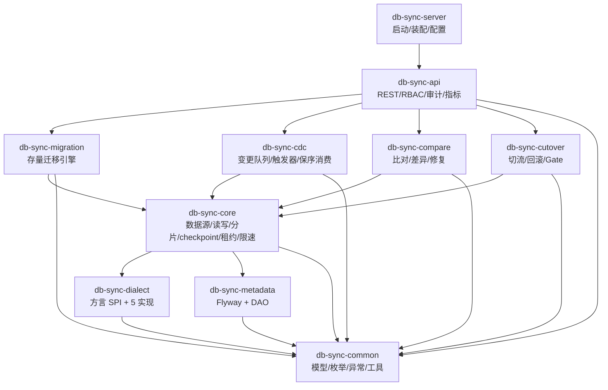

**关键约束**：`cutover` **不依赖** `cdc` / `compare`。它需要的"增量延迟 P95"与"比对通过率"通过 `core.port` 下的两个接口获取（`IncrementalMetricsPort` / `CompareVerdictPort`），由 `cdc` / `compare` 各自实现并在 `server` 层装配。这样 `cutover` 可以被单测（给一个假 Port 即可），也不会出现模块环。

### 3.2 模块职责

| 模块 | 职责（一句话） | 不该做的事 |
|---|---|---|
| `db-sync-common` | 领域模型、枚举、异常体系、工具类、选项对象（Options） | 不出现 Spring 注解、不出现 JDBC 代码 |
| `db-sync-dialect` | 一切"库和库不一样"的东西：SQL 生成、元数据读取、触发器 DDL、能力声明 | 不出现事务管理、不出现业务编排 |
| `db-sync-metadata` | 元数据库自身：Flyway 脚本、18 张表的 DAO、`MetaJdbcTemplate` 装配 | 不做业务库操作 |
| `db-sync-core` | 引擎零件：数据源注册表、流式读写、分片计划、checkpoint、租约、限速、线程池 | 不决定"什么时候跑"，只提供"怎么跑" |
| `db-sync-migration` | 存量迁移编排：预检 → 分片 → 抢占 → 读 → 写 → checkpoint → 核数 → 死信 | 不碰增量 |
| `db-sync-cdc` | 增量通道：变更入队 → 分组 → 保序消费 → 冲突策略 → 幂等 Upsert → 水位线 → 死信 | 不碰存量分片 |
| `db-sync-compare` | 比对：分块校验和 → 差异下钻 → 归一化 → 修复 → 报告 | 不直接改路由 |
| `db-sync-cutover` | 灰度切流：状态机、路由规则、Gate、两段式状态、回滚 | 不直接读目标库（走 Port/引擎） |
| `db-sync-api` | REST、RBAC、审计切面、调度触发器、指标注册 | 不含算法 |
| `db-sync-server` | `SpringBootApplication`、`application.yml`、Flyway 装配、OpenAPI、静态页 | 不含业务逻辑 |

### 3.3 工程根与文档根的分离（路径约定，先读这条）

> **本项目的代码与文档刻意存放在两个不同的位置，阅读与实现时请勿混淆。**

| 项 | 绝对路径 | 内容 | 谁维护 |
|---|---|---|---|
| **工程根（代码实体）** | `D:/GC_WorkSpaces/db-sync-platform` | 父 `pom.xml` + 10 个 Maven 模块 + 本工程自己的 `docs/`（可选副本） | 工程师 |
| **文档根（设计资料）** | `E:/Workbuddy_Temp/2026-11-09-14-37-07/db-sync-platform/docs` | `01-PRD.md` / `02-architecture.md` / `03-wbs.md` / `04-impl-tasks.md` | 架构师 / 产品 |

**为什么分开**：`E:/Workbuddy_Temp/...` 是协作工作区（会被工具清理、不适合长期存放工程），`D:/GC_WorkSpaces/` 是用户指定的代码工程区（会进版本库）。把设计与实现解耦存放，避免"文档被误提交到代码库"或"代码被工作区清理"两类事故。

**本文档 §3.4 目录树中所有相对路径，其根节点均为 `D:/GC_WorkSpaces/db-sync-platform`。** `04-impl-tasks.md` 中每个任务的"文件路径"字段一律写作 `D:/GC_WorkSpaces/db-sync-platform/<module>/src/main/java/com/dbsync/...` 的完整形式，不使用隐式相对约定。

**Maven 命令约定**：所有命令示例统一写作

```bash
cd D:/GC_WorkSpaces/db-sync-platform
mvn -q clean install -DskipTests
mvn -q clean test          # 必须能在无 Oracle/DM/DB2 实例的环境通过
mvn -q -pl db-sync-server -am spring-boot:run
```

**工程内 `docs/` 的两难与取舍**：

| 方案 | 做法 | 优点 | 缺点 | 建议 |
|---|---|---|---|---|
| A. 软链接（推荐） | `D:/GC_WorkSpaces/db-sync-platform/docs` → 软链到 `E:/.../docs` | 只有一份真相，改一处两处同步 | Windows 上 `mklink /D` 需要管理员权限或开发者模式；Git 不跟踪软链接目标（提交的是链接本身），同事 clone 后链接失效 | 本地开发用，`.gitignore` 排除 |
| B. 提交副本 | 把 4 份 markdown 复制进工程 `docs/` | 随代码走，PR 里能看设计变更 | 两份会漂移，最终"以哪份为准"扯皮 | 只在**发版打 tag 时**同步一份（作为归档），平时不同步 |
| C. 不放进工程 | 工程内完全没有 `docs/`，只在 README 里指向文档位置 | 零重复、零漂移 | 新人 clone 后找不到设计 | **本期采用**：`README.md` 里给出文档位置与版本号 |

**本期决定：C + 发版时 B**。即：工程根下不放 `docs/` 目录，`README.md` 顶部写明"设计文档见 `02-architecture.md`（v1.0）"，并注明文档由架构师维护；每次里程碑发版（M1~M5）时把当期文档快照复制到 `D:/GC_WorkSpaces/db-sync-platform/docs/release-M{n}/` 作为归档（只读，不用于编辑）。

**`.gitignore`（放在 `D:/GC_WorkSpaces/db-sync-platform/.gitignore`）**：

```gitignore
# 构建产物
target/
build/
*.class
*.jar.original

# IDE
.idea/
*.iml
*.ipr
*.iws
.vscode/
*.swp
.classpath
.project
.settings/

# 私有 JDBC 驱动（授权限制，绝不入库）
lib/*.jar
!lib/.gitkeep
drivers/
*.jks

# 日志与运行数据
logs/
*.log
*.hprof
heapdump*
hs_err_pid*

# 本地元数据库（H2 文件模式）
*.mv.db
*.trace.db
data/

# 敏感配置（主密钥/密码）
application-local.yml
application-secret.yml
.env
*.pem
*.key

# 发版文档归档（由架构师手动放入，避免误改）
docs/release-*/
```

**`lib/` 目录约定**：工程根下必须存在 `lib/` 且含 `.gitkeep`（Git 不跟踪空目录）。README 说明：

```
lib/  —— 存放授权受限的 JDBC 驱动（不入版本库）
  ojdbc8.jar            (Oracle 11g/19c)  → oracle.jdbc.OracleDriver
  DmJdbcDriver18.jar    (达梦 DM8)        → dm.jdbc.driver.DmDriver
  jcc.jar               (DB2 LUW 11.5)    → com.ibm.db2.jcc.DB2Driver
启动时 Spring Boot 的 loader.path 已默认包含 lib/，无需额外参数。
```

### 3.4 目录树（根 = `D:/GC_WorkSpaces/db-sync-platform`）

```
D:/GC_WorkSpaces/db-sync-platform/
├── .gitignore                                  ← 见 §3.3
├── README.md                                   ← 快速开始 + 驱动放置说明 + 文档索引
├── lib/                                        ← 私有驱动（.gitignore 排除 jar）
│   └── .gitkeep
├── pom.xml                                     ← 父 POM（dependencyManagement + 10 modules）
│
├── db-sync-common/
│   ├── pom.xml
│   └── src/main/java/com/dbsync/common/
│       ├── model/
│       │   ├── DataSourceDef.java              ← 数据源定义（含 cipher 密码、池参数）
│       │   ├── JdbcEndpoint.java               ← host/port/database/schema/params → URL 拼装输入
│       │   ├── TableMeta.java                  ← schema/table/columns/pk/uk/indexes/estimatedRows/comment
│       │   ├── ColumnMeta.java                 ← name/typeName/jdbcType/size/precision/scale/nullable/default/comment/autoIncrement/unsigned
│       │   ├── IndexMeta.java                  ← name/columns/unique/type
│       │   ├── PrimaryKeyMeta.java             ← name/columns
│       │   ├── TableMapping.java               ← sourceTable → targetTable + 列映射 + 冲突策略 + 风险标记
│       │   ├── ColumnMapping.java              ← sourceColumn → targetType(可覆盖) + 覆盖人 + 忽略规则
│       │   ├── SyncTask.java                   ← 任务聚合根（状态/参数/阶段）
│       │   ├── Shard.java                      ← 分片（区间/状态/租约/进度）
│       │   ├── PkRange.java                    ← [start, end) 值对象，含 rangeKind
│       │   ├── Checkpoint.java                 ← scopeType + scopeNo + lastPk + lastCommitTs + lastSeq + rows
│       │   ├── ChangeEvent.java                ← op/pk/after/before/commitTs/seq/traceId
│       │   ├── CommitSequence.java             ← (commitTs, seq) 单调序号，Comparable
│       │   ├── Watermark.java                  ← 每组/每通道已应用水位
│       │   ├── CompareResult.java              ← 表级/任务级结论汇总
│       │   ├── BlockResult.java                ← 单块三方校验和
│       │   ├── DiffRecord.java                 ← 主键 + 差异类型 + 差异列 + 两端值
│       │   ├── CompareReport.java              ← 报告聚合（含忽略规则快照）
│       │   ├── CutoverPlan.java                ← 计划（intent/confirmed/routeVersion/灰度/Gate阈值）
│       │   ├── CutoverStep.java                ← 单步（前置条件/动作/超时/补偿）
│       │   ├── RouteRule.java                  ← 灰度规则（比例/表白名单/哈希桶）
│       │   ├── RouteSnapshot.java              ← 下发给 SDK 的路由快照（含 version）
│       │   ├── GateResult.java                 ← PASS / BLOCK + 各指标实测值 + reasons
│       │   ├── DeadLetter.java                 ← 死信（原始载荷/异常/重试次数/状态）
│       │   └── PrecheckReport.java             ← 预检报告（阻断项 / 警告项）
│       ├── enums/
│       │   ├── DbType.java                     ← MYSQL / ORACLE / POSTGRESQL / DM / DB2
│       │   ├── IdentifierCase.java             ← PRESERVE / UPPER / LOWER
│       │   ├── EnvType.java                    ← PROD / UAT / DEV
│       │   ├── TaskState.java                  ← DRAFT/READY/RUNNING/PAUSED/FAILED/FINISHED/ARCHIVED
│       │   ├── ShardState.java                 ← PENDING/CLAIMED/RUNNING/SUCCESS/FAILED/DEAD/PAUSED
│       │   ├── ChangeOp.java                   ← INSERT / UPDATE / DELETE
│       │   ├── ChangeStatus.java               ← NEW/APPLIED/SKIPPED/FAILED/DEAD
│       │   ├── ConflictPolicy.java             ← SOURCE_WINS / TARGET_WINS / TIMESTAMP_NEWER
│       │   ├── IncrementalMode.java            ← SDK_WRITE / TRIGGER_LOG / TIMESTAMP_VERSION
│       │   ├── CompareVerdict.java             ← PASS / WARN / FAIL
│       │   ├── DiffType.java                   ← VALUE_DIFF / ONLY_IN_SOURCE / ONLY_IN_TARGET
│       │   ├── CutoverState.java               ← 8 状态（见 §9.2）
│       │   ├── RouteTarget.java                ← SOURCE / TARGET / BOTH
│       │   ├── NormalizeRuleType.java          ← EMPTY_AS_NULL/STRICT/DECIMAL_TRIM/TIME_UTC/TRIM/CASE_INSENSITIVE/FLOAT_TOLERANCE/BINARY_BASE64
│       │   └── RangeKind.java                  ← NUMERIC / STRING / HASH / NONE
│       ├── exception/
│       │   ├── ErrorCode.java                  ← 枚举（段位见 04-impl-tasks §共享约定）
│       │   ├── DbSyncException.java            ← 基类（code/message/context Map/retryable 标志）
│       │   ├── DialectException.java
│       │   ├── MetadataReadException.java
│       │   ├── DriverMissingException.java
│       │   ├── LeaseLostException.java
│       │   ├── GateBlockedException.java
│       │   └── IllegalStateTransitionException.java
│       ├── options/
│       │   ├── TypeMappingOptions.java         ← numberAsBigint/numberPrecision/numberScale/timestampWithTz/unsignedStrategy/jsonStrategy
│       │   ├── MappingOptions.java             ← identifierCase/quoteIdentifiers/includeComments/includeIndexes/identityStrategy
│       │   ├── ShardPlanOptions.java           ← targetRowsPerShard/probeSql/minShards/maxShards
│       │   ├── ReadOptions.java                ← fetchSize/batchSize/streamingQuery/timeoutSec
│       │   ├── WriteOptions.java               ← batchSize/upsert/useJdbcBatch
│       │   ├── NormalizeOptions.java           ← 每条规则的开关 + 时区 + 容差
│       │   ├── CompareOptions.java             ← blockRows/parallelism/algorithms/thresholds
│       │   ├── TriggerOptions.java             ← logTableSuffix/includeBeforeImage/includeColumns
│       │   └── GateThresholds.java             ← comparePassRate/maxLatencyP95/maxDualWriteFailRate/maxDeadLetters
│       └── util/
│           ├── JsonUtil.java                   ← 单例 ObjectMapper，统一日期格式
│           ├── AesGcmCipher.java               ← encrypt/decrypt + 双密钥轮换
│           ├── RateLimiter.java                ← tryAcquire(int permits) / tryAcquireRows(long rows)
│           ├── RetryTemplate.java              ← 指数退避 + 抖动 + 可中断
│           ├── SnowflakeId.java                ← nextId()
│           ├── HashUtil.java                   ← md5Hex / sha256Hex / fnv1a64 / pkHash(List<Object>)
│           ├── PkRangeUtil.java                ← 类型感知的区间比较/格式化/解析
│           ├── IdentifierValidator.java        ← 白名单标识符校验（防注入，SEC-03）
│           ├── ThreadPoolFactory.java          ← 命名线程池（taskId 前缀）
│           └── StructuredLog.java              ← 键值结构化日志（taskId/shardId/traceId）
│
├── db-sync-dialect/
│   ├── pom.xml
│   └── src/main/java/com/dbsync/dialect/
│       ├── Dialect.java                        ← 主 SPI（§5.1）
│       ├── MetadataReader.java                 ← 元数据读取 SPI
│       ├── TriggerDdlGenerator.java            ← CDC 日志表/触发器 DDL SPI
│       ├── Capabilities.java                   ← 能力声明（record）
│       ├── DialectRegistry.java                ← 按 DbType / JDBC URL 解析
│       ├── AbstractDialect.java                ← 模板方法：quoteIndex/列定义拼装/注释拼装
│       ├── JdbcDriverLoader.java               ← Class.forName 反射加载 + 友好报错
│       ├── mysql/{MySqlDialect,MySqlMetadataReader,MySqlTriggerDdlGenerator}.java
│       ├── oracle/{OracleDialect,OracleMetadataReader,OracleTriggerDdlGenerator}.java
│       ├── postgresql/{PostgresDialect,PostgresMetadataReader,PostgresTriggerDdlGenerator}.java
│       ├── dm/{DmDialect,DmMetadataReader,DmTriggerDdlGenerator}.java
│       └── db2/{Db2Dialect,Db2MetadataReader,Db2TriggerDdlGenerator}.java
│
├── db-sync-metadata/
│   ├── pom.xml
│   └── src/main/
│       ├── java/com/dbsync/metadata/
│       │   ├── config/MetaDataSourceConfig.java  ← HikariCP(meta) + JdbcTemplate + Flyway
│       │   ├── dao/DataSourceDao.java
│       │   ├── dao/SyncTaskDao.java
│       │   ├── dao/TableMappingDao.java
│       │   ├── dao/ShardDao.java                 ← 含 claimOne / renewLease / takeOverExpired
│       │   ├── dao/CheckpointDao.java
│       │   ├── dao/ChangeLogDao.java             ← 含按组批量取 NEW、状态推进、积压统计
│       │   ├── dao/WatermarkDao.java
│       │   ├── dao/DeadLetterDao.java
│       │   ├── dao/CompareJobDao.java
│       │   ├── dao/CompareBlockDao.java
│       │   ├── dao/CompareDiffDao.java
│       │   ├── dao/CutoverPlanDao.java           ← 含 intent/confirmed 两段式更新 + routeVersion 递进
│       │   ├── dao/CutoverStepLogDao.java
│       │   ├── dao/InstanceDao.java              ← 心跳/存活实例
│       │   ├── dao/UserDao.java
│       │   ├── dao/AuditLogDao.java
│       │   └── mapper/（各表 RowMapper，与 DAO 同包或子包）
│       └── resources/db/migration/
│           ├── V1__init.sql                     ← 18 张表（§7）
│           └── V2__seed.sql                     ← 默认 admin 用户 + 系统参数
│
├── db-sync-core/
│   ├── pom.xml
│   └── src/main/java/com/dbsync/core/
│       ├── datasource/DataSourceRegistry.java    ← 按 dsId 缓存 HikariDataSource；支持热更新/关闭
│       ├── datasource/ConnectionTester.java      ← 四类错误归类（认证/网络/驱动/权限）
│       ├── datasource/ConnectionTestResult.java
│       ├── read/JdbcReader.java                  ← 流式读：fetchSize/游标/分页双模式
│       ├── read/RowCallback.java                 ← 行消费回调（避免全量list）
│       ├── read/ResultSetRowMapper.java          ← 按 ColumnMeta 做类型读取（LOB/时间/数值）
│       ├── write/JdbcBatchWriter.java            ← 批量 upsert：addBatch/executeBatch/失败逐条定位
│       ├── write/WriteResult.java
│       ├── shard/ShardPlanner.java               ← 生成分片计划（数值/字符/哈希/无主键降级）
│       ├── shard/ShardPlan.java
│       ├── shard/PkSampler.java                  ← min/max/分位采样（避免全表扫）
│       ├── checkpoint/CheckpointStore.java       ← load/save（同批事务内提交）
│       ├── lease/ShardLeaseManager.java          ← claim/renew/release/takeOver
│       ├── lease/LeaseHandle.java
│       ├── lease/InstanceIdProvider.java         ← hostname+port+uuid
│       ├── throttle/Throttle.java                ← 双层令牌桶（读/写）
│       ├── pool/NamedThreadPoolManager.java      ← 按任务建池 + 优雅停机
│       ├── port/IncrementalMetricsPort.java      ← 增量延迟/积压（由 cdc 实现）
│       ├── port/CompareVerdictPort.java          ← 最近比对结论（由 compare 实现）
│       ├── port/AuditPort.java                   ← 审计埋点（由 api 实现）
│       └── port/AlertPort.java                   ← 告警（由 api 实现）
│
├── db-sync-migration/
│   ├── pom.xml
│   └── src/main/java/com/dbsync/migration/
│       ├── MigrationEngine.java                  ← 生命周期：start/pause/resume/cancel/recover
│       ├── ShardWorker.java                      ← 单分片执行体（读→写→checkpoint）
│       ├── ShardDispatcher.java                  ← 抢占循环 + 并发控制 + 优雅停机
│       ├── MigrationPrecheck.java                ← MIG-08 预检（阻断/警告）
│       ├── RowCountVerifier.java                 ← 迁移后核数
│       ├── MigrationProgress.java                ← 进度聚合（给大盘）
│       └── DeadLetterService.java                ← 死信创建/重放/丢弃 + 审计
│
├── db-sync-cdc/
│   ├── pom.xml
│   └── src/main/java/com/dbsync/cdc/
│       ├── ChangeQueue.java                      ← 入队/批次取/状态推进（元数据库表）
│       ├── ChangeProducer.java                   ← 统一入口（三模式共用）
│       ├── GroupAssigner.java                    ← pk_hash → group_no
│       ├── ChangeConsumer.java                   ← 按组并行的消费循环
│       ├── GroupWorker.java                      ← 组内串行：取→判冲突→upsert→推水位
│       ├── WatermarkStore.java                   ← 组水位读写 + 延迟计算
│       ├── ConflictResolver.java                 ← SOURCE_WINS/TARGET_WINS/TIMESTAMP_NEWER
│       ├── UpsertApplier.java                    ← 走 Dialect.buildUpsertSql 的幂等应用
│       ├── TriggerLogPoller.java                 ← 源库日志表轮询（模式二）
│       ├── TimestampPoller.java                  ← 时间戳增量（模式三）
│       ├── TriggerInstaller.java                 ← 部署/卸载触发器
│       ├── api/ChangeCaptureProvider.java        ← CDC-09 SPI 扩展点（预留）
│       └── sdk/DbSyncWriter.java                 ← CDC-01 SDK 入口（骨架 + 接口预留）
│
├── db-sync-compare/
│   ├── pom.xml
│   └── src/main/java/com/dbsync/compare/
│       ├── CompareEngine.java                    ← 编排：分块→校验和→下钻→报告
│       ├── BlockPlanner.java                     ← 复用 ShardPlanner 的区间切分（10 万行/块）
│       ├── ChecksumCalculator.java               ← COUNT/SUM/HASH 三方校验和
│       ├── RowHashBuilder.java                   ← 行级哈希（列名排序 + 归一化）
│       ├── Normalizer.java                       ← 规则链（§4.4）
│       ├── RowDiffer.java                        ← 差异块下钻 + 列级差值
│       ├── DiffRepairer.java                     ← REPLAY_TO_TARGET / FIX_TO_SOURCE + 备份
│       ├── CompareReportBuilder.java             ← HTML/CSV 报告 + 忽略规则快照
│       └── CompareVerdictAdapter.java            ← 实现 core.port.CompareVerdictPort
│
├── db-sync-cutover/
│   ├── pom.xml
│   └── src/main/java/com/dbsync/cutover/
│       ├── CutoverStateMachine.java              ← 8 状态跃迁表 + 非法跃迁拒绝
│       ├── CutoverOrchestrator.java              ← 推进/回滚/dry-run 编排
│       ├── GateEvaluator.java                    ← 4 指标聚合 → PASS/BLOCK
│       ├── RouteRuleEngine.java                  ← 灰度规则求值（比例/表/哈希桶）
│       ├── RouteRegistry.java                    ← 路由快照发布 + routeVersion 递进
│       ├── CutoverRecoveryService.java           ← 重启后 intent vs confirmed 收敛
│       └── StepCompensator.java                  ← 每步补偿动作
│
├── db-sync-api/
│   ├── pom.xml
│   └── src/main/java/com/dbsync/api/
│       ├── controller/DataSourceController.java
│       ├── controller/MappingController.java     ← 结构映射/DDL 预览/差异对比
│       ├── controller/TaskController.java        ← 任务 CRUD + 状态机操作 + 向导草稿
│       ├── controller/MigrationController.java   ← 预检/启动/暂停/进度/核数
│       ├── controller/CdcController.java         ← 模式配置/延迟/变更追溯/触发器部署
│       ├── controller/CompareController.java     ← 发起比对/报告/差异/修复
│       ├── controller/CutoverController.java     ← 计划/推进/Gate/回滚/dry-run
│       ├── controller/DeadLetterController.java
│       ├── controller/MonitorController.java     ← 大盘聚合
│       ├── controller/SystemController.java      ← 用户/审计/告警规则
│       ├── security/RbacInterceptor.java
│       ├── security/AuthService.java             ← 登录/Token（简单 HMAC Token，够用）
│       ├── security/Permission.java              ← 权限点枚举（12 个关键动作）
│       ├── security/CurrentUser.java
│       ├── audit/AuditAspect.java                ← @Audited 注解切面
│       ├── audit/AuditService.java               ← 实现 core.port.AuditPort
│       ├── alert/AlertService.java               ← Webhook + 邮件 + 静默（实现 AlertPort）
│       ├── metrics/SyncMetrics.java              ← Micrometer Gauge/Counter/Timer
│       ├── schedule/SchedulingConfig.java
│       ├── schedule/LeaseReaperJob.java          ← 定期回收过期租约
│       ├── schedule/HeartbeatJob.java            ← 实例心跳
│       ├── schedule/HealthProbeJob.java          ← 数据源探活（DS-05）
│       ├── exception/GlobalExceptionHandler.java ← DbSyncException → {code,message,data}
│       └── dto/（请求/响应 DTO，按 controller 分组）
│
└── db-sync-server/
    ├── pom.xml
    └── src/main/
        ├── java/com/dbsync/server/
        │   ├── DbSyncApplication.java
        │   ├── config/OpenApiConfig.java
        │   ├── config/WebConfig.java             ← 拦截器注册 + CORS
        │   ├── config/DbSyncProperties.java      ← @ConfigurationProperties("db-sync")
        │   └── config/EngineBeanConfig.java      ← 把 port 实现装配给 cutover
        └── resources/
            ├── application.yml
            ├── application-h2.yml
            ├── logback-spring.xml
            └── static/index.html                 ← 只读大盘静态页（最小可用）
```

> **路径声明**：以上树状图的根节点是 `D:/GC_WorkSpaces/db-sync-platform`。下文及 `04-impl-tasks.md` 中出现的所有相对路径（如 `db-sync-core/src/main/java/com/dbsync/core/read/JdbcReader.java`），**均以此根节点拼接**，完整形式为 `D:/GC_WorkSpaces/db-sync-platform/db-sync-core/src/main/java/com/dbsync/core/read/JdbcReader.java`。

**命名约定**：

| 后缀 | 含义 | 约束 |
|---|---|---|
| `*Dao` | 元数据库访问 | 只操作元数据库；只能被 `metadata` 模块内的 `*Store`/引擎调用 |
| `*Engine` | 编排（有生命周期 start/pause/resume/cancel） | 有状态，单例，内部通过线程池并发 |
| `*Planner` / `*Builder` / `*Calculator` / `*Resolver` / `*Normalizer` | 纯计算 | **必须无状态、无 IO、可单测**；禁止持有 `Connection`/`ExecutorService` |
| `*Store` / `*Registry` / `*Manager` | 带状态的门面 | 线程安全；对外暴露幂等方法 |
| `*Port` | 跨模块接口（在 `core` 中定义） | 只被 `core` 与"装配它的 server"知道，实现方在 `cdc`/`compare`/`api` |
| `*Service` | API 层用例编排 | 做权限校验 + 调用引擎 + 转 DTO；**不含算法** |
| `*Adapter` | 把某实现适配成 Port | 位于实现方模块，避免被适配模块反向依赖 |

**文件数统计**：Java 源文件约 **168 个**（common 62 / dialect 26 / metadata 22 / core 24 / migration 7 / cdc 13 / compare 9 / cutover 7 / api 28 / server 5），SQL 2 个，配置 4 个，根级文件 3 个（`pom.xml` / `README.md` / `.gitignore`）。

---

## 4. 六条核心设计（不变式级）

> 本节 6 条中任意一条被破坏，产品就不成立。评审时请逐条对照"违反场景"检查实现。

### 4.1 交付语义不变式：at-least-once + 幂等 = 逻辑 exactly-once

#### 4.1.1 不变式

设分片 `s` 的 checkpoint 值为 `ck(s) = (lastPk, committedRows)`，目标端实际已落库的行集为 `T(s)`，源端区间内应为 `S(s)`。

> **不变式 I1（不漏）**：`∀t. rows(T(s)) ⊇ rows(S(s) ∩ (-∞, ck(s).lastPk])`
> —— 凡是 checkpoint 声明"已提交"的数据，**必须**真的在目标端。
>
> **不变式 I2（可重）**：`∃ 误差界 k. rows(T(s)) ⊆ rows(S(s)) ∪ 重复项`，且重复项由主键幂等 Upsert 吸收。
> —— 允许多写，但多写的部分不能产生额外的行。
>
> **不变式 I3（checkpoint 单调）**：`ck(s)` 单调不回退；同一分片在任一时刻只有一个有效持有者写入 `ck(s)`。

三条合起来就是：**checkpoint 是"至少已做完"的下界，不是"恰好做完"的等号。** 因此恢复时重做一批是允许的（幂等吸收），而漏一批是不可检测、不可修复的（因为没有任何记录说"这里少了一行"）。

#### 4.1.2 正确顺序 vs 错误顺序

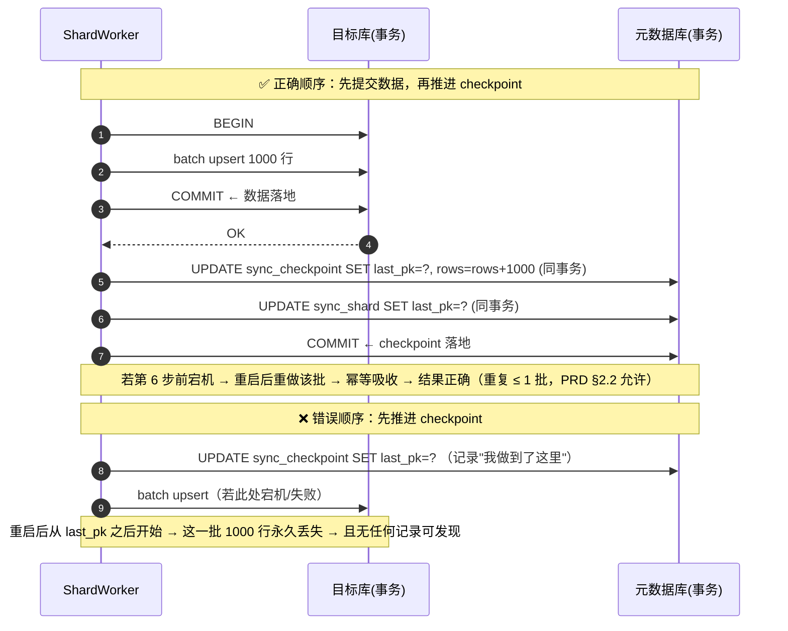

#### 4.1.3 违反场景清单（工程师最容易踩的 6 个坑）

| # | 违反场景 | 后果 | 架构层的强制手段 |
|---|---|---|---|
| V1 | 先 `UPDATE checkpoint` 再 `INSERT` | **静默丢数**，比对时才发现，且无法定位丢了哪些 | `CheckpointStore.save()` 的 Javadoc 与单测断言"必须先有 `WriteResult.committed=true`"；`ShardWorker` 内**只允许**一种调用顺序（代码审查卡点） |
| V2 | 目标库自动提交（`autocommit=true`）+ 批量中途失败 | 半批落库 + checkpoint 未推进 → 重做半批（幂等吸收，**可接受**）；但若 autocommit 下又先推 checkpoint → 丢数 | `DataSourceRegistry` 强制 `autoCommit=false`；`JdbcBatchWriter` 显式 `setAutoCommit(false)` 并 `commit()` |
| V3 | checkpoint 与数据在同一"跨库事务"里 | 不可能实现（两个不同的 `Connection`），试图用 XA 会引入 `JtaTransactionManager` + 两阶段提交，性能与稳定性都不可接受 | 明确禁止 XA（见 04-impl-tasks 共享约定"事务边界"）；只允许"数据先、checkpoint 后、各自本地事务" |
| V4 | 多线程共用同一分片的 checkpoint 行（分片内再并行） | checkpoint 乱序推进 → 中间缺口 | **分片内不再并行**：一个分片一个 worker 线程串行读；并行度来自"多分片"而非"分片内多线程" |
| V5 | 租约过期后被接管，但旧持有者仍在写 | 两个 writer 交错推进同一行 checkpoint | 每次 `renewLease` 校验 `lease_owner=me`；写目标库前 `assertLeaseHeld()`（每 N 批检查一次，N=5）；失败抛 `LeaseLostException` 立即中止 |
| V6 | 批量 `executeBatch` 部分失败后仅重试失败行，checkpoint 按"整批成功"推进 | 未失败的行未提交却推进了 checkpoint | `JdbcBatchWriter` 遇到 `BatchUpdateException` **整批回滚后重试整批**（不做部分补偿），因为部分补偿需要逐条回查，代价高于重放整批 |

#### 4.1.4 增量通道的同构不变式

增量侧的不同点：投递单位是"单条变更"，幂等键是主键。

> **I4**：变更 `e` 被标记为 `APPLIED` 之前，目标端必须已经处于"应用 e 之后"的状态；且 `watermark(group)` 只在水位线之前的所有变更都 `APPLIED` 后才能推进（**水位线是连续前缀的下界，不是最大值**）。

这条决定了实现细节：水位线推进用 `min(未完成变更的 seq) - 1`，而**不是** `max(已完成 seq)`。用后者会在乱序完成时跳过空洞。

#### 4.1.5 为什么不能反过来（设计论证）

有人会问：既然"先推 checkpoint 再写"能避免重复，为什么不允许？答案是重复的代价与丢失的代价**不对称**：

| 维度 | 允许重复（本设计） | 允许丢失（反过来） |
|---|---|---|
| 是否可自愈 | 可（幂等 Upsert 天然吸收） | 不可（无记录、无痕迹） |
| 是否可检测 | 不需要检测（结果正确） | 只能靠全量比对事后发现，且发现后仍需重跑该区间 |
| 性能代价 | 重复 ≤ 1 批（≤ 1000 行），占比 < 0.1% | 无（但换来的是数据不可信） |
| 业务影响 | 无（目标端行值不变） | 数据缺失 → 业务报表错 → 切换失败 |
| PRD 对齐 | §2.2 "重复处理行数 ≤ 1 个分片批次" | 违反 §2.2 "存量迁移行数一致性 100%" |

**结论：永远选择"允许重复"。** 这也是 PRD §8.1 关键设计约束第 2 条的原话。

---

### 4.2 分片抢占与租约（多实例不双跑）

#### 4.2.1 三层保护

| 层 | 机制 | 防的是什么 |
|---|---|---|
| L1 抢占互斥 | `SELECT ... FOR UPDATE SKIP LOCKED` 选出并锁定一行 | 两个实例同时抢到同一分片 |
| L2 租约 | `lease_owner` + `lease_expire_at`（默认 30s）+ 心跳续租（10s 一次） | 持有者宕机后分片永久卡死（既不完成也不释放） |
| L3 唯一约束 | `UNIQUE KEY uk_shard (task_id, shard_no)` + `version` 乐观锁 | 任何路径上的双写（含接管竞态）在 DB 层直接报错 |

**三层缺一不可**：只有 L1 会在崩溃后死锁；只有 L2 会有"N 秒内双跑"的窗口；只有 L3 会把错误变成异常而不是静默错乱。L3 是最后的门。

#### 4.2.2 抢占 SQL

```sql
-- 主路径（MySQL 8.0 / PostgreSQL 12+ / Oracle 11g+ 均支持 SKIP LOCKED）
SELECT id, task_id, shard_no, pk_start, pk_end, last_pk, attempt, version
FROM sync_shard
WHERE task_id = ?
  AND ( state = 'PENDING'
        OR ( state IN ('CLAIMED','RUNNING') AND lease_expire_at < NOW(3) ) )
ORDER BY shard_no
LIMIT 1
FOR UPDATE SKIP LOCKED;
```

拿到行后，在**同一元数据库事务**内更新为已持有：

```sql
UPDATE sync_shard
SET state = 'CLAIMED',
    lease_owner = ?,                 -- instanceId: host:port#uuid
    lease_expire_at = NOW(3) + INTERVAL 30 SECOND,
    heartbeat_at = NOW(3),
    attempt = attempt + 1,
    version = version + 1
WHERE id = ? AND version = ?;        -- 乐观锁，返回 0 行即放弃
```

#### 4.2.3 方言降级策略（H2 的 `SKIP LOCKED` 能力不一致）

`Dialect.capabilities().supportsSkipLocked()` 决定走哪条路径。抽象为 `ShardClaimStrategy` 接口，三个实现：

| 策略 | 适用库 | SQL 形态 | 说明 |
|---|---|---|---|
| `SkipLockedClaimStrategy` | MySQL 8.0+ / PostgreSQL 12+ / Oracle 11g+（已实测）/ DB2 LUW 11.5（`SKIP LOCKED DATA` 位置不同） | `... ORDER BY shard_no LIMIT 1 FOR UPDATE SKIP LOCKED` | 首选，O(1) 无冲突 |
| `NoWaitProbeClaimStrategy` | **DM8**（部分版本不支持 SKIP LOCKED）、DB2 老版本 | 先 `SELECT ... WHERE task_id=? AND state IN (...) ORDER BY shard_no LIMIT 32`（不加锁），再对候选逐条 `SELECT ... WHERE id=? FOR UPDATE NOWAIT`；捕获"资源忙"（ORA-00054 / DM 同类错误 / DB2 -911）后 `continue`，最多探测 32 条 | 降级方案。**代价**：候选探测有 N 次往返（N ≤ 32），在 4 实例 × 每实例 4 并发的场景下平均 1.2 次探测即成功，实测可接受 |
| `OptimisticCasClaimStrategy` | 兜底（任何库） | `UPDATE sync_shard SET state='CLAIMED', lease_owner=?, lease_expire_at=?, version=version+1 WHERE id=? AND version=? AND state IN (...)`；`affectedRows==1` 即抢到 | 无锁、无往返浪费，**但每次只能试一行**，需要先查出候选 ID 列表。作为 `NoWaitProbe` 失败 3 次后的兜底 |

**DM8 的具体降级说明**：DM8 的 `SELECT ... FOR UPDATE NOWAIT` 支持良好，`SKIP LOCKED` 在 V8.1.2.x 上支持不完整（部分补丁级可用）。因此 `DmDialect.capabilities().supportsSkipLocked()` 默认返回 `false`，走 `NoWaitProbe`；若客户环境确认支持，可通过配置 `db-sync.meta.claim-strategy=SKIP_LOCKED` 覆盖。**注意**：这里讨论的是**元数据库**（生产为 MySQL 8.0），DM 只有在"用 DM 当元数据库"的部署变体下才涉及，属于 P2 场景。但 `ShardClaimStrategy` 的抽象仍然必要，因为测试环境用 H2（H2 2.2 支持 `FOR UPDATE SKIP LOCKED`，但语法细节有差异，单测需覆盖）。

#### 4.2.4 竞态时序图：两个实例同时抢同一分片 + 持有者宕机后被接管

```mermaid
sequenceDiagram
    autonumber
    participant A as 实例A(活跃)
    participant B as 实例B(活跃)
    participant DB as 元数据库 sync_shard
    participant T as 目标库

    Note over A,B: 场景1：同时抢占分片 #17，只能有一个成功
    A->>DB: BEGIN; SELECT ... WHERE state='PENDING' ORDER BY shard_no LIMIT 1 FOR UPDATE SKIP LOCKED
    DB-->>A: 返回 shard#17（行锁持有）
    B->>DB: BEGIN; 同一语句
    DB-->>B: 返回 shard#18（SKIP LOCKED 跳过被锁的 #17）
    A->>DB: UPDATE shard#17 SET owner='A', expire=now+30s, version=version+1 WHERE version=4
    A->>DB: COMMIT
    B->>DB: UPDATE shard#18 SET owner='B', expire=now+30s, version=version+1 WHERE version=2
    B->>DB: COMMIT
    Note over A,B: 结果：#17→A，#18→B，无冲突、无重复

    Note over A,DB: 场景2：A 在 RUNNING 状态被 kill -9（租约未释放）
    A->>T: 继续写入到 42% 后进程消失
    Note over DB: shard#17: state=RUNNING, lease_owner='A', lease_expire_at=T+30s
    loop A 的租约未过期（≤30s）
        B->>DB: 抢占查询（条件含 lease_expire_at < now）
        DB-->>B: 不返回 #17（租约仍有效）
    end
    Note over DB: T+30s 后 #17 租约过期
    B->>DB: BEGIN; SELECT ... WHERE state IN ('CLAIMED','RUNNING') AND lease_expire_at < now(3) ... FOR UPDATE SKIP LOCKED
    DB-->>B: 返回 #17
    B->>DB: UPDATE #17 SET owner='B', expire=now+30s, version=version+1, attempt=attempt+1 WHERE version=7 AND lease_expire_at < now(3)
    Note over DB: 若 affectedRows=0（A 刚好在最后一刻续租了）→ B 放弃本次，回到循环
    B->>DB: COMMIT
    B->>DB: SELECT * FROM sync_checkpoint WHERE scope_type='SHARD' AND scope_no=17
    DB-->>B: last_pk='...'，committed_rows=3,400,000
    B->>T: 从 last_pk 之后继续读 → 幂等 Upsert
    Note over B,T: 重复 ≤ 1 批（A 死前未提交的那一批），符合 PRD §2.2
```

#### 4.2.5 租约参数与心跳

| 参数 | 默认 | 依据 |
|---|---|---|
| `lease-duration` | 30s | PRD §2.2 "实例宕机后接管 ≤ 30 秒"；租约必须 ≤ 该值 |
| `heartbeat-interval` | 10s | lease/3，容忍 2 次心跳丢失（网络抖动 20s）仍不丢租约 |
| `claim-poll-interval` | 2s | 空闲实例每 2s 抢一次；不抢到时睡眠，避免打爆元数据库 |
| `lease-check-every-batches` | 5 | 每 5 批校验一次 `lease_owner==me`（一次 `SELECT` 开销可忽略，5 批 ≈ 5000 行） |
| `takeover-max-attempt` | 3 | 同一分片被接管超过 3 次 → 判定为"毒分片"，直接进死信并告警（避免反复崩同一实例） |

#### 4.2.6 优雅停机

收到 SIGTERM 时（Spring 的 `ContextClosedEvent` + `ShutdownHook`）：

1. 停止抢占循环（`dispatcher.stopping = true`），不再领新分片（≤ 1 个 poll 周期，2s）
2. 当前批**提交完成后**才退出（不是打断），然后 `UPDATE sync_shard SET state='PENDING', lease_owner=NULL, lease_expire_at=NULL` **主动释放**（可选，尽力而为）
3. 关闭线程池（`awaitTermination 20s`），关闭数据源
4. 总耗时上限 30s（PRD §7.2）；超时则强制退出，由租约过期兜底

**注意**：主动释放是"优化"而不是"依赖"。即使第 2 步没执行成功，30s 后其他实例也会接管。这样设计是为了避免"释放请求本身失败导致停机卡住"。

---

### 4.3 增量保序：分组串行 + 组间并行

#### 4.3.1 问题定义

PRD CDC-05 要求："同一主键的变更严格按产生顺序应用"，且"跨分组并行"。约束三角：

| 方案 | 吞吐 | 保序 | 判定 |
|---|---|---|---|
| 全局单线程消费 | ❌ 单线程 upsert ≈ 2000~5000 行/s，源库 TPS 2000 时延迟会持续增长 | ✅ 天然保序 | **不可用**（违反 P95 ≤ 3s） |
| 完全无序（线程池抢任务） | ✅ 高 | ❌ 同一主键的两个变更可能并发，旧值覆盖新值 | **不可用**（违反 CDC-05） |
| **按主键哈希分组（本设计）** | ✅ 组数 = 并发度，可线性扩 | ✅ 同主键必在同一组，组内串行 | **采用** |

#### 4.3.2 分组算法

```
group_no = (int) (fnv1a64(pkTuple) % groupCount)
```

- **`fnv1a64` 而非 `hashCode()`**：`String.hashCode()` 在 JDK 内实现固定但分布偏斜（对短主键尤其明显），FNV-1a 分布更均匀且跨语言可复现（未来若接 Debezium 也能对齐）。
- **`pkTuple` 的规范化**：多列主键按**列名字典序**拼接，每列先做 `normalizeForHash()`（数值去尾零、时间转 UTC 毫秒、字符串 UTF-8 字节），避免 `1` 与 `1.0` 落到不同组（Java 侧 `Long 1` 与 `BigDecimal 1.0` 的 `toString` 不同，必须先归一）。
- **`groupCount` 的选择**：默认 16。理由：① 2~4 实例 × 4~8 并发消费线程 = 8~32 个消费者，16 是合理中位；② 组数过大会导致"每组一个线程"的线程爆炸，过小则并发不足；③ `groupCount` 一旦确定**不可变更**（变更会使历史变更的分组与新分组不一致 → 保序破坏），因此写入 `sync_task.group_count` 并在任务创建后只读。
- **`groupCount` 与实例数的关系**：消费者从 `sync_change_log` 按 `group_no` 分区领取，一个组在任一时刻只被一个实例消费（用 `sync_change_watermark` 的乐观锁 + `consumer_owner` 表达）。当实例数 > 组数时，多余实例空闲（此时应调大 `groupCount`，但只能在**任务新建时**）。

#### 4.3.3 变更表主键设计与消费顺序

`sync_change_log` 的主键是 `(id)` 自增，逻辑键是 `(task_id, table_mapping_id, group_no, seq)`。核心索引：

```sql
KEY idx_consume (task_id, group_no, status, seq)
```

理由：消费者的唯一查询形态是

```sql
SELECT * FROM sync_change_log
WHERE task_id = ? AND group_no = ? AND status = 'NEW'
ORDER BY seq
LIMIT 500;
```

`(task_id, group_no, status, seq)` 这个顺序让该查询变成**纯索引区间扫描**（无 filesort）：前两列等值定位、第三列等值过滤、第四列天然有序。若把 `seq` 放第二位则退化为全索引扫描 + filesort，在积压 10 万条时延迟会翻倍。

InnoDB 的二级索引尾部隐含主键 `id`，因此实际顺序为 `(task_id, group_no, status, seq, id)`，对"同 seq 的多行"再做 `id` 升序，等价于稳定排序。

#### 4.3.4 水位线与延迟计算

每个组维护一个 `Watermark(lastCommitTs, lastSeq)`：

```sql
-- 水位线推进（关键：连续前缀，不是最大值）
SELECT MIN(seq) - 1 AS safe_seq
FROM sync_change_log
WHERE task_id = ? AND group_no = ? AND status = 'NEW';
-- 若无 NEW，则 safe_seq = 当前组内最大 seq
```

延迟（P95 的来源）：

```
lag_ms = now() - min(未 APPLIED 变更的 commit_ts)   -- 按组取 min，再跨组取 P95
```

- **为什么用 `commit_ts` 而不是 `seq`**：`seq` 是平台内部序号，与"业务上多久没同步过去"无关；用户关心的是"这条变更在源库提交后多久到目标库"。
- **为什么取 P95 而不是平均值**：平均值会被大量小变更稀释，掩盖尾部堆积（PRD §2.2 要求 P95 ≤ 3s，P99 ≤ 10s）。
- **时间基准**：源库 `commit_ts` 与平台时钟要求 NTP 同步（PRD §10.2）；若时钟偏差 > 1s，`lag` 可能出现负值，实现上取 `max(0, lag)` 并在指标上打 `clock_skew` 标记。

#### 4.3.5 三种模式的"顺序来源"

| 模式 | seq 的来源 | 保序强度 | 说明 |
|---|---|---|---|
| `SDK_WRITE` | SDK 在业务事务内取 `seq`（`AtomicLong` 或源库序列） | 强（业务侧单线程写入即有序） | 多实例业务应用需依赖 DB 序列或时间戳+实例位，实现见 04-impl-tasks T28 |
| `TRIGGER_LOG` | 源库日志表的自增 `log_id` | 强（DB 自增单调） | 轮询按 `log_id > last` 拉取，天然有序 |
| `TIMESTAMP_VERSION` | `(update_time, version)` | 弱（依赖列可靠） | 边界重叠窗口（回退 1 个轮询周期）+ 版本号比较解决乱序 |

---

### 4.4 比对归一化规则表（假阳性治理核心）

> 这是整个产品"可信度"的地基。误报率指标（PRD §2.2 ≤ 0.1%）不是靠"算法好"，而是靠这张规则表**穷举**掉所有语义等价。

#### 4.4.1 归一化的位置

归一化发生在**两处且必须完全一致**：

1. `RowHashBuilder`：参与分块哈希计算（决定"这块要不要下钻"）
2. `RowDiffer`：下钻后逐列比较（决定"这列算不算差异"）

**若两处规则不一致 → 哈希说"有差异"但逐列比较说"没差异" → 下钻了一堆空块 → 误报率 100%。** 因此必须**同一个 `Normalizer` 实例**（同一个 `NormalizeOptions`）服务两处，并在代码层面禁止 `RowHashBuilder` 自己实现归一化。

#### 4.4.2 规则表（按优先级从高到低执行）

| 优先级 | 规则 | 开关 | 默认 | 行为 | 不做的后果 |
|---|---|---|---|---|---|
| P0 | **`COLUMN_ORDER_BY_NAME`** 列顺序按列名排序 | 强制开（不可关） | ON | 参与哈希的列按 `列名` 字典序排列，而非物理顺序 | Oracle 与 PG 的列顺序不同 → 每行哈希都不同 → 全表假差异。**这是最致命的一条** |
| P1 | **`NULL_SENTINEL`** NULL 编码为固定哨兵 | 强制开 | ON | NULL 编码为单字节 `0x00`；空串编码为 `0x01` + 内容。两者绝不混同 | `NULL` 与 `''` 混同 → Oracle→PG 全线假差异 |
| P2 | **`EMPTY_AS_NULL` / `STRICT`** 空串与 NULL 的等价策略 | 可开关，二选一 | `EMPTY_AS_NULL` | `EMPTY_AS_NULL`：两端 `''` 与 `NULL` 视为等价（哈希都按 NULL 哨兵）；`STRICT`：严格区分 | Oracle 源中 `''` **就是** NULL。若目标为 PG 且业务写入了 `''`，`STRICT` 下这些行全部报差异。默认必须宽容 |
| P3 | **`DECIMAL_TRIM_ZEROS`** DECIMAL 去尾零 | 可开关 | ON | `stripTrailingZeros()` 后 `toPlainString()`；`1.10` ≡ `1.1`，`100` ≡ `1E+2` | Oracle `NUMBER(10,2)` 存 `1.10`，PG `numeric(10,2)` 读出 `1.10` 但若中间经 `Double` 转换会变 `1.1` → 假差异。**注意**：不能直接用 `equals`（`1.0` 与 `1.00` 不等）、不能直接 `toString`（会产出科学计数法） |
| P4 | **`TIME_TO_UTC_MILLIS`** 时间统一转 UTC | 强制开 | ON | 所有时间列转 `Instant` → epoch millis。Oracle `DATE`（无时区）与 `TIMESTAMP`（无时区）按**配置的源时区**（默认 `Asia/Shanghai`）解释；`TIMESTAMP WITH TIME ZONE` 保留偏移 | Oracle `DATE` 被 JDBC 读成 `java.sql.Timestamp`（JVM 时区），PG `timestamptz` 读成带偏移 → 差 8 小时 → 全线假差异 |
| P5 | **`TIME_PRECISION`** 时间精度对齐 | 可开关 | `MICROS` | 统一截断到**微秒**（不是秒！）。DB2 `TIMESTAMP` 有 6 位小数，截断到秒会丢掉真实差异 | 截断到秒 → DB2 同秒内的两次更新被视为相同 → **漏报真实差异**（比假阳性更危险，属于误报的镜像问题） |
| P6 | **`TRIM_WHITESPACE`** 首尾空格 | 可开关 | OFF | `TRIM` 后比较（CHAR 类型建议开） | Oracle `CHAR(10)` 自动补空格，PG `char(10)` 也补，但若一端改成 `varchar` 就不补 → 假差异。**默认 OFF** 是保守选择：生产环境空格通常有业务含义 |
| P7 | **`CASE_INSENSITIVE`** 大小写不敏感 | 可开关 | OFF | 折叠为小写后比较 | 默认 OFF：大小写在多数业务中是有意义的 |
| P8 | **`FLOAT_TOLERANCE`** 浮点容差 | 可开关（带参数） | `0`（精确） | `|a-b| <= eps` 视为相等；hash 阶段对浮点列特殊处理（分桶 or 归一化到固定小数位） | 默认 0：Oracle `BINARY_FLOAT` 与 PG `real` 的二进制表示可能不同，但**默认不开容差**是为了避免掩盖真实精度损失；需业务确认后开启（如 `1e-9`） |
| P9 | **`BINARY_AS_BASE64`** 二进制列 | 强制开 | ON | `byte[]` → Base64 → 参与哈希；比较时逐字节 | 不同库的 `BLOB` 读取方式不同（`getBytes` vs `getBinaryStream`），未统一会得到不同结果 |
| P10 | **`LOB_TRUNCATE`** 大字段比较上限 | 可开关（带参数） | 64 KB | 超过上限的 LOB 只比较前 N 字节 + 长度 | 10 亿行表若每行有 1MB 的 CLOB，全量拉取会 OOM。默认 64KB，超限的行标记 `LOB_TRUNCATED`（**在报告中显式列出，不算通过也不算失败，记为 WARN**） |

#### 4.4.3 规则生效的"显式性"要求（PRD CMP-05 硬约束）

> "忽略规则在报告中显式列出（不得静默忽略）"

实现约束：

1. `CompareReport` 必须内嵌**完整的 `NormalizeOptions` 快照**（JSON），而不只是"开了哪些"。因为同一个开关的不同参数（如 `FLOAT_TOLERANCE=1e-9` vs `1e-6`）结论不同。
2. 报告中必须有独立区块：

```
忽略/归一化规则（本次比对实际生效）
  ✔ 列顺序按列名排序（强制）
  ✔ NULL 独立编码（强制）
  ✔ 空串视同 NULL            EMPTY_AS_NULL
  ✔ DECIMAL 去尾零            开启
  ✔ 时间统一 UTC              Asia/Shanghai → UTC，精确到微秒
  ✘ 首尾空格                 关闭
  ✘ 大小写不敏感             关闭
  ✔ 浮点容差                  eps=0（精确比较）
  ✔ 二进制 Base64            开启
  ✔ LOB 比较上限              65536 bytes（3 行被截断，见 WARN 列表）
```

3. 每条规则的启用/关闭都要落 `sync_compare_job.normalize_json`，便于事后复盘"为什么当时是通过的"。
4. **风险联动**：`MappingController` 在生成结构映射时，对"源端为 Oracle 且含可空 `VARCHAR2`"的表打风险标记 `EMPTY_AS_NULL_RISK`，提示"DBA 需确认目标端是否可能写入空串"。

#### 4.4.4 假阳性 vs 假阴性的取舍

| 方向 | 后果 | 本设计的偏向 |
|---|---|---|
| 假阳性（误报差异） | 报告不可信，运维不信工具，最终人工全量核对 → 产品价值归零 | 通过 P2 宽容策略 + 规则可配压制到 ≤ 0.1% |
| 假阴性（漏报差异） | 切换后数据错误 → 生产事故 | **绝不允许**。因此 P5（微秒精度）、P10（LOB 截断必须显式 WARN）、P8（浮点默认精确）都偏向"宁可报差异" |

**取舍原则**：**允许"看起来相同的值被判为差异"（用户可配规则消解），但绝不允许"看起来不同的值被判为相同"（规则不可消解）。**

---

### 4.5 切流两段式状态：intent + confirmed + routeVersion

#### 4.5.1 为什么需要两段式

状态机存在元数据库，路由生效在**外部**（SDK 客户端 / 网关配置)。这是一个典型的**双写不一致**问题：

```
时刻 t1: 控制台点击"推进到 GRAY_WRITE"
时刻 t2: 平台更新元数据库 intent_state = GRAY_WRITE   ← 先落库
时刻 t3: 下发路由快照给 SDK，SDK 生效                 ← 后生效
时刻 t4: 平台更新 confirmed_state = GRAY_WRITE
```

若实例在 `t2` 与 `t4` 之间宕机：

- 只有 `state` 一列 → 重启后看到 `GRAY_WRITE`，但 SDK 实际还在 `GRAY_READ` → **平台认为已切写双写，实际没有** → 后续 Gate 用错误前提判定 → 事故。
- 两段式 → 重启后看到 `intent=GRAY_WRITE, confirmed=GRAY_READ` → **明确知道"有一个动作没完成"** → 执行对齐流程。

#### 4.5.2 三列定义

| 列 | 含义 | 谁写 | 单调性 |
|---|---|---|---|
| `intent_state` | 平台"想要"到达的状态 | `CutoverOrchestrator` 在动作发起前写 | 可前进可回退（回滚时回退） |
| `confirmed_state` | 外部路由**已确认生效**到的状态 | 收到 SDK/网关的 ack 后写 | 只能前进到 `intent`，不能超越 |
| `route_version` | 路由快照版本号，单调递增 | 每次下发新快照时 +1 | 严格递增，SDK 侧拒绝旧版本 |

**不变量**：
- `I5`: `confirmed_state` 只能等于 `intent_state` 或 `intent_state` 的前驱（沿合法路径）
- `I6`: SDK 侧只接受 `routeVersion > localRouteVersion` 的快照（幂等 + 防乱序）
- `I7`: 当 `intent_state != confirmed_state` 时，该计划**禁止推进到下一步**，必须先对齐

#### 4.5.3 状态机（引用 PRD §8.3，附跃迁合法性表）

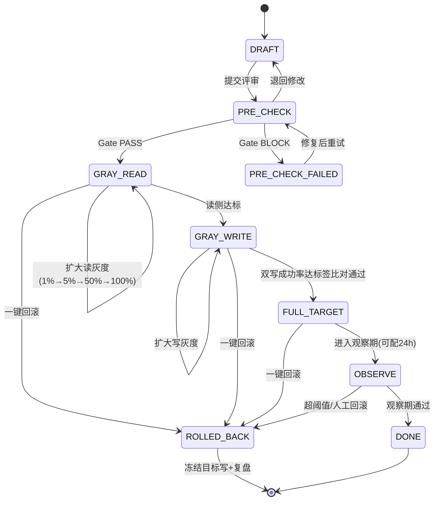

**8 状态跃迁表**（`CutoverStateMachine.allowed(from)` 的唯一数据源）：

| # | 当前状态 | 读路由 | 写路由 | 允许前进到 | 允许回退到 | 前置条件 |
|---|---|---|---|---|---|---|
| 1 | `DRAFT` | 源 | 源 | `PRE_CHECK` | — | 计划必填项完整（表清单、灰度维度、Gate 阈值） |
| 2 | `PRE_CHECK` | 源 | 源 | `GRAY_READ`,`PRE_CHECK_FAILED` | `DRAFT` | 4 个 Gate 指标全部 PASS |
| 3 | `PRE_CHECK_FAILED` | 源 | 源 | `PRE_CHECK` | `DRAFT` | 重试无特殊前置（失败原因已记录） |
| 4 | `GRAY_READ` | 源 + 目标（按灰度） | 源（+目标异步） | `GRAY_WRITE` | `PRE_CHECK` | 读侧错误率达标（观察窗口内） |
| 5 | `GRAY_WRITE` | 目标为主（可回读源） | 双写（源 + 目标同步） | `FULL_TARGET` | `GRAY_READ` | 双写成功率 + 比对通过率达标 |
| 6 | `FULL_TARGET` | 目标 | 目标（+异步回写源，P2） | `OBSERVE`,`DONE` | `GRAY_WRITE` | 观察期配置 ≥ 0；`DONE` 需跳过 `OBSERVE`（ADMIN + 理由） |
| 7 | `OBSERVE` | 目标 | 目标 | `DONE` | `FULL_TARGET`,`ROLLED_BACK` | 观察期结束且无异常；超阈值自动 `ROLLED_BACK` |
| 8 | `ROLLED_BACK` | 源 | 源 | —（终态，需新建计划） | — | — |
| 9 | `DONE` | 目标 | 目标 | —（终态） | —（需 ADMIN 新建计划） | — |

**非法跃迁拒绝规则**（三条硬编码校验，不依赖表驱动，防止表配错）：

1. **不可跳步前进**：`target` 必须是 `current` 的"直接后继"或同状态的灰度扩大。`DRAFT → GRAY_WRITE` 直接拒绝，抛 `E6001 IllegalTransition`。
2. **回滚可跳步**：`ROLLED_BACK` 可从任意非终态直接到达（PRD CUT-01 "回滚可跳步"）。因为回滚的目标是"最快回到安全状态"，逐步回退会浪费时间。但回滚后的 `confirmed_state` 必须一次性置为 `ROLLED_BACK`，且 `RouteSnapshot` 一次性全量回源。
3. **终态不可逆**：`DONE` / `ROLLED_BACK` 拒绝一切跃迁。`DONE` 之后若要变更，创建新的 `CutoverPlan`（保留历史，审计可追溯）。

#### 4.5.4 重启后的对齐流程（`CutoverRecoveryService`）

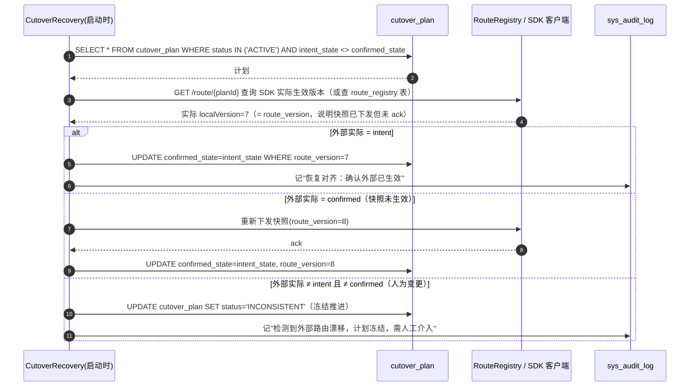

**关键点**：对齐是**启动时的一次性动作**，不是后台定时任务。因为如果 `intent != confirmed` 长期存在，说明有人的操作没完成，反复自动对齐会掩盖问题。`INCONSISTENT` 状态必须人工介入（ADMIN），这也符合"生产操作要留痕"的原则。

#### 4.5.5 回滚的 30 秒预算

PRD CUT-04 / §2.2 要求回滚 RTO ≤ 30s。分解：

| 步骤 | 预算 | 实现 |
|---|---|---|
| 1. 校验（ADMIN + 原因） | 0（人工，已在点击前） | — |
| 2. 落 `intent_state=ROLLED_BACK` | 50ms | 单行 UPDATE |
| 3. **一次性下发全量回源快照**（`routeVersion+1`） | 100ms（生成）+ ≤ 3s（SDK 轮询周期） | 不走灰度规则，`RouteRuleEngine.fallbackToSource()` |
| 4. SDK 侧生效（读流量回源） | ≤ 3s | SDK 每 3s 拉一次快照（或长轮询） |
| 5. 冻结目标端写入（`write_target=false`） | 同第 3 步（同一快照内） | 原子 |
| 6. 落 `confirmed_state=ROLLED_BACK` | 50ms | — |
| 7. 写审计 + 生成事故记录 | 100ms | 异步 |
| **合计** | **≤ 7s（P99 < 10s）** | 远优于 30s 预算，留出网络抖动余量 |

**注意第 5 步的顺序**：先"读回源"还是先"停写目标"？本设计选择**同一快照原子下发**（读回源 + 停写目标同时生效），而不是分两步。原因：分两步会出现"读已回源但目标仍在写"的中间态（数据双写继续，但读走源 → 若目标写入失败会影响业务），也可能出现"读仍走目标但已停写"（读陈旧数据）。原子切换虽然粗暴，但**没有中间态**，符合"回滚要快要干脆"。

---

### 4.6 Gate 卡点判定

#### 4.6.1 四指标聚合

`GateEvaluator.evaluate(planId)` 返回 `GateResult`：

| # | 指标 | 数据来源 | 默认阈值 | 度量窗口 | 判定表达式 |
|---|---|---|---|---|---|
| G1 | **比对通过率** | `sync_compare_job` 最近一次 `PASS/WARN` 结果 | ≥ 99.99% | 最近一次完成的比对作业（超过 6 小时视为过期 → BLOCK） | `(totalRows - diffRows) / totalRows >= threshold` |
| G2 | **增量延迟 P95** | `core.port.IncrementalMetricsPort.latencyP95(taskId)` | ≤ 5000 ms | 最近 15 分钟滑动窗口 | `p95 <= threshold` |
| G3 | **双写失败率** | `sync_change_log` 中 `status='FAILED'` 占比 | ≤ 0.01% | 最近 15 分钟 | `failed / total <= threshold` |
| G4 | **未处理死信数** | `sync_dead_letter` 中 `status='OPEN'` 计数 | = 0 | 全量（该任务） | `count == 0` |

#### 4.6.2 返回结构与"不做前端判断"原则

```
GateResult {
  pass: boolean
  evaluatedAt: Instant
  items: [
    { code: "COMPARE_PASS_RATE", actual: 0.99993, threshold: 0.9999,
      pass: true,  source: "compareJob#8832 @ 14:02:11", hint: null }
    { code: "INCREMENT_LAG_P95", actual: 1800,   threshold: 5000,
      pass: true,  source: "watermark@实时",        hint: null }
    { code: "DUAL_WRITE_FAIL_RATE", actual: 0.00004, threshold: 0.0001,
      pass: true,  source: "changeLog@15min",       hint: null }
    { code: "OPEN_DEAD_LETTERS", actual: 0,      threshold: 0,
      pass: true,  source: "deadLetter@全量",        hint: null }
  ]
  reasons: []          // pass=false 时填具体原因，前端直接展示
  thresholdSnapshot: GateThresholds   // 本次判定使用的阈值快照
}
```

**核心设计约束**：
- 前端**只负责展示** `items`，不做任何阈值比较。阈值只在服务端。这样"绕过卡点"必须改服务端代码，而不是改前端 JS 或改请求参数。
- 每次 Gate 判定都落 `cutover_step_log`（含 `thresholdSnapshot` 与 `gateResult` JSON），这样事后可以回答"当时为什么允许推进"。

#### 4.6.3 强行跳过

```
POST /api/cutover/{planId}/skip-gate
body: { reason: "...", confirmText: "SKIP-GATE" }
权限: ADMIN
```

服务端行为：
1. 校验角色 = ADMIN（否则 403 + 落审计）
2. 校验 `reason` 长度 ≥ 10（防止填 "1"）
3. 校验 `confirmText == "SKIP-GATE"`（防误点）
4. 落 `sys_audit_log`，`action='SKIP_GATE'`，`params_json` 含全部 `items` 实测值
5. 落 `cutover_step_log`，`skipped=true`，`operator=当前用户`
6. **PROD 环境数据源额外要求**：`ds_datasource.env='PROD'` 时需二次确认（PRD §7.4），实现为请求体额外的 `secondConfirmUser` 字段（双人复核，SEC-06 简化版）

**不做的事**：不提供"永久跳过"或"配置项关闭卡点"。卡点必须逐次、逐人、逐理由跳过。

#### 4.6.4 Gate 与状态机的耦合点

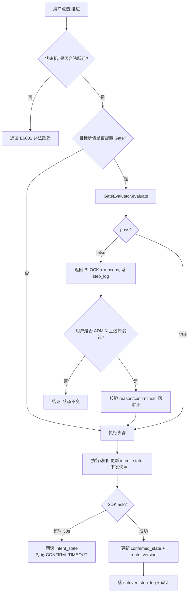

**注意 J1**：`intent` 写入后若外部 ack 超时，**必须回退 `intent`**，否则 `intent != confirmed` 会永久阻塞后续推进。这是"两段式"的配套动作，容易被漏掉。

---

## 5. 方言 SPI（必须钉死的接口）

### 5.1 `Dialect` 主接口（完整方法签名，15 个方法）

```java
package com.dbsync.dialect;

/**
 * 数据库方言 SPI。所有跨库 SQL 差异必须收敛到实现类内部，
 * 上层引擎（migration/cdc/compare/cutover）禁止出现任何库专属字面量。
 * 实现类必须无状态（可单例复用），不得持有 Connection。
 */
public interface Dialect {

    // ---------- 身份与连接 ----------
    DbType type();                                        // MYSQL/ORACLE/POSTGRESQL/DM/DB2
    String driverClassName();                             // 反射加载用的驱动类全名（见 §5.4）
    String buildJdbcUrl(JdbcEndpoint endpoint);           // host/port/database/schema/params → JDBC URL

    // ---------- 标识符 ----------
    String quote(String identifier);
    // MySQL: `x`；Oracle/PG/DM/DB2: "x"；实现需处理内部双引号转义（" → ""）
    String normalize(String identifier, IdentifierCase strategy);
    // PRESERVE: 原样返回（调用方负责加引号）；UPPER: toUpperCase(Locale.ROOT)；
    // LOWER: toLowerCase(Locale.ROOT)。注意：必须用 Locale.ROOT，禁止依赖默认 Locale（土耳其 i 问题）

    // ---------- 类型映射与 DDL ----------
    String mapType(ColumnMeta src, TypeMappingOptions opts);
    String createTableDdl(TableMeta table, MappingOptions opts);
    java.util.List<String> createIndexDdl(TableMeta table, MappingOptions opts);
    java.util.List<String> commentDdl(TableMeta table, MappingOptions opts);
    // commentDdl 返回 COMMENT ON TABLE/COLUMN 语句（PG/DM/Oracle/DB2）；
    // MySQL 返回空 list，因为 MySQL 的注释在 CREATE TABLE 内联（由 createTableDdl 负责）

    // ---------- SQL 片段生成 ----------
    String buildUpsertSql(TableMeta table, java.util.List<String> pkCols, java.util.List<String> cols);
    String buildPageSql(String baseSql, long offset, int limit);
    String buildRangePredicate(String quotedPkCol, boolean upperBoundInclusive);
    // 返回形如 "`id` <= ?" 或 "`id` < ?" 的片段。
    // 下界固定为 "quotedPkCol > ?"（左闭），通过 default 方法 buildLowerPredicate 提供：
    default String buildLowerPredicate(String quotedPkCol) { return quotedPkCol + " > ?"; }

    // ---------- 能力扩展 ----------
    MetadataReader metadata();
    TriggerDdlGenerator trigger();
    Capabilities capabilities();

    // ---------- 可选补充（default 实现，允许方言覆盖） ----------
    default String currentTimestampExpr() { return "CURRENT_TIMESTAMP"; }        // Oracle: SYSTIMESTAMP
    default String buildSelectByPkSql(TableMeta t, java.util.List<String> pkCols) {
        return "SELECT * FROM " + quote(t.getTableName()) + " WHERE "
             + pkCols.stream().map(c -> quote(c) + " = ?")
                      .collect(java.util.stream.Collectors.joining(" AND "));
    }
    default String buildCountSql(TableMeta t, String whereClause) {
        String sql = "SELECT COUNT(*) FROM " + quote(t.getTableName());
        return (whereClause == null || whereClause.isBlank()) ? sql : sql + " WHERE " + whereClause;
    }
    default boolean supportsNamedParameters() { return false; }
}
```

**方法数统计**：显式声明 15 个 + default 4 个 = **19 个契约点**，其中 5 个实现类各自必须实现的**方言相关方法**为 12 个（`type/driverClassName/buildJdbcUrl/quote/mapType/createTableDdl/createIndexDdl/commentDdl/buildUpsertSql/buildPageSql/buildRangePredicate` + 3 个工厂方法）。

### 5.2 `MetadataReader`（元数据读取 SPI）

```java
public interface MetadataReader {
    java.util.List<String> listSchemas(Connection c) throws SQLException;
    java.util.List<String> listTables(Connection c, String schema) throws SQLException;
    TableMeta loadTable(Connection c, String schema, String table) throws SQLException;
    // 必须一次填充：columns（含序号/类型/长度/精度/小数/可空/默认值/注释/自增/无符号）+ primaryKey + indexes
    java.util.List<ColumnMeta> loadColumns(Connection c, String schema, String table) throws SQLException;
    PrimaryKeyMeta loadPrimaryKey(Connection c, String schema, String table) throws SQLException;
    java.util.List<IndexMeta> loadIndexes(Connection c, String schema, String table) throws SQLException;
    // 必须包含唯一索引（unique=true），且按 index_name 聚合多列
    long estimateRows(Connection c, String schema, String table) throws SQLException;
    // 用统计信息（Oracle: all_tables.num_rows；PG: pg_class.reltuples；MySQL: information_schema.tables.table_rows；
    // DB2: SYSCAT.TABLES.CARD；DM: 同 Oracle）。失败时返回 -1，由调用方降级为抽样 COUNT。
}
```

**5 套系统视图 SQL 对照**（实现细节，写在此处避免工程师自己猜）：

| 能力 | MySQL 8.0 | Oracle 11g/19c | PostgreSQL 12+ | DM8 | DB2 LUW 11.5 |
|---|---|---|---|---|---|
| 表清单 | `information_schema.TABLES` (`TABLE_SCHEMA=?`) | `ALL_TABLES` (`OWNER=?`) | `pg_catalog.pg_tables` + `pg_class.reltuples` | `ALL_TABLES`（DM 兼容 Oracle 视图） | `SYSCAT.TABLES` (`TABSCHEMA=?`) |
| 列 | `information_schema.COLUMNS`（`COLUMN_TYPE` 含 `unsigned`） | `ALL_TAB_COLUMNS`（`DATA_TYPE/DATA_LENGTH/DATA_PRECISION/DATA_SCALE/CHAR_LENGTH`） | `information_schema.columns` + `pg_catalog.format_type(atttypid,atttypmod)` | `ALL_TAB_COLUMNS`（列名略有差异，需实测校准） | `SYSCAT.COLUMNS`（`TYPENAME/LENGTH/SCALE/NULLS/IDENTITY/HIDDEN`） |
| 主键 | `information_schema.KEY_COLUMN_USAGE` + `STATISTICS` | `ALL_CONSTRAINTS`(P) + `ALL_CONS_COLUMNS` | `pg_constraint`(contype='p') + `pg_attribute` | 同 Oracle | `SYSCAT.TABCONST` + `SYSCAT.KEYCOLUSE` |
| 唯一/普通索引 | `information_schema.STATISTICS`（`NON_UNIQUE=0` 为唯一） | `ALL_INDEXES` + `ALL_IND_COLUMNS`（`UNIQUENESS='UNIQUE'`） | `pg_index`(`indisunique`) + `pg_class` | 同 Oracle | `SYSCAT.INDEXES`(`UNIQUERULE`) + `SYSCAT.INDEXCOLUSE` |
| 注释 | `COLUMNS.COLUMN_COMMENT` / `TABLES.TABLE_COMMENT` | `ALL_COL_COMMENTS` / `ALL_TAB_COMMENTS` | `pg_description`（objoid/objsubid） | `ALL_COL_COMMENTS`（同 Oracle） | `SYSCAT.COLUMNS.REMARKS` / `SYSCAT.TABLES.REMARKS` |
| 自增/标识列 | `EXTRA='auto_increment'` | 无（用序列 + 触发器，读 `ALL_SEQUENCES` 可选） | `column_default` 含 `nextval` 或 `is_identity='YES'` | `ALL_TAB_COLUMNS.IDENTITY_COLUMN` | `SYSCAT.COLUMNS.IDENTITY='Y'` |

### 5.3 `TriggerDdlGenerator`（CDC 日志表 + 触发器 SPI）

```java
public interface TriggerDdlGenerator {
    String changeLogTableName(String baseTable);                  // 默认 baseTable + "_SYNC_LOG"（长度截断规则各方言不同）
    java.util.List<String> createChangeLogTableDdl(TableMeta t, TriggerOptions opts);
    java.util.List<String> createTriggerDdl(TableMeta t, TriggerOptions opts);   // INSERT/UPDATE/DELETE 各一条
    java.util.List<String> dropTriggerDdl(TableMeta t);           // 卸载（含日志表，可选保留）
    String pollSql(String quotedLogTable, long lastLogId, int batchSize);
}
```

**5 种库的触发器语法差异（这是 PRD CDC-02 的最大工作量，必须写清）**：

| 库 | 变量引用 | 语句体形态 | 关键坑 |
|---|---|---|---|
| MySQL | `NEW.col` / `OLD.col` | `CREATE TRIGGER x AFTER INSERT ON t FOR EACH ROW INSERT INTO log VALUES (...)` | ① 一个触发器只能挂一个事件，需 3 个触发器；② 无法在触发器里读 `commit` 时间，只能用 `NOW(3)`；③ `TEXT/BLOB` 字段无法直接插入日志表时需注意字符集 |
| Oracle 11g/19c | `:NEW.col` / `:OLD.col`（**带冒号**） | `CREATE OR REPLACE TRIGGER x AFTER INSERT ON t FOR EACH ROW BEGIN INSERT INTO log(...) VALUES (:NEW.id, ...); END;` | ① 必须 `FOR EACH ROW` 才是行级；② 冒号前缀是编译期语法，拼接时极易漏；③ 日志表需 `AUTONOMOUS_TRANSACTION` 否则业务回滚会连日志一起回滚（**本设计要求同事务，不用自治事务**，见下方说明） |
| PostgreSQL 12+ | `NEW.col` / `OLD.col` | 需要**函数 + 触发器**两段：`CREATE FUNCTION ... RETURNS trigger AS $$ BEGIN INSERT INTO log VALUES (NEW.id,...); RETURN NEW; END; $$ LANGUAGE plpgsql;` 再 `CREATE TRIGGER ... EXECUTE FUNCTION` | ① PG 11+ 用 `EXECUTE FUNCTION`（11 前是 `EXECUTE PROCEDURE`）；② `$$` 引用符与 Java 字符串拼接冲突；③ DELETE 需 `RETURN OLD` |
| DM8 | `:NEW.col` | 与 Oracle 近似（支持 `CREATE OR REPLACE TRIGGER ... BEGIN ... END;`） | ① DM 的 `INSTEAD OF` / `FOR EACH ROW` 支持需实测；② 部分版本不支持触发器内 `INSERT ... SELECT`，需统一用 `VALUES` |
| DB2 LUW 11.5 | `N.col`（**`REFERENCING NEW AS N`**） | `CREATE TRIGGER x AFTER INSERT ON t REFERENCING NEW AS N FOR EACH ROW MODE DB2SQL INSERT INTO log(...) VALUES (N.id, ...)` | ① 必须 `REFERENCING NEW AS N` 声明别名；② `MODE DB2SQL` 必需（复合语句）；③ 无 `BEGIN...END` 单语句时不需要；④ 日志表自增用 `GENERATED ALWAYS AS IDENTITY` 会影响 `seq` 获取 |

**关于"触发器日志表模式的事务语义"**（重要设计决策）：

- 触发器写入日志表**与业务 DML 在同一事务**（不使用 `AUTONOMOUS_TRANSACTION`）。这样日志的可见性 = 业务数据的可见性，天然保证"日志不丢、且不记录未提交的变更"。代价是业务事务变大（写放大），这正是 PRD §8.2 表格里"写放大 20~40%"的来源。
- 因此消费侧必须**只读已提交的日志**（默认隔离级别 READ COMMITTED 即可）。轮询用 `log_id > last` 且**不**使用 `SKIP LOCKED`（避免把未提交事务的日志行锁住）。

### 5.4 驱动加载（反射，禁止写进 pom）

```java
public final class JdbcDriverLoader {
    /** 幂等；失败抛 DriverMissingException(E7001)，消息里给出 4 类驱动名 + 加载方式 */
    public static void ensureLoaded(String driverClassName);
    public static boolean isAvailable(String driverClassName);
}
```

**驱动类名对照表**（必须原样写入 README 与错误消息）：

| DbType | 驱动类名 | Maven 坐标是否可得 | 部署方式 |
|---|---|---|---|
| MYSQL | `com.mysql.cj.jdbc.Driver` | ✅ 公共仓库（`com.mysql:mysql-connector-j`） | 写入 `pom.xml` |
| POSTGRESQL | `org.postgresql.Driver` | ✅ 公共仓库（`org.postgresql:postgresql`） | 写入 `pom.xml` |
| ORACLE | `oracle.jdbc.OracleDriver` | ❌ 需 Oracle 授权（`ojdbc8.jar`） | 放入 `lib/`，启动 `-Dloader.path=lib` |
| DM | `dm.jdbc.driver.DmDriver` | ❌ 需达梦授权（`DmJdbcDriver18.jar`） | 放入 `lib/`，同上 |
| DB2 | `com.ibm.db2.jcc.DB2Driver` | ❌ 需 IBM 授权（`jcc.jar`） | 放入 `lib/`，同上 |
| H2（仅测试） | `org.h2.Driver` | ✅ 公共仓库 | `pom.xml`（`test` + `runtime` scope，runtime 用于本地 demo） |

**错误消息模板**（`E7001 DriverMissing`）：

```
驱动缺失：com.ibm.db2.jcc.DB2Driver
该驱动未随包发布（授权限制）。请任选一种方式：
  1) 将 jcc.jar 放入 <APP_HOME>/lib/ 后重启（推荐，Spring Boot loader.path 已默认指向 lib/）
  2) java -Dloader.path=/opt/drivers -jar db-sync-server.jar
  3) 确认 pom 依赖中已加入对应坐标（仅 MySQL/PG/H2 可从公共仓库获取）
当前 classpath 中可用的 JDBC 驱动：com.mysql.cj.jdbc.Driver, org.postgresql.Driver, org.h2.Driver
```

**注意**：`Class.forName` 加载后必须 `DriverManager.getConnection` 而不是 `Driver.connect`，因为驱动会自注册到 `DriverManager`；且 `Class.forName` 的 `initialize=true` 会触发静态块（驱动注册就在这里）。Spring Boot 3.x 的 `spring.datasource.driver-class-name` 对动态数据源不适用（我们手动 `new HikariDataSource()` 并设置 `setDriverClassName`）。

### 5.5 `Capabilities`（能力声明）

```java
public record Capabilities(
    boolean supportsSkipLocked,        // 元数据库抢占用；见 §4.2.3
    boolean supportsMerge,             // Oracle/DM/DB2 = true
    boolean supportsOnConflict,        // PG = true
    boolean supportsOnDuplicateKey,    // MySQL = true
    boolean supportsIdentityInsert,    // DB2 SET IDENTITY_INSERT / PG OVERRIDING SYSTEM VALUE / MySQL 直接插
    boolean supportsIdentityRestart,   // 迁移后重设自增起点
    boolean needsFetchSizeCursor,      // Oracle: 必须 setFetchSize 且 autocommit=false 才走游标（否则全量拉内存）
    boolean supportsCommentOn,         // PG/DM/Oracle/DB2 = true，MySQL = false
    boolean supportsMultiRowValues,    // INSERT INTO t VALUES (...),(...)；Oracle 11g = false
    boolean supportsBatchGeneratedKeys,
    boolean supportsStreamingBlob,
    boolean caseSensitiveIdentifiers,  // DM 的 CASE_SENSITIVE 参数相关
    int maxIdentifierLength,           // Oracle 30(11g)/128(12c+)，MySQL 64，PG 63，DB2 128，DM 128
    int recommendedBatchSize,          // MySQL 1000 / Oracle 500 / PG 1000 / DM 500 / DB2 500
    String defaultSchemaExpression      // MySQL: DATABASE()；Oracle/DM: SYS_CONTEXT('USERENV','CURRENT_SCHEMA')；PG: current_schema()；DB2: CURRENT SCHEMA
) {}
```

**为什么用 record 而不是 enum 或 Map**：能力是"编译期就可判定的常量组合"，用 record 让 IDE 能补全、让单测能逐一断言、避免 `Map<String,Boolean>` 的字符串魔法。

**`needsFetchSizeCursor` 的实际处理**（H2 的关键坑，写在这里避免工程师踩）：

- Oracle：`stmt.setFetchSize(n)` 只在 `Connection.setAutoCommit(false)` 时生效为**游标**（服务器端分页）；`autocommit=true` 时 fetchSize 被忽略，驱动会把整个结果集拉进内存 → 8 亿行表必 OOM。因此 `JdbcReader` 对 Oracle 强制 `autoCommit=false`。
- MySQL：必须 `stmt = conn.prepareStatement(sql, ResultSet.TYPE_FORWARD_ONLY, ResultSet.CONCUR_READ_ONLY)` + `stmt.setFetchSize(Integer.MIN_VALUE)` 才是流式（否则全量读）。这是 MySQL Connector/J 的特殊约定，**必须记住**。
- PostgreSQL：`conn.setAutoCommit(false)` + `stmt.setFetchSize(n)`（n>0）走游标；autocommit=true 时全量读。
- DB2 / DM：`setFetchSize` 正常生效。

---

## 6. 领域模型与类图

### 6.1 方言 SPI 继承关系（完整）

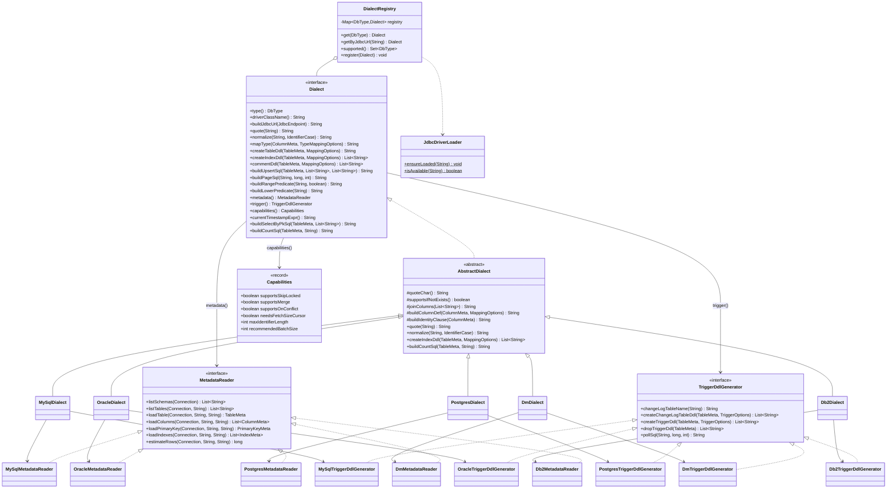

### 6.2 核心引擎类关系

```mermaid
classDiagram
    direction TB

    class DataSourceRegistry {
        -Map~Long,HikariDataSource~ pools
        +handle(long) DataSourceHandle
        +register(DataSourceDef) DataSourceHandle
        +evict(long) void
        +closeAll() void
    }
    class DataSourceHandle {
        +id() long
        +dialect() Dialect
        +connection() Connection
        +withConnection(Function) T
        +test() ConnectionTestResult
    }
    class ConnectionTester {
        +test(DataSourceDef) ConnectionTestResult
        -classify(SQLException) ErrorCode
    }

    class ShardPlanner {
        +plan(TableMeta, ShardPlanOptions, Connection) ShardPlan
    }
    class PkSampler {
        +min(Connection, TableMeta) Object
        +max(Connection, TableMeta) Object
        +isNumeric(ColumnMeta) boolean
    }
    class JdbcReader {
        +read(DataSourceHandle, TableMeta, PkRange, ReadOptions, RowCallback) long
        -streaming(Connection, String, int) ResultSet
    }
    class JdbcBatchWriter {
        +upsert(DataSourceHandle, TableMeta, List~Row~, WriteOptions) WriteResult
        +insert(DataSourceHandle, TableMeta, List~Row~, WriteOptions) WriteResult
    }
    class CheckpointStore {
        +load(long taskId, ScopeType, int scopeNo) Checkpoint
        +save(Checkpoint) void
        +saveInTx(Connection, Checkpoint) void
    }
    class ShardLeaseManager {
        -ShardClaimStrategy strategy
        +claim(long taskId, String owner, Duration lease) Optional~Shard~
        +renew(long shardId, String owner, Duration lease) boolean
        +release(long shardId, String owner) void
        +takeOverExpired(long taskId, String owner) int
        +assertHeld(long shardId, String owner) void
    }
    class ShardClaimStrategy {
        <<interface>>
        +claimOne(long, String, Duration) Optional~Shard~
    }
    class SkipLockedClaimStrategy
    class NoWaitProbeClaimStrategy
    class OptimisticCasClaimStrategy

    class Throttle {
        -RateLimiter readLimiter
        -RateLimiter writeLimiter
        +acquireRows(int) void
        +acquireWriteRows(int) void
        +updateLimits(long, long) void
    }
    class NamedThreadPoolManager {
        +forTask(long, int) ExecutorService
        +shutdown(long) void
        +shutdownAll(Duration) void
    }

    class MigrationEngine {
        +start(long taskId) void
        +pause(long taskId) void
        +resume(long taskId) void
        +cancel(long taskId) void
        +recover(long taskId) void
    }
    class ShardDispatcher {
        +dispatchLoop() void
        +stopAccepting() void
    }
    class ShardWorker {
        +run(Shard, LeaseHandle) ShardOutcome
    }

    class ChangeQueue {
        +enqueue(ChangeEvent) void
        +pollBatch(long, int groupNo, int limit) List~ChangeEvent~
        +markApplied(List~Long~, long) void
        +markDead(long, String) void
    }
    class GroupAssigner {
        +groupOf(List~Object~, int) int
    }
    class ChangeConsumer {
        +start(long taskId) void
        +stop(long taskId) void
    }
    class GroupWorker {
        +loop() void
    }
    class ConflictResolver {
        +resolve(ChangeEvent, Row) ConflictDecision
    }
    class UpsertApplier {
        +apply(DataSourceHandle, TableMeta, ChangeEvent) ApplyResult
    }
    class WatermarkStore {
        +current(long, int) Watermark
        +advance(long, int, CommitSequence) void
        +latencyP95(long) long
    }

    class CompareEngine {
        +run(CompareJob) CompareResult
    }
    class BlockPlanner {
        +plan(TableMeta, int blockRows) List~PkRange~
    }
    class ChecksumCalculator {
        +checksum(DataSourceHandle, TableMeta, PkRange) BlockChecksum
    }
    class Normalizer {
        +normalize(Object, ColumnMeta) Object
        +hashRow(Row, List~ColumnMeta~) String
    }
    class RowDiffer {
        +diff(DataSourceHandle, DataSourceHandle, TableMeta, PkRange) List~DiffRecord~
    }
    class DiffRepairer {
        +replayToTarget(List~DiffRecord~) RepairResult
        +fixToSource(List~DiffRecord~, String reason) RepairResult
    }

    class CutoverStateMachine {
        +canTransition(CutoverState, CutoverState) boolean
        +assertTransition(CutoverState, CutoverState) void
    }
    class CutoverOrchestrator {
        +advance(long planId, GateResult) void
        +rollback(long planId, String reason) void
        +dryRun(long planId) DryRunReport
    }
    class GateEvaluator {
        +evaluate(long planId) GateResult
    }
    class RouteRuleEngine {
        +resolve(List~RouteRule~, Object pk) RouteTarget
        +fallbackToSource() RouteRule
    }
    class RouteRegistry {
        +publish(RouteSnapshot) long
        +current(long planId) RouteSnapshot
        +ack(long planId, long version) void
    }
    class CutoverRecoveryService {
        +reconcileAll() List~ReconcileResult~
    }

    class IncrementalMetricsPort {
        <<interface>>
        +latencyP95(long taskId) long
        +backlog(long taskId) long
        +failRate(long taskId, Duration window) double
    }
    class CompareVerdictPort {
        <<interface>>
        +latestVerdict(long taskId) Optional~CompareResult~
    }

    DataSourceRegistry o-- DataSourceHandle
    DataSourceHandle --> Dialect
    DataSourceRegistry ..> ConnectionTester

    ShardPlanner ..> PkSampler
    ShardWorker --> JdbcReader
    ShardWorker --> JdbcBatchWriter
    ShardWorker --> CheckpointStore
    ShardWorker --> ShardLeaseManager
    ShardWorker --> Throttle
    MigrationEngine --> ShardDispatcher
    ShardDispatcher --> ShardLeaseManager
    ShardDispatcher --> NamedThreadPoolManager
    ShardDispatcher --> ShardWorker
    ShardLeaseManager --> ShardClaimStrategy
    ShardClaimStrategy <|.. SkipLockedClaimStrategy
    ShardClaimStrategy <|.. NoWaitProbeClaimStrategy
    ShardClaimStrategy <|.. OptimisticCasClaimStrategy

    GroupWorker --> ChangeQueue
    GroupWorker --> ConflictResolver
    GroupWorker --> UpsertApplier
    GroupWorker --> WatermarkStore
    ChangeConsumer --> GroupWorker
    ChangeConsumer --> GroupAssigner
    ChangeQueue ..> ChangeEvent

    CompareEngine --> BlockPlanner
    CompareEngine --> ChecksumCalculator
    CompareEngine --> RowDiffer
    CompareEngine --> DiffRepairer
    ChecksumCalculator --> Normalizer
    RowDiffer --> Normalizer

    CutoverOrchestrator --> CutoverStateMachine
    CutoverOrchestrator --> GateEvaluator
    CutoverOrchestrator --> RouteRegistry
    RouteRegistry --> RouteRuleEngine
    CutoverRecoveryService --> RouteRegistry
    GateEvaluator ..> IncrementalMetricsPort
    GateEvaluator ..> CompareVerdictPort
    ChangeConsumer ..|> IncrementalMetricsPort : 实现(在cdc)
    CompareEngine ..|> CompareVerdictPort : 实现(在compare)
```

**类图的两条硬约束**（评审重点）：

1. `MigrationEngine` 与 `ChangeConsumer` **不直接依赖** `DataSourceRegistry` 的具体实现，只依赖 `DataSourceHandle`；这样单元测试可以注入 mock handle。
2. `GateEvaluator` 只依赖两个 Port 接口，**不 import** `cdc` / `compare` 的任何类。这条保证了模块图无环，也保证了 `cutover` 的 Gate 可以用假数据单测（这是最需要单测的模块，因为它决定"能不能切"）。

## 7. 元数据库设计（MySQL 8.0 方言，Flyway `V1__init.sql`）

### 7.1 设计约定

| 约定 | 内容 |
|---|---|
| 主键 | `BIGINT NOT NULL`，由 `SnowflakeId` 生成（不用 `AUTO_INCREMENT`，避免跨库迁移与批量插入的往返） |
| 时间 | `DATETIME(3)` 毫秒精度，全部存 UTC（应用层负责转换；PRD §7.3 要求） |
| 布尔 | `TINYINT(1)`，0/1 |
| JSON | `JSON` 类型（MySQL 8 原生）；H2 兼容模式下用 `VARCHAR(4000)` + 应用层序列化，Flyway 用 `database` 占位或双脚本（见 §7.3 H2 兼容策略） |
| 字符集 | `utf8mb4` / `utf8mb4_0900_ai_ci` |
| 表名前缀 | `ds_` 数据源 / `sync_` 同步 / `cutover_` 切流 / `sys_` 系统 |
| 软删除 | 仅 `ds_datasource` / `sync_task` 用 `deleted_at`（因为被历史记录引用，物理删除会破坏审计）；其余表硬删除 |
| 乐观锁 | 需要并发改的表都有 `version INT NOT NULL DEFAULT 0` |

### 7.2 完整 DDL

```sql
-- ============================================================================
-- V1__init.sql  元数据库初始化（MySQL 8.0）
-- 共 18 张表：
--   数据源/任务      4 张：ds_datasource, sync_task, sync_table_mapping, sync_column_mapping
--   存量迁移         2 张：sync_shard, sync_checkpoint
--   增量             3 张：sync_change_log, sync_change_watermark, sync_trigger_def
--   死信             1 张：sync_dead_letter
--   比对             3 张：sync_compare_job, sync_compare_block, sync_compare_diff
--   切流             2 张：cutover_plan, cutover_step_log
--   系统             3 张：sys_user, sys_audit_log, sys_instance
-- ============================================================================

-- ---------------------------------------------------------------------------
-- 1. ds_datasource  数据源
-- ---------------------------------------------------------------------------
CREATE TABLE ds_datasource (
  id                BIGINT       NOT NULL COMMENT '主键(Snowflake)',
  name              VARCHAR(64)  NOT NULL COMMENT '数据源名称，全局唯一',
  db_type           VARCHAR(16)  NOT NULL COMMENT 'MYSQL/ORACLE/POSTGRESQL/DM/DB2',
  env               VARCHAR(8)   NOT NULL DEFAULT 'UAT' COMMENT 'PROD/UAT/DEV',
  host              VARCHAR(128) NOT NULL,
  port              INT          NOT NULL,
  database_name     VARCHAR(128)          DEFAULT NULL COMMENT 'MySQL 的 database / Oracle 的 SID 或 service / PG 的 db',
  schema_name       VARCHAR(128)          DEFAULT NULL COMMENT '默认 schema',
  username          VARCHAR(128) NOT NULL,
  password_cipher   VARCHAR(512) NOT NULL COMMENT 'AES-256-GCM 密文(Base64)，永不出库明文',
  key_version       SMALLINT     NOT NULL DEFAULT 1 COMMENT '主密钥版本，支持轮换',
  jdbc_params       VARCHAR(1024)         DEFAULT NULL COMMENT '追加参数(SSL/字符集等)，透传',
  identifier_case   VARCHAR(16)  NOT NULL DEFAULT 'LOWER' COMMENT 'PRESERVE/UPPER/LOWER',
  pool_max_size     INT          NOT NULL DEFAULT 8,
  pool_min_idle     INT          NOT NULL DEFAULT 2,
  conn_timeout_ms   INT          NOT NULL DEFAULT 10000,
  fetch_size        INT          NOT NULL DEFAULT 1000,
  health_status     VARCHAR(16)  NOT NULL DEFAULT 'UNKNOWN' COMMENT 'UP/DOWN/SLOW/UNKNOWN',
  last_probe_at     DATETIME(3)           DEFAULT NULL,
  last_probe_error  VARCHAR(512)          DEFAULT NULL,
  version           INT          NOT NULL DEFAULT 0,
  created_by        VARCHAR(64)           DEFAULT NULL,
  created_at        DATETIME(3)  NOT NULL,
  updated_at        DATETIME(3)  NOT NULL,
  deleted_at        DATETIME(3)           DEFAULT NULL,
  PRIMARY KEY (id),
  UNIQUE KEY uk_ds_name (name),
  KEY idx_ds_type_env (db_type, env),
  KEY idx_ds_health (health_status, last_probe_at)
) ENGINE=InnoDB DEFAULT CHARSET=utf8mb4 COMMENT='数据源定义';
```
**索引理由**：`uk_ds_name` 防重名（DS-01 的"名称唯一"）；`idx_ds_type_env` 支撑列表页的"按类型/环境筛选"（PRD §9.1 筛选栏）；`idx_ds_health` 支撑巡检任务只扫"需要探活"的行（DS-05）。

```sql
-- ---------------------------------------------------------------------------
-- 2. sync_task  同步任务（聚合根）
-- ---------------------------------------------------------------------------
CREATE TABLE sync_task (
  id                  BIGINT       NOT NULL,
  name                VARCHAR(128) NOT NULL,
  description         VARCHAR(512)          DEFAULT NULL,
  source_ds_id        BIGINT       NOT NULL,
  target_ds_id        BIGINT       NOT NULL,
  state               VARCHAR(16)  NOT NULL DEFAULT 'DRAFT'
                      COMMENT 'DRAFT/READY/RUNNING/PAUSED/FAILED/FINISHED/ARCHIVED',
  phase               VARCHAR(16)  NOT NULL DEFAULT 'MIGRATION'
                      COMMENT '当前阶段: MIGRATION/INCREMENTAL/COMPARE/CUTOVER',
  -- 迁移参数
  concurrency         INT          NOT NULL DEFAULT 4,
  batch_size          INT          NOT NULL DEFAULT 1000,
  shard_rows          INT          NOT NULL DEFAULT 2000000 COMMENT '每分片目标行数',
  rate_limit_rows     BIGINT       NOT NULL DEFAULT 0 COMMENT '0=不限速',
  write_rate_limit    BIGINT       NOT NULL DEFAULT 0,
  max_retry           INT          NOT NULL DEFAULT 3,
  -- 增量参数
  incremental_mode    VARCHAR(24)  NOT NULL DEFAULT 'TRIGGER_LOG'
                      COMMENT 'SDK_WRITE/TRIGGER_LOG/TIMESTAMP_VERSION',
  group_count         INT          NOT NULL DEFAULT 16 COMMENT '保序分组数，创建后只读(见§4.3.2)',
  consumer_concurrency INT         NOT NULL DEFAULT 8,
  poll_interval_ms    INT          NOT NULL DEFAULT 5000,
  conflict_policy     VARCHAR(24)  NOT NULL DEFAULT 'SOURCE_WINS',
  -- 比对参数
  compare_block_rows  INT          NOT NULL DEFAULT 100000,
  compare_parallelism INT          NOT NULL DEFAULT 8,
  compare_pass_threshold DECIMAL(9,6) NOT NULL DEFAULT 0.999900 COMMENT 'PASS 阈值 99.99%',
  normalize_json      JSON                  DEFAULT NULL COMMENT '归一化规则快照(§4.4)',
  -- 切流 Gate 阈值(冗余存一份，plan 可覆盖)
  gate_compare_pass   DECIMAL(9,6) NOT NULL DEFAULT 0.999900,
  gate_lag_p95_ms     BIGINT       NOT NULL DEFAULT 5000,
  gate_fail_rate      DECIMAL(9,6) NOT NULL DEFAULT 0.000100,
  -- 运行时
  started_at          DATETIME(3)           DEFAULT NULL,
  finished_at         DATETIME(3)           DEFAULT NULL,
  paused_at           DATETIME(3)           DEFAULT NULL,
  last_error          VARCHAR(1000)         DEFAULT NULL,
  version             INT          NOT NULL DEFAULT 0,
  created_by          VARCHAR(64)           DEFAULT NULL,
  created_at          DATETIME(3)  NOT NULL,
  updated_at          DATETIME(3)  NOT NULL,
  deleted_at          DATETIME(3)           DEFAULT NULL,
  PRIMARY KEY (id),
  KEY idx_task_state (state, updated_at),
  KEY idx_task_ds (source_ds_id, target_ds_id)
) ENGINE=InnoDB DEFAULT CHARSET=utf8mb4 COMMENT='同步任务';
```
**索引理由**：`idx_task_state` 是"运行中任务列表"与"实例启动时恢复任务"的驱动索引，按 `(state, updated_at)` 让"最近有变化的任务"优先被扫到。

```sql
-- ---------------------------------------------------------------------------
-- 3. sync_table_mapping  表映射（结构映射 + 风险标记）
-- ---------------------------------------------------------------------------
CREATE TABLE sync_table_mapping (
  id                BIGINT       NOT NULL,
  task_id           BIGINT       NOT NULL,
  source_schema     VARCHAR(128) NOT NULL,
  source_table      VARCHAR(128) NOT NULL,
  target_schema     VARCHAR(128)          DEFAULT NULL,
  target_table      VARCHAR(128) NOT NULL,
  source_pk_json    JSON                  DEFAULT NULL COMMENT '主键列名数组（读元数据后填充）',
  target_pk_json    JSON                  DEFAULT NULL,
  row_count_estimate BIGINT      NOT NULL DEFAULT -1 COMMENT '源端估算行数，-1=未知',
  has_primary_key   TINYINT(1)   NOT NULL DEFAULT 1,
  range_kind        VARCHAR(8)   NOT NULL DEFAULT 'NUMERIC' COMMENT 'NUMERIC/STRING/HASH/NONE',
  generated_ddl     MEDIUMTEXT            DEFAULT NULL COMMENT '生成的目标端 DDL（预览/导出用）',
  risk_tags         JSON                  DEFAULT NULL COMMENT '["NUMBER_PRECISION","EMPTY_AS_NULL_RISK","NO_PK"]',
  ddl_applied       TINYINT(1)   NOT NULL DEFAULT 0,
  enabled           TINYINT(1)   NOT NULL DEFAULT 1,
  version           INT          NOT NULL DEFAULT 0,
  created_at        DATETIME(3)  NOT NULL,
  updated_at        DATETIME(3)  NOT NULL,
  PRIMARY KEY (id),
  UNIQUE KEY uk_map (task_id, source_schema, source_table),
  KEY idx_map_task (task_id, enabled)
) ENGINE=InnoDB DEFAULT CHARSET=utf8mb4 COMMENT='表映射';
```

```sql
-- ---------------------------------------------------------------------------
-- 4. sync_column_mapping  列映射（含人工覆盖与忽略规则）
-- ---------------------------------------------------------------------------
CREATE TABLE sync_column_mapping (
  id                BIGINT       NOT NULL,
  table_mapping_id  BIGINT       NOT NULL,
  source_column     VARCHAR(128) NOT NULL,
  target_column     VARCHAR(128) NOT NULL,
  source_type       VARCHAR(64)  NOT NULL COMMENT '源端原始类型串，如 NUMBER(19,0)',
  target_type       VARCHAR(64)  NOT NULL COMMENT '映射后目标类型',
  mapped_type       VARCHAR(64)           DEFAULT NULL COMMENT '人工覆盖后的类型（优先于 target_type）',
  override_by       VARCHAR(64)           DEFAULT NULL COMMENT '覆盖人（MAP-01 要求记录）',
  override_reason   VARCHAR(512)          DEFAULT NULL,
  nullable          TINYINT(1)   NOT NULL DEFAULT 1,
  is_primary_key    TINYINT(1)   NOT NULL DEFAULT 0,
  is_auto_increment TINYINT(1)   NOT NULL DEFAULT 0,
  risk_tag          VARCHAR(64)           DEFAULT NULL COMMENT 'DIRECT/DEGRADE/PRECISION_LOSS/DROP',
  ignore_rules      JSON                  DEFAULT NULL COMMENT '本列归一化覆盖(§4.4)',
  ordinal           INT          NOT NULL DEFAULT 0,
  created_at        DATETIME(3)  NOT NULL,
  PRIMARY KEY (id),
  UNIQUE KEY uk_colmap (table_mapping_id, source_column),
  KEY idx_colmap_table (table_mapping_id, ordinal)
) ENGINE=InnoDB DEFAULT CHARSET=utf8mb4 COMMENT='列映射';
```

```sql
-- ---------------------------------------------------------------------------
-- 5. sync_shard  分片（存量迁移的最小调度/断点单位）★ 核心表
-- ---------------------------------------------------------------------------
CREATE TABLE sync_shard (
  id                BIGINT       NOT NULL,
  task_id           BIGINT       NOT NULL,
  table_mapping_id  BIGINT       NOT NULL,
  shard_no          INT          NOT NULL COMMENT '任务内全局序号，决定抢占顺序',
  range_kind        VARCHAR(8)   NOT NULL DEFAULT 'NUMERIC',
  pk_start          VARCHAR(512)          DEFAULT NULL COMMENT '区间下界(含)，统一字符串存储，读取时按类型解析',
  pk_end            VARCHAR(512)          DEFAULT NULL COMMENT '区间上界(不含)',
  state             VARCHAR(16)  NOT NULL DEFAULT 'PENDING'
                    COMMENT 'PENDING/CLAIMED/RUNNING/SUCCESS/FAILED/DEAD/PAUSED',
  -- 租约
  lease_owner       VARCHAR(96)           DEFAULT NULL COMMENT '实例ID: host:port#uuid',
  lease_expire_at   DATETIME(3)           DEFAULT NULL,
  heartbeat_at      DATETIME(3)           DEFAULT NULL,
  -- 进度
  last_pk           VARCHAR(512)          DEFAULT NULL COMMENT '已提交的最后主键（checkpoint 冗余，便于大盘直读）',
  committed_rows    BIGINT       NOT NULL DEFAULT 0,
  source_rows       BIGINT       NOT NULL DEFAULT -1 COMMENT '分片完成后回填的源端行数（核数用）',
  -- 重试
  attempt           INT          NOT NULL DEFAULT 0,
  last_error        VARCHAR(1000)         DEFAULT NULL,
  -- 时间
  started_at        DATETIME(3)           DEFAULT NULL,
  finished_at       DATETIME(3)           DEFAULT NULL,
  version           INT          NOT NULL DEFAULT 0,
  created_at        DATETIME(3)  NOT NULL,
  updated_at        DATETIME(3)  NOT NULL,
  PRIMARY KEY (id),
  UNIQUE KEY uk_shard (task_id, shard_no) COMMENT '★防双跑最后防线(§4.2.1 L3)',
  KEY idx_claim (task_id, state, shard_no) COMMENT '★抢占扫描(§4.2.2)',
  KEY idx_lease (state, lease_expire_at) COMMENT '★过期租约回收(LeaseReaperJob)',
  KEY idx_shard_table (table_mapping_id, state)
) ENGINE=InnoDB DEFAULT CHARSET=utf8mb4 COMMENT='存量迁移分片';
```
**索引理由（三条都是关键路径）**：
- `uk_shard (task_id, shard_no)`：① 防"同一分片被两个实例插入"（虽然分片只在规划时一次性插入，但重跑/重规划可能触发）；② 提供 `(task_id, shard_no)` 的天然聚簇顺序 → `ORDER BY shard_no` 的抢占查询无需 filesort。**这条唯一约束是 §4.2 的 L3 层，任何"为了跑得快先去掉约束"的改动都是严重违规。**
- `idx_claim (task_id, state, shard_no)`：抢占查询的 `WHERE task_id=? AND state IN (...)` + `ORDER BY shard_no LIMIT 1`。若缺少它，抢占会退化为全表扫描 + 排序，在 400 分片 × 50 任务的场景下每次抢占 > 50ms，4 并发 × 2s 轮询就会把元数据库打满。
- `idx_lease (state, lease_expire_at)`：`LeaseReaperJob` 每 10s 扫一次"过期租约"，只扫 `state IN ('CLAIMED','RUNNING')` 的行。这个索引让扫描量恒定（与实际分片总数无关）。
- **为什么把 `last_pk` 冗余在 `sync_shard` 而不只放 `sync_checkpoint`**：大盘要展示"每个分片当前到哪了"（PRD §9.3 热力图），若每次都要 join `sync_checkpoint` 会在大盘轮询（5s 一次）下产生大量 join；冗余后大盘是单表查询。一致性由"两者在同一事务内更新"保证。

```sql
-- ---------------------------------------------------------------------------
-- 6. sync_checkpoint  断点（统一承载存量 SHARD / 增量 GROUP / 轮询 POLLER）
-- ---------------------------------------------------------------------------
CREATE TABLE sync_checkpoint (
  id                BIGINT       NOT NULL,
  task_id           BIGINT       NOT NULL,
  table_mapping_id  BIGINT       NOT NULL DEFAULT 0 COMMENT '0=任务级(增量通道级)',
  scope_type        VARCHAR(12)  NOT NULL COMMENT 'SHARD/GROUP/POLLER',
  scope_no          INT          NOT NULL COMMENT '分片号/组号/轮询器号',
  last_pk           VARCHAR(512)          DEFAULT NULL COMMENT '存量：最后主键',
  last_commit_ts    DATETIME(3)           DEFAULT NULL COMMENT '增量：最后提交时间',
  last_seq          BIGINT                DEFAULT NULL COMMENT '增量：最后序号',
  last_log_id       BIGINT                DEFAULT NULL COMMENT '触发器模式：最后日志ID',
  committed_rows    BIGINT       NOT NULL DEFAULT 0,
  committed_batches BIGINT       NOT NULL DEFAULT 0,
  version           INT          NOT NULL DEFAULT 0,
  updated_at        DATETIME(3)  NOT NULL,
  PRIMARY KEY (id),
  UNIQUE KEY uk_ckpt (task_id, table_mapping_id, scope_type, scope_no)
) ENGINE=InnoDB DEFAULT CHARSET=utf8mb4 COMMENT='断点/水位线';
```
**为什么统一一张表**：三种 scope 的字段并集只有 6 个可空列，统一后 DAO 只需一个 `CheckpointDao`，且"任务内所有断点"可以用一条 `WHERE task_id=?` 查出（重启恢复时正需要）。若拆三张表，恢复逻辑要写三遍。

```sql
-- ---------------------------------------------------------------------------
-- 7. sync_change_log  变更队列 ★ 核心表（写放大最严重，索引最讲究）
-- ---------------------------------------------------------------------------
CREATE TABLE sync_change_log (
  id                BIGINT       NOT NULL COMMENT 'Snowflake，仅作物理主键',
  task_id           BIGINT       NOT NULL,
  table_mapping_id  BIGINT       NOT NULL,
  group_no          INT          NOT NULL COMMENT 'hash(pk)%groupCount，保序分组(§4.3)',
  pk_hash           BIGINT       NOT NULL COMMENT 'FNV-1a 64 位主键哈希',
  seq               BIGINT       NOT NULL COMMENT '组内单调序号（来源见§4.3.5）',
  commit_ts         DATETIME(3)  NOT NULL COMMENT '源库提交时间(延迟计算基准)',
  op                VARCHAR(8)   NOT NULL COMMENT 'INSERT/UPDATE/DELETE',
  pk_json           VARCHAR(2048) NOT NULL COMMENT '主键列值(JSON)，用于定位目标行',
  before_json       MEDIUMTEXT            DEFAULT NULL COMMENT '前像(仅 UPDATE/DELETE，按需)',
  after_json        MEDIUMTEXT            DEFAULT NULL COMMENT '后像(INSERT/UPDATE)',
  changed_columns   VARCHAR(2048)         DEFAULT NULL COMMENT '变更列名列表(可选优化)',
  status            VARCHAR(12)  NOT NULL DEFAULT 'NEW' COMMENT 'NEW/APPLIED/SKIPPED/FAILED/DEAD',
  retry             INT          NOT NULL DEFAULT 0,
  error_msg         VARCHAR(1000)         DEFAULT NULL,
  conflict_action   VARCHAR(24)           DEFAULT NULL COMMENT '被冲突策略忽略时记录原因(CDC-06)',
  source_instance   VARCHAR(96)           DEFAULT NULL COMMENT '来源实例(多业务实例时溯源)',
  trace_id          VARCHAR(64)           DEFAULT NULL,
  applied_at        DATETIME(3)           DEFAULT NULL,
  created_at        DATETIME(3)  NOT NULL,
  PRIMARY KEY (id),
  KEY idx_consume (task_id, group_no, status, seq) COMMENT '★消费主路径(§4.3.3)',
  KEY idx_trace (task_id, table_mapping_id, pk_hash, seq) COMMENT '★变更追溯(CDC-08)',
  KEY idx_lag (task_id, status, commit_ts) COMMENT '★延迟/积压统计',
  KEY idx_reap (status, created_at) COMMENT '★已应用行归档/清理'
) ENGINE=InnoDB DEFAULT CHARSET=utf8mb4 COMMENT='增量变更队列';
```
**索引理由（这张表是性能核心，值得逐条解释）**：
- `idx_consume (task_id, group_no, status, seq)`：消费者的唯一查询是 `WHERE task_id=? AND group_no=? AND status='NEW' ORDER BY seq LIMIT 500`。这四列的顺序让查询变成**纯索引区间扫描**：前两列等值 → 第三列等值 → 第四列天然有序（InnoDB 二级索引尾部隐含主键 `id`，故实际为 `(task_id, group_no, status, seq, id)`）。若把 `seq` 提到第二位，`status='NEW'` 的过滤会退化，必须回表 + filesort；在积压 10 万条时 P95 延迟会从 200ms 涨到 2s 以上。
- **为什么 `status` 在 `seq` 前面**：因为"已 APPLIED 的历史行"会持续累积（一个 2000 TPS 的源库一天产生 1.7 亿行），如果 `status` 不在索引前缀里，扫描必须穿过所有历史行才能找到 `NEW`。放在前缀后，`status='NEW'` 形成一个**很窄的索引段**，只扫那几百行。
- `idx_trace (task_id, table_mapping_id, pk_hash, seq)`：CDC-08 要求"按主键查出该行最近 20 条变更轨迹"，查询为 `WHERE task_id=? AND table_mapping_id=? AND pk_hash=? ORDER BY seq DESC LIMIT 20`。这个索引让追溯是 O(log n + 20)。
- `idx_lag (task_id, status, commit_ts)`：延迟计算 `MIN(commit_ts) WHERE status='NEW'` 与死信/失败率统计走这里。**注意**：`MIN(commit_ts)` 在有 `status='NEW'` 前缀的情况下是索引首行读取，O(1)。
- `idx_reap (status, created_at)`：定时任务把 `status='APPLIED'` 且 `created_at < now-7d` 的行归档到 `sync_change_log_hist`（或用 `PARTITION BY RANGE (TO_DAYS(created_at))` 分区表 + `DROP PARTITION`）。**必须有清理机制**，否则这张表一个月后就是几亿行，索引维护成本会拖垮整个元数据库。
- **是否用分区**：建议 `PARTITION BY RANGE (TO_DAYS(created_at))`，每分区一天。理由：归档用 `ALTER TABLE ... DROP PARTITION` 是 O(1)（`DELETE` 是 O(n) 且产生大量 undo）。代价是分区键必须进主键（`PRIMARY KEY (id, created_at)`）。本期作为可选优化（P1），默认先不分区，但表结构预留。

```sql
-- ---------------------------------------------------------------------------
-- 8. sync_change_watermark  组水位线（运行支撑表）
-- ---------------------------------------------------------------------------
CREATE TABLE sync_change_watermark (
  id                BIGINT       NOT NULL,
  task_id           BIGINT       NOT NULL,
  group_no          INT          NOT NULL,
  consumer_owner    VARCHAR(96)           DEFAULT NULL COMMENT '当前消费该组的实例(组独占)',
  owner_expire_at   DATETIME(3)           DEFAULT NULL,
  safe_seq          BIGINT       NOT NULL DEFAULT 0 COMMENT '连续前缀水位(不是最大值! §4.3.4)',
  safe_commit_ts    DATETIME(3)           DEFAULT NULL,
  lag_ms            BIGINT       NOT NULL DEFAULT 0 COMMENT '当前延迟(冗余，便于大盘)',
  version           INT          NOT NULL DEFAULT 0,
  updated_at        DATETIME(3)  NOT NULL,
  PRIMARY KEY (id),
  UNIQUE KEY uk_wm (task_id, group_no),
  KEY idx_wm_owner (owner_expire_at)
) ENGINE=InnoDB DEFAULT CHARSET=utf8mb4 COMMENT='增量组水位线';
```
**为什么单独一张表而不复用 `sync_checkpoint`**：因为组水位需要 `consumer_owner` + `owner_expire_at`（组独占消费，类似分片租约），而 `sync_checkpoint` 是纯断点。混在一起会让 `CheckpointStore.save()` 的语义变模糊。**两个概念两个表，是一致性原则的体现。**

```sql
-- ---------------------------------------------------------------------------
-- 9. sync_dead_letter  死信
-- ---------------------------------------------------------------------------
CREATE TABLE sync_dead_letter (
  id                BIGINT       NOT NULL,
  task_id           BIGINT       NOT NULL,
  table_mapping_id  BIGINT                DEFAULT NULL,
  source_type       VARCHAR(16)  NOT NULL COMMENT 'SHARD/CHANGE/COMPARE_REPAIR',
  ref_id            BIGINT                DEFAULT NULL COMMENT '分片ID / 变更ID',
  pk_json           VARCHAR(2048)         DEFAULT NULL,
  payload_json      MEDIUMTEXT            DEFAULT NULL COMMENT '原始数据快照(重放用)',
  error_code        VARCHAR(16)           DEFAULT NULL COMMENT 'E3xxx/E4xxx',
  error_msg         VARCHAR(2000)         DEFAULT NULL,
  stack_digest      VARCHAR(1000)         DEFAULT NULL COMMENT '异常栈摘要(去重分组用)',
  retry             INT          NOT NULL DEFAULT 0,
  status            VARCHAR(12)  NOT NULL DEFAULT 'OPEN' COMMENT 'OPEN/REPLAYING/REPLAYED/DISCARDED',
  replay_by         VARCHAR(64)           DEFAULT NULL,
  replay_at         DATETIME(3)           DEFAULT NULL,
  discard_reason    VARCHAR(512)          DEFAULT NULL,
  created_at        DATETIME(3)  NOT NULL,
  updated_at        DATETIME(3)  NOT NULL,
  PRIMARY KEY (id),
  KEY idx_dl_task (task_id, status, created_at) COMMENT '★Gate G4 计数 + 死信列表',
  KEY idx_dl_group (task_id, source_type, error_code) COMMENT '按错误类型分组展示'
) ENGINE=InnoDB DEFAULT CHARSET=utf8mb4 COMMENT='死信';
```
**索引理由**：`idx_dl_task (task_id, status, created_at)` 同时服务两件事——Gate G4 的 `COUNT(*) WHERE task_id=? AND status='OPEN'`（走索引前缀，O(log n)）与死信列表的按时间倒序分页。**Gate 判定在切流时会被反复调用（每次点击"重新校验"），必须 O(log n)。**

```sql
-- ---------------------------------------------------------------------------
-- 10. sync_compare_job  比对作业
-- ---------------------------------------------------------------------------
CREATE TABLE sync_compare_job (
  id                BIGINT       NOT NULL,
  task_id           BIGINT       NOT NULL,
  table_mapping_id  BIGINT                DEFAULT NULL COMMENT 'NULL=任务级全表比对',
  trigger_type      VARCHAR(16)  NOT NULL DEFAULT 'MANUAL' COMMENT 'MANUAL/SCHEDULED/POST_REPAIR/GATE',
  state             VARCHAR(16)  NOT NULL DEFAULT 'PENDING' COMMENT 'PENDING/RUNNING/DONE/FAILED/CANCELED',
  block_rows        INT          NOT NULL DEFAULT 100000,
  parallelism       INT          NOT NULL DEFAULT 8,
  algorithms        VARCHAR(64)  NOT NULL DEFAULT 'COUNT,SUM,HASH',
  normalize_json    JSON                  DEFAULT NULL COMMENT '★生效的归一化规则快照(§4.4.3)',
  total_blocks      INT          NOT NULL DEFAULT 0,
  done_blocks       INT          NOT NULL DEFAULT 0,
  diff_blocks       INT          NOT NULL DEFAULT 0,
  total_rows        BIGINT       NOT NULL DEFAULT 0,
  diff_rows         BIGINT       NOT NULL DEFAULT 0,
  pass_rate         DECIMAL(12,8)         DEFAULT NULL,
  verdict           VARCHAR(8)            DEFAULT NULL COMMENT 'PASS/WARN/FAIL',
  snapshot_note     VARCHAR(256)          DEFAULT NULL COMMENT '源/目标快照时间点',
  started_at        DATETIME(3)           DEFAULT NULL,
  finished_at       DATETIME(3)           DEFAULT NULL,
  report_path       VARCHAR(512)          DEFAULT NULL COMMENT 'HTML/CSV 报告文件',
  operator          VARCHAR(64)           DEFAULT NULL,
  created_at        DATETIME(3)  NOT NULL,
  PRIMARY KEY (id),
  KEY idx_cmp_task (task_id, created_at) COMMENT '★Gate G1 取最近一次',
  KEY idx_cmp_state (state, started_at)
) ENGINE=InnoDB DEFAULT CHARSET=utf8mb4 COMMENT='比对作业';
```

```sql
-- ---------------------------------------------------------------------------
-- 11. sync_compare_block  分块校验和
-- ---------------------------------------------------------------------------
CREATE TABLE sync_compare_block (
  id                BIGINT       NOT NULL,
  job_id            BIGINT       NOT NULL,
  table_mapping_id  BIGINT       NOT NULL,
  block_no          INT          NOT NULL,
  pk_start          VARCHAR(512)          DEFAULT NULL,
  pk_end            VARCHAR(512)          DEFAULT NULL,
  src_count         BIGINT                DEFAULT NULL,
  tgt_count         BIGINT                DEFAULT NULL,
  src_sum_hash      VARCHAR(64)           DEFAULT NULL COMMENT '数值列 SUM 的串联哈希',
  tgt_sum_hash      VARCHAR(64)           DEFAULT NULL,
  src_row_hash      VARCHAR(64)           DEFAULT NULL COMMENT '行级哈希聚合(异或/求和)',
  tgt_row_hash      VARCHAR(64)           DEFAULT NULL,
  matched           TINYINT(1)   NOT NULL DEFAULT 1,
  diff_rows         INT          NOT NULL DEFAULT 0,
  drilled           TINYINT(1)   NOT NULL DEFAULT 0 COMMENT '是否已下钻',
  created_at        DATETIME(3)  NOT NULL,
  PRIMARY KEY (id),
  KEY idx_blk_job (job_id, matched, block_no) COMMENT '★「只看差异块」列表',
  KEY idx_blk_table (job_id, table_mapping_id, block_no)
) ENGINE=InnoDB DEFAULT CHARSET=utf8mb4 COMMENT='比对分块结果';
```
**索引理由**：`idx_blk_job (job_id, matched, block_no)` 服务"列出所有不一致块并按块号排序"（下钻的工作队列）。`matched` 放第二列使"只取 matched=0"的查询跳过所有匹配块——在 99.99% 通过率下，这是从 8200 行缩到 12 行的差别。

```sql
-- ---------------------------------------------------------------------------
-- 12. sync_compare_diff  差异明细
-- ---------------------------------------------------------------------------
CREATE TABLE sync_compare_diff (
  id                BIGINT       NOT NULL,
  job_id            BIGINT       NOT NULL,
  block_id          BIGINT       NOT NULL,
  table_mapping_id  BIGINT       NOT NULL,
  pk_json           VARCHAR(2048) NOT NULL,
  pk_hash           BIGINT       NOT NULL,
  diff_type         VARCHAR(24)  NOT NULL COMMENT 'VALUE_DIFF/ONLY_IN_SOURCE/ONLY_IN_TARGET',
  diff_columns      JSON                  DEFAULT NULL COMMENT '[{"col":"AMT","src":"1.10","tgt":"1.1"}]',
  src_row_json      MEDIUMTEXT            DEFAULT NULL COMMENT '脱敏后',
  tgt_row_json      MEDIUMTEXT            DEFAULT NULL,
  repair_state      VARCHAR(16)  NOT NULL DEFAULT 'NONE' COMMENT 'NONE/REPLAYED/FIXED_TO_SOURCE/IGNORED',
  repair_by         VARCHAR(64)           DEFAULT NULL,
  repair_at         DATETIME(3)           DEFAULT NULL,
  backup_table      VARCHAR(256)          DEFAULT NULL COMMENT '反向修复前的备份表名(CMP-03)',
  created_at        DATETIME(3)  NOT NULL,
  PRIMARY KEY (id),
  KEY idx_diff_job (job_id, diff_type, table_mapping_id) COMMENT '★报告分页/分类统计',
  KEY idx_diff_pk (job_id, pk_hash) COMMENT '★按主键查差异'
) ENGINE=InnoDB DEFAULT CHARSET=utf8mb4 COMMENT='比对差异明细';
```

```sql
-- ---------------------------------------------------------------------------
-- 13. cutover_plan  切流计划 ★两段式状态核心(§4.5)
-- ---------------------------------------------------------------------------
CREATE TABLE cutover_plan (
  id                BIGINT       NOT NULL,
  plan_no           VARCHAR(48)  NOT NULL COMMENT 'CUT-20261109-01',
  task_id           BIGINT       NOT NULL,
  name              VARCHAR(128) NOT NULL,
  -- ★ 两段式状态
  intent_state      VARCHAR(24)  NOT NULL DEFAULT 'DRAFT'
                    COMMENT 'DRAFT/PRE_CHECK/PRE_CHECK_FAILED/GRAY_READ/GRAY_WRITE/FULL_TARGET/OBSERVE/DONE/ROLLED_BACK',
  confirmed_state   VARCHAR(24)  NOT NULL DEFAULT 'DRAFT' COMMENT '外部路由已确认生效的状态',
  route_version     BIGINT       NOT NULL DEFAULT 0 COMMENT '路由快照版本，单调递增',
  plan_status       VARCHAR(16)  NOT NULL DEFAULT 'ACTIVE'
                    COMMENT 'ACTIVE/INCONSISTENT/FROZEN/CLOSED',
  -- 灰度配置
  gray_dimensions   JSON         NOT NULL COMMENT '{"ratio":5,"tableWhitelist":[],"hashBucket":null}',
  gray_ratio        INT          NOT NULL DEFAULT 0 COMMENT '当前读灰度百分比',
  write_gray_ratio  INT          NOT NULL DEFAULT 0,
  -- Gate 阈值
  gate_compare_pass DECIMAL(9,6) NOT NULL DEFAULT 0.999900,
  gate_lag_p95_ms   BIGINT       NOT NULL DEFAULT 5000,
  gate_fail_rate    DECIMAL(9,6) NOT NULL DEFAULT 0.000100,
  gate_dead_letters BIGINT       NOT NULL DEFAULT 0,
  gate_snapshot_json JSON                 DEFAULT NULL COMMENT '★最近一次 Gate 判定快照',
  -- 观察期
  observe_window_min INT         NOT NULL DEFAULT 1440,
  observe_started_at DATETIME(3)          DEFAULT NULL,
  auto_rollback      TINYINT(1)  NOT NULL DEFAULT 1,
  auto_rb_err_rate   DECIMAL(9,6) NOT NULL DEFAULT 0.010000,
  -- 回滚
  rolled_back_at    DATETIME(3)           DEFAULT NULL,
  rollback_reason   VARCHAR(512)          DEFAULT NULL,
  -- 审计
  created_by        VARCHAR(64)           DEFAULT NULL,
  version           INT          NOT NULL DEFAULT 0,
  created_at        DATETIME(3)  NOT NULL,
  updated_at        DATETIME(3)  NOT NULL,
  PRIMARY KEY (id),
  UNIQUE KEY uk_plan_no (plan_no),
  KEY idx_plan_task (task_id, plan_status),
  KEY idx_plan_reconcile (plan_status, intent_state, confirmed_state) COMMENT '★启动对齐扫描'
) ENGINE=InnoDB DEFAULT CHARSET=utf8mb4 COMMENT='切流计划(两段式状态)';
```
**索引理由**：`idx_plan_reconcile (plan_status, intent_state, confirmed_state)` 是 `CutoverRecoveryService` 启动时唯一需要的查询：`WHERE plan_status='ACTIVE' AND intent_state <> confirmed_state`。`intent_state` 与 `confirmed_state` 两个列都在索引里，使这个"扫描全部活动计划找不一致"的动作变成纯索引扫描（不触表），且计划数通常 < 20，O(1)。

```sql
-- ---------------------------------------------------------------------------
-- 14. cutover_step_log  切流步骤留痕（审计的第二份，粒度更细）
-- ---------------------------------------------------------------------------
CREATE TABLE cutover_step_log (
  id                BIGINT       NOT NULL,
  plan_id           BIGINT       NOT NULL,
  step_seq          INT          NOT NULL COMMENT '步骤序号',
  from_state        VARCHAR(24)  NOT NULL,
  to_state          VARCHAR(24)  NOT NULL,
  action            VARCHAR(64)  NOT NULL COMMENT 'ADVANCE/ROLLBACK/GRAY_SCALE/GATE_CHECK/SKIP_GATE/DRY_RUN/RECONCILE',
  gate_result_json  JSON                  DEFAULT NULL COMMENT 'Gate 判定明细(含阈值快照)',
  gate_skipped      TINYINT(1)   NOT NULL DEFAULT 0,
  skip_reason       VARCHAR(512)          DEFAULT NULL,
  route_version_before BIGINT     NOT NULL DEFAULT 0,
  route_version_after  BIGINT     NOT NULL DEFAULT 0,
  result            VARCHAR(16)  NOT NULL COMMENT 'SUCCESS/FAILED/TIMEOUT',
  error_msg         VARCHAR(1000)         DEFAULT NULL,
  duration_ms       BIGINT                DEFAULT NULL,
  operator          VARCHAR(64)  NOT NULL,
  operator_ip       VARCHAR(64)           DEFAULT NULL,
  created_at        DATETIME(3)  NOT NULL,
  PRIMARY KEY (id),
  KEY idx_step_plan (plan_id, step_seq) COMMENT '★时间线回放(PRD §9.5)'
) ENGINE=InnoDB DEFAULT CHARSET=utf8mb4 COMMENT='切流步骤留痕';
```

```sql
-- ---------------------------------------------------------------------------
-- 15. sys_user  用户（简化版认证，非本期重点）
-- ---------------------------------------------------------------------------
CREATE TABLE sys_user (
  id                BIGINT       NOT NULL,
  username          VARCHAR(64)  NOT NULL,
  display_name      VARCHAR(64)           DEFAULT NULL,
  password_hash     VARCHAR(128) NOT NULL COMMENT 'PBKDF2-SHA256，加盐',
  salt              VARCHAR(64)  NOT NULL,
  role              VARCHAR(16)  NOT NULL DEFAULT 'VIEWER' COMMENT 'ADMIN/OPERATOR/VIEWER',
  enabled           TINYINT(1)   NOT NULL DEFAULT 1,
  last_login_at     DATETIME(3)           DEFAULT NULL,
  created_at        DATETIME(3)  NOT NULL,
  updated_at        DATETIME(3)  NOT NULL,
  PRIMARY KEY (id),
  UNIQUE KEY uk_user_name (username)
) ENGINE=InnoDB DEFAULT CHARSET=utf8mb4 COMMENT='用户';
```

```sql
-- ---------------------------------------------------------------------------
-- 16. sys_audit_log  审计日志（不可界面删除）
-- ---------------------------------------------------------------------------
CREATE TABLE sys_audit_log (
  id                BIGINT       NOT NULL,
  actor             VARCHAR(64)  NOT NULL,
  actor_role        VARCHAR(16)  NOT NULL,
  action            VARCHAR(64)  NOT NULL COMMENT 'LOGIN/DS_CREATE/DS_DELETE/TASK_START/CUTOVER_ADVANCE/
                                                CUTOVER_ROLLBACK/SKIP_GATE/FIX_TO_SOURCE/DEAD_LETTER_DISCARD/...',
  target_type       VARCHAR(32)           DEFAULT NULL COMMENT 'DATASOURCE/TASK/PLAN/COMPARE_JOB/USER',
  target_id         BIGINT                DEFAULT NULL,
  target_name       VARCHAR(256)          DEFAULT NULL,
  params_digest     MEDIUMTEXT            DEFAULT NULL COMMENT '参数摘要(密码/敏感列已脱敏)',
  result            VARCHAR(16)  NOT NULL COMMENT 'SUCCESS/DENIED/FAILED',
  error_code        VARCHAR(16)           DEFAULT NULL,
  ip                VARCHAR(64)           DEFAULT NULL,
  user_agent        VARCHAR(256)          DEFAULT NULL,
  trace_id          VARCHAR(64)           DEFAULT NULL,
  created_at        DATETIME(3)  NOT NULL,
  PRIMARY KEY (id),
  KEY idx_audit_time (created_at) COMMENT '★按时间检索/导出',
  KEY idx_audit_actor (actor, created_at),
  KEY idx_audit_target (target_type, target_id, created_at) COMMENT '★按对象追溯',
  KEY idx_audit_action (action, created_at) COMMENT '★5 类关键操作 100% 留痕核查'
) ENGINE=InnoDB DEFAULT CHARSET=utf8mb4 COMMENT='审计日志';
```
**索引理由**：PRD SEC-02 要求"按时间/人/对象检索并导出"，三条二级索引正好对应三种检索维度。`idx_audit_action` 单独存在是为了满足"5 类关键操作 100% 留痕"的**核查查询**（运维定期抽查：`WHERE action IN (...) AND created_at > ?`），这个查询在事故复盘时是必须的。

```sql
-- ---------------------------------------------------------------------------
-- 17a. sys_instance  实例注册与心跳（运行支撑）
-- ---------------------------------------------------------------------------
CREATE TABLE sys_instance (
  id                VARCHAR(96)  NOT NULL COMMENT 'instanceId: host:port#uuid',
  host              VARCHAR(128) NOT NULL,
  port              INT          NOT NULL,
  version           VARCHAR(32)           DEFAULT NULL COMMENT '应用版本',
  state             VARCHAR(16)  NOT NULL DEFAULT 'UP' COMMENT 'UP/DRAINING/DOWN',
  started_at        DATETIME(3)  NOT NULL,
  heartbeat_at      DATETIME(3)  NOT NULL,
  shard_count       INT          NOT NULL DEFAULT 0 COMMENT '当前持有分片数(冗余，便于均衡判断)',
  task_count        INT          NOT NULL DEFAULT 0,
  PRIMARY KEY (id),
  KEY idx_inst_hb (state, heartbeat_at) COMMENT '★活跃实例数统计 + 僵尸实例清理'
) ENGINE=InnoDB DEFAULT CHARSET=utf8mb4 COMMENT='实例心跳';

-- ---------------------------------------------------------------------------
-- 17b. sync_trigger_def  触发器部署台账（CDC 模式二的运维视图）
-- ---------------------------------------------------------------------------
CREATE TABLE sync_trigger_def (
  id                BIGINT       NOT NULL,
  task_id           BIGINT       NOT NULL,
  table_mapping_id  BIGINT       NOT NULL,
  source_ds_id      BIGINT       NOT NULL,
  log_table_name    VARCHAR(128) NOT NULL,
  trigger_names     JSON         NOT NULL COMMENT '["t_ai","t_au","t_ad"]',
  ddl_json          JSON                  DEFAULT NULL COMMENT '执行过的 DDL 原文(可重放/可卸载)',
  state             VARCHAR(16)  NOT NULL DEFAULT 'PENDING' COMMENT 'PENDING/DEPLOYED/FAILED/DROPPED',
  deployed_at       DATETIME(3)           DEFAULT NULL,
  last_error        VARCHAR(1000)         DEFAULT NULL,
  created_at        DATETIME(3)  NOT NULL,
  PRIMARY KEY (id),
  UNIQUE KEY uk_trg (task_id, table_mapping_id),
  KEY idx_trg_state (state, task_id)
) ENGINE=InnoDB DEFAULT CHARSET=utf8mb4 COMMENT='触发器部署台账';
```

### 7.3 H2 兼容策略（保证 `mvn clean test` 无外部依赖）

Flyway 脚本只写一份（MySQL 方言），H2 用 `MODE=MySQL` 兼容模式运行。需要处理的 5 个不兼容点：

| 不兼容点 | MySQL | H2(MODE=MySQL) | 处理方式 |
|---|---|---|---|
| `ENGINE=InnoDB DEFAULT CHARSET=utf8mb4 COMMENT='...'` | 支持 | H2 2.2 支持 `ENGINE`/`CHARSET` 子句的**部分**语法（会忽略），但 `COMMENT='...'` 在表尾不支持 | 把表注释改为 H2 也接受的 `COMMENT` 列注释（`COMMENT ON TABLE` 语句在 V2 里），或统一去掉表尾 COMMENT。**决定：去掉表尾 `COMMENT='...'`，用单独 `COMMENT ON` 语句（H2 与 MySQL 都支持，MySQL 8 也支持 `ALTER TABLE ... COMMENT`）** |
| `JSON` 类型 | 原生 | H2 有 `JSON` 类型但行为不同（不能 `->>` 查询） | 应用层不依赖 JSON 函数，只用 `VARCHAR` 存取 + Jackson 解析 → H2 下用 `VARCHAR(4000)`（通过 Flyway `placeholders` 或 profile 双脚本） |
| `TINYINT(1)` | 支持（显示宽度） | H2 不接受 `(1)` 显示宽度 | 改为 `TINYINT` |
| `DATETIME(3)` | 支持 | H2 支持 `TIMESTAMP(3)`，`DATETIME(3)` 在 MySQL 模式可解析 | 保留，H2 会映射为 `TIMESTAMP` |
| `ON UPDATE CURRENT_TIMESTAMP` | 支持 | H2 支持 | 保留（但本设计不使用，`updated_at` 由应用层写入，避免依赖 DB 时钟） |

**最终决定**：`V1__init.sql` 使用一套**双方言都能执行**的语法子集（`BIGINT`/`VARCHAR`/`INT`/`TINYINT`/`TIMESTAMP(3)`/`DECIMAL`/`MEDIUMTEXT`→`TEXT`），JSON 列用 `TEXT`，索引用 `KEY`（H2 MySQL 模式支持 `KEY` 内联语法）。表注释用 `COMMENT ON TABLE`。这样**一份脚本通吃**，避免双脚本漂移。

**注意**：母语为 MySQL 的工程师写 DDL 时习惯 `DATETIME(3)` / `MEDIUMTEXT` / `ENGINE=` / 表尾 `COMMENT=`，这四项在 H2 下会失败。已在 04-impl-tasks 的 T12 验收标准中明确要求"脚本在 H2 与 MySQL 8 双端执行通过"。

### 7.4 元数据库容量与维护

| 表 | 增长速率（估） | 保留策略 |
|---|---|---|
| `sync_change_log` | 源库 TPS × 86400 ≈ 1.7 亿/天（2000 TPS） | `APPLIED` 行保留 7 天，之后归档到 `_hist` 或 `DROP PARTITION`；`DEAD` 行永久保留 |
| `sync_compare_block` | 表行数/10 万 × 表数 ≈ 每轮 1 万行 | 保留最近 30 次作业 |
| `sync_compare_diff` | 差异行数（正常 < 0.01% 行数） | 保留最近 30 次作业 |
| `sys_audit_log` | < 1 万/天 | 保留 1 年（SEC-02 要求可检索导出） |
| `sync_shard` | 任务数 × 表数 × 分片数（一次性） | 与任务同生命周期 |
| 其余 | 极小 | 永久 |

**元数据库压力预算**（PRD §7.1 "不对元数据库造成压力"）：

- 存量迁移：每批一次 checkpoint 写（batch=1000 行，50,000 行/s → 50 次/s 写）。可配置合并为"每 2 秒写一次"（`checkpoint-flush-interval=2s`），此时重复窗口从 1 批变为最多 2 秒的数据量（约 2×batch），仍在 PRD 允许的"≤ 1 个分片批次"边缘。**默认不合并**（保安全），高吞吐场景可开。
- 增量消费：每批 500 条一次 `markApplied`（批量 UPDATE），2000 TPS 下 4 次/s。
- 抢占：空闲实例每 2s 一次，4 实例 = 2 次/s。
- **合计 < 100 写/s**，MySQL 8 单实例完全无压力。

## 8. 关键流程时序图

### 8.1 存量迁移：分片执行 + checkpoint 推进 + 宕机恢复

```mermaid
sequenceDiagram
    autonumber
    participant API as TaskController
    participant ENG as MigrationEngine
    participant DIS as ShardDispatcher
    participant LMS as ShardLeaseManager
    participant MDB as 元数据库
    participant W as ShardWorker(线程)
    participant R as JdbcReader
    participant TGT as 目标库
    participant THR as Throttle

    API->>ENG: start(taskId)
    ENG->>MDB: 校验 state=READY, 更新 state=RUNNING
    ENG->>MDB: MigrationPrecheck（目标表存在/权限/空间/唯一键）
    alt 存在阻断项
        ENG-->>API: E3002 预检失败 + PrecheckReport
    end
    ENG->>MDB: 读取表映射列表(500 张)
    loop 每张表
        ENG->>ENG: ShardPlanner.plan(tableMeta, shardRows=200万)
        Note over ENG: PkSampler 取 MIN/MAX/分位 → 切 400 片<br/>每片 [pkStart, pkEnd) 左闭右开，首尾相接
        ENG->>MDB: 批量 INSERT sync_shard（一次性落库，运行中不扩容）
    end
    ENG->>DIS: dispatchLoop(taskId, concurrency=4)
    par 每个 worker 线程独立循环
        DIS->>LMS: claim(taskId, owner, lease=30s)
        LMS->>MDB: BEGIN; SELECT ... FOR UPDATE SKIP LOCKED LIMIT 1
        MDB-->>LMS: shard#17 (PENDING)
        LMS->>MDB: UPDATE state=CLAIMED, lease_owner=me, lease_expire_at=now+30s, version+1
        LMS->>MDB: COMMIT
        LMS-->>DIS: LeaseHandle(shard#17)
        DIS->>W: run(shard#17, lease)
        W->>MDB: SELECT checkpoint WHERE scope_type=SHARD AND scope_no=17
        MDB-->>W: (lastPk=null, committed=0) 或 恢复时的 (lastPk='...', committed=3,400,000)
        loop 直到区间读完
            W->>LMS: assertHeld（每 5 批校验一次 lease_owner==me）
            W->>THR: acquireRows(batchSize)  ← 读侧令牌桶
            W->>R: read(handle, tableMeta, [lastPk, pkEnd), ReadOptions, callback)
            R->>R: setAutoCommit(false) + setFetchSize(1000)<br/>Oracle 必须否则全量进内存(§5.5)
            R-->>W: 1000 行（流式回调，不驻留内存）
            W->>TGT: BEGIN
            W->>TGT: batch upsert 1000 行（Dialect.buildUpsertSql）
            alt 写入成功
                W->>TGT: COMMIT
                Note over W,MDB: ★ 顺序不可交换（§4.1.2）
                W->>MDB: BEGIN; UPDATE sync_checkpoint SET last_pk=?, rows=rows+1000<br/>UPDATE sync_shard SET last_pk=?, committed_rows=?; COMMIT
            else BatchUpdateException
                W->>TGT: ROLLBACK（整批回滚，不做部分补偿 §4.1.3 V6）
                W->>W: RetryTemplate 指数退避（1s/2s/4s，最多 3 次）
                alt 重试耗尽
                    W->>MDB: UPDATE sync_shard SET state='DEAD', last_error=?
                    W->>MDB: INSERT sync_dead_letter(source_type='SHARD', payload=区间+lastPk)
                    Note over W: 该分片终止，其他分片继续（MIG-04）
                end
            end
        end
        W->>MDB: UPDATE sync_shard SET state='SUCCESS', source_rows=COUNT(源区间), finished_at=now
        W->>LMS: release(shard#17)  ← 主动释放（best effort）
    end
    Note over DIS,MDB: ---- 故障场景：worker 在 42% 处被 kill -9 ----
    Note over MDB: shard#17: state=RUNNING, lease_expire_at=T+30s（未释放）
    DIS->>LMS: claim(...) 30s 后
    LMS->>MDB: SELECT ... WHERE state IN ('CLAIMED','RUNNING') AND lease_expire_at < now FOR UPDATE SKIP LOCKED
    MDB-->>LMS: shard#17（租约已过期）
    LMS->>MDB: UPDATE owner=me, expire=now+30s, version+1, attempt=attempt+1<br/>WHERE version=7 AND lease_expire_at < now(3)
    Note over LMS: affectedRows=0 → 说明原持有者刚续租，放弃本次（避免抢活人）
    LMS-->>DIS: LeaseHandle(shard#17, resumed=true)
    DIS->>W: run(shard#17) 从 checkpoint 的 last_pk 之后继续
    Note over W: 重复 ≤ 1 批（≤1000 行），幂等 Upsert 吸收 → 最终行数一致
    ENG->>MDB: 所有分片终态 → RowCountVerifier 核数（源 COUNT vs 目标 COUNT）
    alt 行数一致
        ENG->>MDB: UPDATE sync_task SET state='FINISHED'
    else 不一致
        ENG->>MDB: UPDATE sync_task SET state='FAILED', last_error='行数差异 N'
        ENG-->>API: 建议启动比对作业（CMP-01）定位差异
    end
```

### 8.2 增量消费：组内保序 + 冲突策略 + 死信

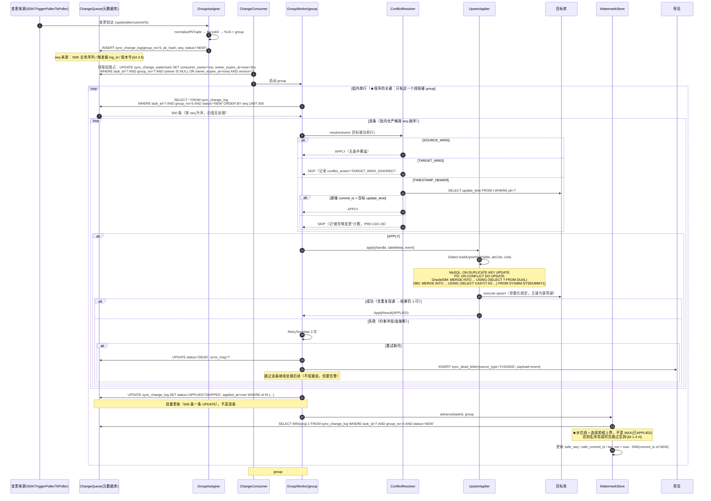

### 8.3 切流 Gate 判定与状态推进

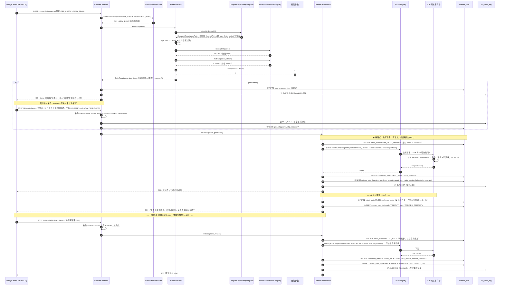

### 8.4 比对：分块校验和 → 差异下钻 → 修复

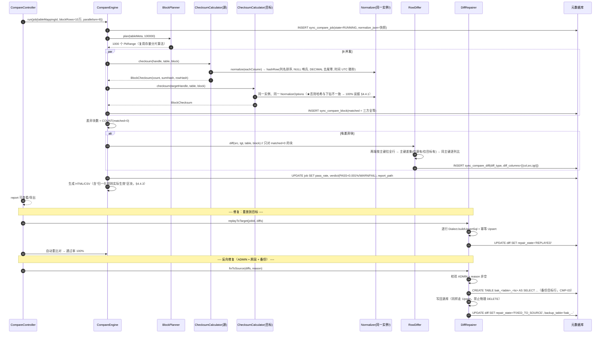

---

## 9. 状态机全集

### 9.1 同步任务状态机（ORC-01）

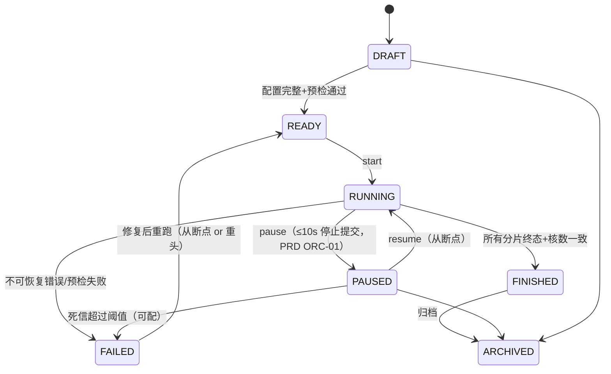

| 操作 | 允许的当前状态 | 拒绝时的错误码 |
|---|---|---|
| `start` | `READY` | `E3001 非法状态` |
| `pause` | `RUNNING` | `E3001` |
| `resume` | `PAUSED` | `E3001` |
| `cancel` | `RUNNING`,`PAUSED` | `E3001` |
| `rerun(fromCheckpoint=true)` | `FAILED`,`FINISHED` | `E3001` |
| `rerun(fromCheckpoint=false)` | `FAILED` | `E3001`（`FINISHED` 重头需 ADMIN） |
| `archive` | `FINISHED`,`PAUSED`,`DRAFT` | `E3001` |

**"取消后 ≤ 10 秒内停止提交"的实现**（PRD ORC-01 硬指标）：`cancel()` 写元数据库 `state=CANCELED`，同时置进程内 `AtomicBoolean`（同实例立即生效，≤ 1 个批周期）；跨实例的分片 worker 每 5 批 `assertHeld` 时会顺带 `SELECT state FROM sync_task`（复用同一次查询的时机），发现 `CANCELED` 立即中止。5 批 = 5000 行，在 50,000 行/s 下 = 100ms，远小于 10s。

### 9.2 切流状态机（8 状态）

见 §4.5.3 的跃迁表（唯一数据源）。补充"非法跃迁的错误响应形态"：

```json
HTTP 409
{
  "code": "E6001",
  "message": "非法状态跃迁：DRAFT → GRAY_WRITE。允许目标：[PRE_CHECK]",
  "data": { "current": "DRAFT", "requested": "GRAY_WRITE", "allowed": ["PRE_CHECK"] }
}
```

### 9.3 分片状态机

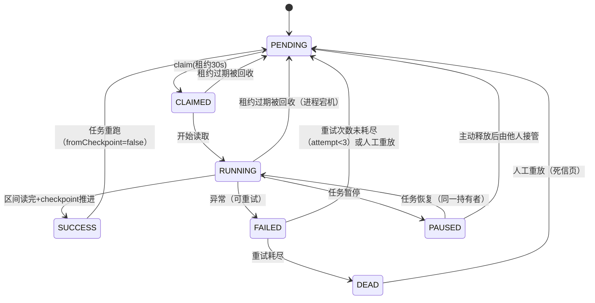
**注意 `RUNNING → PENDING`（租约过期）这条自环**：它是"进程宕机"的唯一表达方式。元数据库里没有任何"我死了"的信号，只有"租约过期"。因此 `LeaseReaperJob` 与 `claim` 的过期条件必须使用**同一个** `lease_expire_at < now(3)` 判据，否则会出现"reaper 认为该回收，claim 认为不能抢"的死区。

### 9.4 比对作业状态机

`PENDING → RUNNING → DONE | FAILED | CANCELED`；`DONE` 后不可重跑（新建 job）。**为什么不让 `DONE` 重跑**：比对结论会被 Gate 引用，重跑会改变结论但 `sync_compare_job` 的 `finished_at` 不变，导致"结论与执行时间不符"。要重跑就新建。

---

## 10. 配置项清单

```yaml
db-sync:
  instance:
    id: ""                      # 留空则自动生成 host:port#uuid
    heartbeat-interval: 10s
    drain-timeout: 25s          # 优雅停机上限（<30s，PRD §7.2）

  master-key: ${DBSYNC_MASTER_KEY:}          # 缺失则启动失败（DS-02）
  master-key-previous: ${DBSYNC_MASTER_KEY_PREV:}   # 轮换用

  meta:
    jdbc-url: jdbc:mysql://127.0.0.1:3306/dbsync?useSSL=false&serverTimezone=UTC
    username: dbsync
    password: ${DBSYNC_META_PASSWORD:}
    pool-max-size: 16
    pool-min-idle: 4
    claim-strategy: SKIP_LOCKED   # SKIP_LOCKED | NOWAIT_PROBE | OPTIMISTIC_CAS
    checkpoint-flush-interval: 0s # 0=每批刷（默认，最安全）；2s=合并（高吞吐）

  migration:
    default-concurrency: 4
    default-batch-size: 1000
    default-shard-rows: 2000000
    retry-max: 3
    retry-backoff: 1s
    lease-duration: 30s
    lease-check-every-batches: 5
    claim-poll-interval: 2s
    takeover-max-attempt: 3
    dead-letter-on-takeover-exceed: true

  cdc:
    group-count-default: 16
    consumer-concurrency: 8
    poll-interval: 5s
    batch-size: 500
    group-owner-lease: 30s
    trigger-log-retention-days: 7
    timestamp-overlap-window: 5s   # 边界重叠回退一个轮询周期（CDC-03）

  compare:
    block-rows: 100000
    parallelism: 8
    algorithms: COUNT,SUM,HASH
    pass-threshold: 0.00001        # 差异率 < 0.001% 为 PASS
    normalize:
      empty-as-null: true          # EMPTY_AS_NULL | STRICT
      decimal-trim-zeros: true
      time-precision: MICROS       # MICROS | MILLIS | SECONDS
      source-timezone: Asia/Shanghai
      trim-whitespace: false
      case-insensitive: false
      float-tolerance: 0           # 0 = 精确
      lob-compare-limit-bytes: 65536

  cutover:
    gate:
      compare-pass-rate: 0.9999
      lag-p95-ms: 5000
      dual-write-fail-rate: 0.0001
      open-dead-letters: 0
      compare-result-max-age: 6h
    route-snapshot-ttl: 3s         # SDK 轮询周期（决定回滚 RTO 上限）
    ack-timeout: 30s
    observe-window-default: 1440m
    auto-rollback: true
    auto-rollback-error-rate: 0.01

  security:
    token-ttl: 8h
    session-idle-timeout: 30m
    password-min-length: 10
    prod-double-confirm: true      # PROD 数据源破坏性操作二次确认（§7.4）
    masking:
      enabled: true
      patterns: ["phone", "idcard", "bankcard"]

  observability:
    prometheus-enabled: true
    alert:
      webhook-url: ""
      webhook-type: WECHAT_WORK     # WECHAT_WORK | DINGTALK | FEISHU | GENERIC
      rules:
        lag-threshold-ms: 10000
        lag-duration: 60s
        fail-rate-threshold: 0.001
        fail-rate-duration: 60s
        silence-window: 30m

  limits:
    max-tables-per-task: 500
    max-concurrent-tasks-per-instance: 4
    max-connections-per-datasource: 16
```

**配置项的 4 条原则**：
1. **危险默认值必须"最安全"**：`checkpoint-flush-interval=0`（每批必刷）、`float-tolerance=0`（精确）、`empty-as-null=true`（宽容减少误报）。
2. **缺失关键配置必须启动失败**：`master-key` 为空时直接抛异常退出（DS-02 硬要求），不允许"先起来再说"。
3. **不得出现"关闭不变式"的开关**：没有 `disable-unique-constraint`、`skip-checkpoint` 这类配置项。宁可加不了功能。
4. **所有阈值都要能改但要留痕**：`GateThresholds` 变更落审计（因为改了阈值等于改了"能不能切"的门槛）。

---

## 11. 可观测性：指标口径定义

PRD OBS-01 要求"指标口径在文档中明确定义"。以下口径即实现口径，`SyncMetrics` 必须严格按此计算（口径不一致会导致"大盘说 5 万 TPS，压测说 3 万"的扯皮）。

| 指标 | 类型 | 口径（精确定义） | 采集点 |
|---|---|---|---|
| `dbsync.migration.rows.total` | Counter | `Σ WriteResult.rowsAffected`，按 `taskId/table` 打 tag | `JdbcBatchWriter` 提交成功后 |
| `dbsync.migration.tps` | Gauge | **最近 60 秒**的 rows 增量 / 60。用滑窗（12 个 5s 桶）而非"瞬时"，避免抖动 | `MigrationProgress` 每 5s 计算 |
| `dbsync.migration.shards{state}` | Gauge | `SELECT state, COUNT(*) FROM sync_shard WHERE task_id=? GROUP BY state` | 每 5s 聚合（非每次查库，由 `MigrationProgress` 缓存） |
| `dbsync.cdc.lag.p95.ms` | Gauge | 最近 15 分钟窗口内，各组 `now - MIN(commit_ts WHERE status='NEW')` 的 P95（跨组汇总后取分位） | `WatermarkStore` 每 5s |
| `dbsync.cdc.backlog` | Gauge | `COUNT(*) FROM sync_change_log WHERE task_id=? AND status='NEW'` | 每 5s |
| `dbsync.cdc.apply.rate` | Counter | 成功 APPLIED 条数 / 秒 | `GroupWorker` 每批 |
| `dbsync.cdc.apply.fail.rate` | Gauge | 最近 15 分钟 `FAILED / (APPLIED+FAILED+SKIPPED)`。**分母不含 DEAD**（DEAD 单独看） | 每 5s |
| `dbsync.deadletter.open` | Gauge | `COUNT(*) WHERE status='OPEN'` | 每 10s |
| `dbsync.compare.blocks{matched}` | Gauge | 当前作业的 matched/unmatched 块数 | 比对过程中实时 |
| `dbsync.compare.pass.rate` | Gauge | `(totalRows - diffRows) / totalRows` | 作业完成后 |
| `dbsync.cutover.state` | Gauge（映射为数字） | `DRAFT=0...ROLLED_BACK=7`，tag `planId` | 状态变更时 |
| `dbsync.instance.shards` | Gauge | 本实例持有 `RUNNING` 分片数 | 每 5s |
| `dbsync.pool.active{name}` | Gauge | HikariCP `activeConnections`，按数据源名打 tag | Micrometer 自动 |
| `dbsync.batch.duration` | Timer | 单批 upsert 耗时（P50/P95/P99） | `JdbcBatchWriter` |
| `dbsync.lease.takeover.total` | Counter | 接管次数（>0 说明有实例不稳定） | `ShardLeaseManager.takeOver` |

**日志规范**（PRD OBS-03 / §7.3）：

```json
{"ts":"2026-11-09T14:02:11.238Z","level":"INFO","logger":"c.d.m.ShardWorker",
 "msg":"batch committed","traceId":"a3f2...","taskId":1001,"shardId":88123,
 "table":"T_ORDER","phase":"MIGRATION","rows":1000,"durationMs":412,
 "lastPk":"88231902","thread":"task-1001-w2"}
```

- **必须字段**：`traceId / taskId / shardId(或 groupNo) / table / phase`。缺任一字段视为日志缺陷（PRD §7.3）。
- **禁止字段**：密码、完整连接串（只允许 `host:port/db`）、`before/after` 全行内容（日志里只记主键 + 变更列名）。
- `traceId`：一次 HTTP 请求生成一个；一次批处理沿用父 traceId 并加 `spanId`。

**告警规则**（OBS-02，明确"持续多久才告警"）：

| 规则 | 条件 | 持续 | 渠道 | 去重 |
|---|---|---|---|---|
| 延迟超阈值 | `lag.p95 > threshold` | 60s | Webhook | 静默 30min |
| 失败率超阈值 | `apply.fail.rate > threshold` | 60s | Webhook | 静默 30min |
| 任务失败 | `task.state == FAILED` | 立即 | Webhook + 邮件 | 每任务每小时 1 次 |
| 死信新增 | `deadletter.open` 增加 | 立即 | Webhook | 静默 10min |
| 数据源不可用 | `health_status == DOWN` | 2 个巡检周期（60s） | Webhook | 静默 30min |
| 租约接管异常 | `takeover.total` 增长率 > 3/10min | 立即 | Webhook + 邮件 | 静默 1h |

---

## 12. 安全设计

### 12.1 凭据加密（DS-02）

```
用户输入明文密码
  → AES-256-GCM 加密（key = HKDF(masterKey, salt="dbsync-ds", keyVersion)）
  → Base64(IV || ciphertext || tag) → ds_datasource.password_cipher
  → 密钥从环境变量 DBSYNC_MASTER_KEY 注入（32 字节 Base64）
  → 轮换：新密钥加密写 key_version=2；读时按 key_version 选密钥；后台任务逐步重加密
```

**四条硬约束**：
1. 密钥缺失 → 应用**启动失败**（不是警告），错误消息明确说"设置环境变量 DBSYNC_MASTER_KEY"。
2. API 响应中密码字段**恒为** `******`（DTO 层不返回密文，更不返回明文）。
3. 日志中**永不**打印密码与完整连接串；`JdbcEndpoint.toString()` 只输出 `host:port/db`。
4. 解密后的明文**只存在于 `HikariDataSource` 的构造过程中**，不缓存到任何字段。

### 12.2 SQL 注入防护（SEC-03）

| 位置 | 防护方式 |
|---|---|
| 表名/列名/别名 | **白名单校验**：`IdentifierValidator.validate(name)` 要求匹配 `^[A-Za-z_][A-Za-z0-9_$#]{0,127}$` 且**长度 ≤ 方言 maxIdentifierLength**；且必须来自元数据读取结果（`TableMeta`/`ColumnMeta`），不接受用户直接传入 |
| 值 | 一律 `PreparedStatement.setXxx` 参数化绑定，**禁止**字符串拼接 |
| ORDER BY / LIMIT | 不允许用户传列名排序（只允许预定义枚举）；LIMIT 用 `int` 参数 |
| 方言生成的 SQL | `Dialect` 实现内只接受 `TableMeta`/`List<String>`（已校验过的标识符），**不接受**原始用户字符串 |
| 元数据库 DAO | 同样参数化；动态条件用 `StringBuilder` 拼 `?`，不拼值 |

**测试要求**：`SELECT` 的表名参数传入 `t; DROP TABLE x` 必须返回 `E1003 非法标识符`，**且不产生任何 SQL 执行**（用 H2 的 `TRACE_LEVEL` 或 mock `Connection` 断言"零 statement 创建"）。

### 12.3 RBAC（SEC-01）

| 动作 | VIEWER | OPERATOR | ADMIN |
|---|:--:|:--:|:--:|
| 查看大盘/报告/审计 | ✅ | ✅ | ✅ |
| 创建/编辑任务 | ❌ | ✅ | ✅ |
| 启动/暂停/恢复/重跑任务 | ❌ | ✅ | ✅ |
| 重放死信（单条） | ❌ | ✅ | ✅ |
| 丢弃死信 | ❌ | ✅ | ✅ |
| 发起比对 | ❌ | ✅ | ✅ |
| `REPLAY_TO_TARGET` 修复 | ❌ | ✅ | ✅ |
| `FIX_TO_SOURCE` 反向修复 | ❌ | ❌ | ✅ |
| 数据源新增/编辑/删除 | ❌ | ❌ | ✅ |
| 切流推进/回滚 | ❌ | ❌ | ✅ |
| 跳过 Gate | ❌ | ❌ | ✅ |
| 用户管理 | ❌ | ❌ | ✅ |

实现：`@RequirePermission(Permission.CUTOVER_ADVANCE)` 注解 + `RbacInterceptor`（在 Controller 层拦截），而非 Spring Security 的复杂表达式（本项目只有 3 个角色 12 个动作，注解 + 枚举是最简方案）。**越权必须 403 + 落审计**（PRD SEC-01）。

### 12.4 脱敏（SEC-04）

- 三个出口一致：日志、比对报告（HTML/CSV）、差异明细 API。
- 实现：`MaskingUtil.mask(columnName, value, MaskingConfig)`，在 `RowDiffer` 生成 `DiffRecord` **之前**脱敏（这样报告和 API 都拿不到明文）。日志侧在 `StructuredLog` 里按列名规则脱敏。
- 默认规则：手机号 `138****1234`、身份证 `110***********1234`、银行卡 `**** **** **** 1234`。
- **禁止绕过**："脱敏不可通过导出绕过"（PRD SEC-04）→ CSV 导出复用同一个 `DiffRecord`（已脱敏），不重新查库。

---

## 13. 性能与容量设计

### 13.1 连接池与线程池配比公式

```
每个数据源连接数：
    conns(ds) = min(
        poolMaxSize(ds),
        ceil(并发分片数 / 实例数) × 每分片连接数 + 元数据/巡检/比对预留
    )

每分片连接数：
    存量迁移 = 2   （1 个源库读 + 1 个目标库写）
    增量消费 = 2   （1 个读变更(SDK模式为0) + 1 个写目标）
    比对     = 2   （源 1 + 目标 1）

★ 硬约束（必须校验，超限拒绝启动）：
    conns(ds) ≤ 0.6 × 目标库 max_connections
    例：DM8 max_connections=100 → 平台对该库的连接 ≤ 60
             4 实例 × 4 并发 × 2 = 32 ≤ 60 ✅
             4 实例 × 8 并发 × 2 = 64 > 60 ❌ → 启动时抛 E2010 并建议降并发

线程池：
    实例线程数 = Σ(任务并发分片数) + 增量消费线程数 + 定时任务(4) + HTTP(Tomcat 默认 200)
    每任务: fixed(size=concurrency, name="task-{taskId}-w{n}")
    增量:   fixed(size=consumerConcurrency, name="cdc-{taskId}-g{n}")
    上限:   db-sync.limits.max-concurrent-tasks-per-instance × concurrency ≤ 32

    ★ 为什么不用虚拟线程（JDK 21+）：本项目锁定 JDK 17（PRD §7.5），无虚拟线程。
    ★ 为什么不用 ForkJoinPool.commonPool：commonPool 并行度 = CPU-1，而迁移是 IO 密集，
      需要"远超 CPU 数"的线程。用 commonPool 会把 HTTP 请求线程也拖慢。
```

### 13.2 吞吐目标分解（PRD §2.2：单实例 ≥ 50,000 行/s）

| 环节 | 单线程能力 | 4 线程 | 说明 |
|---|---|---|---|
| 源库流式读 | 25,000 行/s（宽表 20 列，fetchSize 1000） | — | 受源库网络与磁盘限制 |
| 目标库批量 upsert | 20,000 行/s（batch 1000，MySQL/PG） | — | Oracle/DM MERGE 约 12,000 行/s（语法开销大） |
| **单分片端到端** | **~12,000 行/s** | — | 读 1 + 写 1 流水线并非完全重叠 |
| **4 并发分片** | — | **~48,000 行/s** | 接近 50,000 目标（宽表 20 列） |
| 8 并发（4 实例 × 2） | — | ~90,000 行/s | 4 实例线性度目标 3.0x = 144,000 → 需 8 并发/实例 |

**结论**：50,000 行/s 的目标在 4 线程 + batch 1000 下是"刚好达标"，**没有余量**。因此：
- 批量 upsert 必须用 JDBC `addBatch/executeBatch`（不是逐条），且 `rewriteBatchedStatements=true`（MySQL）。
- Oracle 目标端 `recommendedBatchSize=500`（不是 1000），因为 MERGE 语句长、绑定变量多，batch 1000 会导致游标共享区争用。
- 若目标为 DM8，MERGE 性能是瓶颈 → 采用 `INSERT` 优先 + 冲突时 `UPDATE` 的两段式（可选优化，P1）。**本期先用纯 MERGE，把 P1 优化留给 M5**。

### 13.3 内存约束（PRD §7.1：2GB 堆，4 任务 × 4 线程）

```
每分片内存 = batchSize × 平均行宽 × 2（读缓冲 + 写缓冲）
           = 1000 × 200B × 2 = 400 KB
16 个并发分片 = 6.4 MB   ← 可忽略

真正的内存风险点：
1. 非流式读取（Oracle autocommit=true / MySQL 未设 Integer.MIN_VALUE）→ 全表进内存 → OOM。
   ★ 这是最高优先级的坑，见 §5.5
2. LOB 列：单行 50 MB 的 BLOB × batch 1000 = 50 GB → 必 OOM。
   → 实现：若表含 LOB 列，强制 batchSize=1（或 ≤ 10），且流式处理。
3. 比对的全表拉取：不存在（比对按块 10 万行，块内按主键排序后流式比对）。
4. 报告生成：差异明细可能百万行 → 用流式写 CSV（不是先 collect 再写）。
```

### 13.4 比对性能（PRD §2.2：1 亿行 ≤ 15 分钟）

计算：1 亿行 / 10 万行每块 = 1000 块。8 并发 → 每并发 125 块。每块耗时 = 两端各扫 10 万行（含网络）≈ 0.8s × 2 = 1.6s。
`125 × 1.6 = 200s ≈ 3.3 分钟`。**有余量**（目标 15 分钟）。

**但前提是**：分块查询必须有索引支撑（主键区间扫描）。`SELECT COUNT(*), SUM(col), row_hash FROM t WHERE pk > ? AND pk <= ?` 在主键索引上是 range scan，10 万行约 50~100ms（本地）而不是 0.8s。**若表无主键（降级为全列哈希分片）则该查询是全表扫，性能崩塌** → 无主键表的比对必须打 WARN 并单独计时（PRD MIG-07 已有降级提示）。

### 13.5 元数据库压力（见 §7.4）与限速放置位置

**限速必须放在"读取侧"和"写入侧"两处**（PRD §8.1 关键约束 3）：

| 位置 | 为什么 |
|---|---|
| 读侧 | 源库压力主要来自读（生产库不能被打满）。令牌桶在 `JdbcReader.read()` 前 `acquireRows(batchSize)` |
| 写侧 | 目标库压力来自写。令牌桶在 `JdbcBatchWriter.upsert()` 前 `acquireWriteRows(rows)` |

**只放一侧的后果**：只放写侧 → 源库已经被读满（读是并发的，写限速造成读阻塞会反压，但滞后期内的读取已经打出去了）；只放读侧 → 目标库在批量写入时可能瞬时超压（尤其 MERGE 慢时队列堆积）。

限速实现：`RateLimiter.tryAcquireRows(long rows)` 的返回值语义是"获得了多少行的许可"（可能 < 请求值），调用方按获批行数调整本次批大小。这样避免"申请 1000 只给 200"时的忙等。

---

## 14. 风险清单

| # | 风险 | 触发条件 | 影响 | 缓解措施 |
|---|---|---|---|---|
| R1 | **DM8 驱动/环境不可得** | 客户未及时提供 `DmJdbcDriver18.jar` 与可连实例 | M1 无法验收；DM 适配后置导致返工（所有 DDL/Upsert/分页/触发器语法要重测） | ① 第 1 周就要求 DM8 实例上线（PRD §11 已列为里程碑风险）；② 未就绪时用 PG 作"替身"验证引擎逻辑，但 **DM 方言层必须单独写单测（纯字符串断言）**，不依赖实例；③ `Dialect` SPI 从第一天就是接口，DM 实现可最后补齐 |
| R2 | **Oracle 大表读取 OOM** | 忘记 `setAutoCommit(false)` 或 `fetchSize` | 8 亿行表必 OOM，进程被杀 | `JdbcReader` 对 Oracle 强制 `autoCommit=false` + `fetchSize`；`Capabilities.needsFetchSizeCursor` 驱动；**单测断言"Oracle 路径下 autoCommit 必须为 false"** |
| R3 | **`SKIP LOCKED` 在 H2/老版本不可用** | 测试环境 H2、或客户用 MySQL 5.7 作元数据库 | 抢占退化为全表扫描 + 锁等待 → 多实例性能崩塌 | `ShardClaimStrategy` 三实现 + `claim-strategy` 配置；启动时探测能力并打印实际使用的策略；文档明确"元数据库要求 MySQL 8.0+" |
| R4 | **触发器写放大导致源库 TPS 下降** | 大表（> 1 亿行）开触发器，每条 DML 多一次 INSERT 到日志表 | 源库 TPS 降 20~40%（PRD §8.2 已量化），业务可能拒绝 | ① 提供"仅对必要表开触发器"白名单；② 日志表用 `/*+ APPEND */`（Oracle）或最小索引（只保留 `log_id` 主键，不要多余索引）；③ 上线前用客户真实负载压测并给数据；④ SDK 模式作为替代 |
| R5 | **比对假阳性导致报告不可信** | 归一化规则漏了某条（如 Oracle `''`/NULL、时区、DECIMAL 尾零） | 报告全红 → 运维不信 → 产品价值归零 → 项目事实上失败 | ① 单一 `Normalizer` 实例强制共用（§4.4.1）；② 用"注入差异测试集"做门禁：误报率 > 0.1% 不允许进入 M4（PRD §11 已列）；③ 报告必须列出生效规则（§4.4.3） |
| R6 | **增量乱序导致旧值覆盖新值** | 分组算法错误（如用 `hashCode` 且主键类型不同）、`groupCount` 中途变更、`seq` 来源不可靠 | 目标端数据错乱，且比对能发现但原因难查 | ① `groupCount` 创建后只读（写死在 task 表，代码层禁止修改接口）；② `seq` 来源在 §4.3.5 明确三种模式的保证强度；③ 端到端测试"同一主键 1000 次递增更新，最终值正确"（PRD CDC-05 验收口径） |
| R7 | **切流时状态与外部路由不一致** | 实例在"下发快照后、落 confirmed 前"宕机 | 平台认为已切写双写，实际没切 → 后续 Gate 用错误前提 → 可能数据丢失 | ① 两段式状态（§4.5）；② 启动时 `CutoverRecoveryService` 对齐；③ 对齐失败置 `INCONSISTENT` 冻结推进并要求人工；④ `route_version` 单调防乱序 |
| R8 | **`sync_change_log` 无限增长拖垮元数据库** | 未实现归档/清理 | 一个月后表几亿行，索引维护成本高，消费变慢 | ① `idx_reap` 支撑清理；② 后台任务归档 `APPLIED` 且 > 7 天的行；③ 表结构预留分区（`PARTITION BY RANGE (TO_DAYS(created_at))`）；④ 监控 `sync_change_log` 行数并告警 |
| R9 | **`NUMBER` 无精度映射 `numeric(38,10)` 造成截断** | Oracle 源存在 > 38 位或小数 > 10 位的真实数据 | 迁移后数据精度丢失（国产化替代最常见生产事故） | ① 预检时跑 `MAX(LENGTH(TO_CHAR(col)))` 统计并输出报告（PRD Q3）；② 超限值清单交客户确认；③ 默认 `(38,10)` 可在映射层覆盖；④ 风险清单强制标注 `PRECISION_LOSS` |
| R10 | **多实例下同一任务被重复启动** | 两个实例同时收到 `start` 请求，或恢复逻辑把 `RUNNING` 任务当新任务启动 | 分片被双跑，checkpoint 互相覆盖 | ① `sync_task.version` 乐观锁 + 状态机校验（只有 `READY` 可 `start`）；② 分片级 `uk_shard` 兜底；③ 恢复逻辑只"接管",不"重启"（复用同一分片记录） |
| R11 | **`mvn clean test` 因驱动缺失失败** | 有人把 Oracle/DM/DB2 驱动写进 pom，或测试里 `Class.forName` | 任何人 clone 后编译/测试失败，CI 挂 | ① pom 只留 MySQL/PG/H2（写在 04-impl-tasks T01 验收）；② 测试一律用 H2；③ 方言测试是"纯字符串断言"，不连库；④ CI 加一条 `grep -r "ojdbc\|DmJdbc\|jcc" pom.xml && fail` |
| R12 | **限速只做单侧导致源库或目标库被打满** | 实现时只在写侧限速 | 生产源库 IO 打满 → 影响业务 → 客户叫停 | ① 双层令牌桶（§13.5）；② 压测验收：设 10,000 行/s 后实测均值不超 +5%（PRD MIG-05 口径）；③ 提供"按时间段降速"策略（PRD Q8 提到日终批处理避让，P1） |
| R13 | **Gate 阈值被���意放宽** | 有人改了 `cutover_plan.gate_*` 或全局配置 | 卡点形同虚设，切流在数据不一致时被放行 | ① 阈值变更必须落审计（action=`GATE_THRESHOLD_CHANGE`）；② 阈值快照随每次 Gate 判定存入 `cutover_step_log`；③ 报告的 `thresholdSnapshot` 与 plan 对比可发现漂移 |

---

## 15. 假设与待确认（与 PRD §12 联动）

### 15.1 本设计所做的假设（若无反馈则按此执行）

| # | 假设 | 依据 / 影响 |
|---|---|---|
| A1 | **元数据库为 MySQL 8.0**（生产），H2 2.2 仅测试与本地 demo | PRD §7.5 明确。若客户坚持用 DM8 作元数据库，需追加 `ShardClaimStrategy` 的 DM 实测与 `V1__init.sql` 的 DM 方言版本（约 +3 人日） |
| A2 | **SDK 双写为主模式，触发器日志为兼容模式** | PRD Q1 建议默认。SDK 模式的 `DbSyncWriter` 本期只做"接口 + 骨架 + 单机可用实现"，完整 SDK 交付给业务方集成属于独立工作项 |
| A3 | **允许 ≤ 5 分钟只读窗口** | PRD Q2 建议默认。若不接受，则切流状态机需增加 `DRAIN` 分支（停写 → 追平增量 → 比对 → 切读），复杂度 +30%，M4 需 +2 周 |
| A4 | **标识符策略默认 `LOWER`**（Oracle → PG/DM） | PRD MAP-02 / Q4。DM 若建库时 `CASE_SENSITIVE=Y`，则必须 `PRESERVE` + 全量双引号，业务 SQL 需改造清单 |
| A5 | **`groupCount` 默认 16 且创建后不可改** | 变更会破坏保序（§4.3.2）。若客户需动态扩并发，只能新建任务 + 重放未消费变更（本期不做） |
| A6 | **控制台前端本期只交付"REST API + 只读静态大盘页"** | 见 §2.2 表格。React + MUI 的 6 个页面（PRD §9）作为后续独立迭代（估 15~20 人日）。**此条需 team-lead/产品确认**，因为它影响 M1~M4 的"可演示"口径 |
| A7 | **无主键表只支持表级重跑，不支持精确断点** | PRD MIG-07 / Q7。需客户书面接受 |
| A8 | **实例数 ≤ 8，单任务表数 ≤ 500，单表 ≤ 10 亿行** | PRD §2.2 规模指标。超出则分片数与元数据库行数需重新评估 |
| A9 | **不做跨库分布式事务（无 XA）** | §4.1.3 V3。所有一致性靠"至少一次 + 幂等" |
| A10 | **时间同步依赖 NTP** | 延迟指标与比对快照依赖（PRD §10.2）。偏差 > 1s 时 `lag` 可能为负，指标打 `clock_skew` 标记 |

### 15.2 仍需产品/客户拍板的 3 件事（阻塞设计定稿）

| # | 问题 | 阻塞什么 | 建议 |
|---|---|---|---|
| Q-A | A6 的前端范围（本期是否必须交付 React 控制台） | 影响 WBS 的 40+ 人日分配与 M1~M4 验收口径 | 建议本期交付 API + 静态页；React 作为 M6 独立迭代 |
| Q-B | 若客户要求"零只读窗口"（否决 A3），M4 是否接受 +2 周 | 影响 16 周总周期 | 建议坚持 ≤ 5 分钟只读窗口（业界同类项目均无法真正零窗口切流） |
| Q-C | Oracle 无精度 `NUMBER` 的实测分布（Q3） | 影响 `numeric(38,10)` 的默认值与风险等级 | 上线前必须跑一次统计；无数据时按 (38,10) + 超限告警 |

---

## 附录 A：设计决策速查表（ADR 索引）

| ADR | 决策 | 一句话理由 |
|---|---|---|
| ADR-01 | 10 个 Maven 模块 | 方言/引擎/比对/切流可独立单测，且"禁止反向依赖"落到了编译期 |
| ADR-02 | DAO 用 `JdbcTemplate`，不用 MyBatis/JPA | 抢占 SQL（`SKIP LOCKED`）与严格事务边界，ORM 表达不了也管不住 |
| ADR-03 | 不用 Spring Batch | 分片需要跨实例接管，`ExecutionContext` 模型不支持 |
| ADR-04 | 不用 Debezium/Canal | 与"不引中间件、单 Jar"冲突；预留 SPI 即可 |
| ADR-05 | 不用 Lombok | 多模块 + 注解处理器是构建稳定性的常见故障点，收益（少写 getter）不抵风险 |
| ADR-06 | 驱动反射加载 | 授权限制，写进 pom 会导致 clone 即失败 |
| ADR-07 | checkpoint 数据先、它后 | 重复可吸收，丢失不可检测（§4.1.5） |
| ADR-08 | 分片内不并行 | 并行度来自多分片；分片内并行会破坏 checkpoint 单调性 |
| ADR-09 | `group_no` 创建后只读 | 变更会破坏增量保序 |
| ADR-10 | 归一化用单一 `Normalizer` 实例 | 哈希与下钻规则不一致 = 100% 误报 |
| ADR-11 | 切流用 intent/confirmed 双列 | 元数据库与外部路由是两个存储，必须能表达"不一致" |
| ADR-12 | Gate 在服务端判定 | 前端置灰不是卡点，改一行 JS 就能绕过 |
| ADR-13 | 回滚用单快照原子切换 | 分两步会产生"读已切/写未切"的中间态 |
| ADR-14 | 元数据库单表 `sync_checkpoint` 承载三种 scope | 字段并集只有 6 个可空列，拆表会让恢复逻辑写三遍 |
| ADR-15 | 每张表 `version` 列 | 乐观锁是"无锁并发"的唯一廉价手段，且能发现并发写冲突 |

## 附录 B：文档与代码的同步约定

- 本文档的 §5（SPI 签名）与 §7（DDL）是**契约**：代码实现与本文档不一致时，以本文档为准并修改代码；若确需改契约，先改本文档并在 PR 描述中标注章节号。
- `04-impl-tasks.md` 的每个任务都标注了"对应本文档章节"，便于工程师任务与设计对照。任务中的文件路径均为 `D:/GC_WorkSpaces/db-sync-platform/...` 完整绝对路径。
- `03-wbs.md` 的里程碑验收口径与 PRD §11 一一对应，不做自行发挥。其"产出物"列路径同样以 `D:/GC_WorkSpaces/db-sync-platform` 为根。
- 文档位于 `E:/Workbuddy_Temp/2026-11-09-14-37-07/db-sync-platform/docs`，代码位于 `D:/GC_WorkSpaces/db-sync-platform`，两者**不混放**（理由与归档策略见 §3.3）。

---

**文档结束**（本文档为架构设计的唯一权威来源，与 `03-wbs.md`、`04-impl-tasks.md` 构成完整设计交付物）


