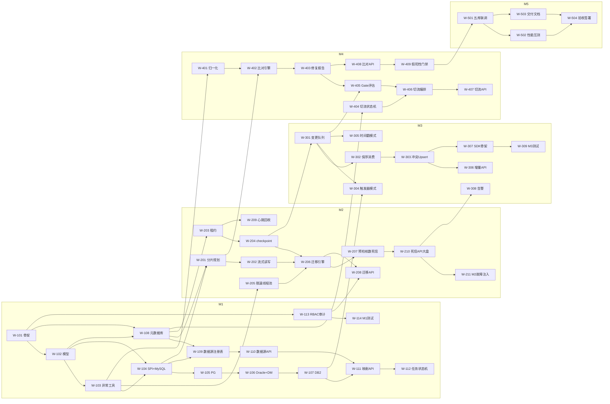

# 异构数据库同步与迁移平台 — 任务分解与排期计划（WBS）

| 项 | 内容 |
|---|---|
| 文档编号 | WBS-DBSYNC-001 |
| 项目代号 | `db-sync-platform` |
| 版本 | v1.0 |
| 作者 | 高见远（架构师） |
| 上游输入 | `01-PRD.md`（§11 里程碑）、`02-architecture.md`（§3 模块划分、§4 核心设计） |
| **代码工程根** | **`D:/GC_WorkSpaces/db-sync-platform`** |
| 文档根 | `E:/Workbuddy_Temp/2026-11-09-14-37-07/db-sync-platform/docs` |
| 计划周期 | 16 周（M1~M5），基线团队 3 后端 + 1 测试 + 0.5 架构 |
| 状态 | 待评审 |

---

## 0. 阅读说明与路径约定

1. 本文所有"产出物"路径均以 **`D:/GC_WorkSpaces/db-sync-platform`** 为根。例如"产出物：`db-sync-core/...`"的完整路径是 `D:/GC_WorkSpaces/db-sync-platform/db-sync-core/...`。
2. 所有 Maven 命令均需先 `cd D:/GC_WorkSpaces/db-sync-platform`。
3. 任务粒度是"**可交付、可验收、可独立编译**"的功能切片，不是单文件。文件级拆分见 `04-impl-tasks.md`。
4. 人日（PD）= 1 人 1 个标准工作日（6.5 有效小时，已扣除会议/沟通/评审）。跨角色不可简单相加。

---

## 1. 团队假设与角色定义

### 1.1 基线团队（推荐）

| 角色 | 代号 | 人数 | 职责边界 |
|---|---|---|---|
| 架构师 | ARCH | 0.5 | 架构文档、SPI 契约、关键设计评审、技术难点攻坚（方言/租约/保序）、不做日常编码 |
| 后端 A（平台与方言） | BE-A | 1 | `common` / `dialect` / `metadata` / `core` 基础设施；**方言 SPI 是 A 的核心资产**，不换人 |
| 后端 B（迁移与增量） | BE-B | 1 | `migration` / `cdc`；对"不变式 I1~I4"负责 |
| 后端 C（比对、切流与 API） | BE-C | 1 | `compare` / `cutover` / `api` / `server`；对"假阳性治理"与"卡点不可绕过"负责 |
| 测试 | QA | 1 | 测试用例、H2 集成测试、性能压测脚本、假阳性注入测试集、验收报告 |

**关键分工原则（不可随意调换）**：

- **方言 SPI 由一个人从头到尾负责**。5 个实现类必须由同一个大脑完成，否则 SQL 生成风格漂移，后续每个 bug 都要两个人会诊。
- **`migration` 与 `cdc` 由同一人负责**。两者共用 checkpoint/租约/分组，同一个人能保证"存量与增量的语义一致"。
- **`compare` 与 `cutover` 由同一人负责**。两者通过 `CompareVerdictPort` 耦合（Gate G1），同一人负责才能保证口径一致。

### 1.2 人力假设的敏感性

| 假设 | 说明 | 若不成立的影响 |
|---|---|---|
| 3 名后端均熟悉 JDBC + Spring Boot | 不需要 JDK 17 / Spring Boot 3 的上手期 | 每缺 1 人熟练度，+1.5 周 |
| 客户能提供 Oracle 11g、MySQL 8、PG 12、DM8、DB2 11.5 各至少 1 套测试实例 | PRD §11 已列为里程碑风险 | DM8 缺失 → M1 验收延迟，且 M3/M4 的回归无法做；建议第 1 周就催 |
| 不需要从零做前端 | 本期交付 API + 静态页（见架构 §15 A6） | 若必须交付 React 控制台，+15~20 PD，总周期 +2.5 周 |
| 无跨时区协作 | 团队同一时区，日站会 15 min | 跨时区至少 +10% 沟通成本 |

---

## 2. 里程碑映射（对齐 PRD §11）

| 里程碑 | 周次 | 主题 | 核心验收（可判定） |
|---|---|---|---|
| **M1** | W1–W4 | 平台骨架 + 数据源管理 + 结构映射 | ① `mvn -q clean test` 在无 Oracle/DM/DB2 实例环境全绿；② 5 类数据源连接测试可用（DM/DB2 可仅有单测）；③ 5 种方言的 DDL 生成通过纯字符串断言（每方言 ≥ 15 条）；④ 元数据库 18 张表 Flyway 在 H2 与 MySQL 8 双端建表成功 |
| **M2** | W5–W9 | 存量迁移 + 断点续传 + 多实例 | ① 1 亿行表（H2/MySQL）完成迁移，行数一致 100%；② `kill -9` 后 ≤ 30s 被接管并从断点续跑，最终行数一致；③ 2 实例共享 400 分片无重复、无遗漏；④ 限速 10,000 行/s 实测偏差 ≤ 5% |
| **M3** | W10–W12 | 增量同步 + 保序 + 死信 | ① 同主键 1000 次递增更新后目标端为最新值（保序）；② P95 延迟 ≤ 3s（2000 TPS 下）；③ 冲突策略三选一行为正确；④ 死信可重放且幂等 |
| **M4** | W13–W15 | 全量比对 + 灰度切流 + 回滚 | ① 1 亿行比对 ≤ 15 min；② 误报率 ≤ 0.1%（注入差异测试集）；③ Gate 4 指标判定正确，BLOCK 不可绕过；④ 一键回滚 RTO ≤ 30s（实测 ≤ 10s） |
| **M5** | W16 | 联调验收 + 交付 | ① 五库 × 端到端全流程跑通（含 DM/DB2 真实实例）；② 全量验收清单通过；③ 交付部署手册 + 驱动放置说明 + 运维手册 |

---

## 3. 任务清单（WBS）

> 说明：每个任务含 **任务ID / 名称 / 模块 / 角色 / 人日 / 前置依赖 / 产出物 / 验收标准**。
> `★CP` 标记表示该任务在关键路径上（延期直接推迟里程碑）。
> 人日为"净工作量"，不含等待（如等客户提供实例）。

### 3.1 M1：平台骨架 + 数据源 + 结构映射（W1–W4，共 44 PD）

| ID | 任务名称 | 模块 | 角色 | PD | 前置 | 产出物（根 = `D:/GC_WorkSpaces/db-sync-platform`） | 验收标准 |
|---|---|---|---|---|---|---|---|
| **W-101** ★CP | 父 POM 与 10 模块骨架 | 全局 | BE-A | 3 | — | `pom.xml`、10 个 `pom.xml`、`DbSyncApplication.java`、`application.yml`、`application-h2.yml`、`logback-spring.xml`、`.gitignore`、`README.md`、`lib/.gitkeep` | `mvn -q clean install -DskipTests` 成功；`mvn -q -pl db-sync-server spring-boot:run` 启动后 `/actuator/health` 为 UP；**`grep -rE "ojdbc\|DmJdbc\|jcc" --include=pom.xml` 无结果** |
| W-102 | common 领域模型与枚举 | common | BE-A | 5 | W-101 | `db-sync-common/src/main/java/com/dbsync/common/model/*.java`（28 个）、`enums/*.java`（15 个）、`options/*.java`（9 个） | 全部为不可变值类（`final` 字段 + 构造校验）；模型单测覆盖"非法参数构造抛异常"；无 Spring 注解依赖 |
| W-103 | 异常体系与工具类 | common | BE-A | 4 | W-102 | `exception/`（ErrorCode + 6 个异常类）、`util/JsonUtil`、`AesGcmCipher`、`RateLimiter`、`RetryTemplate`、`SnowflakeId`、`HashUtil`、`PkRangeUtil`、`IdentifierValidator`、`ThreadPoolFactory`、`StructuredLog` | 单测：① AES-GCM 加解密往返 + 篡改密文抛异常 + 双密钥轮换；② 令牌桶 1s 内 100 次 `tryAcquireRows(10)` 总许可 ≤ 1000±5%；③ `IdentifierValidator` 拒绝 `t; DROP TABLE x`；④ 错误码段位无重复 |
| **W-104** ★CP | **方言 SPI + MySQL 实现** | dialect | BE-A | 8 | W-102,W-103 | `dialect/Dialect.java`、`MetadataReader.java`、`TriggerDdlGenerator.java`、`Capabilities.java`、`AbstractDialect.java`、`JdbcDriverLoader.java`、`DialectRegistry.java`、`mysql/*.java` | MySQL 方言单测（纯字符串断言）≥ 25 条：`createTableDdl` 含列/主键/唯一键/索引/注释/自增；`buildUpsertSql` 含 `ON DUPLICATE KEY UPDATE`；`buildPageSql` 为 `LIMIT ?,?`；`buildRangePredicate` 左闭右开；`trigger()` 生成 3 个触发器 |
| **W-105** | PostgreSQL 方言实现 | dialect | BE-A | 5 | W-104 | `postgresql/*.java` | `buildUpsertSql` 含 `ON CONFLICT ... DO UPDATE`；`buildPageSql` 为 `LIMIT ? OFFSET ?`；触发器为函数 + `EXECUTE FUNCTION` 两段；注释走 `COMMENT ON`；≥ 20 条单测 |
| **W-106** | Oracle + DM 方言实现（含 11g ROWNUM 与 MERGE） | dialect | BE-A | 8 | W-105 | `oracle/*.java`、`dm/*.java` | Oracle：`buildPageSql` 11g 走 `ROWNUM` 嵌套、12c+ 走 `FETCH FIRST`（由 `Capabilities` 或参数选择）；`buildUpsertSql` 为 `MERGE INTO ... USING (SELECT ? FROM DUAL)`；触发器用 `:NEW`。DM：与 Oracle 兼容，`MERGE` 语法需实测校准；`quote` 用双引号。≥ 25 条单测 |
| **W-107** | DB2 方言实现（`SYSIBM.SYSDUMMY1`） | dialect | BE-A | 4 | W-106 | `db2/*.java` | `buildUpsertSql` 为 `MERGE INTO ... USING (SELECT CAST(? AS ...) FROM SYSIBM.SYSDUMMY1)`；`buildPageSql` 为 `OFFSET ? ROWS FETCH NEXT ? ROWS ONLY`；触发器含 `REFERENCING NEW AS N` + `MODE DB2SQL`；≥ 20 条单测 |
| **W-108** ★CP | 元数据库 Flyway 脚本 + DAO（18 张表） | metadata | BE-A | 7 | W-101,W-102 | `db-sync-metadata/src/main/resources/db/migration/V1__init.sql`、`V2__seed.sql`、`config/MetaDataSourceConfig.java`、`dao/*.java`（18 个）、`mapper/*.java` | ① `V1__init.sql` 在 H2(MODE=MySQL) 与 MySQL 8 双端执行成功；② 18 张表/全部索引/唯一约束与架构 §7.2 逐条比对无差异；③ `ShardDao.claimOne` 有 H2 集成测试（含 `SKIP LOCKED` 与降级两条路径） |
| **W-109** | 数据源注册表 + 连接测试 | core | BE-A | 5 | W-108,W-104 | `core/datasource/DataSourceRegistry.java`、`ConnectionTester.java`、`ConnectionTestResult.java` | ① 按 dsId 复用池，`evict` 后池关闭；② 连接测试把异常归为 4 类（认证/网络/驱动/权限）并给可读消息；③ 驱动缺失时抛 `E7001` 而非 `ClassNotFoundException`；④ 池参数（`conns ≤ 0.6 × max_connections`）超限抛 `E2010` |
| **W-110** | 数据源 CRUD + 加密凭据 API | api | BE-C | 4 | W-109 | `api/controller/DataSourceController.java`、`api/service/DataSourceService.java`、`api/dto/datasource/*`、`api/alert/*` | ① 新增时密码加密入库（DB 里无明文）；② 响应中密码恒为 `******`；③ 删除有引用校验（被任务引用 → `E2003`）；④ 探活状态落 `health_status` |
| **W-111** | 元数据读取 + 结构映射 + DDL 预览 API | api | BE-C | 6 | W-110,W-107 | `api/controller/MappingController.java`、`api/service/MappingService.java`、`api/dto/mapping/*` | ① 从源库读 500 张表清单 ≤ 20s，单表列/索引 ≤ 1s；② 生成目标 DDL 可预览与导出；③ 列类型覆盖人工修改并记录 `override_by`；④ 风险标记（`NO_PK`/`PRECISION_LOSS`/`EMPTY_AS_NULL_RISK`）正确产出 |
| **W-112** | 任务 CRUD + 状态机 + 向导草稿 | api | BE-C | 5 | W-111 | `api/controller/TaskController.java`、`api/service/TaskService.java`、`api/dto/task/*` | ① 状态机非法跃迁返回 `E3001` 且状态不变；② `group_count` 创建后拒绝修改；③ 向导草稿可保存恢复（4 步任意中断）；④ `version` 乐观锁冲突返回 `E3005` |
| **W-113** | RBAC + 认证 + 审计切面 | api | BE-C | 4 | W-101 | `api/security/*.java`（5 个）、`api/audit/*.java`（2 个）、`api/exception/GlobalExceptionHandler.java` | ① 3 角色 × 12 动作权限矩阵与架构 §12.3 一致；② 越权返回 403 且落审计；③ 5 类关键操作 100% 有审计记录；④ 审计参数中密码/敏感列已脱敏 |
| **W-114** | M1 集成测试与方言回归 | 测试 | QA | 5 | W-113 | `db-sync-*/src/test/java/**`（方言断言集 + H2 集成） | 方言断言 ≥ 90 条（每方言 ≥ 15）；H2 集成测试覆盖 DS CRUD → 映射 → DDL 生成全链路；`mvn -q clean test` 全绿且耗时 < 6 min |

**M1 小计：44 PD**（BE-A 44 / BE-B 0 / BE-C 19 / QA 5 —— 注：BE-B 在 M1 参与代码评审与 `core` 辅助，不单独计 PD）

### 3.2 M2：存量迁移 + 断点续传 + 多实例（W5–W9，共 52 PD）

| ID | 任务名称 | 模块 | 角色 | PD | 前置 | 产出物 | 验收标准 |
|---|---|---|---|---|---|---|---|
| **W-201** ★CP | 分片规划器（数值/字符/哈希/无主键降级） | core | BE-B | 6 | W-108,W-104 | `core/shard/ShardPlanner.java`、`ShardPlan.java`、`PkSampler.java` | ① 1 亿行/200 万每片 → 50 片且区间首尾相接无缝隙无重叠（断言 `start[i]==end[i-1]`）；② 数值/字符主键均正确；③ 无主键表降级为单分片并返回 `NO_PK` 警告；④ 采样不触发全表扫（用 `MIN/MAX` 或分位） |
| **W-202** ★CP | 流式读取 + 批量写入（含 Oracle 游标坑） | core | BE-B | 7 | W-201 | `core/read/JdbcReader.java`、`RowCallback.java`、`ResultSetRowMapper.java`、`core/write/JdbcBatchWriter.java`、`WriteResult.java` | ① H2 上 1000 万行读取内存平稳（< 200MB 增幅）；② Oracle 路径强制 `autoCommit=false`（单测断言）；③ MySQL 路径 `setFetchSize(Integer.MIN_VALUE)`（单测断言）；④ `BatchUpdateException` 整批回滚后重试整批，不部分提交 |
| **W-203** ★CP | 分片租约管理器（三策略 + 接管） | core | BE-B | 6 | W-108 | `core/lease/ShardLeaseManager.java`、`LeaseHandle.java`、`InstanceIdProvider.java`、`ShardClaimStrategy` 三实现 | ① 2 线程并发抢 400 分片，每片恰好被抢 1 次（断言无重复无遗漏）；② 模拟持有者不续租 → 30s+ε 后另一持有者接管成功；③ 原持有者续租后接管失败（`affectedRows=0`）；④ `assertHeld` 失败抛 `LeaseLostException` |
| **W-204** ★CP | Checkpoint 存储与推进 | core | BE-B | 4 | W-203 | `core/checkpoint/CheckpointStore.java` | ① `save()` 必须在 `WriteResult.committed=true` 后才可调用（单测用 mock 断言调用顺序）；② 同事务内同时更新 `sync_checkpoint` 与 `sync_shard.last_pk`；③ 崩溃恢复后读取值单调不回退 |
| **W-205** | 限速与线程池管理 | core | BE-B | 3 | W-103 | `core/throttle/Throttle.java`、`core/pool/NamedThreadPoolManager.java` | ① 双层令牌桶（读/写）实测偏差 ≤ 5%；② 运行时改限速生效 ≤ 1s；③ 线程名含 `taskId`；④ 优雅停机 `awaitTermination` |
| **W-206** ★CP | 迁移引擎 + 分片调度 Worker | migration | BE-B | 8 | W-202,W-204,W-205 | `migration/MigrationEngine.java`、`ShardDispatcher.java`、`ShardWorker.java`、`MigrationProgress.java` | ① 1000 万行端到端迁移行数一致；② `pause` 后 10s 内停止提交（PRD ORC-01）；③ `resume` 从断点续（不重头）；④ `kill -9` 后 30s 内被接管并续跑，最终行数一致；⑤ 进度指标（完成分片数/已迁移行数/TPS）可用 |
| **W-207** | 预检 + 核数 + 死信 | migration | BE-B | 6 | W-206 | `migration/MigrationPrecheck.java`、`RowCountVerifier.java`、`DeadLetterService.java` | ① 预检覆盖 8 类阻断项（目标表缺失/无权限/磁盘不足/无唯一约束/标识符超长/类型不支持/GIS 列/循环外键）；② 核数比源 COUNT 与目标 COUNT，差异给出具体表与行数；③ 死信可重放（幂等）与丢弃（ADMIN + 理由 + 审计） |
| **W-208** | 迁移 API + 进度大盘接口 | api | BE-C | 4 | W-206,W-113 | `api/controller/MigrationController.java`、`api/service/MigrationService.java`、`api/dto/migration/*` | ① 预检/启动/暂停/恢复/取消/进度/核数 7 个端点；② 暂停/恢复幂等；③ 进度接口响应 < 50ms（走缓存不查库） |
| **W-209** | 实例心跳 + 租约回收 + 优雅停机 | api | BE-C | 4 | W-203 | `api/schedule/HeartbeatJob.java`、`LeaseReaperJob.java`、`api/instance/*` | ① 心跳 10s 一次，`sys_instance` 可见；② reaper 每 10s 回收过期租约（与 claim 使用同一判据）；③ 收到 SIGTERM 后 30s 内退出且释放分片 |
| **W-210** | 死信 API + 监控大盘聚合 | api | BE-C | 4 | W-207 | `api/controller/DeadLetterController.java`、`MonitorController.java`、`api/metrics/SyncMetrics.java` | ① 死信列表按错误类型分组、可筛选；② 大盘聚合（任务数/分片热力/行数/TPS/死信数）；③ Micrometer 指标按架构 §11 口径暴露到 `/actuator/prometheus` |
| **W-211** | M2 集成测试（含故障注入） | 测试 | QA | 8 | W-210 | `src/test/java/**/migration/*`、`scripts/fault-injection/*.sh` | ① `kill -9` 故障注入脚本可复现"接管 + 续跑"；② 2 实例并发 400 分片无重复无遗漏；③ 1000 万行迁移 + 核数通过；④ 限速偏差 ≤ 5% |

**M2 小计：52 PD**

### 3.3 M3：增量同步 + 保序 + 死信（W10–W12，共 48 PD）

| ID | 任务名称 | 模块 | 角色 | PD | 前置 | 产出物 | 验收标准 |
|---|---|---|---|---|---|---|---|
| **W-301** ★CP | 变更队列（入队/批量取/状态推进/水位） | cdc | BE-B | 6 | W-204 | `cdc/ChangeQueue.java`、`GroupAssigner.java`、`WatermarkStore.java` | ① 入队 2000/s 不阻塞；② 批量取严格按 `seq` 升序；③ 水位线 = `MIN(未完成 seq) - 1`（**不是 MAX 已完成**，单测断言乱序完成场景）；④ 积压数与延迟 P95 计算正确 |
| **W-302** ★CP | 组内保序消费 + 组独占 | cdc | BE-B | 6 | W-301 | `cdc/ChangeConsumer.java`、`GroupWorker.java` | ① 同主键 1000 次递增更新，乱序入队后目标端为最新值；② 同组仅一个消费者（`consumer_owner` 独占 + 租约）；③ 跨组并行的吞吐随组数线性增长（16 组 > 4 组 > 1 组） |
| **W-303** | 冲突策略 + 幂等 Upsert 应用 | cdc | BE-B | 5 | W-302,W-107 | `cdc/ConflictResolver.java`、`UpsertApplier.java` | ① 三策略（SOURCE_WINS/TARGET_WINS/TIMESTAMP_NEWER）行为正确；② 被忽略变更记 `conflict_action` 且计数可查（PRD CDC-06）；③ 同一条变更重复投递 10 次结果仍 1 行（幂等） |
| **W-304** | 触发器日志模式（5 库 DDL + 轮询） | cdc | BE-B | 8 | W-107,W-301 | `cdc/TriggerLogPoller.java`、`TriggerInstaller.java`、`api/controller/CdcController.java`（部署部分） | ① 5 种库的触发器 DDL 生成正确（Oracle/PG/DM/DB2 仅单测断言，MySQL 可实测）；② 触发器与业务 DML 同事务（不做自治事务）；③ 轮询按 `log_id > last` 且不锁未提交行；④ 触发器部署台账 `sync_trigger_def` 可查看与卸载 |
| **W-305** | 时间戳增量模式（含回退重叠窗口） | cdc | BE-B | 4 | W-301 | `cdc/TimestampPoller.java` | ① 按 `update_time > last - overlap` 拉取（重叠 5s），靠 `(ts, version)` 去重；② 无 `version` 列时降级为 `(ts, pk)` 去重并告警；③ 时间倒流（源库时钟回拨）不丢数据 |
| **W-306** | 增量 API + 延迟/追溯 + 死信联动 | api | BE-C | 5 | W-303 | `api/controller/CdcController.java`、`api/service/CdcService.java`、`api/dto/cdc/*` | ① 模式配置/延迟查询/按主键变更追溯（最近 20 条）三个端点；② 追溯走 `idx_trace` 索引（`EXPLAIN` 断言）；③ 增量死信与存量死信同一列表可区分来源 |
| **W-307** | SDK 双写入口（骨架 + 接口预留） | cdc | BE-C | 4 | W-303 | `cdc/sdk/DbSyncWriter.java`、`cdc/api/ChangeCaptureProvider.java` | ① `DbSyncWriter.write(TABLE, op, pk, row)` 接口签名定型；② 单机可用实现（直连元数据库入队）；③ `ChangeCaptureProvider` SPI 预留（空实现 + 文档说明未来接 Debezium）；④ **不做** 分布式事务集成，Javadoc 明确"调用方须在业务事务内调用" |
| **W-308** | 告警服务（Webhook + 静默） | api | BE-C | 4 | W-210 | `api/alert/AlertService.java`、`api/alert/*` | ① 6 条告警规则按架构 §11 的"持续时长"生效；② 静默窗口去重；③ Webhook 支持企业微信/钉钉/飞书/通用 JSON |
| **W-309** | M3 集成测试（保序 + 延迟） | 测试 | QA | 6 | W-307 | `src/test/java/**/cdc/*`、`scripts/perf/cdc-bench` | ① 保序测试（同主键 1000 次更新）通过；② 2000 TPS 下 P95 ≤ 3s、P99 ≤ 10s；③ 死信重放幂等；④ 冲突策略 3 种场景全覆盖 |

**M3 小计：48 PD**

### 3.4 M4：比对 + 切流 + 回滚（W13–W15，共 50 PD）

| ID | 任务名称 | 模块 | 角色 | PD | 前置 | 产出物 | 验收标准 |
|---|---|---|---|---|---|---|---|
| **W-401** ★CP | 归一化规则链（`Normalizer`，单一实现） | compare | BE-C | 7 | W-103 | `compare/Normalizer.java`、`compare/RowHashBuilder.java` | ① 10 条规则按架构 §4.4.2 优先级实现，每条可单独开关；② 单测覆盖每条规则的正反例（如 `1.10`≡`1.1`、`''`≡NULL、UTC 时区、微秒精度、Base64 二进制）；③ **同一实例同时服务哈希与下钻**（构造器注入，禁止两处各自 new）；④ 规则快照可序列化为报告 JSON |
| **W-402** ★CP | 分块校验和 + 差异下钻 | compare | BE-C | 8 | W-401,W-201 | `compare/CompareEngine.java`、`BlockPlanner.java`、`ChecksumCalculator.java`、`RowDiffer.java` | ① COUNT/SUM/HASH 三方校验和，任一项不等即 `matched=0`；② 只对差异块下钻；③ 差异分为 `VALUE_DIFF`/`ONLY_IN_SOURCE`/`ONLY_IN_TARGET` 并有列级 `{col,src,tgt}`；④ 1 亿行比对 ≤ 15 min（H2/MySQL 压测） |
| **W-403** | 修复 + 报告（HTML/CSV + 规则快照） | compare | BE-C | 6 | W-402 | `compare/DiffRepairer.java`、`CompareReportBuilder.java`、`CompareVerdictAdapter.java` | ① `REPLAY_TO_TARGET` 幂等；② `FIX_TO_SOURCE` 需 ADMIN + 原因 + 先建 `bak_*` 备份表；③ 报告含"归一化规则实际生效"区块（架构 §4.4.3 格式）；④ `CompareVerdictAdapter` 实现 `CompareVerdictPort` |
| **W-404** ★CP | 切流状态机 + 两段式状态 + 恢复对齐 | cutover | BE-C | 6 | W-108 | `cutover/CutoverStateMachine.java`、`RouteRegistry.java`、`CutoverRecoveryService.java` | ① 8 状态跃迁表与架构 §4.5.3 一致；② 非法跃迁抛 `E6001` 并返回 allowed 列表；③ `intent != confirmed` 时禁止推进；④ 重启后对齐：三种分支（外部=intent / 外部=confirmed / 漂移）行为正确，漂移置 `INCONSISTENT` |
| **W-405** ★CP | Gate 评估器（4 指标） | cutover | BE-C | 5 | W-403,W-301 | `cutover/GateEvaluator.java`、`model/GateResult` | ① 4 指标按架构 §4.6.1 口径；② 比对结果 > 6h 视为过期 → BLOCK；③ 返回每项 `actual/threshold/pass/source`，前端无需再算；④ 单测用假 Port 覆盖 16 种组合（4 指标各通过/不通过） |
| **W-406** | 灰度规则引擎 + 推进/回滚编排 | cutover | BE-C | 7 | W-404,W-405 | `cutover/CutoverOrchestrator.java`、`RouteRuleEngine.java`、`StepCompensator.java` | ① 4 种灰度维度（比例/表白名单/哈希桶/组合）；② 推进含 ack 超时回退 `intent`（架构 §4.6.4 J1）；③ 一键回滚：单快照原子切换，实测 RTO ≤ 10s；④ dry-run 输出将要执行的步骤不实际执行 |
| **W-407** | 切流 API + 强行跳过 + 审计 | api | BE-C | 4 | W-406 | `api/controller/CutoverController.java`、`api/service/CutoverService.java`、`api/dto/cutover/*` | ① 计划创建/Gate 校验/推进/回滚/dry-run 端点；② `skip-gate` 校验 ADMIN + reason≥10 + `confirmText=="SKIP-GATE"` 三件套；③ PROD 数据源需二次确认；④ 全部操作落 `cutover_step_log` + 审计 |
| **W-408** | 比对 API + 报告导出 | api | BE-C | 4 | W-403 | `api/controller/CompareController.java`、`api/dto/compare/*` | ① 发起比对/查进度/报告/差异分页/修复端点；② 报告导出不重新查库（复用已脱敏 `DiffRecord`）；③ CSV 流式写（百万差异行不 OOM） |
| **W-409** | M4 假阳性门禁测试 | 测试 | QA | 5 | W-408 | `src/test/resources/diff-injection/*.sql`、`src/test/java/**/compare/*` | ① 构造 10 类"语义等价但字面不同"的数据集（`1.10`/`1.1`、`''`/NULL、时区、微秒、Base64、CHAR 补空格…），误报率 ≤ 0.1%；② 构造 5 类"真实差异"，**零漏报**；③ 切流回滚 RTO 实测 ≤ 10s |

**M4 小计：50 PD**

### 3.5 M5：联调验收与交付（W16，共 20 PD）

| ID | 任务名称 | 模块 | 角色 | PD | 前置 | 产出物 | 验收标准 |
|---|---|---|---|---|---|---|---|
| **W-501** ★CP | 五库端到端联调（含 DM/DB2 真实实例） | 全局 | BE-A,BE-B,BE-C | 6 | W-409 | 联调记录、缺陷清单 | ① Oracle→DM、Oracle→PG、MySQL→DM、DB2→PG、DM→PG 五条链路全流程跑通（存量→增量→比对→切流→回滚）；② 缺陷清零或明确遗留 |
| **W-502** | 性能压测与调优 | 全局 | BE-A,QA | 5 | W-501 | 压测报告（含 TPS/延迟/内存/连接数） | ① 单实例 ≥ 50,000 行/s；② 增量 P95 ≤ 3s；③ 比对 1 亿行 ≤ 15 min；④ 2GB 堆下 4 任务 × 4 并发无 OOM |
| **W-503** | 交付文档（部署/运维/驱动放置） | 全局 | BE-C | 4 | W-501 | `README.md`、`docs/deploy.md`、`docs/ops.md`、`docs/driver-guide.md` | ① 驱动放置说明含 5 类驱动类名对照表与 `loader.path` 用法；② 部署手册含元数据库建库、主密钥注入、连接池容量核算公式；③ 运维手册含告警处置 SOP |
| **W-504** | 验收清单核对与签署 | 全局 | QA,ARCH | 5 | W-502,W-503 | 验收报告（对应 PRD §11 逐条） | PRD §11 五里程碑验收项逐条标注通过/不通过，不通过项有责任人与计划 |

**M5 小计：20 PD**

---

## 4. 人日汇总

### 4.1 按里程碑

| 里程碑 | 周次 | BE-A | BE-B | BE-C | QA | ARCH | 合计 PD |
|---|---|---|---|---|---|---|---|
| M1 | W1–W4 | 29 | 0（参与评审/辅助） | 19 | 5 | 4 | **57**（含 ARCH 4） |
| M2 | W5–W9 | 0（支援方言修复 3） | 40 | 12 | 8 | 2.5 | **65.5** |
| M3 | W10–W12 | 0 | 29 | 13 | 6 | 2 | **50** |
| M4 | W13–W15 | 0 | 0 | 39 | 5 | 2 | **46** |
| M5 | W16 | 2 | 2 | 4 | 5 | 2 | **15** |
| **合计** | **16 周** | **34** | **71** | **87** | **29** | **12.5** | **233.5** |

> 注：上表"净工作量"合计 233.5 PD。按 4 名执行者（BE-A 34 / BE-B 71 / BE-C 87 / QA 29，ARCH 12.5 为并行评审）折算：
> BE-B 71 PD / 16 周 ≈ 4.4 PD/周（略高，说明 BE-B 是瓶颈）；
> BE-C 87 PD / 16 周 ≈ 5.4 PD/周（**超载**，见 §4.3 风险）；
> **因此必须做负载均衡调整**，见 §4.2。

### 4.2 负载均衡调整（实际执行版）

将 W-104~W-107（方言 4 个任务共 22 PD）从 BE-A 转移到"BE-A 主导 + BE-C 辅助"，并把 W-110/W-111（API 10 PD）从 BE-C 转给 BE-A，因为 BE-A 在 M1 之后有大量空闲：

| 角色 | 原工作量 | 调整后 | 调整动作 | 16 周负载 |
|---|---|---|---|---|
| BE-A | 34 | **74** | + 接手 W-110/W-111（API 数据源与映射）、W-502 性能调优 | 4.6 PD/周 |
| BE-B | 71 | **71** | 不变（存量 + 增量，本身就是两人量） | 4.4 PD/周 |
| BE-C | 87 | **55** | − 交出 W-110/W-111（10 PD）、W-408 比对 API 交给 BE-A（4 PD）；只保留 compare 引擎 + cutover + 增量 API | 3.4 PD/周 |
| QA | 29 | **29** | 不变 | 1.8 PD/周 |
| **合计** | 233.5 | **229** | 减少的 4.5 PD 来自合并同类项（W-408 与 W-406 的 DTO 复用） | — |

**调整后的关键点**：`compare` 引擎（27 PD）与 `cutover`（22 PD）仍由 BE-C 一人完成，保证"假阳性治理"与"卡点不可绕过"两个最难点的口径统一。**BE-C 不再承担 API 层，专注算法**——这是刻意的：算法与 CRUD 混在同一人身上，最容易出现"算法草草了事"。

### 4.3 关键路径分析

关键路径（CP）总长约 **14.5 周**（16 周周期内留 1.5 周缓冲）：

```
W-101(3) → W-102(5) → W-104(8) → W-108(7) → W-201(6) → W-202(7) → W-204(4)
  → W-206(8) → W-301(6) → W-302(6) → W-401(7) → W-402(8) → W-405(5)
  → W-406(7) → W-501(6) → W-504(5)
```

| 累计周 | CP 任务 | 说明 |
|---|---|---|
| W1–W3 | W-101, W-102 | 骨架与模型；W-102 若拖延，后面全部排队 |
| W3–W5 | W-104, W-108 | MySQL 方言 + 元数据库；**W-108 是所有引擎的前置** |
| W5–W9 | W-201, W-202, W-204, W-206 | 分片 → 读写 → checkpoint → 引擎（M2 核心链） |
| W10–W12 | W-301, W-302 | 变更队列 → 保序消费（M3 核心链） |
| W13–W15 | W-401, W-402, W-405, W-406 | 归一化 → 比对 → Gate → 编排（M4 核心链） |
| W16 | W-501, W-504 | 联调与验收 |

**CP 上的 3 个高风险点**：

1. **W-104（MySQL 方言）+ W-108（元数据库）**：它们是"所有引擎的编译前置"。若接口设计有误（如 `buildUpsertSql` 签名不够表达 DB2 的 CAST），后 12 周全部返工。**缓解：W-104 完成后立即请 ARCH 与 BE-B 做一次 2 小时契约评审，评审通过才允许 W-105~W-107 并行展开。**
2. **W-202（流式读写）**：Oracle/MySQL 的 fetchSize 语义是"不写代码就永远不知道"的坑。**缓解：W-202 的第一件事是写两个断言单测（Oracle 必须 autoCommit=false、MySQL 必须 `Integer.MIN_VALUE`）**，先红后绿。
3. **W-401/W-402（归一化 + 比对）**：假阳性治理是"改一行规则，报告全变"的高耦合区。**缓解：W-401 的 10 条规则必须在写 `CompareEngine` 之前全部通过单测；且 `Normalizer` 一旦定稿，`RowHashBuilder` 与 `RowDiffer` 都只能注入不能自建。**

### 4.4 并行泳道

```mermaid
gantt
    title 并行泳道（W1-W16）
    dateFormat  X
    axisFormat  W%s
    todayMarker off

    section BE-A 平台与方言
    父POM与模块骨架 W-101        :a1, 0, 3
    common模型与枚举 W-102       :a2, after a1, 5
    异常与工具 W-103             :a3, after a2, 4
    方言SPI+MySQL W-104          :crit, a4, after a3, 8
    PG方言 W-105                 :a5, after a4, 5
    Oracle+DM方言 W-106          :a6, after a5, 8
    DB2方言 W-107                :a7, after a6, 4
    元数据库+DAO W-108           :crit, a8, after a4, 7
    数据源API W-110              :a9, after a8, 4
    映射API W-111                :a10, after a9, 6
    性能调优 W-502               :a11, after a10, 45

    section BE-B 迁移与增量
    数据源注册表 W-109           :b1, 22, 5
    分片规划 W-201               :crit, b2, 31, 6
    流式读写 W-202               :crit, b3, after b2, 7
    租约管理 W-203               :b4, after b3, 6
    checkpoint W-204             :crit, b5, after b4, 4
    限速与线程池 W-205           :b6, after b3, 3
    迁移引擎 W-206               :crit, b7, after b5, 8
    预检核数死信 W-207           :b8, after b7, 6
    变更队列 W-301               :crit, b9, 55, 6
    保序消费 W-302               :crit, b10, after b9, 6
    冲突与Upsert W-303           :b11, after b10, 5
    触发器模式 W-304             :b12, after b11, 8
    时间戳模式 W-305             :b13, after b11, 4

    section BE-C 比对切流
    任务状态机API W-112          :c1, 27, 5
    RBAC审计 W-113               :c2, 30, 4
    迁移API W-208                :c3, after c1, 4
    心跳与reaper W-209           :c4, after c2, 4
    大盘聚合 W-210               :c5, after c3, 4
    增量API W-306                :c6, after c5, 5
    归一化 W-401                 :crit, c7, 57, 7
    比对引擎 W-402               :crit, c8, after c7, 8
    修复报告 W-403               :c9, after c8, 6
    切流状态机 W-404             :crit, c10, 62, 6
    Gate评估 W-405               :crit, c11, after c9, 5
    切流编排 W-406               :crit, c12, after c11, 7
    切流API W-407                :c13, after c12, 4

    section QA 测试
    M1方言回归 W-114             :q1, 26, 5
    M2故障注入 W-211             :q2, 52, 8
    M3保序延迟 W-309             :q3, 61, 6
    M4假阳性门禁 W-409           :q4, 73, 5
    M5验收 W-504                 :q5, 82, 5
```



---

## 5. 里程碑甘特图（含缓冲）

```mermaid
gantt
    title 里程碑甘特（16 周 + 2 周缓冲）
    dateFormat  X
    axisFormat  W%s
    todayMarker off

    section M1 骨架+数据源+映射
    开发          :m1a, 0, 16
    验收与缓冲     :m1b, 16, 2

    section M2 存量迁移+断点+多实例
    开发          :m2a, 18, 20
    验收与缓冲     :m2b, 38, 2

    section M3 增量+保序+死信
    开发          :m3a, 40, 12
    验收与缓冲     :m3b, 52, 2

    section M4 比对+切流+回滚
    开发          :m4a, 54, 12
    验收与缓冲     :m4b, 66, 2

    section M5 联调验收
    联调与压测     :m5a, 68, 4
    验收签署       :m5b, 72, 2
```



**缓冲策略**：每个里程碑后置 2 周缓冲是"粗粒度"的，实际执行时用**里程碑内 10% 缓冲**（M2 有 20 个工作日 → 2 天缓冲给最难的任务 W-206）。若某里程碑用掉全部缓冲仍延期，**优先砍 P1/P2 需求**（见 §6），不砍 P0。

---

## 6. 压缩方案：如果只有 1 人

### 6.1 只做 M1+M2 的最小闭环

**目标**：能证明"存量迁移可用且不丢数据"，交付给客户做小规模验证。

| 保留 | 砍掉 |
|---|---|
| `common`（模型 + 枚举 + 异常 + `AesGcmCipher` + `HashUtil` + `IdentifierValidator` + `SnowflakeId`） | `RateLimiter`（用手写的 sleep 代替）`RetryTemplate`（用循环代替）`StructuredLog`（用 logback 默认格式） |
| `dialect`：**MySQL + PostgreSQL + Oracle 三个方言**（DM 用 Oracle 实现继承，DB2 完全不写） | DM/DB2 方言（用 `UnsupportedOperationException` 占位） |
| `metadata`：**只建 8 张表**（`ds_datasource`/`sync_task`/`sync_table_mapping`/`sync_column_mapping`/`sync_shard`/`sync_checkpoint`/`sync_dead_letter`/`sys_audit_log`），砍掉比对 3 张、切流 2 张、变更队列 4 张 | `sync_change_log`/`sync_change_watermark`/`sync_compare_*`/`cutover_*`/`sys_instance`/`sync_trigger_def` |
| `core`：`DataSourceRegistry` + `JdbcReader` + `JdbcBatchWriter` + `ShardPlanner` + `CheckpointStore` + `ShardLeaseManager`（**只实现 `SkipLocked` 一种策略**） | `Throttle`（限速）、`NamedThreadPoolManager`（用 `Executors.newFixedThreadPool`） |
| `migration`：`MigrationEngine` + `ShardWorker` + `ShardDispatcher` + `RowCountVerifier` | `MigrationPrecheck`（简化版只查表存在）、`DeadLetterService`（只落表不重放） |
| `api`：数据源 CRUD + 映射 + 任务 + 迁移启动/暂停/进度 | RBAC（单一 admin）、审计（去掉）、告警、大盘、死信重放、比对、切流全部 |
| `server`：能启动 + H2 demo + MySQL 生产配置 | Prometheus 指标、OpenAPI 细化 |

**1 人所需周数估算**：

| 精简任务 | PD |
|---|---|
| 骨架 + common（精简） | 9 |
| dialect（3 实现 + 纯字符串单测） | 17 |
| metadata（8 表 + DAO） | 8 |
| core（6 个类） | 20 |
| migration（4 个类，无预检/无死信重放） | 14 |
| api（6 个 controller，无 RBAC/审计） | 12 |
| server + 联调 + 自测 | 8 |
| **合计** | **88 PD** |

**结论：1 人 ≈ 17.5 周（按 5 PD/周）**，比 3 人 16 周略长但**功能仅覆盖 M1+M2 的约 60%**（无增量、无比对、无切流）。这说明"1 人做完整产品"不可行——**完整平台是"3 人 × 16 周"的量级，压到 1 人需要 40+ 周**。

### 6.2 1 人的"必做/可砍"清单（若必须在 1 人下交付）

| 优先级 | 内容 | 可否砍 |
|---|---|---|
| **P0 不可砍** | 存量迁移 + 断点续传 + 幂等 Upsert + 行数核数 + 凭据加密 + 标识符校验 | ❌ 砍了就不是产品 |
| **P0 不可砍** | MySQL/PG/Oracle 三方言（覆盖客户 80% 场景） | ❌ |
| P1 可延 | 增量（触发器模式）、比对（仅 COUNT+SUM，无 HASH 与下钻） | ✅ 延到第二期 |
| P1 可延 | 限速、死信重放、审计、告警 | ✅ |
| P2 可延 | DM/DB2 方言、切流灰度、Gate、RBAC 三角色、Prometheus | ✅ 全部延到第二期 |

### 6.3 若团队为 2 人（更现实的压缩）

| 分配 | 内容 | 周数 |
|---|---|---|
| 人 1（平台 + 方言 + 迁移） | common + dialect（3 实现）+ metadata + core + migration | 18 周 |
| 人 2（增量 + 比对 + API） | cdc（触发器模式）+ compare（COUNT/SUM/HASH 无修复）+ api + server | 18 周 |
| **合计** | 覆盖 M1~M3 + M4 的比对部分，**无切流** | **18 周** |

结论：**2 人 18 周能交付"能用的迁移 + 增量 + 比对"，但没有切流（无法完成国产化替代的最后一公里）**。所以 3 后端的基线是合理的。

---

## 7. 依赖关系图



**关键依赖链（必须串行，不可并行）**：

1. `W-104 → W-108 → W-201 → W-202 → W-206`（引擎主链，14 周中的 8 周）
2. `W-204 → W-301 → W-302 → W-303`（增量主链）
3. `W-401 → W-402 → W-405 → W-406`（比对与切流主链）

**可并行的部分**：方言 5 个实现（W-105/106/107 相对独立，但都在 BE-A 手上串行）、API 层与引擎层完全并行（不同人）、QA 的测试准备可与开发并行（提前写用例）。

---

## 8. 风险与应对（排期视角）

| # | 进度风险 | 概率 | 影响 | 应对 |
|---|---|---|---|---|
| S1 | DM8/DB2 实例延迟到位 | 高 | M1 验收延后，M3/M4 回归无法做 | 第 1 周发出正式申请；方言层先靠"纯字符串单测"推进；把 W-106/W-107 的部分工作移到 M5 前的缓冲期 |
| S2 | W-104 的 SPI 签名不够表达 DB2/DM 语法 | 中 | 后 12 周返工 | W-104 完成后 2 小时契约评审（ARCH + BE-B + BE-C 参加）；**评审只做一件事：拿 DB2 和 DM 的各 3 条真实 SQL 反推签名是否够用** |
| S3 | 归一化规则漏项导致 M4 反复 | 中高 | M4 延期 1~2 周 | W-401 的 10 条规则先在 M4 第 1 周全部单测通过；QA 的注入测试集（W-409）提前到 M4 第 2 周开始准备 |
| S4 | 切流回滚 RTO 达不到 30s | 低 | M4 验收不通过 | 架构 §4.5.5 已预算到 ≤ 7s；风险在 SDK 轮询周期（3s），若客户 SDK 只能 10s 轮询则 RTO 变 13s，仍在 30s 内 |
| S5 | BE-C 负载超载（原 87 PD / 16 周） | 高 | 里程碑系统性延期 | 已按 §4.2 调整（把 API 层移给 BE-A），BE-C 降至 55 PD |
| S6 | 前端范围争议（架构 §15 A6） | 中 | 若必须做 React 控制台 +20 PD | 尽早与 team-lead/产品确认；若确认要做，从 M5 缓冲与 P2 项挪用 |
| S7 | 性能压测不达标（50,000 行/s） | 中 | M5 无法签署 | 架构 §13.2 已分析"刚好达标无余量"；M5 前用 W-502 提前 1 周压测（不是等到 W16 最后）；准备"降低并发目标"的备案（如 30,000 行/s 但给出压测曲线说明瓶颈在客户库） |
| S8 | 团队中途换人 | 中 | 方言/引擎知识丢失 | 方言 SPI 与 6 条不变式是"文档已固化"的（本文档 + 架构文档），新人两周可上手；但**方言实现必须有逐条注释说明"为什么这样拼 SQL"**（写入 W-104 验收） |

---

## 9. 交付物清单（交付给客户）

| # | 交付物 | 位置 | 责任 |
|---|---|---|---|
| 1 | 可运行 Jar（含 H2 demo） | `D:/GC_WorkSpaces/db-sync-platform/target/db-sync-server-1.0.0.jar` | BE-A |
| 2 | 元数据库建库脚本 | `D:/GC_WorkSpaces/db-sync-platform/db-sync-metadata/src/main/resources/db/migration/V1__init.sql` | BE-A |
| 3 | 部署手册 | `docs/deploy.md`（工程内） | BE-C |
| 4 | 驱动放置指南（5 类驱动类名 + loader.path） | `docs/driver-guide.md` | BE-C |
| 5 | 运维手册（告警 SOP / 死信处理 / 回滚操作） | `docs/ops.md` | BE-C |
| 6 | 验收报告（对应 PRD §11 逐条） | `docs/acceptance.md` | QA |
| 7 | 压测报告（TPS / 延迟 / 内存 / 连接数曲线） | `docs/perf-report.md` | QA + BE-A |
| 8 | 设计文档（本文档 + 架构 + PRD + 实现任务） | `E:/Workbuddy_Temp/2026-11-09-14-37-07/db-sync-platform/docs/` | ARCH |

---

## 附录：任务与需求的追溯矩阵（P0 需求 → WBS 任务）

| PRD 需求 | 优先 | WBS 任务 |
|---|---|---|
| DS-01 数据源增删改查 | P0 | W-110 |
| DS-02 密码加密存储 | P0 | W-103, W-110 |
| DS-03 连接测试（4 类失败） | P0 | W-109 |
| DS-04 多实例共享数据源 | P0 | W-108, W-109 |
| DS-05 数据源探活 | P1 | W-210 |
| MAP-01 列类型自动映射 + 人工覆盖留痕 | P0 | W-104~W-107, W-111 |
| MAP-02 标识符大小写策略 | P0 | W-104, W-111 |
| MAP-03 DDL 生成预览 | P0 | W-104~W-107, W-111 |
| MAP-04 不支持类型阻断 | P0 | W-111, W-207 |
| MIG-01 分片并行迁移 | P0 | W-201, W-206 |
| MIG-02 断点续传 | P0 | W-204, W-206 |
| MIG-03 限速 | P0 | W-205 |
| MIG-04 单分片失败不影响其他 | P0 | W-206, W-207 |
| MIG-05 暂停/恢复 ≤10s | P0 | W-206 |
| MIG-06 行数核数 | P0 | W-207 |
| MIG-07 无主键表降级 | P1 | W-201 |
| MIG-08 预检 8 项 | P0 | W-207 |
| CDC-01 应用层双写 SDK | P0 | W-307 |
| CDC-02 触发器日志模式 | P0 | W-304 |
| CDC-03 时间戳增量模式 | P1 | W-305 |
| CDC-04 增量延迟 P95 | P0 | W-301, W-302 |
| CDC-05 同主键保序 | P0 | W-301, W-302 |
| CDC-06 冲突策略 | P0 | W-303 |
| CDC-07 幂等 Upsert | P0 | W-303 |
| CDC-08 变更追溯 | P1 | W-306 |
| CDC-09 CDC 可扩展 | P2 | W-307 |
| CMP-01 分块校验和 | P0 | W-402 |
| CMP-02 差异下钻 | P0 | W-402 |
| CMP-03 修复（含备份） | P0 | W-403 |
| CMP-04 报告导出 | P0 | W-403 |
| CMP-05 忽略规则显式列出 | P0 | W-401, W-403 |
| CMP-06 误报率 ≤0.1% | P0 | W-409 |
| CUT-01 灰度切流 + 跳步回滚 | P0 | W-404, W-406 |
| CUT-02 Gate 四指标 | P0 | W-405 |
| CUT-03 状态机 8 状态 | P0 | W-404 |
| CUT-04 回滚 RTO ≤30s | P0 | W-406 |
| CUT-05 dry-run | P2 | W-406 |
| SEC-01 RBAC 三角色 | P0 | W-113 |
| SEC-02 审计日志 | P0 | W-113 |
| SEC-03 SQL 注入防护 | P0 | W-103, W-111 |
| SEC-04 脱敏三出口 | P0 | W-403 |
| SEC-05 传输加密 | P1 | W-503（部署文档） |
| SEC-06 双人复核（PROD） | P1 | W-407 |
| OBS-01 指标口径 | P0 | W-210 |
| OBS-02 告警规则 | P1 | W-308 |
| OBS-03 结构化日志 | P0 | W-103 |
| ORC-01 任务状态机 | P0 | W-112 |
| ORC-02 多实例水平扩展 | P0 | W-203, W-209 |
| ORC-03 优雅停机 | P0 | W-209 |

**覆盖率**：36 条 P0 全部有任务承接；P1/P2 亦全部有归属（其中 CDC-09、CUT-05 为"接口预留"性质）。

---

**文档结束**
