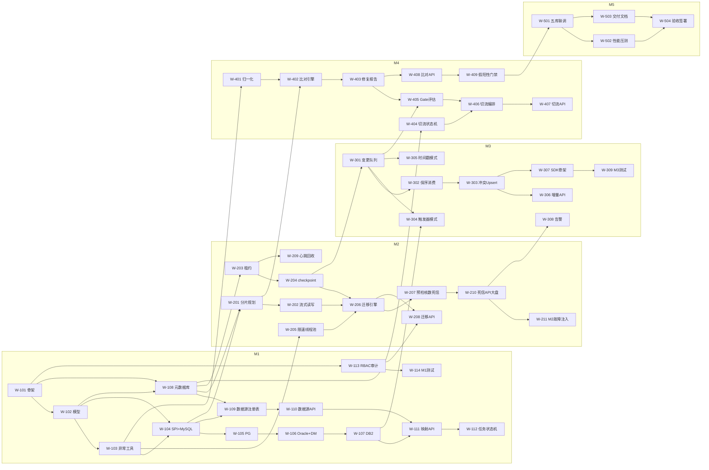
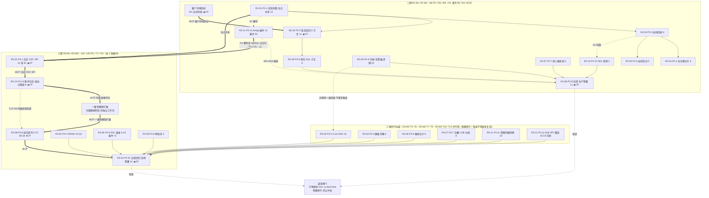

# 异构数据库同步与迁移平台 — 任务分解与排期计划（WBS）

| 项 | 内容 |
|---|---|
| 文档编号 | WBS-DBSYNC-001 |
| 项目代号 | `db-sync-platform` |
| 版本 | v1.0 |
| 作者 | 高见远（架构师） |
| 上游输入 | `01-PRD.md`（§11 里程碑）、`02-architecture.md`（§3 模块划分、§4 核心设计） |
| **代码工程根** | **`D:/GC_WorkSpaces/db-sync-platform`** |
| 文档根 | `E:/Workbuddy_Temp/2026-11-09-14-37-07/db-sync-platform/docs` |
| 计划周期 | 16 周（M1~M5），基线团队 3 后端 + 1 测试 + 0.5 架构 |
| 状态 | 待评审 |

---

## 0. 阅读说明与路径约定

1. 本文所有"产出物"路径均以 **`D:/GC_WorkSpaces/db-sync-platform`** 为根。例如"产出物：`db-sync-core/...`"的完整路径是 `D:/GC_WorkSpaces/db-sync-platform/db-sync-core/...`。
2. 所有 Maven 命令均需先 `cd D:/GC_WorkSpaces/db-sync-platform`。
3. 任务粒度是"**可交付、可验收、可独立编译**"的功能切片，不是单文件。文件级拆分见 `04-impl-tasks.md`。
4. 人日（PD）= 1 人 1 个标准工作日（6.5 有效小时，已扣除会议/沟通/评审）。跨角色不可简单相加。

---

## 1. 团队假设与角色定义

### 1.1 基线团队（推荐）

| 角色 | 代号 | 人数 | 职责边界 |
|---|---|---|---|
| 架构师 | ARCH | 0.5 | 架构文档、SPI 契约、关键设计评审、技术难点攻坚（方言/租约/保序）、不做日常编码 |
| 后端 A（平台与方言） | BE-A | 1 | `common` / `dialect` / `metadata` / `core` 基础设施；**方言 SPI 是 A 的核心资产**，不换人 |
| 后端 B（迁移与增量） | BE-B | 1 | `migration` / `cdc`；对"不变式 I1~I4"负责 |
| 后端 C（比对、切流与 API） | BE-C | 1 | `compare` / `cutover` / `api` / `server`；对"假阳性治理"与"卡点不可绕过"负责 |
| 测试 | QA | 1 | 测试用例、H2 集成测试、性能压测脚本、假阳性注入测试集、验收报告 |

**关键分工原则（不可随意调换）**：

- **方言 SPI 由一个人从头到尾负责**。5 个实现类必须由同一个大脑完成，否则 SQL 生成风格漂移，后续每个 bug 都要两个人会诊。
- **`migration` 与 `cdc` 由同一人负责**。两者共用 checkpoint/租约/分组，同一个人能保证"存量与增量的语义一致"。
- **`compare` 与 `cutover` 由同一人负责**。两者通过 `CompareVerdictPort` 耦合（Gate G1），同一人负责才能保证口径一致。

### 1.2 人力假设的敏感性

| 假设 | 说明 | 若不成立的影响 |
|---|---|---|
| 3 名后端均熟悉 JDBC + Spring Boot | 不需要 JDK 17 / Spring Boot 3 的上手期 | 每缺 1 人熟练度，+1.5 周 |
| 客户能提供 Oracle 11g、MySQL 8、PG 12、DM8、DB2 11.5 各至少 1 套测试实例 | PRD §11 已列为里程碑风险 | DM8 缺失 → M1 验收延迟，且 M3/M4 的回归无法做；建议第 1 周就催 |
| 不需要从零做前端 | 本期交付 API + 静态页（见架构 §15 A6） | 若必须交付 React 控制台，+15~20 PD，总周期 +2.5 周 |
| 无跨时区协作 | 团队同一时区，日站会 15 min | 跨时区至少 +10% 沟通成本 |

---

## 2. 里程碑映射（对齐 PRD §11）

| 里程碑 | 周次 | 主题 | 核心验收（可判定） |
|---|---|---|---|
| **M1** | W1–W4 | 平台骨架 + 数据源管理 + 结构映射 | ① `mvn -q clean test` 在无 Oracle/DM/DB2 实例环境全绿；② 5 类数据源连接测试可用（DM/DB2 可仅有单测）；③ 5 种方言的 DDL 生成通过纯字符串断言（每方言 ≥ 15 条）；④ 元数据库 18 张表 Flyway 在 H2 与 MySQL 8 双端建表成功 |
| **M2** | W5–W9 | 存量迁移 + 断点续传 + 多实例 | ① 1 亿行表（H2/MySQL）完成迁移，行数一致 100%；② `kill -9` 后 ≤ 30s 被接管并从断点续跑，最终行数一致；③ 2 实例共享 400 分片无重复、无遗漏；④ 限速 10,000 行/s 实测偏差 ≤ 5% |
| **M3** | W10–W12 | 增量同步 + 保序 + 死信 | ① 同主键 1000 次递增更新后目标端为最新值（保序）；② P95 延迟 ≤ 3s（2000 TPS 下）；③ 冲突策略三选一行为正确；④ 死信可重放且幂等 |
| **M4** | W13–W15 | 全量比对 + 灰度切流 + 回滚 | ① 1 亿行比对 ≤ 15 min；② 误报率 ≤ 0.1%（注入差异测试集）；③ Gate 4 指标判定正确，BLOCK 不可绕过；④ 一键回滚 RTO ≤ 30s（实测 ≤ 10s） |
| **M5** | W16 | 联调验收 + 交付 | ① 五库 × 端到端全流程跑通（含 DM/DB2 真实实例）；② 全量验收清单通过；③ 交付部署手册 + 驱动放置说明 + 运维手册 |

---

## 3. 任务清单（WBS）

> 说明：每个任务含 **任务ID / 名称 / 模块 / 角色 / 人日 / 前置依赖 / 产出物 / 验收标准**。
> `★CP` 标记表示该任务在关键路径上（延期直接推迟里程碑）。
> 人日为"净工作量"，不含等待（如等客户提供实例）。

### 3.1 M1：平台骨架 + 数据源 + 结构映射（W1–W4，共 44 PD）

| ID | 任务名称 | 模块 | 角色 | PD | 前置 | 产出物（根 = `D:/GC_WorkSpaces/db-sync-platform`） | 验收标准 |
|---|---|---|---|---|---|---|---|
| **W-101** ★CP | 父 POM 与 10 模块骨架 | 全局 | BE-A | 3 | — | `pom.xml`、10 个 `pom.xml`、`DbSyncApplication.java`、`application.yml`、`application-h2.yml`、`logback-spring.xml`、`.gitignore`、`README.md`、`lib/.gitkeep` | `mvn -q clean install -DskipTests` 成功；`mvn -q -pl db-sync-server spring-boot:run` 启动后 `/actuator/health` 为 UP；**`grep -rE "ojdbc\|DmJdbc\|jcc" --include=pom.xml` 无结果** |
| W-102 | common 领域模型与枚举 | common | BE-A | 5 | W-101 | `db-sync-common/src/main/java/com/dbsync/common/model/*.java`（28 个）、`enums/*.java`（15 个）、`options/*.java`（9 个） | 全部为不可变值类（`final` 字段 + 构造校验）；模型单测覆盖"非法参数构造抛异常"；无 Spring 注解依赖 |
| W-103 | 异常体系与工具类 | common | BE-A | 4 | W-102 | `exception/`（ErrorCode + 6 个异常类）、`util/JsonUtil`、`AesGcmCipher`、`RateLimiter`、`RetryTemplate`、`SnowflakeId`、`HashUtil`、`PkRangeUtil`、`IdentifierValidator`、`ThreadPoolFactory`、`StructuredLog` | 单测：① AES-GCM 加解密往返 + 篡改密文抛异常 + 双密钥轮换；② 令牌桶 1s 内 100 次 `tryAcquireRows(10)` 总许可 ≤ 1000±5%；③ `IdentifierValidator` 拒绝 `t; DROP TABLE x`；④ 错误码段位无重复 |
| **W-104** ★CP | **方言 SPI + MySQL 实现** | dialect | BE-A | 8 | W-102,W-103 | `dialect/Dialect.java`、`MetadataReader.java`、`TriggerDdlGenerator.java`、`Capabilities.java`、`AbstractDialect.java`、`JdbcDriverLoader.java`、`DialectRegistry.java`、`mysql/*.java` | MySQL 方言单测（纯字符串断言）≥ 25 条：`createTableDdl` 含列/主键/唯一键/索引/注释/自增；`buildUpsertSql` 含 `ON DUPLICATE KEY UPDATE`；`buildPageSql` 为 `LIMIT ?,?`；`buildRangePredicate` 左闭右开；`trigger()` 生成 3 个触发器 |
| **W-105** | PostgreSQL 方言实现 | dialect | BE-A | 5 | W-104 | `postgresql/*.java` | `buildUpsertSql` 含 `ON CONFLICT ... DO UPDATE`；`buildPageSql` 为 `LIMIT ? OFFSET ?`；触发器为函数 + `EXECUTE FUNCTION` 两段；注释走 `COMMENT ON`；≥ 20 条单测 |
| **W-106** | Oracle + DM 方言实现（含 11g ROWNUM 与 MERGE） | dialect | BE-A | 8 | W-105 | `oracle/*.java`、`dm/*.java` | Oracle：`buildPageSql` 11g 走 `ROWNUM` 嵌套、12c+ 走 `FETCH FIRST`（由 `Capabilities` 或参数选择）；`buildUpsertSql` 为 `MERGE INTO ... USING (SELECT ? FROM DUAL)`；触发器用 `:NEW`。DM：与 Oracle 兼容，`MERGE` 语法需实测校准；`quote` 用双引号。≥ 25 条单测 |
| **W-107** | DB2 方言实现（`SYSIBM.SYSDUMMY1`） | dialect | BE-A | 4 | W-106 | `db2/*.java` | `buildUpsertSql` 为 `MERGE INTO ... USING (SELECT CAST(? AS ...) FROM SYSIBM.SYSDUMMY1)`；`buildPageSql` 为 `OFFSET ? ROWS FETCH NEXT ? ROWS ONLY`；触发器含 `REFERENCING NEW AS N` + `MODE DB2SQL`；≥ 20 条单测 |
| **W-108** ★CP | 元数据库 Flyway 脚本 + DAO（18 张表） | metadata | BE-A | 7 | W-101,W-102 | `db-sync-metadata/src/main/resources/db/migration/V1__init.sql`、`V2__seed.sql`、`config/MetaDataSourceConfig.java`、`dao/*.java`（18 个）、`mapper/*.java` | ① `V1__init.sql` 在 H2(MODE=MySQL) 与 MySQL 8 双端执行成功；② 18 张表/全部索引/唯一约束与架构 §7.2 逐条比对无差异；③ `ShardDao.claimOne` 有 H2 集成测试（含 `SKIP LOCKED` 与降级两条路径） |
| **W-109** | 数据源注册表 + 连接测试 | core | BE-A | 5 | W-108,W-104 | `core/datasource/DataSourceRegistry.java`、`ConnectionTester.java`、`ConnectionTestResult.java` | ① 按 dsId 复用池，`evict` 后池关闭；② 连接测试把异常归为 4 类（认证/网络/驱动/权限）并给可读消息；③ 驱动缺失时抛 `E7001` 而非 `ClassNotFoundException`；④ 池参数（`conns ≤ 0.6 × max_connections`）超限抛 `E2010` |
| **W-110** | 数据源 CRUD + 加密凭据 API | api | BE-C | 4 | W-109 | `api/controller/DataSourceController.java`、`api/service/DataSourceService.java`、`api/dto/datasource/*`、`api/alert/*` | ① 新增时密码加密入库（DB 里无明文）；② 响应中密码恒为 `******`；③ 删除有引用校验（被任务引用 → `E2003`）；④ 探活状态落 `health_status` |
| **W-111** | 元数据读取 + 结构映射 + DDL 预览 API | api | BE-C | 6 | W-110,W-107 | `api/controller/MappingController.java`、`api/service/MappingService.java`、`api/dto/mapping/*` | ① 从源库读 500 张表清单 ≤ 20s，单表列/索引 ≤ 1s；② 生成目标 DDL 可预览与导出；③ 列类型覆盖人工修改并记录 `override_by`；④ 风险标记（`NO_PK`/`PRECISION_LOSS`/`EMPTY_AS_NULL_RISK`）正确产出 |
| **W-112** | 任务 CRUD + 状态机 + 向导草稿 | api | BE-C | 5 | W-111 | `api/controller/TaskController.java`、`api/service/TaskService.java`、`api/dto/task/*` | ① 状态机非法跃迁返回 `E3001` 且状态不变；② `group_count` 创建后拒绝修改；③ 向导草稿可保存恢复（4 步任意中断）；④ `version` 乐观锁冲突返回 `E3005` |
| **W-113** | RBAC + 认证 + 审计切面 | api | BE-C | 4 | W-101 | `api/security/*.java`（5 个）、`api/audit/*.java`（2 个）、`api/exception/GlobalExceptionHandler.java` | ① 3 角色 × 12 动作权限矩阵与架构 §12.3 一致；② 越权返回 403 且落审计；③ 5 类关键操作 100% 有审计记录；④ 审计参数中密码/敏感列已脱敏 |
| **W-114** | M1 集成测试与方言回归 | 测试 | QA | 5 | W-113 | `db-sync-*/src/test/java/**`（方言断言集 + H2 集成） | 方言断言 ≥ 90 条（每方言 ≥ 15）；H2 集成测试覆盖 DS CRUD → 映射 → DDL 生成全链路；`mvn -q clean test` 全绿且耗时 < 6 min |

**M1 小计：44 PD**（BE-A 44 / BE-B 0 / BE-C 19 / QA 5 —— 注：BE-B 在 M1 参与代码评审与 `core` 辅助，不单独计 PD）

### 3.2 M2：存量迁移 + 断点续传 + 多实例（W5–W9，共 52 PD）

| ID | 任务名称 | 模块 | 角色 | PD | 前置 | 产出物 | 验收标准 |
|---|---|---|---|---|---|---|---|
| **W-201** ★CP | 分片规划器（数值/字符/哈希/无主键降级） | core | BE-B | 6 | W-108,W-104 | `core/shard/ShardPlanner.java`、`ShardPlan.java`、`PkSampler.java` | ① 1 亿行/200 万每片 → 50 片且区间首尾相接无缝隙无重叠（断言 `start[i]==end[i-1]`）；② 数值/字符主键均正确；③ 无主键表降级为单分片并返回 `NO_PK` 警告；④ 采样不触发全表扫（用 `MIN/MAX` 或分位） |
| **W-202** ★CP | 流式读取 + 批量写入（含 Oracle 游标坑） | core | BE-B | 7 | W-201 | `core/read/JdbcReader.java`、`RowCallback.java`、`ResultSetRowMapper.java`、`core/write/JdbcBatchWriter.java`、`WriteResult.java` | ① H2 上 1000 万行读取内存平稳（< 200MB 增幅）；② Oracle 路径强制 `autoCommit=false`（单测断言）；③ MySQL 路径 `setFetchSize(Integer.MIN_VALUE)`（单测断言）；④ `BatchUpdateException` 整批回滚后重试整批，不部分提交 |
| **W-203** ★CP | 分片租约管理器（三策略 + 接管） | core | BE-B | 6 | W-108 | `core/lease/ShardLeaseManager.java`、`LeaseHandle.java`、`InstanceIdProvider.java`、`ShardClaimStrategy` 三实现 | ① 2 线程并发抢 400 分片，每片恰好被抢 1 次（断言无重复无遗漏）；② 模拟持有者不续租 → 30s+ε 后另一持有者接管成功；③ 原持有者续租后接管失败（`affectedRows=0`）；④ `assertHeld` 失败抛 `LeaseLostException` |
| **W-204** ★CP | Checkpoint 存储与推进 | core | BE-B | 4 | W-203 | `core/checkpoint/CheckpointStore.java` | ① `save()` 必须在 `WriteResult.committed=true` 后才可调用（单测用 mock 断言调用顺序）；② 同事务内同时更新 `sync_checkpoint` 与 `sync_shard.last_pk`；③ 崩溃恢复后读取值单调不回退 |
| **W-205** | 限速与线程池管理 | core | BE-B | 3 | W-103 | `core/throttle/Throttle.java`、`core/pool/NamedThreadPoolManager.java` | ① 双层令牌桶（读/写）实测偏差 ≤ 5%；② 运行时改限速生效 ≤ 1s；③ 线程名含 `taskId`；④ 优雅停机 `awaitTermination` |
| **W-206** ★CP | 迁移引擎 + 分片调度 Worker | migration | BE-B | 8 | W-202,W-204,W-205 | `migration/MigrationEngine.java`、`ShardDispatcher.java`、`ShardWorker.java`、`MigrationProgress.java` | ① 1000 万行端到端迁移行数一致；② `pause` 后 10s 内停止提交（PRD ORC-01）；③ `resume` 从断点续（不重头）；④ `kill -9` 后 30s 内被接管并续跑，最终行数一致；⑤ 进度指标（完成分片数/已迁移行数/TPS）可用 |
| **W-207** | 预检 + 核数 + 死信 | migration | BE-B | 6 | W-206 | `migration/MigrationPrecheck.java`、`RowCountVerifier.java`、`DeadLetterService.java` | ① 预检覆盖 8 类阻断项（目标表缺失/无权限/磁盘不足/无唯一约束/标识符超长/类型不支持/GIS 列/循环外键）；② 核数比源 COUNT 与目标 COUNT，差异给出具体表与行数；③ 死信可重放（幂等）与丢弃（ADMIN + 理由 + 审计） |
| **W-208** | 迁移 API + 进度大盘接口 | api | BE-C | 4 | W-206,W-113 | `api/controller/MigrationController.java`、`api/service/MigrationService.java`、`api/dto/migration/*` | ① 预检/启动/暂停/恢复/取消/进度/核数 7 个端点；② 暂停/恢复幂等；③ 进度接口响应 < 50ms（走缓存不查库） |
| **W-209** | 实例心跳 + 租约回收 + 优雅停机 | api | BE-C | 4 | W-203 | `api/schedule/HeartbeatJob.java`、`LeaseReaperJob.java`、`api/instance/*` | ① 心跳 10s 一次，`sys_instance` 可见；② reaper 每 10s 回收过期租约（与 claim 使用同一判据）；③ 收到 SIGTERM 后 30s 内退出且释放分片 |
| **W-210** | 死信 API + 监控大盘聚合 | api | BE-C | 4 | W-207 | `api/controller/DeadLetterController.java`、`MonitorController.java`、`api/metrics/SyncMetrics.java` | ① 死信列表按错误类型分组、可筛选；② 大盘聚合（任务数/分片热力/行数/TPS/死信数）；③ Micrometer 指标按架构 §11 口径暴露到 `/actuator/prometheus` |
| **W-211** | M2 集成测试（含故障注入） | 测试 | QA | 8 | W-210 | `src/test/java/**/migration/*`、`scripts/fault-injection/*.sh` | ① `kill -9` 故障注入脚本可复现"接管 + 续跑"；② 2 实例并发 400 分片无重复无遗漏；③ 1000 万行迁移 + 核数通过；④ 限速偏差 ≤ 5% |

**M2 小计：52 PD**

### 3.3 M3：增量同步 + 保序 + 死信（W10–W12，共 48 PD）

| ID | 任务名称 | 模块 | 角色 | PD | 前置 | 产出物 | 验收标准 |
|---|---|---|---|---|---|---|---|
| **W-301** ★CP | 变更队列（入队/批量取/状态推进/水位） | cdc | BE-B | 6 | W-204 | `cdc/ChangeQueue.java`、`GroupAssigner.java`、`WatermarkStore.java` | ① 入队 2000/s 不阻塞；② 批量取严格按 `seq` 升序；③ 水位线 = `MIN(未完成 seq) - 1`（**不是 MAX 已完成**，单测断言乱序完成场景）；④ 积压数与延迟 P95 计算正确 |
| **W-302** ★CP | 组内保序消费 + 组独占 | cdc | BE-B | 6 | W-301 | `cdc/ChangeConsumer.java`、`GroupWorker.java` | ① 同主键 1000 次递增更新，乱序入队后目标端为最新值；② 同组仅一个消费者（`consumer_owner` 独占 + 租约）；③ 跨组并行的吞吐随组数线性增长（16 组 > 4 组 > 1 组） |
| **W-303** | 冲突策略 + 幂等 Upsert 应用 | cdc | BE-B | 5 | W-302,W-107 | `cdc/ConflictResolver.java`、`UpsertApplier.java` | ① 三策略（SOURCE_WINS/TARGET_WINS/TIMESTAMP_NEWER）行为正确；② 被忽略变更记 `conflict_action` 且计数可查（PRD CDC-06）；③ 同一条变更重复投递 10 次结果仍 1 行（幂等） |
| **W-304** | 触发器日志模式（5 库 DDL + 轮询） | cdc | BE-B | 8 | W-107,W-301 | `cdc/TriggerLogPoller.java`、`TriggerInstaller.java`、`api/controller/CdcController.java`（部署部分） | ① 5 种库的触发器 DDL 生成正确（Oracle/PG/DM/DB2 仅单测断言，MySQL 可实测）；② 触发器与业务 DML 同事务（不做自治事务）；③ 轮询按 `log_id > last` 且不锁未提交行；④ 触发器部署台账 `sync_trigger_def` 可查看与卸载 |
| **W-305** | 时间戳增量模式（含回退重叠窗口） | cdc | BE-B | 4 | W-301 | `cdc/TimestampPoller.java` | ① 按 `update_time > last - overlap` 拉取（重叠 5s），靠 `(ts, version)` 去重；② 无 `version` 列时降级为 `(ts, pk)` 去重并告警；③ 时间倒流（源库时钟回拨）不丢数据 |
| **W-306** | 增量 API + 延迟/追溯 + 死信联动 | api | BE-C | 5 | W-303 | `api/controller/CdcController.java`、`api/service/CdcService.java`、`api/dto/cdc/*` | ① 模式配置/延迟查询/按主键变更追溯（最近 20 条）三个端点；② 追溯走 `idx_trace` 索引（`EXPLAIN` 断言）；③ 增量死信与存量死信同一列表可区分来源 |
| **W-307** | SDK 双写入口（骨架 + 接口预留） | cdc | BE-C | 4 | W-303 | `cdc/sdk/DbSyncWriter.java`、`cdc/api/ChangeCaptureProvider.java` | ① `DbSyncWriter.write(TABLE, op, pk, row)` 接口签名定型；② 单机可用实现（直连元数据库入队）；③ `ChangeCaptureProvider` SPI 预留（空实现 + 文档说明未来接 Debezium）；④ **不做** 分布式事务集成，Javadoc 明确"调用方须在业务事务内调用" |
| **W-308** | 告警服务（Webhook + 静默） | api | BE-C | 4 | W-210 | `api/alert/AlertService.java`、`api/alert/*` | ① 6 条告警规则按架构 §11 的"持续时长"生效；② 静默窗口去重；③ Webhook 支持企业微信/钉钉/飞书/通用 JSON |
| **W-309** | M3 集成测试（保序 + 延迟） | 测试 | QA | 6 | W-307 | `src/test/java/**/cdc/*`、`scripts/perf/cdc-bench` | ① 保序测试（同主键 1000 次更新）通过；② 2000 TPS 下 P95 ≤ 3s、P99 ≤ 10s；③ 死信重放幂等；④ 冲突策略 3 种场景全覆盖 |

**M3 小计：48 PD**

### 3.4 M4：比对 + 切流 + 回滚（W13–W15，共 50 PD）

| ID | 任务名称 | 模块 | 角色 | PD | 前置 | 产出物 | 验收标准 |
|---|---|---|---|---|---|---|---|
| **W-401** ★CP | 归一化规则链（`Normalizer`，单一实现） | compare | BE-C | 7 | W-103 | `compare/Normalizer.java`、`compare/RowHashBuilder.java` | ① 10 条规则按架构 §4.4.2 优先级实现，每条可单独开关；② 单测覆盖每条规则的正反例（如 `1.10`≡`1.1`、`''`≡NULL、UTC 时区、微秒精度、Base64 二进制）；③ **同一实例同时服务哈希与下钻**（构造器注入，禁止两处各自 new）；④ 规则快照可序列化为报告 JSON |
| **W-402** ★CP | 分块校验和 + 差异下钻 | compare | BE-C | 8 | W-401,W-201 | `compare/CompareEngine.java`、`BlockPlanner.java`、`ChecksumCalculator.java`、`RowDiffer.java` | ① COUNT/SUM/HASH 三方校验和，任一项不等即 `matched=0`；② 只对差异块下钻；③ 差异分为 `VALUE_DIFF`/`ONLY_IN_SOURCE`/`ONLY_IN_TARGET` 并有列级 `{col,src,tgt}`；④ 1 亿行比对 ≤ 15 min（H2/MySQL 压测） |
| **W-403** | 修复 + 报告（HTML/CSV + 规则快照） | compare | BE-C | 6 | W-402 | `compare/DiffRepairer.java`、`CompareReportBuilder.java`、`CompareVerdictAdapter.java` | ① `REPLAY_TO_TARGET` 幂等；② `FIX_TO_SOURCE` 需 ADMIN + 原因 + 先建 `bak_*` 备份表；③ 报告含"归一化规则实际生效"区块（架构 §4.4.3 格式）；④ `CompareVerdictAdapter` 实现 `CompareVerdictPort` |
| **W-404** ★CP | 切流状态机 + 两段式状态 + 恢复对齐 | cutover | BE-C | 6 | W-108 | `cutover/CutoverStateMachine.java`、`RouteRegistry.java`、`CutoverRecoveryService.java` | ① 8 状态跃迁表与架构 §4.5.3 一致；② 非法跃迁抛 `E6001` 并返回 allowed 列表；③ `intent != confirmed` 时禁止推进；④ 重启后对齐：三种分支（外部=intent / 外部=confirmed / 漂移）行为正确，漂移置 `INCONSISTENT` |
| **W-405** ★CP | Gate 评估器（4 指标） | cutover | BE-C | 5 | W-403,W-301 | `cutover/GateEvaluator.java`、`model/GateResult` | ① 4 指标按架构 §4.6.1 口径；② 比对结果 > 6h 视为过期 → BLOCK；③ 返回每项 `actual/threshold/pass/source`，前端无需再算；④ 单测用假 Port 覆盖 16 种组合（4 指标各通过/不通过） |
| **W-406** | 灰度规则引擎 + 推进/回滚编排 | cutover | BE-C | 7 | W-404,W-405 | `cutover/CutoverOrchestrator.java`、`RouteRuleEngine.java`、`StepCompensator.java` | ① 4 种灰度维度（比例/表白名单/哈希桶/组合）；② 推进含 ack 超时回退 `intent`（架构 §4.6.4 J1）；③ 一键回滚：单快照原子切换，实测 RTO ≤ 10s；④ dry-run 输出将要执行的步骤不实际执行 |
| **W-407** | 切流 API + 强行跳过 + 审计 | api | BE-C | 4 | W-406 | `api/controller/CutoverController.java`、`api/service/CutoverService.java`、`api/dto/cutover/*` | ① 计划创建/Gate 校验/推进/回滚/dry-run 端点；② `skip-gate` 校验 ADMIN + reason≥10 + `confirmText=="SKIP-GATE"` 三件套；③ PROD 数据源需二次确认；④ 全部操作落 `cutover_step_log` + 审计 |
| **W-408** | 比对 API + 报告导出 | api | BE-C | 4 | W-403 | `api/controller/CompareController.java`、`api/dto/compare/*` | ① 发起比对/查进度/报告/差异分页/修复端点；② 报告导出不重新查库（复用已脱敏 `DiffRecord`）；③ CSV 流式写（百万差异行不 OOM） |
| **W-409** | M4 假阳性门禁测试 | 测试 | QA | 5 | W-408 | `src/test/resources/diff-injection/*.sql`、`src/test/java/**/compare/*` | ① 构造 10 类"语义等价但字面不同"的数据集（`1.10`/`1.1`、`''`/NULL、时区、微秒、Base64、CHAR 补空格…），误报率 ≤ 0.1%；② 构造 5 类"真实差异"，**零漏报**；③ 切流回滚 RTO 实测 ≤ 10s |

**M4 小计：50 PD**

### 3.5 M5：联调验收与交付（W16，共 20 PD）

| ID | 任务名称 | 模块 | 角色 | PD | 前置 | 产出物 | 验收标准 |
|---|---|---|---|---|---|---|---|
| **W-501** ★CP | 五库端到端联调（含 DM/DB2 真实实例） | 全局 | BE-A,BE-B,BE-C | 6 | W-409 | 联调记录、缺陷清单 | ① Oracle→DM、Oracle→PG、MySQL→DM、DB2→PG、DM→PG 五条链路全流程跑通（存量→增量→比对→切流→回滚）；② 缺陷清零或明确遗留 |
| **W-502** | 性能压测与调优 | 全局 | BE-A,QA | 5 | W-501 | 压测报告（含 TPS/延迟/内存/连接数） | ① 单实例 ≥ 50,000 行/s；② 增量 P95 ≤ 3s；③ 比对 1 亿行 ≤ 15 min；④ 2GB 堆下 4 任务 × 4 并发无 OOM |
| **W-503** | 交付文档（部署/运维/驱动放置） | 全局 | BE-C | 4 | W-501 | `README.md`、`docs/deploy.md`、`docs/ops.md`、`docs/driver-guide.md` | ① 驱动放置说明含 5 类驱动类名对照表与 `loader.path` 用法；② 部署手册含元数据库建库、主密钥注入、连接池容量核算公式；③ 运维手册含告警处置 SOP |
| **W-504** | 验收清单核对与签署 | 全局 | QA,ARCH | 5 | W-502,W-503 | 验收报告（对应 PRD §11 逐条） | PRD §11 五里程碑验收项逐条标注通过/不通过，不通过项有责任人与计划 |

**M5 小计：20 PD**

---

## 4. 人日汇总

### 4.1 按里程碑

| 里程碑 | 周次 | BE-A | BE-B | BE-C | QA | ARCH | 合计 PD |
|---|---|---|---|---|---|---|---|
| M1 | W1–W4 | 29 | 0（参与评审/辅助） | 19 | 5 | 4 | **57**（含 ARCH 4） |
| M2 | W5–W9 | 0（支援方言修复 3） | 40 | 12 | 8 | 2.5 | **65.5** |
| M3 | W10–W12 | 0 | 29 | 13 | 6 | 2 | **50** |
| M4 | W13–W15 | 0 | 0 | 39 | 5 | 2 | **46** |
| M5 | W16 | 2 | 2 | 4 | 5 | 2 | **15** |
| **合计** | **16 周** | **34** | **71** | **87** | **29** | **12.5** | **233.5** |

> 注：上表"净工作量"合计 233.5 PD。按 4 名执行者（BE-A 34 / BE-B 71 / BE-C 87 / QA 29，ARCH 12.5 为并行评审）折算：
> BE-B 71 PD / 16 周 ≈ 4.4 PD/周（略高，说明 BE-B 是瓶颈）；
> BE-C 87 PD / 16 周 ≈ 5.4 PD/周（**超载**，见 §4.3 风险）；
> **因此必须做负载均衡调整**，见 §4.2。

### 4.2 负载均衡调整（实际执行版）

将 W-104~W-107（方言 4 个任务共 22 PD）从 BE-A 转移到"BE-A 主导 + BE-C 辅助"，并把 W-110/W-111（API 10 PD）从 BE-C 转给 BE-A，因为 BE-A 在 M1 之后有大量空闲：

| 角色 | 原工作量 | 调整后 | 调整动作 | 16 周负载 |
|---|---|---|---|---|
| BE-A | 34 | **74** | + 接手 W-110/W-111（API 数据源与映射）、W-502 性能调优 | 4.6 PD/周 |
| BE-B | 71 | **71** | 不变（存量 + 增量，本身就是两人量） | 4.4 PD/周 |
| BE-C | 87 | **55** | − 交出 W-110/W-111（10 PD）、W-408 比对 API 交给 BE-A（4 PD）；只保留 compare 引擎 + cutover + 增量 API | 3.4 PD/周 |
| QA | 29 | **29** | 不变 | 1.8 PD/周 |
| **合计** | 233.5 | **229** | 减少的 4.5 PD 来自合并同类项（W-408 与 W-406 的 DTO 复用） | — |

**调整后的关键点**：`compare` 引擎（27 PD）与 `cutover`（22 PD）仍由 BE-C 一人完成，保证"假阳性治理"与"卡点不可绕过"两个最难点的口径统一。**BE-C 不再承担 API 层，专注算法**——这是刻意的：算法与 CRUD 混在同一人身上，最容易出现"算法草草了事"。

### 4.3 关键路径分析

关键路径（CP）总长约 **14.5 周**（16 周周期内留 1.5 周缓冲）：

```
W-101(3) → W-102(5) → W-104(8) → W-108(7) → W-201(6) → W-202(7) → W-204(4)
  → W-206(8) → W-301(6) → W-302(6) → W-401(7) → W-402(8) → W-405(5)
  → W-406(7) → W-501(6) → W-504(5)
```

| 累计周 | CP 任务 | 说明 |
|---|---|---|
| W1–W3 | W-101, W-102 | 骨架与模型；W-102 若拖延，后面全部排队 |
| W3–W5 | W-104, W-108 | MySQL 方言 + 元数据库；**W-108 是所有引擎的前置** |
| W5–W9 | W-201, W-202, W-204, W-206 | 分片 → 读写 → checkpoint → 引擎（M2 核心链） |
| W10–W12 | W-301, W-302 | 变更队列 → 保序消费（M3 核心链） |
| W13–W15 | W-401, W-402, W-405, W-406 | 归一化 → 比对 → Gate → 编排（M4 核心链） |
| W16 | W-501, W-504 | 联调与验收 |

**CP 上的 3 个高风险点**：

1. **W-104（MySQL 方言）+ W-108（元数据库）**：它们是"所有引擎的编译前置"。若接口设计有误（如 `buildUpsertSql` 签名不够表达 DB2 的 CAST），后 12 周全部返工。**缓解：W-104 完成后立即请 ARCH 与 BE-B 做一次 2 小时契约评审，评审通过才允许 W-105~W-107 并行展开。**
2. **W-202（流式读写）**：Oracle/MySQL 的 fetchSize 语义是"不写代码就永远不知道"的坑。**缓解：W-202 的第一件事是写两个断言单测（Oracle 必须 autoCommit=false、MySQL 必须 `Integer.MIN_VALUE`）**，先红后绿。
3. **W-401/W-402（归一化 + 比对）**：假阳性治理是"改一行规则，报告全变"的高耦合区。**缓解：W-401 的 10 条规则必须在写 `CompareEngine` 之前全部通过单测；且 `Normalizer` 一旦定稿，`RowHashBuilder` 与 `RowDiffer` 都只能注入不能自建。**

### 4.4 并行泳道

```mermaid
gantt
    title 并行泳道（W1-W16）
    dateFormat  X
    axisFormat  W%s
    todayMarker off

    section BE-A 平台与方言
    父POM与模块骨架 W-101        :a1, 0, 3
    common模型与枚举 W-102       :a2, after a1, 5
    异常与工具 W-103             :a3, after a2, 4
    方言SPI+MySQL W-104          :crit, a4, after a3, 8
    PG方言 W-105                 :a5, after a4, 5
    Oracle+DM方言 W-106          :a6, after a5, 8
    DB2方言 W-107                :a7, after a6, 4
    元数据库+DAO W-108           :crit, a8, after a4, 7
    数据源API W-110              :a9, after a8, 4
    映射API W-111                :a10, after a9, 6
    性能调优 W-502               :a11, after a10, 45

    section BE-B 迁移与增量
    数据源注册表 W-109           :b1, 22, 5
    分片规划 W-201               :crit, b2, 31, 6
    流式读写 W-202               :crit, b3, after b2, 7
    租约管理 W-203               :b4, after b3, 6
    checkpoint W-204             :crit, b5, after b4, 4
    限速与线程池 W-205           :b6, after b3, 3
    迁移引擎 W-206               :crit, b7, after b5, 8
    预检核数死信 W-207           :b8, after b7, 6
    变更队列 W-301               :crit, b9, 55, 6
    保序消费 W-302               :crit, b10, after b9, 6
    冲突与Upsert W-303           :b11, after b10, 5
    触发器模式 W-304             :b12, after b11, 8
    时间戳模式 W-305             :b13, after b11, 4

    section BE-C 比对切流
    任务状态机API W-112          :c1, 27, 5
    RBAC审计 W-113               :c2, 30, 4
    迁移API W-208                :c3, after c1, 4
    心跳与reaper W-209           :c4, after c2, 4
    大盘聚合 W-210               :c5, after c3, 4
    增量API W-306                :c6, after c5, 5
    归一化 W-401                 :crit, c7, 57, 7
    比对引擎 W-402               :crit, c8, after c7, 8
    修复报告 W-403               :c9, after c8, 6
    切流状态机 W-404             :crit, c10, 62, 6
    Gate评估 W-405               :crit, c11, after c9, 5
    切流编排 W-406               :crit, c12, after c11, 7
    切流API W-407                :c13, after c12, 4

    section QA 测试
    M1方言回归 W-114             :q1, 26, 5
    M2故障注入 W-211             :q2, 52, 8
    M3保序延迟 W-309             :q3, 61, 6
    M4假阳性门禁 W-409           :q4, 73, 5
    M5验收 W-504                 :q5, 82, 5
```



---

## 5. 里程碑甘特图（含缓冲）

```mermaid
gantt
    title 里程碑甘特（16 周 + 2 周缓冲）
    dateFormat  X
    axisFormat  W%s
    todayMarker off

    section M1 骨架+数据源+映射
    开发          :m1a, 0, 16
    验收与缓冲     :m1b, 16, 2

    section M2 存量迁移+断点+多实例
    开发          :m2a, 18, 20
    验收与缓冲     :m2b, 38, 2

    section M3 增量+保序+死信
    开发          :m3a, 40, 12
    验收与缓冲     :m3b, 52, 2

    section M4 比对+切流+回滚
    开发          :m4a, 54, 12
    验收与缓冲     :m4b, 66, 2

    section M5 联调验收
    联调与压测     :m5a, 68, 4
    验收签署       :m5b, 72, 2
```



**缓冲策略**：每个里程碑后置 2 周缓冲是"粗粒度"的，实际执行时用**里程碑内 10% 缓冲**（M2 有 20 个工作日 → 2 天缓冲给最难的任务 W-206）。若某里程碑用掉全部缓冲仍延期，**优先砍 P1/P2 需求**（见 §6），不砍 P0。

---

## 6. 压缩方案：如果只有 1 人

### 6.1 只做 M1+M2 的最小闭环

**目标**：能证明"存量迁移可用且不丢数据"，交付给客户做小规模验证。

| 保留 | 砍掉 |
|---|---|
| `common`（模型 + 枚举 + 异常 + `AesGcmCipher` + `HashUtil` + `IdentifierValidator` + `SnowflakeId`） | `RateLimiter`（用手写的 sleep 代替）`RetryTemplate`（用循环代替）`StructuredLog`（用 logback 默认格式） |
| `dialect`：**MySQL + PostgreSQL + Oracle 三个方言**（DM 用 Oracle 实现继承，DB2 完全不写） | DM/DB2 方言（用 `UnsupportedOperationException` 占位） |
| `metadata`：**只建 8 张表**（`ds_datasource`/`sync_task`/`sync_table_mapping`/`sync_column_mapping`/`sync_shard`/`sync_checkpoint`/`sync_dead_letter`/`sys_audit_log`），砍掉比对 3 张、切流 2 张、变更队列 4 张 | `sync_change_log`/`sync_change_watermark`/`sync_compare_*`/`cutover_*`/`sys_instance`/`sync_trigger_def` |
| `core`：`DataSourceRegistry` + `JdbcReader` + `JdbcBatchWriter` + `ShardPlanner` + `CheckpointStore` + `ShardLeaseManager`（**只实现 `SkipLocked` 一种策略**） | `Throttle`（限速）、`NamedThreadPoolManager`（用 `Executors.newFixedThreadPool`） |
| `migration`：`MigrationEngine` + `ShardWorker` + `ShardDispatcher` + `RowCountVerifier` | `MigrationPrecheck`（简化版只查表存在）、`DeadLetterService`（只落表不重放） |
| `api`：数据源 CRUD + 映射 + 任务 + 迁移启动/暂停/进度 | RBAC（单一 admin）、审计（去掉）、告警、大盘、死信重放、比对、切流全部 |
| `server`：能启动 + H2 demo + MySQL 生产配置 | Prometheus 指标、OpenAPI 细化 |

**1 人所需周数估算**：

| 精简任务 | PD |
|---|---|
| 骨架 + common（精简） | 9 |
| dialect（3 实现 + 纯字符串单测） | 17 |
| metadata（8 表 + DAO） | 8 |
| core（6 个类） | 20 |
| migration（4 个类，无预检/无死信重放） | 14 |
| api（6 个 controller，无 RBAC/审计） | 12 |
| server + 联调 + 自测 | 8 |
| **合计** | **88 PD** |

**结论：1 人 ≈ 17.5 周（按 5 PD/周）**，比 3 人 16 周略长但**功能仅覆盖 M1+M2 的约 60%**（无增量、无比对、无切流）。这说明"1 人做完整产品"不可行——**完整平台是"3 人 × 16 周"的量级，压到 1 人需要 40+ 周**。

### 6.2 1 人的"必做/可砍"清单（若必须在 1 人下交付）

| 优先级 | 内容 | 可否砍 |
|---|---|---|
| **P0 不可砍** | 存量迁移 + 断点续传 + 幂等 Upsert + 行数核数 + 凭据加密 + 标识符校验 | ❌ 砍了就不是产品 |
| **P0 不可砍** | MySQL/PG/Oracle 三方言（覆盖客户 80% 场景） | ❌ |
| P1 可延 | 增量（触发器模式）、比对（仅 COUNT+SUM，无 HASH 与下钻） | ✅ 延到第二期 |
| P1 可延 | 限速、死信重放、审计、告警 | ✅ |
| P2 可延 | DM/DB2 方言、切流灰度、Gate、RBAC 三角色、Prometheus | ✅ 全部延到第二期 |

### 6.3 若团队为 2 人（更现实的压缩）

| 分配 | 内容 | 周数 |
|---|---|---|
| 人 1（平台 + 方言 + 迁移） | common + dialect（3 实现）+ metadata + core + migration | 18 周 |
| 人 2（增量 + 比对 + API） | cdc（触发器模式）+ compare（COUNT/SUM/HASH 无修复）+ api + server | 18 周 |
| **合计** | 覆盖 M1~M3 + M4 的比对部分，**无切流** | **18 周** |

结论：**2 人 18 周能交付"能用的迁移 + 增量 + 比对"，但没有切流（无法完成国产化替代的最后一公里）**。所以 3 后端的基线是合理的。

---

## 7. 依赖关系图



**关键依赖链（必须串行，不可并行）**：

1. `W-104 → W-108 → W-201 → W-202 → W-206`（引擎主链，14 周中的 8 周）
2. `W-204 → W-301 → W-302 → W-303`（增量主链）
3. `W-401 → W-402 → W-405 → W-406`（比对与切流主链）

**可并行的部分**：方言 5 个实现（W-105/106/107 相对独立，但都在 BE-A 手上串行）、API 层与引擎层完全并行（不同人）、QA 的测试准备可与开发并行（提前写用例）。

---

## 8. 风险与应对（排期视角）

| # | 进度风险 | 概率 | 影响 | 应对 |
|---|---|---|---|---|
| S1 | DM8/DB2 实例延迟到位 | 高 | M1 验收延后，M3/M4 回归无法做 | 第 1 周发出正式申请；方言层先靠"纯字符串单测"推进；把 W-106/W-107 的部分工作移到 M5 前的缓冲期 |
| S2 | W-104 的 SPI 签名不够表达 DB2/DM 语法 | 中 | 后 12 周返工 | W-104 完成后 2 小时契约评审（ARCH + BE-B + BE-C 参加）；**评审只做一件事：拿 DB2 和 DM 的各 3 条真实 SQL 反推签名是否够用** |
| S3 | 归一化规则漏项导致 M4 反复 | 中高 | M4 延期 1~2 周 | W-401 的 10 条规则先在 M4 第 1 周全部单测通过；QA 的注入测试集（W-409）提前到 M4 第 2 周开始准备 |
| S4 | 切流回滚 RTO 达不到 30s | 低 | M4 验收不通过 | 架构 §4.5.5 已预算到 ≤ 7s；风险在 SDK 轮询周期（3s），若客户 SDK 只能 10s 轮询则 RTO 变 13s，仍在 30s 内 |
| S5 | BE-C 负载超载（原 87 PD / 16 周） | 高 | 里程碑系统性延期 | 已按 §4.2 调整（把 API 层移给 BE-A），BE-C 降至 55 PD |
| S6 | 前端范围争议（架构 §15 A6） | 中 | 若必须做 React 控制台 +20 PD | 尽早与 team-lead/产品确认；若确认要做，从 M5 缓冲与 P2 项挪用 |
| S7 | 性能压测不达标（50,000 行/s） | 中 | M5 无法签署 | 架构 §13.2 已分析"刚好达标无余量"；M5 前用 W-502 提前 1 周压测（不是等到 W16 最后）；准备"降低并发目标"的备案（如 30,000 行/s 但给出压测曲线说明瓶颈在客户库） |
| S8 | 团队中途换人 | 中 | 方言/引擎知识丢失 | 方言 SPI 与 6 条不变式是"文档已固化"的（本文档 + 架构文档），新人两周可上手；但**方言实现必须有逐条注释说明"为什么这样拼 SQL"**（写入 W-104 验收） |

---

## 9. 交付物清单（交付给客户）

| # | 交付物 | 位置 | 责任 |
|---|---|---|---|
| 1 | 可运行 Jar（含 H2 demo） | `D:/GC_WorkSpaces/db-sync-platform/target/db-sync-server-1.0.0.jar` | BE-A |
| 2 | 元数据库建库脚本 | `D:/GC_WorkSpaces/db-sync-platform/db-sync-metadata/src/main/resources/db/migration/V1__init.sql` | BE-A |
| 3 | 部署手册 | `docs/deploy.md`（工程内） | BE-C |
| 4 | 驱动放置指南（5 类驱动类名 + loader.path） | `docs/driver-guide.md` | BE-C |
| 5 | 运维手册（告警 SOP / 死信处理 / 回滚操作） | `docs/ops.md` | BE-C |
| 6 | 验收报告（对应 PRD §11 逐条） | `docs/acceptance.md` | QA |
| 7 | 压测报告（TPS / 延迟 / 内存 / 连接数曲线） | `docs/perf-report.md` | QA + BE-A |
| 8 | 设计文档（本文档 + 架构 + PRD + 实现任务） | `E:/Workbuddy_Temp/2026-11-09-14-37-07/db-sync-platform/docs/` | ARCH |

---

## 附录：任务与需求的追溯矩阵（P0 需求 → WBS 任务）

| PRD 需求 | 优先 | WBS 任务 |
|---|---|---|
| DS-01 数据源增删改查 | P0 | W-110 |
| DS-02 密码加密存储 | P0 | W-103, W-110 |
| DS-03 连接测试（4 类失败） | P0 | W-109 |
| DS-04 多实例共享数据源 | P0 | W-108, W-109 |
| DS-05 数据源探活 | P1 | W-210 |
| MAP-01 列类型自动映射 + 人工覆盖留痕 | P0 | W-104~W-107, W-111 |
| MAP-02 标识符大小写策略 | P0 | W-104, W-111 |
| MAP-03 DDL 生成预览 | P0 | W-104~W-107, W-111 |
| MAP-04 不支持类型阻断 | P0 | W-111, W-207 |
| MIG-01 分片并行迁移 | P0 | W-201, W-206 |
| MIG-02 断点续传 | P0 | W-204, W-206 |
| MIG-03 限速 | P0 | W-205 |
| MIG-04 单分片失败不影响其他 | P0 | W-206, W-207 |
| MIG-05 暂停/恢复 ≤10s | P0 | W-206 |
| MIG-06 行数核数 | P0 | W-207 |
| MIG-07 无主键表降级 | P1 | W-201 |
| MIG-08 预检 8 项 | P0 | W-207 |
| CDC-01 应用层双写 SDK | P0 | W-307 |
| CDC-02 触发器日志模式 | P0 | W-304 |
| CDC-03 时间戳增量模式 | P1 | W-305 |
| CDC-04 增量延迟 P95 | P0 | W-301, W-302 |
| CDC-05 同主键保序 | P0 | W-301, W-302 |
| CDC-06 冲突策略 | P0 | W-303 |
| CDC-07 幂等 Upsert | P0 | W-303 |
| CDC-08 变更追溯 | P1 | W-306 |
| CDC-09 CDC 可扩展 | P2 | W-307 |
| CMP-01 分块校验和 | P0 | W-402 |
| CMP-02 差异下钻 | P0 | W-402 |
| CMP-03 修复（含备份） | P0 | W-403 |
| CMP-04 报告导出 | P0 | W-403 |
| CMP-05 忽略规则显式列出 | P0 | W-401, W-403 |
| CMP-06 误报率 ≤0.1% | P0 | W-409 |
| CUT-01 灰度切流 + 跳步回滚 | P0 | W-404, W-406 |
| CUT-02 Gate 四指标 | P0 | W-405 |
| CUT-03 状态机 8 状态 | P0 | W-404 |
| CUT-04 回滚 RTO ≤30s | P0 | W-406 |
| CUT-05 dry-run | P2 | W-406 |
| SEC-01 RBAC 三角色 | P0 | W-113 |
| SEC-02 审计日志 | P0 | W-113 |
| SEC-03 SQL 注入防护 | P0 | W-103, W-111 |
| SEC-04 脱敏三出口 | P0 | W-403 |
| SEC-05 传输加密 | P1 | W-503（部署文档） |
| SEC-06 双人复核（PROD） | P1 | W-407 |
| OBS-01 指标口径 | P0 | W-210 |
| OBS-02 告警规则 | P1 | W-308 |
| OBS-03 结构化日志 | P0 | W-103 |
| ORC-01 任务状态机 | P0 | W-112 |
| ORC-02 多实例水平扩展 | P0 | W-203, W-209 |
| ORC-03 优雅停机 | P0 | W-209 |

**覆盖率**：36 条 P0 全部有任务承接；P1/P2 亦全部有归属（其中 CDC-09、CUT-05 为"接口预留"性质）。

---

## 10. 二期 / 三期增量排期（v1.2 竞品对标）

> 本章唯一需求真源为 `docs/01-PRD.md` §13，数字与边界以「主理人裁定」为准；只描述**增量**排期与任务分解，不改动上文 §0~§9 与附录的任何既有内容、编号与人日。
> 本章 WBS 任务编号：`R2-xx`（二期）、`R3-xx`（三期），与 §3 的 `W-xxx` 编号空间互不相交；里程碑编号 `R2-Mx` / `R3-Mx` **沿用 PRD §13.3 / §13.4 锚点表与 §13.7 第 6 条**（WBS 非首次落编号，见 10.9）；`P2-xx` / `P3-xx` 仍为 PRD §13 的**工作包编号**（排期 / 估算单元），不复用为 WBS 任务号。
> 路径均以 §0.1 的工程根 `D:/GC_WorkSpaces/db-sync-platform` 为相对起点。

### 10.1 团队与产能口径

**团队组成（沿用 §1，4.5 人）**

| 角色 | 代号 | 人数 | 增量阶段职责（沿用 §1，不换人原则不变） |
|---|---|---|---|
| 架构师 | ARCH | 0.5 | SPI 契约、一致性 / 环路不变式、关键设计评审；不做日常编码，评审工作量按 §4.1 惯例计入 PD |
| 后端 A（平台与方言） | BE-A | 1 | `db-sync-core` / `db-sync-dialect` / `db-sync-metadata` 基础设施；方言 SPI 仍是 A 的核心资产 |
| 后端 B（迁移与增量） | BE-B | 1 | `db-sync-cdc` / 迁移路径；对「不变式 I1~I4」与 CDC-09 provider 负责 |
| 后端 C（比对、切流与 API） | BE-C | 1 | `db-sync-api` / `db-sync-server` / `db-sync-console`；对「假阳性治理」与「卡点不可绕过」负责 |
| 测试 | QA | 1 | 真库回归、并发断言集、压测脚本、验收报告；二期 / 三期生产签署的出具方 |
| **合计** | — | **4.5** | 3 后端 + 1 测试 + 0.5 架构 |

**增量定位（不与一期相加）**

- 一期 **233.5 PD / 16 周**（§4.1：BE-A 34 / BE-B 71 / BE-C 87 / QA 29 / ARCH 12.5；M1 57 + M2 65.5 + M3 50 + M4 46 + M5 15）是**历史验收基线**，直接引用 **PRD §13.7 第 7 条**；真实交付证据为：10 模块、737 次测试执行 0 失败、10 个模块 JaCoCo 报告、75 端点、前端 `dist` 与后端 `static` 产物 md5 一致。
- 本章 **86 / 98 PD（二期）** 与 **132~140 PD（三期）** 是 v1.2 竞品对标形成的**增量估算**，独立核算，**不与一期 233.5 PD 相加为同一阶段总量、亦不互相替代**（PRD §13.7 第 7 条）；一期已交付能力作为增量任务的既有前置（CUT-05 状态机、CUT-01 路由广播 V4、CMP-03 差异修复、MAP-05、CDC-09 SPI 预留等），不重复计 PD。
- **勿误用 `229`**：`docs/03-wbs.md` §4.2（行 185）的 `229` 是负载均衡调整后的**执行版合计**（233.5 − 4.5，来自合并同类项 DTO 复用），既非一期基线、亦非本章增量口径；本章所有产能校验一律以 **233.5 PD** 为准。
- PD 定义沿用 §0.4 = 1 人 1 标准工作日（6.5 有效小时，已扣会议 / 沟通 / 评审）；跨角色不可简单相加，故 10.3 / 10.4 逐任务给出「按角色拆分」，10.5 据此验算。

**有效产能校验**

| 阶段 | 合计 PD | 周次 | 平均 PD/周 | 与校准上限比较 |
|---|---|---|---|---|
| 一期（历史基线） | 233.5 | 16 周 | ≈ 14.6 | 校准上限 |
| 二期基线 | 86 | W1–W8（8 周） | 10.75 | 低于上限 |
| 二期条件（D1 触发） | 98 | W1–W10（10 周） | 9.8 | 低于上限 |
| 三期下界 | 132 | T1–T15（含 2 周缓冲） | 8.8 | 低于上限 |
| 三期上界 | 140 | T1–T15 | ≈ 9.3 | 低于上限 |
| 三期 D3 对外口径 | 约 110 | 12 周 | ≈ 9.2 | 低于上限 |

> 理论周产能 = 4.5 人 × 5 工作日 = 22.5 PD/周；扣除评审 / 沟通后取一期实际 233.5 ÷ 16 ≈ **14.6 PD/周**为可执行校准上限。上述增量排期均在其内，故瓶颈不在人力总量，而在**关键路径与客户外部环境依赖**（见 10.7 / 10.8）。

**「并行泳道、构建串行、干净副本复验」硬约束**

1. 增量任务全部落在**同一代码库、同一 10 模块**上，泳道可并行但**构建必须串行**：历史教训是并发 `mvn clean test` 会互相删 `target/classes` 导致假红 / 假绿。所有泳道共享单一构建队列，★CP 关键路径任务优先占用。
2. **每波（周次闸门 / 里程碑出口）结束，由 QA 在 `git clean` 后的干净副本独立复验** `mvn -q clean test` 全绿，方可进入下一波；复验记录与 10.7 的波次编号一一对应。
3. H2 用例保留但不作二期生产签署依据（P2-2 口径），真库复验在客户环境副本上另行执行。

### 10.2 里程碑映射

> **层次口径**：**PRD §13.3 / §13.4 已定义 R2/R3 里程碑锚点表与周次区间**（§13.7 第 6 条统一命名），本表**严格复用、照抄**其编号、周次区间与覆盖工作包；**PRD 负责命名与周次区间，WBS 负责任务分解（R2-xx / R3-xx）、人日与可判定出口条件**，验收项以 QA 文档为准（PRD 锚点表自述「仅作命名锚点、不构成任务分解」）。二期 `R2-M1 ~ R2-M4`、三期 `R3-M1 ~ R3-M5`，**不复用 M6 / M7 / M8**，详见 10.9。

**二期里程碑（86 PD / W1–W8；D1 条件触发 98 PD / W1–W10）**

| 里程碑 | 周次锚点（PRD 13.3） | 覆盖工作包（PRD 13.3） | WBS 任务分解 | 人日 | 可判定出口条件（WBS 补充） |
|---|---|---|---|---|---|
| **R2-M1** | W1–W2 | P2-1、P2-2（客户环境与客户事实前置） | R2-01、R2-02 | 12 + 11 = **23** | ① 客户 DM8 实例 / MySQL8 + PG docker-compose / 真实 SMTP 的**正式申请已在 W1 发出**（工单号或回执可查）；MySQL8 + PG 端到端全链路核数一致、5 种方言各 ≥1 次真连并落版本号 / 驱动 / 关键 SQL 断言（DM8 记录 `CASE_SENSITIVE` 实测值，Q4）、真实 SMTP 实收 1 封含任务名 / 阈值 / 当前值的告警邮件、报告落盘可复跑、H2 不作签署依据；② 4 实例下元数据库租约行仅 1 个有效 owner、令牌任一实例登录后其余可用、空闲 30 分钟失效口径一致、跨实例改限速 `effective=IMMEDIATE`、`/api/sdk/route-snapshot` 版本广播 ack 在 4 实例一致、**状态外置后重跑全部并发断言全绿** |
| **R2-M2** | W3–W4 | P2-3、P2-4、P2-5 | R2-03、R2-04、R2-05 | 8 + 6 + 5 = **19** | ① 注入 5% 错误率在观察窗内自动回滚、`cutover_plan.auto_rollback` 由代码**实际读取**、RTO ≤ 30s、可开关关闭（默认开启）、事故记录可查；② 无主键表切 ≥2 分片且行数一致不重不漏、复合主键按拼接区间不重不漏、UI 标注「不可断点精确定位」降级（Q7）；③ 10 万条积压 ≤60 秒触发告警、SDK 自动降速 / 日志表模式消费并发自动提升且 CDC-05 保序断言仍过、积压回落自动恢复原参数 |
| **R2-M3** | W5–W6 | P2-6、P2-7、P2-9 | R2-06、R2-07、R2-09 | 19 + 3 + 6 = **28** | ① `ChangeLogArchiver` 有调用方、`change_log` 分区后单表行数受控且归档前后位点可恢复、独立 `db-sync-sdk` jar 可引、`/actuator/prometheus` 可抓任务级指标、超阈值 ≤1 分钟告警 + 静默期同一告警只发 1 次 + 按级别升级、`prometheus-enabled` 幽灵键二选一有**确定结论与测试断言**（见 10.9 第 10 条）；② 双人复核第二人账号查库存在且 ≠ 操作人、否则拒绝并落审计（Q6）；③ 差异三类分别生成 INSERT / DELETE / UPDATE、方言覆盖 5 种目标库且脚本 100% 可执行、执行前自动备份 + ADMIN 二次确认 + 填原因、执行后重比对通过率 100%、无差异不生成空脚本、修复记录进 CMP-04 |
| **R2-M4** | W7–W8 | P2-8、P2-10；条件触发延伸至 W9–W10 承载 P2-11 | R2-08、R2-10 | 11 + 5 = **16** | ① 源端 DDL 变更 ≤2 个巡检周期检出并自动置 PAUSED、产出 MAP-05 三方对照 `.sql`、**不下发任何 `ALTER`**、暂停期间位点不丢恢复后不重不漏；② 以 v1.2 的 737 次执行全绿为基线不退化、二期新增用例全绿、5 方言回归矩阵 + 4 实例扩展 ≥3.0x 压测报告落盘、运维手册覆盖部署 / 多实例 / 告警 / 回滚 / 归档、**客户生产签署记录归档** |
| **R2-M4 · 条件延伸（D1）** | W9–W10（承载 P2-11） | P2-11（条件触发） | R2-11 | 12（条件） | ① 插件为可选依赖、主 Jar 依赖树零命中 `kafka-connect` / Debezium / Flink；② 纯 Java binlog 客户端捕获 INSERT / UPDATE / DELETE（含 DELETE 传播）、位点 file+pos 或 GTID 持久化且重启从位点恢复；③ 注册到 CDC-09 `ChangeCaptureProvider` SPI、`IncrementalMode` 仍为三值、非法 `BINLOG` 仍被拒绝；④ 压测与生产签署顺延至 W10，二期按 **98 PD / W1–W10** 收口 |

> 二期人日验算：23 + 19 + 28 + 16 = **86**（条件项 12 单列，不计入）。

**三期里程碑（132~140 PD / T1–T15，含 2 周缓冲）**

| 里程碑 | 周次锚点（PRD 13.4） | 覆盖工作包（PRD 13.4） | WBS 任务分解 | 人日 | 可判定出口条件（WBS 补充） |
|---|---|---|---|---|---|
| **R3-M1** | T1–T3 | P3-1（日志 CDC SPI）、P3-13（事件日志与重放，关键路径起段） | R3-01、R3-13 | (12 或 20) + 8 = **20 或 28** | ① `ChangeCaptureProvider` SPI 接口稳定且新增 provider 不改核心调度代码、每种已交付方言 provider 真连用例通过（INSERT / UPDATE / DELETE + 位点持久化 + 重启恢复）、主 Jar 依赖树零命中 Kafka Connect / Flink、DM8 无成熟 connector 作为**已知风险写入验收口径**而非承诺覆盖；② 事件日志表按 `(commit_ts, seq)` / `log_id` 持久化、按位点区间重放幂等（重复重放不产生重复行，CDC-04 断言仍过）、不引 Kafka、P3-8 复用同一位点模型；③ **可重放事件流就绪**是 CUT-08 环路检测的不可绕过前提 |
| **R3-M2** | T4–T6 | P3-2、P3-3、P3-4 | R3-02、R3-03、R3-04 | 10 + 10 + 8 = **28** | ① 状态机新增 `DRAIN` 分支且非法跃迁被拒绝、DRAIN 期间源端写入排空至水位线追平（延迟 P95 ≤3s 后才允许进入 FULL_TARGET）、dry-run 覆盖、不引入小时级停机、Q2 决策记录与分支开关可查；② Cron 配置错误保存即报错并预览下次执行时间、DAG 依赖未完成时 B 不启动并显示等待原因、与 P2-6 归档调度**共用同一调度器不重复触发**；③ 模板导出 / 导入 JSON、克隆后仅数据源与表映射可改、≥50 张表批量套用生效、模板变更不影响已建任务；④ 末周（T6）由 ARCH 完成**一致性模型扩展**契约评审，作为进入 R3-M4 反向双写的前置门 |
| **R3-M3** | T7–T9 | P3-5、P3-6、P3-7、P3-11 | R3-05、R3-06、R3-07、R3-11 | 6 + 8 + 8 + 10 = **32**（D2 解禁时 +4 → 36） | ① P3-5 仅当 D2 解禁且 P2-3 自动回滚已交付时启用 MANUAL_CONFIRM、执行前展示完整脚本与影响表数、需 ADMIN + 二次确认、执行失败自动回暂停态且不破坏增量位点、未解禁时保持 6 PD 且不下发任何 `ALTER`；② 抽样 1% 耗时 ≤ 全量 5% 且报告注明「抽样，非全量结论」、连续 5 次可绘差异数收敛曲线、抽样结论**不得**作为 Gate 比对通过率输入；③ 大盘标出双写后分片并给出顺序说明、单行 50MB BLOB 迁移成功且 JVM 堆 ≤1GB、数据源分组 PROD 二次确认口径不变；④ 受限算子白名单可导出且在比对报告显式列出、不提供通用 DSL / 脚本 / UDF / 跨列合成 / 码表翻译、迁移与修复路径规则一致且幂等 |
| **R3-M4** | T10–T13 | P3-8（反向双写）、P3-9、P3-12 | R3-08、R3-09、R3-12 | 18 + 5 + 15 = **38** | ① 反向通道可独立开关、关闭后**不产生任何目标→源写入**、冲突策略复用 CDC-06、任一时刻只有一个主写端（符合 §10 N4，不形成双向环路）、位点与幂等复用 P3-13 事件日志表、**CUT-08 环路检测建立在可重放事件流上**、回滚 CUT-04 后反向通道自动关闭并留审计；② 50% 以上档位需业务方确认、审批记录含申请人 / 审批人 / 时间 / 档位 / 结论、与 SEC-02 审计不可删除可检索导出、与 P2-7 共用同一账号校验逻辑（Q6）；③ Sink SPI 接口稳定、新增一个非 RDBMS Sink 不改核心调度与比对代码、可按 schema 批量生成整库映射、主 Jar 不强制依赖任何外部连接器运行时（D3 触发时 P3-12 与 P3-13 整体砍掉） |
| **R3-M5** | T14–T15 | P3-10（回归与生产签署）；T14–T15 为 2 周缓冲 | R3-10 | **14** | ① 5 种库 × P0 方向回归矩阵全绿、以 737 次执行全绿为基线不退化；② 4 实例线性扩展 ≥3.0x、延迟 P95 ≤3s / P99 ≤10s 压测报告落盘；③ 运维 / 升级 / 回退文档齐备、**客户生产签署记录归档**；④ T14–T15 缓冲周用于缺陷收敛与客户环境延迟兜底，不排入新工作包 |

> 三期人日验算：20 + 28 + 32 + 38 + 14 = **132**（P3-1 = 12）；P3-1 = 20 时 28 + 28 + 32 + 38 + 14 = **140**；D2 解禁各 +4 → **136~144**。D3 触发时砍 P3-12（15）+ P3-13（8）= 23，回落约 110 PD / 12 周。

> **关键路径（保留）**：二期 `客户环境到位 → 真库回归（P2-2）→ 生产签署（P2-8）`，另有「binlog 插件是否前置」分支（D1 → P2-11）；三期 `日志 CDC SPI（P3-1）→ 事件日志与重放（P3-13）→ 一致性模型扩展 → 反向双写（P3-8）→ 回归（P3-10）`，与锚点 `R3-M1（P3-1 / P3-13）→ R3-M4（P3-8）→ R3-M5（P3-10）` 一致。

### 10.3 二期任务清单（R2-01 ~ R2-11）

> 采用「一工作包一 WBS 任务」的 1:1 映射，故每条「人日」与 PRD §13.3 的工作包 PD 严格相等；「按角色拆分」为 WBS 内部负载分配，逐条求和守恒。
> D1 条件项 R2-11 单列、不计入 86 PD 基线。

| 任务ID | 对应工作包 | 任务名 | 角色（主责 / 协作） | 人日（PD，按角色拆分） | 前置依赖 | 涉及模块 / 文件路径 | 可判定出口 |
|---|---|---|---|---|---|---|---|
| **R2-01** | P2-1 | 状态外置、leader 选举与跨实例位点共享 | BE-A 主 / ARCH 契约 / QA 并发断言 | **12** = BE-A 8 / ARCH 3 / QA 1 | 一期 CUT-01 路由广播 V4、W-203 租约、W-204 checkpoint；客户环境申请在 W1 发起 | `db-sync-core/`（令牌 / 限速 / leader 选举）、`db-sync-metadata/`（租约唯一约束、`sync_change_log` 唯一约束、位点共享列）、`db-sync-server/`（多实例 `application*.yml`）、`scripts/`（4 实例起停）、`.github/workflows/`（4 实例 CI 复验） | 4 实例元数据库租约行仅 1 个有效 owner；杀 leader 后 ≤30s 接管且任务 / checkpoint 不丢；同一分片不双跑；令牌跨实例可用且空闲 30 分钟失效口径一致；跨实例改限速 `effective=IMMEDIATE`；路由快照 ack 4 实例一致；**状态外置后重跑全部并发断言全绿** |
| **R2-02** | P2-2 | 5 方言真连与真实数据面 E2E 回归 | QA 主 / BE-A 方言校准 | **11** = QA 8 / BE-A 3 | 客户环境到位（DM8 实例、MySQL8 + PG compose、真实 SMTP）；Q4 / Q7 环境事实 | `scripts/real-db/`（compose 与真连断言）、`db-sync-dialect/`（5 方言驱动 / `CASE_SENSITIVE`）、`db-sync-api/`（SMTP 实连告警）、`db-sync-server/`、` .github/workflows/`（真库矩阵） | MySQL8 + PG migrate→compare→cutover 全链路通过且核数一致；5 方言各 ≥1 次真连并落版本号 / 驱动 / 关键 SQL 断言（DM8 记录 `CASE_SENSITIVE` 实测值）；真实 SMTP 实收 1 封含任务名 / 阈值 / 当前值的告警邮件；报告落盘可复跑；H2 用例不作为签署依据 |
| **R2-03** | P2-3 | 灰度观察期自动回滚 | BE-C 主 / QA 故障注入 | **8** = BE-C 6 / QA 2 | CUT-05 状态机、CUT-01 路由广播、OBS-02 告警；是 D2 的前置 | `db-sync-core/`（`cutover_plan.auto_rollback` 实际读取、回滚编排）、`db-sync-api/`（开关 / 事故记录 / 审计）、`db-sync-server/`、`scripts/fault-injection/`（5% 错误率注入） | 注入 5% 错误率观察窗内自动回滚（读写全回源 + 冻结目标端写入）并留痕；`auto_rollback` 由代码实际读取（不再只出现在列默认值）；可开关关闭且默认开启；自动生成事故记录可查；回滚 RTO ≤30s；为 D2 解锁提供确定性前置 |
| **R2-04** | P2-4 | 无主键 / 复合主键表并行分片 | BE-B 主 / QA 断言集 | **6** = BE-B 5 / QA 1 | MIG-01 分片模型、MIG-03 checkpoint | `db-sync-core/`（`ShardPlanner` 全列哈希 / 物理 ROWID / ctid）、`db-sync-metadata/`（分片台账）、`db-sync-console/`（降级提示） | 无主键表切 ≥2 分片且行数一致、分片不重不漏；复合主键 2~3 列按拼接区间切分不重不漏；UI 标注「不可断点精确定位」；`kill -9` 后表级重跑不产生脏数据（幂等 Upsert）；对应 Q7 客户书面接受口径 |
| **R2-05** | P2-5 | 增量积压自动背压 | BE-B 主 / QA 断言集 | **5** = BE-B 4 / QA 1 | CDC-07 水位线 / 延迟监控已有部分实现 | `db-sync-cdc/`（消费并发 / SDK 生产端降速）、`db-sync-api/`（审计与可回滚开关）、`db-sync-server/`、`scripts/perf/`（10 万条积压注入） | 人为制造 10 万条积压，延迟曲线正确反映且 ≤60 秒触发告警；SDK 模式自动降速后源端写入速率回落至阈值内、日志表模式消费并发自动提升且同主键顺序不被破坏（CDC-05 仍过）；降速 / 扩并发有审计且可回滚开关；积压回落后自动恢复原参数 |
| **R2-06** | P2-6 | 归档调度接线、SDK 分发、告警升级与幽灵键结论 | BE-A 主 / BE-C 告警 / QA 验收项 / ARCH 裁定 | **19** = BE-A 11 / BE-C 5 / QA 2 / ARCH 1 | `ChangeLogArchiver`、SDK 包、OBS-02 告警规则；幽灵配置键实证（PRD §13.6.1 第 1 条） | `db-sync-core/`（`ChangeLogArchiver` 调度接线 / 分区）、`db-sync-metadata/`（`change_log` 分区 DDL 与位点可恢复）、`db-sync-api/`（告警升级 / 静默去重 / SDK 分发）、`db-sync-server/`（`SyncMetrics` Javadoc 与 `application*.yml`）、`scripts/`（独立 sdk jar）、`.github/workflows/`（幽灵键断言） | `ChangeLogArchiver` 由定时任务调用（不再无调用方）、分区后单表行数受控且归档前后位点可恢复；产出独立 `db-sync-sdk` jar 可依赖引入；`/actuator/prometheus` 可抓任务级指标；超阈值 ≤1 分钟告警、静默期同一告警只发 1 次、按级别升级至次级接收人；**含 Javadoc 与实现对齐或补全真实开关，二选一给出确定结论**（`db-sync.observability.prometheus-enabled` 幽灵键），并有测试断言；本轮不修改 `docs/00:219` / `docs/02:2647` / `docs/04:2658` 三处文件，由 QA 写入 P2-6 验收项 |
| **R2-07** | P2-7 | 双人复核强校验 | BE-C 主 / QA 断言集 | **3** = BE-C 2 / QA 1 | SEC-01 角色、SEC-02 审计；Q6 | `db-sync-api/`（强校验 / 审计）、`db-sync-metadata/`（账号查库）、`db-sync-console/`（二次确认） | 开启后单人无法完成切流；第二人账号必须存在且 ≠ 操作人（查库校验），否则拒绝并落审计；复核记录含两人账号 / 时间 / 动作 / 结果；与 P3-9 共用同一账号校验逻辑 |
| **R2-08** | P2-8 | 全量回归、压测与生产签署收口 | QA 主 / BE-A 调优 / ARCH 评审 | **11** = QA 8 / BE-A 2 / ARCH 1 | R2-02 / R2-03 / R2-06 完成；客户生产签署 | `scripts/`（5 方言回归矩阵 / 4 实例压测）、`.github/workflows/`（737 基线门禁）、`db-sync-server/`（部署与运维手册附录）、`db-sync-console/` | 以 v1.2 的 737 次执行全绿为回归基线不退化、二期新增用例全绿；5 方言回归矩阵与 4 实例扩展 ≥3.0x 压测报告落盘；运维手册覆盖部署 / 多实例 / 告警 / 回滚 / 归档；客户生产签署记录归档；排期与 W1–W8（条件 W1–W10）一致 |
| **R2-09** | P2-9 | 校验 → 修复 SQL 订正闭环 | BE-C 主 / BE-A 方言 | **6** = BE-C 4 / BE-A 2 | CMP-03 差异修复已交付、CMP-04 报告、备份表 | `db-sync-core/`（`DiffRepairer` 三类差异脚本）、`db-sync-dialect/`（5 方言 INSERT / DELETE / UPDATE）、`db-sync-api/`（ADMIN 二次确认端点）、`db-sync-metadata/`（备份表）、`db-sync-console/` | 对差异三类（仅源有 / 仅目标有 / 主键同值不同内容）分别生成 INSERT / DELETE / UPDATE，方言覆盖 5 种目标库；脚本导出 `.sql` 且在目标库 100% 可执行；执行前自动备份目标行、需 ADMIN + 二次确认 + 填原因；执行后自动重比对通过率 100%；修复记录写入 CMP-04 报告；无差异时不生成空脚本 |
| **R2-10** | P2-10 | DDL 变更检测 / 自动暂停 / 差异脚本（检测一半） | BE-A 主 / ARCH 不变式 / QA 断言集 | **5** = BE-A 3 / ARCH 1 / QA 1 | MAP-05 DDL 差异对比、ORC-01 暂停 / 恢复；R2-03 为 D2 前置 | `db-sync-metadata/`（MAP-05 三方对照）、`db-sync-cdc/`（巡检 / 置 PAUSED）、`db-sync-api/`（ORC-01 暂停恢复）、`scripts/`（差异脚本 `.sql` 导出） | 构造源端加列 / 改类型 / 删索引，≤2 个巡检周期内检出并自动置 PAUSED 且告警；产出 MAP-05 三方对照差异脚本并可导出 `.sql`；二期**不自动执行 DDL**（端点 / 日志核验无 `ALTER` 下发）；暂停期间增量位点不丢、恢复后不重不漏；「改表须暂停任务、重建映射」不变式保持 |
| **R2-11** ⚠ 条件 | P2-11 | 可选 MySQL binlog 插件（CDC-09 SPI 扩展） | BE-B 主 / ARCH SPI 契约 / QA 真连 | **12（条件，不计入 86 基线）** = BE-B 8 / ARCH 2 / QA 2 | **仅当 D1 解禁 N3 且客户授予 binlog 读取权限**；CDC-09 `ChangeCaptureProvider` SPI；R2-01 位点共享 | `db-sync-cdc/`（CDC-09 SPI 注册、MySQL provider）、`db-sync-server/`（可选插件包，主 Jar 不引中间件）、`db-sync-metadata/`（位点 file+pos / GTID 持久化）、`scripts/`（依赖树零命中校验）、`.github/workflows/`（CI 门禁） | 当且仅当 D1 解禁 N3 且客户授予 binlog 读取权限时启动；插件为可选依赖、主 Jar 依赖树零命中 `kafka-connect` / Debezium / Flink；纯 Java binlog 客户端捕获 INSERT / UPDATE / DELETE（含 DELETE 传播），位点持久化、重启从位点恢复；**注册到 CDC-09 `ChangeCaptureProvider` SPI，不改 `IncrementalMode` 三值枚举**（D1 解禁走 SPI 扩展，不是给枚举加值）；非法模式 `BINLOG` 仍被拒绝；仅 MySQL 单方言，PG / Oracle / DM8 及 DM8 无成熟 connector 风险留待 R3-01 |

**二期关键路径**：客户环境到位（W1 正式申请，R2-M1）→ 真库回归 R2-02（R2-M1，W1–W2）→ 生产签署 R2-08（R2-M4，W7–W8）；另有「binlog 插件是否前置」分支（D1 → R2-11，R2-M4 条件延伸 W9–W10）。周次锚点照抄 PRD §13.3。

### 10.4 三期任务清单（R3-01 ~ R3-13）

> 同样采用 1:1 映射；P3-1 取值 12（D1 解禁、二期已做 MySQL）或 20（未解禁）构成 132~140 的上下界。
> 耦合标注：**R3-01 ↔ D1**、**R3-05 ↔ D2**、**R3-12 / R3-13 ↔ D3**。

| 任务ID | 对应工作包 | 任务名 | 角色（主责 / 协作） | 人日（PD，按角色拆分） | 前置依赖 | 涉及模块 / 文件路径 | 可判定出口 |
|---|---|---|---|---|---|---|---|
| **R3-01** ↔ D1 | P3-1 | 日志解析 CDC 剩余方言 provider 与 SPI 稳定化 | BE-B 主 / BE-A 方言 / ARCH SPI 契约 | **12（D1 解禁下界）或 20（未解禁上界）** = 12：BE-B 7 / BE-A 3 / ARCH 2；20：BE-B 12 / BE-A 5 / ARCH 3 | CDC-09 SPI；**D1**；R2-01 位点共享；R2-11（D1 已交付 MySQL 时取 12）；与 R3-13 事件日志同处 R3-M1 关键路径起点 | `db-sync-cdc/`（`ChangeCaptureProvider` × 4 provider）、`db-sync-dialect/`（各方言日志解析）、`db-sync-server/`（可选插件包）、`scripts/`（真连用例 / 依赖树核验） | SPI 接口稳定且新增 provider 不改核心调度代码；每种已交付方言 provider 通过真连用例（INSERT / UPDATE / DELETE + 位点持久化 + 重启恢复）；主 Jar 依赖树零命中 Kafka Connect / Flink；DM8 无成熟 connector 作为已知风险写入验收口径而非承诺覆盖；D1 已解禁且二期完成 MySQL 最小实现时本包按 **12 PD**（20→12，−8），否则 **20 PD** |
| **R3-02** | P3-2 | 零只读窗口切流（DRAIN 分支） | BE-C 主 / QA 断言集 | **10** = BE-C 7 / QA 3 | Q2 只读窗口决策；CUT-05 状态机 | `db-sync-core/`（`CutoverStateMachine` DRAIN 分支）、`db-sync-api/`（决策记录 / 分支开关）、`db-sync-console/`（dry-run）、`scripts/perf/`（延迟 P95 断言） | 状态机新增 `DRAIN` 分支且非法跃迁被拒绝；DRAIN 期间源端写入被排空至水位线追平（延迟 P95 ≤3s 后才允许进入 FULL_TARGET）；dry-run 覆盖 DRAIN 分支；不引入小时级停机；Q2 决策记录与分支开关可查 |
| **R3-03** | P3-3 | Cron 与简单 DAG 编排（合并加强） | BE-A 主 / BE-C API / QA 断言集 | **10** = BE-A 6 / BE-C 2 / QA 2 | ORC-01 状态机；与 R2-06 归档调度共用同一调度器 | `db-sync-core/`（调度器与 P2-6 归档共用）、`db-sync-api/`（Cron 校验 / 预览）、`db-sync-console/`、`db-sync-metadata/` | Cron 配置错误保存即报错并预览下次执行时间（ORC-04）；依赖未完成时 B 不启动并显示等待原因、A 失败可按配置阻塞或放行 B（ORC-05）；与 P2-6 归档调度共用同一调度器、**不产生重复触发**；合并加强不新增独立验收口径 |
| **R3-04** | P3-4 | 映射模板与任务克隆（合并加强） | BE-C 主 / BE-A 元数据 / QA 断言集 | **8** = BE-C 5 / BE-A 2 / QA 1 | MAP-01 映射矩阵、ORC-03 向导 | `db-sync-api/`（MAP-06 模板导入导出 / ORC-06 克隆）、`db-sync-metadata/`（模板表）、`db-sync-console/` | 模板导出 / 导入 JSON（MAP-06）；克隆任务后仅数据源与表映射可改、其余参数继承（ORC-06）；模板变更不影响已创建任务；≥50 张表批量套用生效 |
| **R3-05** ↔ D2 | P3-5 | DDL 兼容演进（MANUAL_CONFIRM 自动应用） | ARCH 不变式主 / BE-A 方言 / QA 断言集 | **6（基线）** = ARCH 3 / BE-A 2 / QA 1；**D2 解禁时 10** = ARCH 5 / BE-A 3 / QA 2（+4 为条件增补，不进 132~140 基线） | R2-03 自动回滚、R2-10 DDL 检测、MAP-05；**D2 解禁 N1 自动应用** | `db-sync-metadata/`（MAP-05 脚本）、`db-sync-core/`（MANUAL_CONFIRM / 自动回暂停态）、`db-sync-dialect/`（`ALTER` 下发）、`db-sync-api/`（ADMIN 二次确认） | 仅当 D2 解禁 N1 且 R2-03 自动回滚已交付时启用；执行前展示完整脚本与影响表数、需 ADMIN + 二次确认；执行失败自动回滚到暂停态且不破坏增量位点；未解禁时本包保持 6 PD、**不下发任何 `ALTER`**；「暂停任务重建映射」不变式保持；D2 扩展 +4 按 PRD §13.7(4) 不计入 132~140 基线 |
| **R3-06** | P3-6 | 抽样比对与差异收敛曲线 | BE-C 主 / QA 断言集 | **8** = BE-C 6 / QA 2 | CMP-04 报告、CMP-01 分块 | `db-sync-core/`（抽样 / 收敛曲线）、`db-sync-api/`（报告）、`db-sync-console/`（曲线） | 抽样比例 1% 时比对耗时 ≤ 全量的 5%、报告注明「抽样，非全量结论」（CMP-07）；连续 5 次比对可绘制差异数收敛曲线（CMP-06）；抽样结论**不得**作为 Gate 的比对通过率输入 |
| **R3-07** | P3-7 | 存量 / 增量交叠可视化、50MB LOB、数据源分组 | BE-B 主 / BE-C 大盘 / QA 断言集 | **8** = BE-B 5 / BE-C 2 / QA 1 | MIG-01 分片、DS-01 数据源 | `db-sync-core/`（交叠区间 / 50MB LOB）、`db-sync-api/`（DS-04 分组）、`db-sync-console/`（大盘） | 大盘标出双写开始时间点之后的分片并给出「迁移结果可能被增量覆盖」的顺序说明（MIG-10）；单行 50MB BLOB 迁移成功且 JVM 堆 ≤1GB（MIG-09）；数据源分组可增删改且 PROD 二次确认口径不变（DS-04） |
| **R3-08** | P3-8 | 切流后反向双写（CUT-08，N4 边界内） | BE-C 主 / BE-B 位点 / ARCH 环路评审 / QA 断言集 | **18** = BE-C 9 / BE-B 4 / ARCH 3 / QA 2 | R3-13 事件日志与重放、CDC-06 冲突策略、CUT-04 回滚；依赖可重放事件流 | `db-sync-cdc/`（事件日志位点 / 幂等 / CUT-08 环路检测）、`db-sync-api/`（反向通道开关 / 审计）、`db-sync-core/`（CUT-04 回滚联动）、`db-sync-metadata/` | 反向通道可独立开关，关闭后不产生任何目标→源写入；冲突策略复用 CDC-06；任一时刻只有一个主写端（不形成双向环路，符合 §10 N4）；位点与幂等复用 R3-13 事件日志表；**CUT-08 环路检测必须建立在可重放事件流上**；回滚（CUT-04）后反向通道自动关闭并留审计 |
| **R3-09** | P3-9 | 灰度档位审批流与审计强化 | BE-C 主 / QA 断言集 | **5** = BE-C 3 / QA 2 | Q6、SEC-02 审计、R2-07 强校验 | `db-sync-api/`（Q6 审批 / SEC-02 审计）、`db-sync-console/`（档位确认）、`db-sync-metadata/` | 50% 以上档位需业务方确认后方可推进（Q6）；审批记录含申请人 / 审批人 / 时间 / 档位 / 结论；与 SEC-02 审计不可删除、可检索导出；与 R2-07 共用同一账号校验逻辑 |
| **R3-10** | P3-10 | 五库回归、压测与上生产准入收口 | QA 主 / BE-A 调优 / BE-B、BE-C 联调 / ARCH 评审 | **14** = QA 9 / BE-A 2 / BE-B 1 / BE-C 1 / ARCH 1 | R3-01 ~ R3-09 全部 | `scripts/`（5 库矩阵 / 4 实例压测）、`.github/workflows/`（737 基线门禁）、`db-sync-server/`（运维 / 升级 / 回退文档）、`db-sync-console/` | 5 种库 × P0 方向回归矩阵全绿；4 实例线性扩展 ≥3.0x 与延迟 P95 ≤3s / P99 ≤10s 压测报告落盘；运维 / 升级 / 回退文档齐备；以 737 次执行全绿为回归基线且不退化；生产签署归档；T1–T15 含 2 周缓冲，排期与实际一致 |
| **R3-11** | P3-11 | 受限列级转换 / 过滤（N2 部分解禁） | BE-B 主 / BE-A 方言 / BE-C 报告 / QA 断言集 | **10** = BE-B 4 / BE-A 3 / BE-C 2 / QA 1 | MAP-01 列映射、MIG-02 批量写入 | `db-sync-core/`（白名单算子 / 幂等）、`db-sync-dialect/`（规则导出）、`db-sync-api/`（比对报告显式列出）、`db-sync-console/` | 支持受限算子白名单（默认值 / 常量列、列投影、单列条件过滤），转换规则可导出并在比对报告中显式列出（不得静默）；不提供通用 DSL / 脚本执行 / UDF / 跨列合成 / 码表翻译；重复迁移 / 修复路径均应用同一转换规则且幂等；N2「复杂转换走源端视图」仍为默认路径 |
| **R3-12** ↔ D3 | P3-12 | Sink SPI + 非 RDBMS Sink + 整库同步（可选） | BE-A 主 / ARCH SPI 契约 / BE-C 映射 / QA 断言集 | **15（D3 可整体砍掉）** = BE-A 7 / ARCH 4 / BE-C 2 / QA 2 | CDC-09 SPI、DS-01 数据源；**D3 决策** | `db-sync-cdc/`（Sink SPI）、`db-sync-metadata/`（按 schema 批量生成整库映射）、`db-sync-server/`（可选运行时不强制依赖）、`scripts/`（非 RDBMS Sink demo） | Sink SPI 接口稳定、新增一个非 RDBMS Sink 不改核心调度与比对代码；可按 schema 批量生成整库映射；SPI 为可选扩展、主 Jar 不强制依赖任何外部连接器运行时；**D3 决策为「不扩展下游生态」时与 R3-13 共 23 PD 整体砍掉**，三期回落约 110 PD / 12 周 |
| **R3-13** ↔ D3 | P3-13 | 内置事件日志表 + 按位点区间重放 API | BE-B 主 / ARCH 位点模型契约 / QA 幂等断言 | **8（D3 可整体砍掉）** = BE-B 4 / ARCH 2 / QA 2 | CDC-09 SPI、checkpoint 水位线、R2-01 位点共享；**D3 决策** | `db-sync-cdc/`（事件日志表 / 重放 API）、`db-sync-metadata/`（`(commit_ts, seq)` / `log_id`、位点）、`db-sync-api/`（重放端点）、`scripts/`（CDC-04 幂等断言） | 事件日志表按 `(commit_ts, seq)` / `log_id` 持久化、位点可查；按位点区间重放 API 幂等（重复重放不产生重复行，CDC-04 断言仍过）；不引入 Kafka / 多消费者订阅模型；R3-08 反向双写复用同一位点模型；**D3 决策为「不扩展下游生态」时随 R3-12 一并砍掉** |

**三期关键路径**：日志 CDC SPI（R3-01，R3-M1 T1–T3）→ 事件日志与重放（R3-13，R3-M1 T1–T3）→ 一致性模型扩展（R3-M2 末 T6 契约评审门）→ 反向双写（R3-08，R3-M4 T10–T13）→ 回归（R3-10，R3-M5 T14–T15）；其中 **CUT-08 的环路检测必须建立在可重放事件流上**，故 R3-13 是 R3-08 的不可绕过前置。周次锚点照抄 PRD §13.4。

### 10.5 人日汇总

**分角色汇总（按 10.3 / 10.4 的「按角色拆分」逐项验算）**

*二期*

| 角色 | 基线 86 核算式（R2-01 ~ R2-10） | 基线小计 | 条件项 R2-11（P2-11，D1） | 条件合计 98 |
|---|---|---|---|---|
| BE-A | R2-01 8 + R2-02 3 + R2-06 11 + R2-08 2 + R2-09 2 + R2-10 3 | **29** | +0 | **29** |
| BE-B | R2-04 5 + R2-05 4 | **9** | +8 | **17** |
| BE-C | R2-03 6 + R2-06 5 + R2-07 2 + R2-09 4 | **17** | +0 | **17** |
| QA | R2-01 1 + R2-02 8 + R2-03 2 + R2-04 1 + R2-05 1 + R2-06 2 + R2-07 1 + R2-08 8 + R2-10 1 | **25** | +2 | **27** |
| ARCH | R2-01 3 + R2-06 1 + R2-08 1 + R2-10 1 | **6** | +2 | **8** |
| **合计** | 29 + 9 + 17 + 25 + 6 | **86 / W1–W8** | **+12** | **98 / W1–W10** |

*三期（四种口径同时给出，逐角色可验算）*

| 角色 | 132（P3-1=12）核算式 | 132 | 140（P3-1=20） | 136（132 + D2 的 +4） | 144（140 + D2 的 +4） |
|---|---|---|---|---|---|
| BE-A | R3-01 3 + R3-03 6 + R3-04 2 + R3-05 2 + R3-10 2 + R3-11 3 + R3-12 7 | **25** | **27**（R3-01 3→5，+2） | **26**（R3-05 2→3，+1） | **28** |
| BE-B | R3-01 7 + R3-07 5 + R3-08 4 + R3-10 1 + R3-11 4 + R3-13 4 | **25** | **30**（R3-01 7→12，+5） | **25** | **30** |
| BE-C | R3-02 7 + R3-03 2 + R3-04 5 + R3-06 6 + R3-07 2 + R3-08 9 + R3-09 3 + R3-10 1 + R3-11 2 + R3-12 2 | **39** | **39** | **39** | **39** |
| QA | R3-02 3 + R3-03 2 + R3-04 1 + R3-05 1 + R3-06 2 + R3-07 1 + R3-08 2 + R3-09 2 + R3-10 9 + R3-11 1 + R3-12 2 + R3-13 2 | **28** | **28** | **29**（R3-05 1→2，+1） | **29** |
| ARCH | R3-01 2 + R3-05 3 + R3-08 3 + R3-10 1 + R3-12 4 + R3-13 2 | **15** | **16**（R3-01 2→3，+1） | **17**（R3-05 3→5，+2） | **18** |
| **合计** | 25 + 25 + 39 + 28 + 15 | **132** | **140** | **136** | **144** |

> 验算：132 = 12+10+10+8+6+8+8+18+5+14+10+15+8；140 = 132 + 8（P3-1 由 12 变 20）；136 = 132 + 4（D2）；144 = 140 + 4（D2）。
> **136~144 为本表首次落表的条件数字**（推导来源：主理人裁定第 1 条 + PRD §13.7 第 4 条「P3-5 扩展 +4 不计入 132~140 基线」+ PRD §13.6 决策表 D2 行「P3-5 6→10（+4）」）。

**PD 守恒核算表**

| 阶段 | 算式 | 结果 |
|---|---|---|
| 二期原池（P2-1~P2-8） | 8 + 11 + 8 + 6 + 5 + 17 + 3 + 9 | **67** |
| 二期修订增量 | P2-1 +4（8→12）、P2-6 +2（17→19）、P2-8 +2（9→11）、新增 P2-9 +6、P2-10 +5 | **+19** |
| 二期基线 | 67 + 19 = 12+11+8+6+5+19+3+11+6+5 | **86 / W1–W8** |
| 二期条件（D1） | 86 + P2-11 12 | **98 / W1–W10** |
| 三期原池（P3-1~P3-10） | 20 + 10 + 10 + 8 + 6 + 6 + 8 + 18 + 5 + 12 | **103** |
| 三期修订 | −8（P3-1 20→12，D1 条件）+2（P3-6 6→8）+2（P3-10 12→14）+10（P3-11）+15（P3-12）+8（P3-13） | **+29** |
| 三期下界 | 103 + 29 | **132 / T1–T15（含 2 周缓冲）** |
| 三期上界（P3-1 = 20，D1 未解禁） | 132 + 8 | **140 / T1–T15** |
| 三期条件（D2 解禁 N1 自动应用） | 132 + 4 / 140 + 4 | **136~144**（本表首次落表，不进基线） |
| 三期条件（D3 不扩展下游生态） | 砍 P3-12 15 + P3-13 8 = 23 | 对外口径 **约 110 PD / 12 周** |

> **核算说明（D3）**：砍 P3-12（15）+ P3-13（8）= 23 后，核算区间为 132−23 = **109** 至 140−23 = **117**，即「约 109~117 PD」；但**正文结论只用用户已确认的「约 110 PD / 12 周」**，不把 109~117 作为对外口径或新基线。

**条件项单列（不混进 86 / 132~140 基线）**

| 条件项 | 触发条件 | PD 变化 | 是否进基线 | 说明 |
|---|---|---|---|---|
| R2-11（P2-11 binlog 插件） | **D1** 解禁 N3 + 客户授予 binlog 读取权限 | +12（86 → 98 / W1–W10） | ❌ 否 | 二期条件分支；未解禁时明确接受「实时性与删除捕获弱于竞品」并写入验收口径 |
| R3-01（P3-1 取值） | **D1** | 12（下界）或 20（上界） | ✅ 两界共同构成 132~140 区间 | 解禁且 R2-11 已交付 MySQL 时取 12；未解禁保持 20 |
| R3-05（P3-5 扩展 +4） | **D2** 解禁 N1 自动应用 | +4（6 → 10），132~140 → **136~144** | ❌ 否（按 PRD §13.7(4)） | 须先有 R2-03 自动回滚；本表首次落 136~144 |
| R3-12 + R3-13 整体砍掉 | **D3** 不扩展下游生态 | −23 | ❌ 否（对外口径 约 110 PD / 12 周） | 附注核算 109~117，正文只用 110 |
| R2-06 幽灵键结论 | 实证（PRD §13.6.1 第 1 条） | 0（PD 不变） | ❌ 否 | Javadoc 与实现对齐或补全真实开关二选一给出确定结论；本轮不改三处文档，由 QA 写入 P2-6 验收项 |

### 10.6 依赖关系图



**图例与关键路径说明**

- 粗箭头 `==>` = **串行关键路径（★CP）**：二期 `客户环境到位 → R2-02 真库回归 → R2-08 生产签署`；三期 `R3-01 日志 CDC SPI → R3-13 事件日志与重放 → 一致性模型扩展 → R3-08 反向双写 → R3-10 回归`，对应锚点 `R3-M1（T1–T3）→ R3-M4（T10–T13）→ R3-M5（T14–T15）`。
- 虚线 `-.->` = 条件 / 分支 / 旁路：`D1 → R2-11`（binlog 插件是否前置）、`D2 前置`、`D3 可砍的 R3-12`、`CUT-08 环路检测前提`、每波复验闸门。
- `LANE` 为**三期并行泳道**（周次锚点照抄 PRD §13.4）：`R3-M2 T4–T6`（R3-02 / 03 / 04）、`R3-M3 T7–T9`（R3-05 / 06 / 07 / 11）、`R3-M4 T10–T13` 的并行项（R3-09 / R3-12）；与 ★CP 关键路径按锚点区间衔接，但**构建串行**——所有泳道共享单一构建队列，每波结束在干净副本独立复验通过后才进入下一波。
- 跨期链 **`P2-1 → P2-11 → P3-1 → P3-13 → P3-8`** 是 D1 解禁分支：R2-01 位点共享 → R2-11 MySQL 最小实现 → R3-01 取 12 PD 补齐其余方言 → R3-13 可重放事件流 → R3-08 反向双写（CUT-08 环路检测建立在可重放事件流上）。
- 里程碑编号与周次区间以 **PRD §13.3 / §13.4 锚点表**为准（WBS 非首次落编号），本图只体现依赖关系；任务分解 / 人日 / 出口条件见 10.2 ~ 10.4。

### 10.7 周次排期表

> 节奏标记：★CP = 串行关键路径；并行 = 可并行泳道；缓冲 = 不排新工作；条件 = 仅 D1 触发时存在。
> 「波末闸门」列统一执行 10.1 的硬约束：干净副本 `mvn -q clean test` 独立复验，构建串行、禁止并发。

**二期 W1–W8（及 W1–W10 条件列）**

> 里程碑列照抄 **PRD §13.3 锚点表**：R2-M1 W1–W2 / R2-M2 W3–W4 / R2-M3 W5–W6 / R2-M4 W7–W8（条件延伸 W9–W10）。

| 周次 | 里程碑 | 节奏 | 串行关键路径（★CP） | BE-A | BE-B | BE-C | QA | ARCH | 波末闸门 |
|---|---|---|---|---|---|---|---|---|---|
| W1 | R2-M1 | ★CP + 并行 | 客户环境**正式申请发起**（P2-2 前置，工单 / 回执可查）；R2-01 状态外置起步 | R2-01 状态外置·租约·leader（8） | — | — | R2-01 并发断言（1）+ 真库用例 / 报告模板准备 | 令牌 / 限速一致性模型契约评审（R2-01 3） | 复验 ① |
| W2 | R2-M1 | ★CP 串行 | **R2-02 真库回归**：MySQL8 + PG E2E、5 方言真连、SMTP 实收 1 封、核数一致（QA 8 / BE-A 3）；R2-01 收尾：跨实例限速 `IMMEDIATE` / 路由快照 ack | 5 方言驱动 / `CASE_SENSITIVE` 校准（3） | — | — | R2-02 主责（8） | — | 复验 ②（**状态外置后重跑全部并发断言**；R2-M1 出口） |
| W3 | R2-M2 | 并行 | — | — | R2-04 无主键分片（5） | R2-03 自动回滚（6） | R2-03（2）/ R2-04（1）断言集 | — | 复验 ③ |
| W4 | R2-M2 | 并行 | — | — | R2-05 自动背压（4） | R2-03 收尾：RTO ≤30s、事故记录 | R2-05（1）断言 + 背压恢复 | — | 复验 ④（R2-M2 出口） |
| W5 | R2-M3 | 并行 | — | R2-06 归档调度接线 · `change_log` 分区（11） | — | R2-09 修复 SQL 订正（4） | R2-06 告警 / 指标断言（2） | — | 复验 ⑤ |
| W6 | R2-M3 | 并行 | — | R2-09 方言 DML（2） | — | R2-06 告警升级 / 静默（5）、R2-07 强校验（2） | R2-07 验收项写入（1） | 幽灵键二选一裁定（R2-06 1） | 复验 ⑥（**R2-M3 出口**：含 Javadoc 与实现对齐或补全真实开关的确定结论） |
| W7 | R2-M4 | 并行 | — | R2-10 DDL 检测（3）、R2-06 SDK jar 分发 | — | — | R2-10 断言（1）、R2-08 用例准备 | R2-10 一致性不变式（1） | 复验 ⑦ |
| W8 | R2-M4 | ★CP 串行 | R2-08 全量回归（737 全绿基线不退化）+ 5 方言矩阵 + 4 实例 ≥3.0x 压测 + 运维手册 + **客户生产签署** | R2-08 调优（2） | — | — | R2-08 主责（8） | 签署评审（1） | 复验 ⑧（**R2-M4 出口，86 PD / W1–W8 收口**） |
| W9（条件 D1） | R2-M4 条件延伸 | 条件·串行 | R2-11 binlog 插件：CDC-09 SPI 注册、位点 file+pos / GTID 持久化 | — | R2-11 主责（8） | — | 真连 / 重启从位点恢复（2） | SPI 契约·**不改 `IncrementalMode` 枚举**（2） | 复验 ⑨ |
| W10（条件 D1） | R2-M4 条件延伸 | 条件·串行 | R2-11 收口：主 Jar 零命中 kafka-connect / Debezium / Flink、非法 `BINLOG` 仍拒绝；压测签署顺延 | — | — | — | 依赖树核验 / 签署归档 | — | 复验 ⑩（**98 PD / W1–W10 收口**） |

**三期 T1–T15**

> 里程碑列照抄 **PRD §13.4 锚点表**：R3-M1 T1–T3 / R3-M2 T4–T6 / R3-M3 T7–T9 / R3-M4 T10–T13 / R3-M5 T14–T15（2 周缓冲）。

| 周次 | 里程碑 | 节奏 | 串行关键路径（★CP） | BE-A | BE-B | BE-C | QA | ARCH | 波末闸门 |
|---|---|---|---|---|---|---|---|---|---|
| T1 | R3-M1 | ★CP + 并行 | R3-01 日志 CDC SPI 契约冻结 + PG / Oracle / DM8 / DB2 provider 起步（按 12 下界） | provider 方言适配（3） | R3-01 主责（7） | — | 真连用例准备（R3-01 部分） | R3-01 SPI 契约（2） | 复验 ① |
| T2 | R3-M1 | ★CP + 并行 | R3-01 provider 真连用例（INSERT / UPDATE / DELETE + 位点持久化 + 重启恢复） | — | R3-13 事件日志表起步（4） | — | R3-13 幂等断言（2） | R3-13 位点模型契约（2） | 复验 ②（构建串行） |
| T3 | R3-M1 | ★CP 串行 | **R3-13 按位点区间重放 API 收口**：重放幂等（CDC-04 仍过）、主 Jar 零命中 Kafka / Flink；R3-01 4 provider 全绿 | — | — | — | 重放 / 依赖树核验 | — | 复验 ③（**R3-M1 出口：可重放事件流就绪**） |
| T4 | R3-M2 | ★CP + 并行 | R3-02 `DRAIN` 分支 + 非法跃迁拒绝（Q2 决策门） | — | — | R3-02 主责（7） | R3-02 断言（3） | — | 复验 ④ |
| T5 | R3-M2 | 并行 | R3-02 收口：延迟 P95 ≤3s 才进 FULL_TARGET + dry-run 覆盖 + Q2 决策记录 | R3-03 Cron / DAG（6） | — | R3-03（2） | R3-03（2） | — | 复验 ⑤（**与 R2-06 归档调度共用调度器不重复触发**） |
| T6 | R3-M2 | 并行 | **一致性模型扩展**（★CP 阶段，ARCH 契约评审，进入 R3-M4 的前置门） | R3-04 模板（2） | — | R3-04（5） | R3-04（1） | 一致性模型 / 环路不变式预评审 | 复验 ⑥（**R3-M2 出口**） |
| T7 | R3-M3 | 并行 | — | — | R3-07 交叠 / 50MB LOB（5） | R3-06 抽样比对（6）、R3-07（2） | R3-06（2）、R3-07（1） | — | 复验 ⑦ |
| T8 | R3-M3 | 并行 | — | R3-11 受限转换（3）、R3-05（2） | R3-11（4） | R3-11（2） | R3-11（1）、R3-05（1） | R3-05 不变式（3） | 复验 ⑧（D2 触发时 132~140 → **136~144**） |
| T9 | R3-M3 | 并行 | 泳道收口：抽样 / 转换幂等与报告显式列出断言 | — | — | — | 收敛曲线 / 白名单导出核验 | — | 复验 ⑨（**R3-M3 出口**） |
| T10 | R3-M4 | ★CP + 并行 | R3-08 反向双写启动（BE-C 9 / BE-B 4 / ARCH 3 / QA 2）：**环路检测建立在可重放事件流上** | — | R3-08 位点复用（4） | R3-08 主责（9）、R3-09 审批流（3） | R3-08（2）、R3-09（2） | 反向双写环路不变式评审（3） | 复验 ⑩ |
| T11 | R3-M4 | ★CP 串行 | R3-08 反向通道关闭后零目标→源写入 + 回滚自动关闭留审计 | — | — | — | 审计留痕核验 | — | 复验 ⑪ |
| T12 | R3-M4 | ★CP + 并行 | R3-08 收口：任一时刻单一主写端（N4 边界内） | R3-12 Sink SPI（7，D3 可砍） | — | R3-12（2） | R3-12（2） | R3-12 SPI 契约（4） | 复验 ⑫ |
| T13 | R3-M4 | ★CP 串行 | R3-09 收口 + 审批 / 审计可导出核验；R3-12 整库映射收口 | — | — | — | 审批 / 审计导出核验 | — | 复验 ⑬（**R3-M4 出口**） |
| T14 | R3-M5（缓冲周 1） | ★CP 串行 + 缓冲 | R3-10 五库 × P0 方向回归矩阵（QA 9 / BE-A 2 / BE-B 1 / BE-C 1 / ARCH 1） | R3-10（2） | R3-10（1） | R3-10（1） | R3-10 主责（9） | R3-10（1） | 复验 ⑭（**737 全绿基线不退化**） |
| T15 | R3-M5（缓冲周 2） | ★CP 串行 + 缓冲 | R3-10 压测（4 实例 ≥3.0x、P95 ≤3s / P99 ≤10s）+ 运维 / 升级 / 回退文档 + **客户生产签署** | — | — | — | 压测报告 / 文档 / 签署归档 | — | 复验 ⑮（**132~140 PD / T1–T15 收口**，含 2 周缓冲） |

**条件列口径（不在上表另起周次）**

| 条件 | 对周次表的影响 | PD 口径 |
|---|---|---|
| D1 未解禁（R3-01 = 20） | R3-M1（T1–T3）由「补齐 4 方言」扩为「MySQL + 4 方言」5 provider，+8 PD 在 T1–T3 内吸收，T1–T15 不变 | 140 PD |
| D2 解禁（R3-05 = 10） | +4 PD 在 R3-M3（T7–T9）泳道内吸收，T1–T15 不变 | **136~144**（首次落表） |
| D3 不扩展下游生态 | 砍 R3-12（T12–T13）+ R3-13（T2–T3），周次表整体压缩；**P3-8 需降级或改用替代位点模型，须在 D3 决策时给出结论**（PRD §13.6 D3 行 / 主理人裁定 2）；**正文结论只用「约 110 PD / 12 周」**，本表不另造 12 周逐周表 | 约 110 PD / 12 周（核算附注 109~117） |

### 10.8 风险与应对（增量视角）

| # | 增量风险 | 概率 | 影响 | 应对（含责任与判定） | 关联工作包 / 里程碑 |
|---|---|---|---|---|---|
| S2-1 | **客户环境延迟到位**（DM8 实例、MySQL8 + PG compose、真实 SMTP） | 高 | R2-M2 / R2-M3 真库回归与生产签署顺延，二期 ★CP 整体后移 | **W1 必须发起正式申请**（工单号 / 回执可查，写入 R2-M1 出口）；等待窗口内并行推进 R2-01 / R2-03 / R2-04 / R2-05 与方言纯字符串断言；把真库复验放在客户环境干净副本，H2 不作签署依据 | R2-01 / R2-02 / R2-04 / R2-08；R2-M1 ~ R2-M4 |
| S2-2 | **状态外置改变令牌 / 限速一致性模型**，既有并发断言口径失效 | 中高 | 多实例假绿、租约双跑、限速跨实例失效，且会污染后续全部回归 | R2-01 出口强制「**重跑全部并发断言全绿**」（W2 复验 ②）；ARCH 先在 W1 冻结令牌 / 会话 / 限速一致性契约；4 实例租约唯一约束与 `effective=IMMEDIATE` 逐项断言；R2-08 以 737 全绿为基线不退化 | R2-01 / R2-08；R2-M1、R2-M4 |
| S2-3 | **binlog 插件与「单 Jar 不引中间件」约束的张力** | 中 | 若误接 Debezium 需 Kafka Connect，直接违背 ADR-04 / PRD §10 N3，主 Jar 定位不成立 | 做成**可选插件包**：MySQL 用纯 Java binlog 客户端，主 Jar 依赖树零命中 `kafka-connect` / Debezium / Flink（写入 R2-11 出口与 CI 门禁）；**日志 CDC 走 CDC-09 `ChangeCaptureProvider` SPI 扩展，不给 `IncrementalMode` 加枚举值**（`BINLOG` 负例仍被拒绝）；D1 未解禁时不启动并接受「实时性与删除捕获弱于竞品」写入验收口径 | R2-11 / R3-01；R2-M4 条件延伸、R3-M1 |
| S2-4 | **DM8 无成熟 connector** | 高 | 日志 CDC 方言真连用例无法凑齐 5 库，R3-M1 出口不可判定 | 作为**已知风险写入验收口径而非承诺覆盖**（PRD §13.2 / §13.4）；R3-01 按「已交付方言 provider」判定，DM8 走 Q4 `CASE_SENSITIVE` 实测记录与纯字符串断言；真连缺失不阻塞 R3-M1 出口但须在报告显式列出 | R3-01 / R2-02；R3-M1 |
| S2-5 | **反向双写环路不变式评审**（N4 边界） | 中高 | 若形成双向环路会破坏「可证明一致」，CUT-08 无法验收 | **CUT-08 环路检测必须建立在 R3-13 可重放事件流上**；R3-08 出口写死「任一时刻只有一个主写端」「关闭后不产生任何目标→源写入」「回滚后自动关闭并留审计」；T6 / T9 由 ARCH 做环路不变式专项评审，评审通过才允许进入 T10；冲突策略复用 CDC-06，不做双向自动收敛 | R3-13 / R3-08；R3-M1、R3-M4 |
| S2-6 | **Q2 若允许 ≤5 分钟只读窗口，则 R3-02（P3-2，10 PD）可砍** | 中 | 零只读窗口 DRAIN 分支失去必要性，T4–T6 可释放 | 若 Q2 决策为「允许 ≤5 分钟只读窗口」，现有一键回滚 + 短窗口已足够，R3-02 可整体不启动；**此为决策后的范围变更，不进 132~140 基线、不擅自改数字**，须由 team-lead / 产品另行确认并同步重排 T4–T6 与验收清单 | R3-02；R3-M2 |
| S2-7 | **幽灵配置键导致验收口径不可判定** | 高 | `db-sync.observability.prometheus-enabled` 在 Java / yml 零命中，但 `docs/00:219` / `docs/02:2647` / `docs/04:2658` 仍当作真实开关，OBS-03 无法判定 | R2-06 出口要求「**含 Javadoc 与实现对齐或补全真实开关，二选一给出确定结论**」并加测试断言；**本轮不修改那三处文件**，由 QA 写入 P2-6 验收项（见 10.9 口径声明）；结论落盘前 R2-M4 出口不得判定通过 | R2-06 / R2-08；R2-M4 |
| S2-8（补充） | **并发 `mvn clean test` 互相删 `target/classes`**（一期历史教训） | 高 | 并行泳道假红 / 假绿，波次出口不可信 | 泳道并行但**构建串行**：共享单一构建队列、★CP 优先；每波结束由 QA 在 `git clean` 后干净副本独立复验全绿方可进入下一波（10.1 / 10.7 波末闸门 ①~⑮） | 全部 R2-xx / R3-xx |
| S2-9（D3 前提） | **D3 触发砍掉 R3-13（P3-13 事件日志与重放）后，R3-08（P3-8 反向双写）失去「可重放事件流」这一 CUT-08 环路检测前提** | 中 | 反向双写的环路不变式与位点幂等无证据支撑，R3-M4 出口不可判定 | **D3 触发时 P3-8 需降级或改用替代位点模型，须在 D3 决策时给出结论**（PRD §13.6 D3 行 / 主理人裁定 2）；本轮**不改任何 PD**、10.5 全表数字与「约 110 PD / 12 周」结论均保持；结论落盘前 R3-M4 出口不得判定通过 | R3-13 / R3-08；R3-M1、R3-M4 |

### 10.9 口径声明

1. **里程碑编号不混用、与 PRD 锚点表严格一致**：§2 / PRD §11 的 `M1~M5` 是**一期计划里程碑**，`docs/00-后端功能总览.md` §16.5 的 `M5 / M6 / M7` 是**实际开发波次**，PRD §13.3 / §13.4 的 `R2-M1 ~ R2-M4` / `R3-M1 ~ R3-M5` 是**二期 / 三期里程碑锚点**（§13.7 第 6 条统一命名）；三者含义不同、编号重叠，**互不引用、不混用**，且**不复用 `M6 / M7 / M8`**、不改写 §11 的 M1~M5。本章 10.2 / 10.7 的编号与周次区间**与 PRD §13 的 R2/R3 锚点表严格一致**；**本 WBS 不首次落编号，只承接任务分解、人日与可判定出口条件**（PRD 负责命名与周次区间，验收项以 QA 文档为准）。
2. **PRD §13 为需求真源**：所有工作包编号（`P2-xx` / `P3-xx`）、用户故事、验收标准、D1 / D2 / D3 决策、非目标边界（N1~N10）与 Q1~Q8 均以 `docs/01-PRD.md` §13 为准；本章只做 WBS 分解与排期，不新增 / 不改写需求；数字与边界以主理人裁定为准。
3. **PD 数字严格守恒**：二期原池 67 → 修订 **86 / W1–W8** → D1 条件 **98 / W1–W10**；三期原池 103 → **132~140 / T1–T15（含 2 周缓冲）** → D2 条件 **136~144**（首次落表）→ D3 对外口径 **约 110 PD / 12 周**（核算附注 109~117，正文只用 110）。任何 `+N` 标注为相对上一轮原池的增量，不是独立合计项；不改动、不外推上述数字。
4. **条件项不进基线**：R2-11（P2-11，+12 / D1）、R3-05 扩展（+4 / D2）、R3-12 + R3-13 整体砍掉（−23 / D3）均为决策触发的条件项，单列于 10.5「条件项单列」表，**不混入 86 与 132~140 基线**；P3-1 的 12 / 20 是 D1 分支的上下界，共同构成 132~140 区间本身。D2 解禁 N1 自动应用时三期由 132~140 变为 **136~144**（推导：主理人裁定第 1 条 + PRD §13.7(4) + §13.6 D2 行）。
5. **增量不与一期相加**：一期 **233.5 PD / 16 周** 是历史验收基线（§4.1 与真实交付证据），本章 86 / 98 与 132~140 是 v1.2 竞品对标的**增量**，独立核算，**不与一期相加为同一阶段**；一期已交付能力只作为前置，不重复计 PD。
6. **旧估算为 v1.1 历史口径**：`docs/00-后端功能总览.md` §14「后续迭代」与 §16.5「排期」中的估算（20 PD、约 18 PD、约 9 PD、5 PD、1 + 8 PD、10 PD、约 16 PD、30 PD+、约 20 PD、约 9 PD 等）是 **v1.1 历史口径**，仅用于说明工作包来源与映射关系，**不作为二期 / 三期的排期或验收依据**；以 PRD §13.3 / §13.4 与本章为准。
7. **编号空间与角色口径**：WBS 任务号 `R2-01 ~ R2-11` / `R3-01 ~ R3-13` 与 §3 既有 `W-101 ~ W-504`（`W-xxx`）**无冲突、不复用**；`P2-xx` / `P3-xx` 仍是工作包编号，不与 §6 的 62 条需求编号（DS / MAP / MIG / CDC / CMP / CUT / ORC / OBS / SEC 前缀）重排或复用，附录追溯矩阵的「36 / 18 / 8 / 62」统计保持不变。角色沿用 §1 的 BE-A / BE-B / BE-C / QA / ARCH（4.5 人），ARCH 的 PD 为契约与关键评审（§4.1 惯例计入合计），不承担独立编码任务。
8. **D3 对外口径**：用户已确认「约 110 PD / 12 周」；本章仅在 10.5 核算说明中附注「砍 P3-12（15）+ P3-13（8）= 23 后核算区间约 109~117 PD」，**正文结论只用 110**，不把 109~117 作为新基线或对外数字。
9. **D1 解禁走 SPI 而非枚举**：按主理人裁定第 5 条与 PRD §13.6.1 第 2 条，日志 CDC 通过 CDC-09 `ChangeCaptureProvider` SPI 注册，`IncrementalMode` 保持 `SDK_WRITE` / `TRIGGER_LOG` / `TIMESTAMP_VERSION` 三值；`CdcControllerTest` 中的 `"BINLOG"` 只是非法模式负例，不得据此给核心枚举加值（写入 R2-11 / R3-01 出口）。
10. **幽灵配置键本轮不改文档**：`db-sync.observability.prometheus-enabled`（Java / yml 零命中）本轮**不修改** `docs/00:219` / `docs/02:2647` / `docs/04:2658` 三处文件；由 QA 写入 P2-6 验收项，R2-06 出口要求「Javadoc 与实现对齐或补全真实开关，二选一给出确定结论」并加测试断言。
11. **依赖链方向**：10.6 采用主理人裁定的跨期链 `P2-1 → P2-11 → P3-1 → P3-13 → P3-8` 与 PRD §13.4「三期关键路径」方向（P3-1 → P3-13 → P3-8）；PRD §13.4 工作包总表「依赖」列中 P3-1 曾列有「P3-13 事件日志」，方向与此相反，属输入内部不一致，已在回传中显式提出，本章**不擅自改写 PRD**，按裁定链落表。
12. **依赖列兜底与 P3-1 / P3-13 并行口径**：**PRD §13.4 工作包总表 P3-1 依赖列若与关键路径方向不一致，以本表 10.6 的关键路径 `P3-1 → P3-13 → P3-8` 为准**（主理人裁定 1）。PRD 已由产品侧按裁定完成最小修订：P3-1 依赖列改为 `CDC-09 ChangeCaptureProvider SPI 契约；D1；P2-1 多实例位点共享`，并新增「P3-1 / P3-13 并行关系说明」——**二者同在 R3-M1（T1–T3）并行开发、以 CDC-09 SPI 契约为接口，不构成排期上的先后依赖**；关键路径链 `P3-1 → P3-13 → … → P3-8 → P3-10` 表示**能力就绪与事件流方向，不是任务排期顺序**；P3-8 对 P3-13 事件日志与重放的依赖保持不变（CUT-08 环路检测建立在可重放事件流上）。本 WBS 不改写 PRD。

---

**文档结束**
