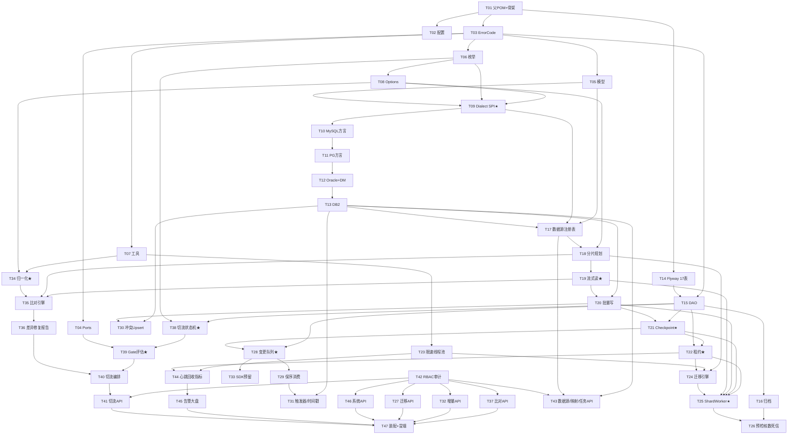

# 异构数据库同步与迁移平台 — 工程师实现任务列表

| 项 | 内容 |
|---|---|
| 文档编号 | IMPL-DBSYNC-001 |
| 项目代号 | `db-sync-platform` |
| 版本 | v1.0 |
| 作者 | 高见远（架构师） |
| 目标读者 | 后端工程师（BE-A / BE-B / BE-C）、测试工程师（QA） |
| 上游输入 | `02-architecture.md`（契约）、`03-wbs.md`（排期与人力） |
| **代码工程根** | **`D:/GC_WorkSpaces/db-sync-platform`** |
| 文档根 | `E:/Workbuddy_Temp/2026-11-09-14-37-07/db-sync-platform/docs` |

---

## 0. 使用说明（工程师先读这页）

### 0.1 路径约定

- 所有"文件路径"字段均为 **`D:/GC_WorkSpaces/db-sync-platform/...`** 完整绝对路径。
- 每次开工前：

```bash
cd D:/GC_WorkSpaces/db-sync-platform
mvn -q clean install -DskipTests     # 确认基线可编译
```

### 0.2 任务格式说明

| 字段 | 含义 |
|---|---|
| **任务ID** | `T01`~`T47`，按实现顺序编号，**严格按序执行**（每个任务的依赖都已满足才可开工） |
| **性质** | `骨架`（只建类/接口/签名，方法体 `throw new UnsupportedOperationException()`）／`核心实现`（完整逻辑）／`接口预留`（只定契约不实现）／`增强`（P1/P2） |
| **文件路径** | 要创建或修改的文件（含完整绝对路径） |
| **关键签名** | 必须实现的类/方法签名要点（不写实现，只钉契约） |
| **验收标准** | 可判定的检查项（测试名/断言/命令输出） |
| **依赖** | 前置任务 ID |

### 0.3 铁律（违反视为返工）

1. **每个任务完成后执行 `mvn -q -pl <module> -am clean install -DskipTests` 必须成功**，且 `mvn -q -pl <module> -am test` 必须绿。不允许"最后一起编译"。
2. **不允许在 `pom.xml` 出现 `ojdbc` / `DmJdbc` / `jcc`**。CI 会 `grep` 检查。
3. **不允许把 `Dialect` 之外的代码里写库专属 SQL 字面量**（如 `LIMIT`、`ROWNUM`、`MERGE INTO`）。所有方言差异必须收敛到 `db-sync-dialect`。
4. **不允许 Lombok**。手写 getter/setter/构造器。
5. **不允许新建未在本文档列出的类**。若确需新增，先更新本文档（PR 里注明）。

---

## 1. 全局共享约定（所有任务共同遵守）

### 1.1 包名规范

```
com.dbsync.common.{model|enums|exception|options|util}
com.dbsync.dialect.{mysql|oracle|postgresql|dm|db2}
com.dbsync.metadata.{config|dao|mapper}
com.dbsync.core.{datasource|read|write|shard|checkpoint|lease|throttle|pool|port}
com.dbsync.migration
com.dbsync.cdc.{api|sdk}
com.dbsync.compare
com.dbsync.cutover
com.dbsync.api.{controller|service|dto|security|audit|alert|metrics|schedule|exception}
com.dbsync.server.{config}
```

- 包根固定 `com.dbsync`，**不允许**出现 `com.dbsync.platform` / `com.dbsync.dbsync` 之类的重复层级。
- 模块名与包名的对应：`db-sync-core` → `com.dbsync.core`（去掉 `db-sync-` 前缀，`-` 转包分层）。

### 1.2 异常码段位分配（`ErrorCode`）

| 段位 | 范围 | 归属 | 示例 |
|---|---|---|---|
| E1xxx | 1000–1999 | 通用/参数/工具 | `E1001 参数非法`、`E1002 标识符非法`、`E1003 JSON 序列化失败`、`E1010 加解密失败`、`E1020 重试耗尽` |
| E2xxx | 2000–2999 | 数据源/连接/池 | `E2001 连接失败-认证`、`E2002 连接失败-网络`、`E2003 数据源被引用`、`E2010 连接池超限`、`E2020 探活失败` |
| E3xxx | 3000–3999 | 任务/迁移/分片 | `E3001 非法任务状态`、`E3002 预检失败`、`E3003 分片区间非法`、`E3005 乐观锁冲突`、`E3010 分片重试耗尽` |
| E4xxx | 4000–4999 | 增量/CDC | `E4001 分组计算失败`、`E4002 水位线回退`、`E4003 触发器部署失败`、`E4010 变更应用失败` |
| E5xxx | 5000–5999 | 比对/修复 | `E5001 比对分块失败`、`E5002 归一化规则冲突`、`E5003 修复证据不足`、`E5010 报告生成失败` |
| E6xxx | 6000–6999 | 切流/Gate | `E6001 非法状态跃迁`、`E6002 Gate 阻断`、`E6003 路由下发未确认`、`E6004 状态不一致需人工介入`、`E6010 灰度规则非法` |
| E7xxx | 7000–7999 | 驱动/方言/环境 | `E7001 驱动缺失`、`E7002 方言不支持该能力`、`E7003 标识符超长`、`E7010 版本不支持` |
| E8xxx | 8000–8999 | 权限/审计/安全 | `E8001 无权限`、`E8002 需要二次确认`、`E8003 审计写入失败` |
| E9xxx | 9000–9999 | 预留（外部集成） | — |

**约定**：
- `ErrorCode` 是枚举，每个值含 `code(String) / httpStatus(int) / retryable(boolean) / messageTemplate(String)`。
- `retryable=true` 的错误码才会被 `RetryTemplate` 重试（如 `E2002`/`E2010` 不可重试，`E4010` 可重试）。
- 新增错误码必须在此表登记（PR 里改本节）。

### 1.3 命名规范

| 类型 | 规范 | 示例 |
|---|---|---|
| 类 | UpperCamelCase | `ShardLeaseManager` |
| 方法 | lowerCamelCase，动词开头 | `claimOne`, `advanceWatermark` |
| 布尔方法/字段 | `is`/`has`/`can`/`needs` 前缀 | `isCommitted()`, `needsFetchSizeCursor` |
| 常量 | UPPER_SNAKE | `DEFAULT_LEASE_SECONDS` |
| 线程名 | `{role}-{taskId}-{n}` | `task-1001-w2`, `cdc-1001-g5` |
| 元数据库表/列 | `snake_case`，表带前缀 | `sync_shard`, `lease_expire_at` |
| DTO | 动词/名词 + `Request`/`Response` | `TaskCreateRequest`, `GateResponse` |
| 测试方法 | `should_期望_When_条件` | `should_notAdvanceCheckpoint_When_writeNotCommitted` |

**Javadoc 硬要求**：以下类的**每个 public 方法**必须有 Javadoc 说明"做了什么 + 失败抛什么 + 幂等性"：
`Dialect` 及 5 实现、`DataSourceRegistry`、`JdbcReader`、`JdbcBatchWriter`、`CheckpointStore`、`ShardLeaseManager`、`MigrationEngine`、`ChangeQueue`、`ChangeConsumer`、`Normalizer`、`GateEvaluator`、`CutoverOrchestrator`。

### 1.4 日志规范

**必须字段**（缺任一视为缺陷）：

| 字段 | 何时必须 | 值来源 |
|---|---|---|
| `traceId` | 所有日志 | HTTP 请求头 `X-Trace-Id` 或入口生成 |
| `taskId` | 任务相关的一切日志 | `MigrationContext` / `GroupWorker` 字段 |
| `shardId` 或 `groupNo` | 分片/组相关 | worker 字段 |
| `table` | 读写数据时 | `TableMeta.getTableName()` |
| `phase` | 引擎日志 | `MIGRATION`/`CDC`/`COMPARE`/`CUTOVER` |

**禁止**：
- 打印密码、完整 JDBC URL（只允许 `host:port/db`）、`before/after` 全行内容。
- 在循环里 `log.info`（用采样：每 100 批一次，或 `log.isDebugEnabled()` 包裹）。
- 用字符串拼接（用 `StructuredLog.info(msg).kv("k",v)...`）。

**示例**（`StructuredLog` 用法）：

```java
StructuredLog.info("batch committed")
    .kv("taskId", ctx.taskId())
    .kv("shardId", shard.id())
    .kv("table", table.getTableName())
    .kv("phase", "MIGRATION")
    .kv("rows", result.rowsAffected())
    .kv("durationMs", cost)
    .kv("lastPk", lastPk)
    .log();
```

### 1.5 事务边界规范（**最容易出错，逐条背下来**）

| 规则 | 说明 |
|---|---|
| **禁止跨库事务** | 源库读事务与目标库写事务是两个 `Connection`，**禁止**用 XA/JTA 把它们绑在一起。所有"一致性"靠 §1.5 的第 2 条。 |
| **禁止在 JDBC 批量里混入 DDL** | `executeBatch()` 只允许 DML（`INSERT/UPDATE/DELETE/MERGE`）。DDL（`CREATE/ALTER/DROP`）必须单独执行并在**自动提交**模式下（MySQL 的 DDL 隐式提交会破坏事务）。 |
| **顺序不可交换** | 目标库 `commit()` 成功 → 才允许写 checkpoint。**反向顺序 = 静默丢数**（架构 §4.1.2）。`ShardWorker` 里只允许一种调用顺序。 |
| **autocommit 必须显式关** | `DataSourceRegistry` 建池时 `setAutoCommit(false)`。Oracle 必须如此（否则 fetchSize 不生效，架构 §5.5）。 |
| **元数据库事务独立** | `MetaJdbcTemplate` 与业务数据源完全隔离，不得在同一段代码里持有两个 `Connection` 超过必要时间（避免连接泄漏与死锁）。 |
| **DAO 方法自带事务** | 需要多语句原子的 DAO 方法用 `TransactionTemplate` 包裹；单语句不需要。`ShardDao.claimOne` 是**必须**的（SELECT FOR UPDATE + UPDATE）。 |
| **分布式锁不用** | 不加 Redis/ZK。多实例互斥靠 `sync_shard` 行锁与 `version`。 |
| **DDL 执行位置** | 目标表建表（`ddl_applied`）在迁移启动前的独立阶段执行，失败不影响已建表。 |

### 1.6 线程池与连接池配比（**上线前必须校验的公式**）

```
每数据源连接数：
    conns(ds) = min( poolMaxSize(ds),
                     ceil(并发分片数 / 实例数) × 每分片连接数 + 预留 )
    每分片连接数：迁移 2、增量 2、比对 2
    预留：元数据读取 1 + 探活 1

★ 硬约束（`DataSourceRegistry.register` 时校验，违反抛 E2010）
    conns(ds) <= 0.6 × 目标库 max_connections

实例线程数：
    Σ(各任务 concurrency) + Σ(各任务 consumerConcurrency)
      + 4（定时任务）+ Tomcat(200)

线程池实现（不用 commonPool，JDK 17 无虚拟线程）：
    迁移: Executors.newFixedThreadPool(concurrency, namedFactory("task-{taskId}-w"))
    增量: Executors.newFixedThreadPool(consumerConcurrency, namedFactory("cdc-{taskId}-g"))
```

**核算示例**（写进部署文档，工程师需在 `W-503` 复现）：

| 场景 | 目标库 max_conn | 实例数 | 每实例并发 | conns(ds) | 0.6×上限 | 结论 |
|---|---|---|---|---|---|---|
| DM8 默认 100 | 100 | 4 | 4 | 4×4×2+2 = 34 | 60 | ✅ |
| DM8 默认 100 | 100 | 4 | 8 | 4×8×2+2 = 66 | 60 | ❌ 抛 E2010，降并发到 7 |
| MySQL 默认 151 | 151 | 2 | 8 | 2×8×2+2 = 34 | 90 | ✅ |

### 1.7 不可变性约定

- `com.dbsync.common.model` 下所有类：`final class` + `private final` 字段 + 构造器校验 + 只提供 getter（**无 setter**）。需要"改一个字段"时用 `withXxx()` 返回新实例。
- 集合字段在构造器里做 `List.copyOf(...)` / `Map.copyOf(...)`，返回时也返回不可变视图。
- 理由：这些对象会跨线程传递（分片计划给 4 个 worker 共享），可变对象是竞态的温床。

### 1.8 测试约定

| 层级 | 要求 |
|---|---|
| 纯计算类（`*Planner`/`*Builder`/`*Calculator`/`*Normalizer`/`*Resolver`） | **必须**有单测，覆盖率 ≥ 80%，无 Spring 上下文（纯 JUnit） |
| DAO | H2 集成测试（`@JdbcTest` 或直接 new `JdbcTemplate`），每张表至少 CRUD 一条 |
| 引擎类 | H2 端到端（`@SpringBootTest` + `application-h2.yml`），覆盖"正常 + 至少 1 条失败路径" |
| 方言实现 | **纯字符串断言**（`assertThat(dialect.createTableDdl(...)).contains("...")`），**不连库** |
| 命名 | `should_<期望>_When_<条件>` |
| 禁止 | `Thread.sleep()` 在测试里超过 200ms（用 `Awaitility` 或显式同步）；禁止 `@Disabled` 提交（要么修要么删） |

---

## 2. 任务总览

| 阶段 | 任务 | 数量 | 性质 |
|---|---|---|---|
| P1 骨架 | T01–T04 | 4 | 骨架 + 接口预留 |
| P2 common | T05–T08 | 4 | 核心实现 |
| P3 dialect | T09–T13 | 5 | 核心实现（T13 为 4 个实现） |
| P4 metadata | T14–T16 | 3 | 核心实现 |
| P5 core | T17–T23 | 7 | 核心实现 |
| P6 migration | T24–T27 | 4 | 核心实现 |
| P7 cdc | T28–T33 | 6 | 核心实现 + 预留 |
| P8 compare | T34–T37 | 4 | 核心实现 |
| P9 cutover | T38–T41 | 4 | 核心实现 |
| P10 api/server | T42–T47 | 6 | 核心实现 |
| **合计** | | **47** | |

**性质分布**：骨架 4 / 核心实现 36 / 接口预留 3（T33 SDK、T47 指标增强、T41 dry-run）/ 增强 4（P1/P2 项）。

---

## 3. 任务详情

### 阶段 P1：骨架（T01–T04）

---

#### T01　父 POM + 10 模块骨架 + 启动类

| 项 | 内容 |
|---|---|
| 性质 | 骨架（可运行） |
| 依赖 | 无 |
| 对应设计 | 架构 §3.1 / §3.2 / §3.3 / §3.4 |

**文件路径**

```
D:/GC_WorkSpaces/db-sync-platform/pom.xml
D:/GC_WorkSpaces/db-sync-platform/.gitignore
D:/GC_WorkSpaces/db-sync-platform/README.md
D:/GC_WorkSpaces/db-sync-platform/lib/.gitkeep
D:/GC_WorkSpaces/db-sync-platform/db-sync-common/pom.xml
D:/GC_WorkSpaces/db-sync-platform/db-sync-dialect/pom.xml
D:/GC_WorkSpaces/db-sync-platform/db-sync-metadata/pom.xml
D:/GC_WorkSpaces/db-sync-platform/db-sync-core/pom.xml
D:/GC_WorkSpaces/db-sync-platform/db-sync-migration/pom.xml
D:/GC_WorkSpaces/db-sync-platform/db-sync-cdc/pom.xml
D:/GC_WorkSpaces/db-sync-platform/db-sync-compare/pom.xml
D:/GC_WorkSpaces/db-sync-platform/db-sync-cutover/pom.xml
D:/GC_WorkSpaces/db-sync-platform/db-sync-api/pom.xml
D:/GC_WorkSpaces/db-sync-platform/db-sync-server/pom.xml
D:/GC_WorkSpaces/db-sync-platform/db-sync-server/src/main/java/com/dbsync/server/DbSyncApplication.java
D:/GC_WorkSpaces/db-sync-platform/db-sync-server/src/main/resources/application.yml
D:/GC_WorkSpaces/db-sync-platform/db-sync-server/src/main/resources/application-h2.yml
D:/GC_WorkSpaces/db-sync-platform/db-sync-server/src/main/resources/logback-spring.xml
```

**关键签名/配置要点**

```java
@SpringBootApplication(scanBasePackages = "com.dbsync")
@EnableScheduling
@EnableConfigurationProperties(DbSyncProperties.class)
public class DbSyncApplication { public static void main(String[] a){ SpringApplication.run(DbSyncApplication.class, a);} }
```

父 POM 必须包含：
- `<properties>`：`java.version=17`、`spring-boot.version=3.2.5`、`<project.build.sourceEncoding>UTF-8`
- `<modules>` 10 个
- `<dependencyManagement>` 统一管理版本
- `spring-boot-maven-plugin` 只在 `db-sync-server` 生效（`<mainClass>` + `<layout>JAR</layout>` + `loader.path` 默认 `lib/`）
- **依赖白名单**（只允许这些）：`spring-boot-starter-web` / `jdbc` / `validation` / `actuator`、`flyway-core`、`h2`（runtime+test）、`mysql-connector-j`（runtime）、`postgresql`（runtime）、`micrometer-registry-prometheus`、`spring-boot-starter-test`、`maven-surefire-plugin`
- **禁止**：`lombok`、`mybatis*`、`spring-boot-starter-data-jpa`、`ojdbc*`、`DmJdbc*`、`jcc`、`guava`、`jasypt`、`mapstruct`

`application.yml` 顶层必须含 `db-sync:` 与 `spring:`（照抄架构 §10 的键与默认值，`master-key: ${DBSYNC_MASTER_KEY:}`）。

**验收标准**

1. `cd D:/GC_WorkSpaces/db-sync-platform && mvn -q clean install -DskipTests` → 成功，10 个模块全部 SUCCESS。
2. `mvn -q -pl db-sync-server spring-boot:run` → 启动成功，`http://localhost:8080/actuator/health` 返回 `{"status":"UP"}`。
3. `grep -rEi "ojdbc|DmJdbc|jcc|lombok|mybatis" --include=pom.xml .` → **无输出**。
4. `git ls-files | grep -c "target/"` → 0（`.gitignore` 生效）。
5. 测试：`should_startContext_When_defaultProfile`（`@SpringBootTest` 空上下文加载）。

---

#### T02　`DbSyncProperties` + 配置绑定

| 项 | 内容 |
|---|---|
| 性质 | 核心实现 |
| 依赖 | T01 |
| 对应设计 | 架构 §10 |

**文件路径**

```
D:/GC_WorkSpaces/db-sync-platform/db-sync-server/src/main/java/com/dbsync/server/config/DbSyncProperties.java
D:/GC_WorkSpaces/db-sync-platform/db-sync-server/src/test/java/com/dbsync/server/config/DbSyncPropertiesTest.java
D:/GC_WorkSpaces/db-sync-platform/db-sync-server/src/main/java/com/dbsync/server/config/OpenApiConfig.java
D:/GC_WorkSpaces/db-sync-platform/db-sync-server/src/main/java/com/dbsync/server/config/WebConfig.java
```

**关键签名**

```java
@ConfigurationProperties(prefix = "db-sync")
public class DbSyncProperties {
    private Instance instance;          // id, heartbeatInterval, drainTimeout
    private String masterKey;
    private String masterKeyPrevious;
    private Meta meta;                  // jdbcUrl, username, password, poolMaxSize, claimStrategy, checkpointFlushInterval
    private Migration migration;        // 11 个字段
    private Cdc cdc;                    // 7 个字段
    private Compare compare;            // 含 Normalize 嵌套
    private Cutover cutover;            // 含 Gate 嵌套
    private Security security;
    private Observability observability;
    private Limits limits;
    // 每个内嵌类都是 static class，字段用 Duration/Integer/Boolean/Double
    public void validate();             // masterKey 空 → 抛 IllegalStateException（启动失败）
}
```

**关键点**：
- `masterKey` 用 `String`，但**重写 `toString()`** 返回 `***`（防止被日志打印）。
- `validate()` 在 `@PostConstruct` 里调用，`masterKey` 为空时抛异常让**启动失败**（架构 §12.1 硬约束 1）。
- `claimStrategy` 用枚举 `ClaimStrategy { SKIP_LOCKED, NOWAIT_PROBE, OPTIMISTIC_CAS }`。

**验收标准**

1. 单测：`should_failStartup_When_masterKeyEmpty`（用 `ApplicationContextRunner`）。
2. 单测：`should_bindAllSections_When_fullYaml`（用 `@EnableConfigurationProperties` + `TestPropertyValues`）。
3. 单测：`should_maskMasterKey_When_toString`。
4. `application.yml` 的每一个 `db-sync.*` 键都能被绑定（用 `Binder` 断言 `bind("db-sync").to(DbSyncProperties.class)` 无 `unbound` 字段）。

---

#### T03　实体基类与 `ErrorCode` 枚举（骨架）

| 项 | 内容 |
|---|---|
| 性质 | 骨架 |
| 依赖 | T01 |
| 对应设计 | 架构 §1.2（异常码段位）/ 本文档 §1.2 |

**文件路径**

```
D:/GC_WorkSpaces/db-sync-platform/db-sync-common/src/main/java/com/dbsync/common/exception/ErrorCode.java
D:/GC_WorkSpaces/db-sync-platform/db-sync-common/src/main/java/com/dbsync/common/exception/DbSyncException.java
D:/GC_WorkSpaces/db-sync-platform/db-sync-common/src/main/java/com/dbsync/common/exception/DialectException.java
D:/GC_WorkSpaces/db-sync-platform/db-sync-common/src/main/java/com/dbsync/common/exception/MetadataReadException.java
D:/GC_WorkSpaces/db-sync-platform/db-sync-common/src/main/java/com/dbsync/common/exception/DriverMissingException.java
D:/GC_WorkSpaces/db-sync-platform/db-sync-common/src/main/java/com/dbsync/common/exception/LeaseLostException.java
D:/GC_WorkSpaces/db-sync-platform/db-sync-common/src/main/java/com/dbsync/common/exception/GateBlockedException.java
D:/GC_WorkSpaces/db-sync-platform/db-sync-common/src/main/java/com/dbsync/common/exception/IllegalStateTransitionException.java
D:/GC_WorkSpaces/db-sync-platform/db-sync-common/src/test/java/com/dbsync/common/exception/ErrorCodeTest.java
```

**关键签名**

```java
public enum ErrorCode {
    PARAM_INVALID("E1001", 400, false, "参数非法：%s"),
    IDENTIFIER_INVALID("E1002", 400, false, "标识符非法：%s"),
    // ... 按 §1.2 段位表逐个补齐，至少 40 个值
    DRIVER_MISSING("E7001", 500, false, "驱动缺失：%s");
    private final String code; private final int httpStatus;
    private final boolean retryable; private final String messageTemplate;
    public String format(Object... args);
}

public class DbSyncException extends RuntimeException {
    private final ErrorCode errorCode;
    private final Map<String,Object> context;   // 结构化上下文（进响应 data）
    public DbSyncException(ErrorCode code, Throwable cause, Object... args);
    public DbSyncException with(String key, Object value);   // 链式加 context
}
```

**验收标准**

1. `ErrorCodeTest`：所有 `code` 唯一；段位与首字母匹配（E1xxx 的归属模块）；`format()` 占位符个数与实际参数校验。
2. 每个子异常类 `should_keepErrorCode_When_wrapped`（`cause` 保留）。

---

#### T04　模块间 Port 接口（接口预留）

| 项 | 内容 |
|---|---|
| 性质 | 接口预留 |
| 依赖 | T03 |
| 对应设计 | 架构 §3.1（禁止模块环）/ §6.2 |

**文件路径**

```
D:/GC_WorkSpaces/db-sync-platform/db-sync-core/src/main/java/com/dbsync/core/port/IncrementalMetricsPort.java
D:/GC_WorkSpaces/db-sync-platform/db-sync-core/src/main/java/com/dbsync/core/port/CompareVerdictPort.java
D:/GC_WorkSpaces/db-sync-platform/db-sync-core/src/main/java/com/dbsync/core/port/AuditPort.java
D:/GC_WorkSpaces/db-sync-platform/db-sync-core/src/main/java/com/dbsync/core/port/AlertPort.java
D:/GC_WorkSpaces/db-sync-platform/db-sync-core/src/main/java/com/dbsync/core/port/AuditEntry.java
```

**关键签名**

```java
public interface IncrementalMetricsPort {
    long latencyP95(long taskId);                  // ms；无数据返回 0
    long backlog(long taskId);                     // 未 APPLIED 条数
    double failRate(long taskId, Duration window); // 0.0~1.0
    Instant lastApplyAt(long taskId);              // null = 从未应用
}

public interface CompareVerdictPort {
    Optional<CompareVerdictSnapshot> latestVerdict(long taskId);
    // snapshot: passRate / finishedAt / verdict / diffRows / totalRows / jobId
}

public interface AuditPort {
    void record(AuditEntry entry);   // 必须永不抛异常（内部吞并记 WARN 日志）
}

public interface AlertPort {
    void fire(String rule, String title, String detail, Map<String,Object> tags);
}
```

**硬约束（写进 Javadoc）**：
- `com.dbsync.cutover` **不得** import `com.dbsync.cdc` / `com.dbsync.compare`。
- `AuditPort.record` 的实现必须吞异常（审计失败不能影响主流程），但要用 WARN 日志记录。

**验收标准**

1. `mvn -q -pl db-sync-cutover dependency:tree | grep -E "db-sync-(cdc|compare)"` → **无输出**（在 T39 完成后校验）。
2. 架构测试（可选但建议）：`ArchUnitTest.should_notDependOnCdcOrCompare_When_packageIsCutover`。

---

### 阶段 P2：common 模型与工具（T05–T08）

---

#### T05　领域模型（28 个值类）

| 项 | 内容 |
|---|---|
| 性质 | 核心实现 |
| 依赖 | T03 |
| 对应设计 | 架构 §6.2 / 本文档 §1.7 |

**文件路径**（`D:/GC_WorkSpaces/db-sync-platform/db-sync-common/src/main/java/com/dbsync/common/model/`）

```
DataSourceDef.java  JdbcEndpoint.java  TableMeta.java  ColumnMeta.java  IndexMeta.java
PrimaryKeyMeta.java  TableMapping.java  ColumnMapping.java  SyncTask.java  Shard.java
PkRange.java  Checkpoint.java  ChangeEvent.java  CommitSequence.java  Watermark.java
CompareResult.java  BlockResult.java  DiffRecord.java  CompareReport.java  CutoverPlan.java
CutoverStep.java  RouteRule.java  RouteSnapshot.java  GateResult.java  DeadLetter.java
PrecheckReport.java  CompareVerdictSnapshot.java  InstanceInfo.java
```

**关键签名（节选，其余按架构 §3.4 注释）**

```java
// PkRange：左闭右开 [start, end)
public final class PkRange {
    private final Object start;  private final Object end;   // null = 无界
    private final RangeKind kind;                            // NUMERIC/STRING/HASH/NONE
    public boolean isLeftOpen() { return start == null; }
    public boolean isRightOpen() { return end == null; }
    public boolean contains(Object pk, Comparator<Object> cmp);   // start < pk <= end? 见注释
}

// CommitSequence：可比较，先 commitTs 后 seq
public final class CommitSequence implements Comparable<CommitSequence> {
    private final Instant commitTs; private final long seq;
    @Override public int compareTo(CommitSequence o);   // 先比 ts，再比 seq
}

// TableMeta：含 columns/pk/indexes/estimatedRows，构造器校验"pks 必须在 columns 中"
public final class TableMeta {
    public List<ColumnMeta> primaryKeyColumns();
    public boolean hasPrimaryKey();
    public List<String> columnNames();       // 物理顺序
    public Optional<ColumnMeta> column(String nameIgnoreCase);
}
```

**验收标准**

1. 每个类：① `final class`；② 字段 `private final`；③ 无 setter；④ 集合字段 `List.copyOf`；⑤ 构造器对必填字段 `Objects.requireNonNull`。
2. `TableMetaTest.should_reject_When_pkNotInColumns`。
3. `PkRangeTest`：`contains` 对 `(start, end]` 与 `[start, end)` 两种语义各 5 个用例（**注意**：SQL 层用 `pk > start AND pk <= end` 还是 `pk >= start AND pk < end`，由 `Dialect.buildRangePredicate` 决定；模型层只提供 `contains` 的统一语义，实现为 `cmp(start, pk) < 0 && cmp(pk, end) <= 0`，即 `(start, end]`，与 Oracle 习惯一致。**此处必须在 Javadoc 写清**，否则工程师会写反)。
4. `CommitSequenceTest`：`ts` 相同时按 `seq` 排序；`Instant` 精度到毫秒或微秒不影响比较。

---

#### T06　枚举（15 个）

| 项 | 内容 |
|---|---|
| 性质 | 核心实现 |
| 依赖 | T03 |
| 对应设计 | 架构 §3.4 |

**文件路径**（`.../common/enums/`）

```
DbType  IdentifierCase  EnvType  TaskState  ShardState  ChangeOp  ChangeStatus
ConflictPolicy  IncrementalMode  CompareVerdict  DiffType  CutoverState  RouteTarget
NormalizeRuleType  RangeKind
```

**关键签名**

```java
public enum DbType {
    MYSQL("com.mysql.cj.jdbc.Driver","jdbc:mysql://"),
    ORACLE("oracle.jdbc.OracleDriver","jdbc:oracle:thin:@//"),
    POSTGRESQL("org.postgresql.Driver","jdbc:postgresql://"),
    DM("dm.jdbc.driver.DmDriver","jdbc:dm://"),
    DB2("com.ibm.db2.jcc.DB2Driver","jdbc:db2://");
    private final String driverClassName; private final String urlPrefix;
    public static DbType ofJdbcUrl(String url);       // 前缀匹配，未知抛 E7010
}

public enum CutoverState {
    DRAFT, PRE_CHECK, PRE_CHECK_FAILED, GRAY_READ, GRAY_WRITE,
    FULL_TARGET, OBSERVE, DONE, ROLLED_BACK;
    public boolean isTerminal();
    public List<CutoverState> allowedNext();    // ★ 架构 §4.5.3 跃迁表，唯一数据源
    public List<CutoverState> allowedPrev();
    public boolean isRollbackReachableFrom(CutoverState from);
}
```

**验收标准**

1. `CutoverStateTest`：跃迁表与架构 §4.5.3 **逐行**对齐（9 行断言）；`DRAFT.allowedNext()` 只含 `PRE_CHECK`；`ROLLED_BACK` 从任意非终态可达。
2. `DbTypeTest.ofJdbcUrl` 5 种 URL + 1 种未知。

---

#### T07　工具类：加密 / 限速 / 重试 / ID / 哈希

| 项 | 内容 |
|---|---|
| 性质 | 核心实现 |
| 依赖 | T03 |
| 对应设计 | 架构 §12.1（加密）/ §13.5（限速） |

**文件路径**（`.../common/util/`）

```
AesGcmCipher.java  RateLimiter.java  RetryTemplate.java  SnowflakeId.java
HashUtil.java  PkRangeUtil.java  IdentifierValidator.java  ThreadPoolFactory.java
StructuredLog.java  JsonUtil.java
```

**关键签名**

```java
public final class AesGcmCipher {
    public AesGcmCipher(byte[] masterKey, byte[] previousKey /*nullable*/, short currentVersion);
    public String encrypt(String plain);                 // Base64(iv||ct||tag)
    public String decrypt(String cipher, short keyVersion);
    public static byte[] generateKey();
}

public final class RateLimiter {
    public RateLimiter(long permitsPerSecond);
    public long tryAcquireRows(long maxRows);   // 返回获批行数 [0, maxRows]；0 表示当前无许可
    public void updateRate(long permitsPerSecond);   // 运行时调整，≤1s 生效
}

public final class RetryTemplate {
    public RetryTemplate(int maxAttempts, Duration initialBackoff, double multiplier, double jitter);
    public <T> T execute(Supplier<T> action, Predicate<Throwable> retryable);
    // 指数退避 1s/2s/4s + ±20% 抖动；InterruptedException 直接抛，不重试
}

public final class HashUtil {
    public static String md5Hex(byte[] b);
    public static long fnv1a64(String s);           // 归一化后的 key
    public static long pkHash(List<Object> normalizedPkTuple);
}

public final class IdentifierValidator {
    public static void validate(String identifier, int maxLength, DbType dbType);  // 抛 E1002/E7003
    public static boolean isValid(String identifier);   // ^[A-Za-z_][A-Za-z0-9_$#]{0,127}$
}
```

**验收标准**

1. `AesGcmCipherTest`：① 加解密往返；② 改密文 1 bit → 抛异常（GCM 校验）；③ 旧密钥版本仍可解（轮换）；④ `generateKey()` 长度 32。
2. `RateLimiterTest`：1s 内 `tryAcquireRows(10)` 累计 ≤ 1000（±5%）；`updateRate` 后 1s 内生效。
3. `RetryTemplateTest`：`retryable=false` 的错误**只执行 1 次**；`maxAttempts=3` 执行 3 次且间隔指数增长（用 mock 时间或断言总耗时 ≥ 3s）。
4. `IdentifierValidatorTest`：拒绝 `t; DROP TABLE x`、`"t"`、`t--`、超长名（Oracle 30/DB2 128）；接受 `T_ORDER`、`t$1`、`_tmp`。
5. `HashUtilTest`：`fnv1a64` 对同输入稳定；`pkHash([1L])` 与 `pkHash([new BigDecimal("1")])` **相同**（归一化后）。★这一条是增量保序的前提。
6. `SnowflakeIdTest`：1 万次生成无重复、趋势递增、workerId 不同不冲突。

---

#### T08　Options 对象（9 个）

| 项 | 内容 |
|---|---|
| 性质 | 核心实现 |
| 依赖 | T06 |
| 对应设计 | 架构 §4.4（归一化开关）/ §5（类型映射） |

**文件路径**（`.../common/options/`）

```
TypeMappingOptions  MappingOptions  ShardPlanOptions  ReadOptions  WriteOptions
NormalizeOptions  CompareOptions  TriggerOptions  GateThresholds
```

**关键签名**

```java
public final class NormalizeOptions {
    // 强制项（无开关，构造器固定 true）
    private final boolean columnOrderByName;    // 恒 true
    private final boolean nullSentinel;         // 恒 true
    private final boolean binaryAsBase64;       // 恒 true
    // 可配项
    private final boolean emptyAsNull;          // 默认 true
    private final boolean decimalTrimZeros;     // 默认 true
    private final TimePrecision timePrecision;  // 默认 MICROS
    private final ZoneId sourceTimeZone;        // 默认 Asia/Shanghai
    private final boolean trimWhitespace;       // 默认 false
    private final boolean caseInsensitive;      // 默认 false
    private final double floatTolerance;        // 默认 0.0
    private final int lobCompareLimitBytes;     // 默认 65536
    public static NormalizeOptions defaults();
    public NormalizeOptions withEmptyAsNull(boolean v);   // 不可变 with*
    public Map<String,String> toReportMap();   // 报告展示用（架构 §4.4.3 格式）
}
```

**验收标准**

1. `NormalizeOptionsTest`：默认值符合架构 §4.4.2；`toReportMap()` 输出含 10 条规则的启停状态 + 参数值（键名与报告格式一致）。
2. 强制项无 setter（`NormalizeOptions.class.getDeclaredMethods()` 断言无 `setColumnOrderByName`）。
3. `GateThresholdsTest`：四阈值默认值 = `0.9999 / 5000 / 0.0001 / 0`。

---

### 阶段 P3：dialect（T09–T13）

---

#### T09　`Dialect` SPI 接口 + `Capabilities` + `DialectRegistry`

| 项 | 内容 |
|---|---|
| 性质 | 核心实现（契约定稿，最关键的评审点） |
| 依赖 | T05, T06, T08 |
| 对应设计 | **架构 §5.1 / §5.5**（契约唯一来源） |

**文件路径**

```
D:/GC_WorkSpaces/db-sync-platform/db-sync-dialect/src/main/java/com/dbsync/dialect/Dialect.java
D:/GC_WorkSpaces/db-sync-platform/db-sync-dialect/src/main/java/com/dbsync/dialect/MetadataReader.java
D:/GC_WorkSpaces/db-sync-platform/db-sync-dialect/src/main/java/com/dbsync/dialect/TriggerDdlGenerator.java
D:/GC_WorkSpaces/db-sync-platform/db-sync-dialect/src/main/java/com/dbsync/dialect/Capabilities.java
D:/GC_WorkSpaces/db-sync-platform/db-sync-dialect/src/main/java/com/dbsync/dialect/DialectRegistry.java
D:/GC_WorkSpaces/db-sync-platform/db-sync-dialect/src/main/java/com/dbsync/dialect/AbstractDialect.java
D:/GC_WorkSpaces/db-sync-platform/db-sync-dialect/src/main/java/com/dbsync/dialect/JdbcDriverLoader.java
D:/GC_WorkSpaces/db-sync-platform/db-sync-dialect/src/test/java/com/dbsync/dialect/DialectRegistryTest.java
D:/GC_WorkSpaces/db-sync-platform/db-sync-dialect/src/test/java/com/dbsync/dialect/JdbcDriverLoaderTest.java
```

**关键签名**

**照抄架构 §5.1 / §5.2 / §5.3 / §5.5，一字不改。** 这是契约，改签名要走架构评审。

补充 `AbstractDialect` 的模板方法：

```java
public abstract class AbstractDialect implements Dialect {
    protected abstract char quoteChar();              // '`' 或 '"'
    protected abstract boolean supportsIfNotExists();
    protected String joinColumns(List<String> quoted) { return String.join(", ", quoted); }
    protected abstract String buildColumnDef(ColumnMeta col, MappingOptions opts);
    protected abstract String buildIdentityClause(ColumnMeta col);
    @Override public String quote(String id) { /* 统一转义：quoteChar 重复即转义 */ }
    @Override public String normalize(String id, IdentifierCase s) { /* Locale.ROOT */ }
    @Override public String createIndexDdl(TableMeta t, MappingOptions o) { /* 通用循环 + 子类提供 INDEX 语法 */ }
}
```

**`JdbcDriverLoader`**

```java
public final class JdbcDriverLoader {
    private static final Set<String> LOADED = ConcurrentHashMap.newKeySet();
    public static void ensureLoaded(String driverClassName);  // 幂等；失败抛 DriverMissingException
    public static boolean isAvailable(String driverClassName);
    private static String buildMissingMessage(String driver);  // 架构 §5.4 模板
}
```

**验收标准**

1. `DialectRegistryTest`：`get(DbType.MYSQL)` 返回单例；`getByJdbcUrl("jdbc:dm://...")` 正确；未知 URL 抛 `E7010`。
2. `JdbcDriverLoaderTest`：`isAvailable("org.h2.Driver")` true；`ensureLoaded("com.ibm.db2.jcc.DB2Driver")` 抛 `DriverMissingException` 且消息**包含** `"SYSIBM"`? 不 —— 必须包含 ① 驱动类名 ② 三条加载方式 ③ 当前可用驱动清单（断言 `assertThatThrownBy(...).hasMessageContaining("lib/")`）。
3. **`AbstractDialect` 的 `quote` 对 `a"b` 转义正确**（`"a""b"`）。
4. ★ **本任务完成后必须发起 2 小时契约评审**（架构 §5 与 DB2/DM 各 3 条真实 SQL 对照），评审结论记录在 PR 描述里。

---

#### T10　MySQL 方言完整实现

| 项 | 内容 |
|---|---|
| 性质 | 核心实现 |
| 依赖 | T09 |
| 对应设计 | 架构 §5.1~§5.4 / §5.5 |

**文件路径**

```
D:/GC_WorkSpaces/db-sync-platform/db-sync-dialect/src/main/java/com/dbsync/dialect/mysql/MySqlDialect.java
D:/GC_WorkSpaces/db-sync-platform/db-sync-dialect/src/main/java/com/dbsync/dialect/mysql/MySqlMetadataReader.java
D:/GC_WorkSpaces/db-sync-platform/db-sync-dialect/src/main/java/com/dbsync/dialect/mysql/MySqlTriggerDdlGenerator.java
D:/GC_WorkSpaces/db-sync-platform/db-sync-dialect/src/test/java/com/dbsync/dialect/mysql/MySqlDialectTest.java
D:/GC_WorkSpaces/db-sync-platform/db-sync-dialect/src/test/java/com/dbsync/dialect/mysql/MySqlDdlSnapshotTest.java
```

**关键实现要点**

| 能力 | MySQL 实现 |
|---|---|
| `quote` | `` `id` ``；内部 `` ` `` 转义为 ` `` ` |
| `mapType` | `NUMBER(p,0)&p<=19`→`BIGINT`；`NUMBER(p,s)`→`DECIMAL(p,s)`；`VARCHAR2`→`VARCHAR`；`CLOB`→`LONGTEXT`；`BLOB`→`LONGBLOB`；`DATE`→`DATETIME(3)`；`TIMESTAMP WITH TIME ZONE`→`DATETIME(3)`（+ 注释提醒时区） |
| `createTableDdl` | 列 + 主键 + 唯一键**内联**（`UNIQUE KEY uk_x (...)`）+ 普通索引内联 + **表/列注释内联**（`COMMENT '...'`）；`AUTO_INCREMENT` 内联 |
| `createIndexDdl` | **返回空 list**（索引已内联在 CREATE TABLE） |
| `commentDdl` | **返回空 list**（注释已内联） |
| `buildUpsertSql` | `INSERT INTO t (c1,c2) VALUES (?,?) ON DUPLICATE KEY UPDATE c2=VALUES(c2), ...`（**主键列不参与 UPDATE 部分**） |
| `buildPageSql` | 无 ORDER BY 时 `${base} LIMIT ?, ?`；有则包一层 `SELECT * FROM (${base}) _p LIMIT ?, ?` |
| `buildRangePredicate` | `upperInclusive ? "`pk` <= ?" : "`pk` < ?"` |
| `capabilities` | `supportsOnDuplicateKey=true`、`supportsMerge=false`、`supportsOnConflict=false`、`needsFetchSizeCursor=false`（但需 `Integer.MIN_VALUE`，见 §5.5）、`maxIdentifierLength=64`、`recommendedBatchSize=1000`、`supportsCommentOn=false` |
| `metadata` | 见架构 §5.2 表；`estimateRows` 用 `information_schema.TABLES.TABLE_ROWS` |
| `trigger` | 3 个触发器（INSERT/UPDATE/DELETE）；`NEW.col`/`OLD.col`；日志表 `id BIGINT AUTO_INCREMENT PRIMARY KEY` |

**验收标准**（`MySqlDialectTest` ≥ 25 条断言）

1. `createTableDdl` 含：`CREATE TABLE`、`` `id` BIGINT NOT NULL ``、`PRIMARY KEY`、`UNIQUE KEY`、`COMMENT '...'`、`AUTO_INCREMENT`。
2. `buildUpsertSql` 含 `ON DUPLICATE KEY UPDATE`，且 `SET` 部分**不含**主键列（断言 `notContaining("id=VALUES(id)")`）。
3. `buildPageSql(base)` == `base + " LIMIT ?, ?"`；`buildPageSql(baseWithOrderBy)` 含 `SELECT * FROM (`。
4. `buildRangePredicate("`id`", false)` == `` "`id` < ?" ``。
5. `quote("a`b")` == `` "`a``b`" ``。
6. `mapType(NUMBER(19,0))` == `BIGINT`；`mapType(NUMBER(38,10))` == `DECIMAL(38,10)`；`mapType(VARCHAR2(64))` == `VARCHAR(64)`。
7. `createIndexDdl` 与 `commentDdl` 返回**空**。
8. `capabilities().supportsOnDuplicateKey()` true。
9. `MySqlDdlSnapshotTest`：对 3 张典型表（单主键/复合主键/含 LOB）生成 DDL 的快照文件比对（`src/test/resources/snapshot/mysql/*.sql`）。
10. `MySqlMetadataReader` 用 H2(MySQL 模式) 建 2 张表，`loadTable` 返回的列数/主键/唯一索引/注释正确。

---

#### T11　PostgreSQL 方言完整实现

| 项 | 内容 |
|---|---|
| 性质 | 核心实现 |
| 依赖 | T10 |
| 对应设计 | 同 T10 |

**文件路径**

```
D:/GC_WorkSpaces/db-sync-platform/db-sync-dialect/src/main/java/com/dbsync/dialect/postgresql/PostgresDialect.java
D:/GC_WorkSpaces/db-sync-platform/db-sync-dialect/src/main/java/com/dbsync/dialect/postgresql/PostgresMetadataReader.java
D:/GC_WorkSpaces/db-sync-platform/db-sync-dialect/src/main/java/com/dbsync/dialect/postgresql/PostgresTriggerDdlGenerator.java
D:/GC_WorkSpaces/db-sync-platform/db-sync-dialect/src/test/java/com/dbsync/dialect/postgresql/PostgresDialectTest.java
```

**关键实现要点**

| 能力 | PG 实现 |
|---|---|
| `quote` | `"id"`；内部 `"` 转义为 `""` |
| `mapType` | `NUMBER(p,0)&p<=9`→`INTEGER`；`<=19`→`BIGINT`；否则 `NUMERIC(p,s)`；`VARCHAR2`→`VARCHAR`；`CLOB`→`TEXT`；`BLOB`→`BYTEA`；`DATE`→`TIMESTAMP(3)`；`NUMBER` 无精度→`NUMERIC(38,10)`（架构风险 R9） |
| `createTableDdl` | 列 + `PRIMARY KEY (...)` 表级约束 + `UNIQUE (...)` 表级；`GENERATED BY DEFAULT AS IDENTITY`；**注释不在 DDL 内** |
| `createIndexDdl` | `CREATE INDEX idx_x ON t (c)`；唯一索引 `CREATE UNIQUE INDEX` |
| `commentDdl` | `COMMENT ON TABLE/COLUMN ... IS '...'`（**必须在这里**） |
| `buildUpsertSql` | `INSERT INTO t (...) VALUES (...) ON CONFLICT (pk1,pk2) DO UPDATE SET c=EXCLUDED.c, ...` |
| `buildPageSql` | `base + " LIMIT ? OFFSET ?"` |
| `capabilities` | `supportsOnConflict=true`、`maxIdentifierLength=63`、`recommendedBatchSize=1000`、`supportsIdentityInsert=true`（`OVERRIDING SYSTEM VALUE`） |
| `trigger` | **两段式**：`CREATE FUNCTION xxx_sync_fn() RETURNS trigger AS $$ BEGIN INSERT INTO log(...) VALUES (NEW.id, ..., TG_OP); RETURN NEW; END; $$ LANGUAGE plpgsql;` + `CREATE TRIGGER xxx_sync AFTER INSERT OR UPDATE OR DELETE ON t FOR EACH ROW EXECUTE FUNCTION xxx_sync_fn();`（**一个触发器可挂三个事件**，用 `TG_OP` 区分） |

**关键坑（写进注释）**：
- `$$` 在 Java 字符串里安全，但**不要在 JDBC 里用 `Statement.execute(sql)` 分号分隔**，PG 会把 `$$...$$` 内容当整体。
- DELETE 触发器必须 `RETURN OLD`（不是 `NEW`，否则报错）。
- `EXECUTE FUNCTION` 是 PG 11+；若客户是 PG 10，要 `EXECUTE PROCEDURE`（通过 `Capabilities` 或版本探测，本期先 `EXECUTE FUNCTION`，在文档标注 PG 11+ 要求）。

**验收标准**

1. `buildUpsertSql` 含 `ON CONFLICT` 与 `EXCLUDED.`。
2. `createTableDdl` **不含** `COMMENT`（断言 `notContaining("COMMENT")`）。
3. `commentDdl` 返回非空且含 `COMMENT ON TABLE`。
4. `createTriggerDdl` 返回 **2** 条（函数 + 触发器），第 1 条含 `LANGUAGE plpgsql`、第 2 条含 `EXECUTE FUNCTION`。
5. `mapType(NUMBER 无精度)` == `NUMERIC(38,10)`。
6. ≥ 20 条断言 + 快照测试。

---

#### T12　Oracle + DM 方言实现

| 项 | 内容 |
|---|---|
| 性质 | 核心实现 |
| 依赖 | T11 |
| 对应设计 | 同 T10；DM 参考架构 §5.2 / §5.3 的"同 Oracle"列 |

**文件路径**

```
D:/GC_WorkSpaces/db-sync-platform/db-sync-dialect/src/main/java/com/dbsync/dialect/oracle/OracleDialect.java
D:/GC_WorkSpaces/db-sync-platform/db-sync-dialect/src/main/java/com/dbsync/dialect/oracle/OracleMetadataReader.java
D:/GC_WorkSpaces/db-sync-platform/db-sync-dialect/src/main/java/com/dbsync/dialect/oracle/OracleTriggerDdlGenerator.java
D:/GC_WorkSpaces/db-sync-platform/db-sync-dialect/src/main/java/com/dbsync/dialect/dm/DmDialect.java
D:/GC_WorkSpaces/db-sync-platform/db-sync-dialect/src/main/java/com/dbsync/dialect/dm/DmMetadataReader.java
D:/GC_WorkSpaces/db-sync-platform/db-sync-dialect/src/main/java/com/dbsync/dialect/dm/DmTriggerDdlGenerator.java
D:/GC_WorkSpaces/db-sync-platform/db-sync-dialect/src/test/java/com/dbsync/dialect/oracle/OracleDialectTest.java
D:/GC_WorkSpaces/db-sync-platform/db-sync-dialect/src/test/java/com/dbsync/dialect/dm/DmDialectTest.java
```

**Oracle 要点**

| 能力 | 实现 |
|---|---|
| `buildUpsertSql` | `MERGE INTO t tgt USING (SELECT ? AS c1, ? AS c2 FROM DUAL) src ON (tgt.pk1 = src.c1) WHEN MATCHED THEN UPDATE SET c2 = src.c2 WHEN NOT MATCHED THEN INSERT (c1,c2) VALUES (src.c1, src.c2)` |
| `buildPageSql` | `Capabilities.oraclePagination = ROWNUM \| FETCH_FIRST`：ROWNUM → `SELECT * FROM (SELECT a.*, ROWNUM rn FROM (${base}) a WHERE ROWNUM <= ?) WHERE rn > ?`；FETCH_FIRST → `base OFFSET ? ROWS FETCH NEXT ? ROWS ONLY` |
| `capabilities` | `needsFetchSizeCursor=true`（**最关键**）、`maxIdentifierLength=30`（11g）/`128`（12c+，用参数）、`recommendedBatchSize=500`、`supportsMultiRowValues=false` |
| `metadata` | 架构 §5.2 的 `ALL_*` 视图 |
| `trigger` | `:NEW.col` 前缀；`FOR EACH ROW`；**同事务**（不用 `AUTONOMOUS_TRANSACTION`）；3 个触发器 |

**DM 要点**

- `trigger`：与 Oracle 近似（`:NEW.col`）；**DM 不支持触发器内 `INSERT ... SELECT`，统一用 `VALUES`**。
- `capabilities().supportsSkipLocked()` **默认 false**（架构 §4.2.3）。
- `quote`：双引号，且**引号内标识符大小写敏感**（DM 的 `CASE_SENSITIVE` 参数相关，`capabilities.caseSensitiveIdentifiers=true`）。
- `MERGE` 语法需实测：DM8 的 `MERGE INTO ... USING (SELECT ? FROM DUAL)` 支持，但 `WHEN NOT MATCHED THEN INSERT` 的列列表必须与 `USING` 子查询列**严格同序**（注释强调）。
- `buildPageSql`：DM 兼容 Oracle 的 `ROWNUM` 与 `LIMIT`，**统一用 `LIMIT ? OFFSET ?`**（DM 原生支持，比 ROWNUM 简单）。

**验收标准**

1. Oracle：`buildUpsertSql` 含 `MERGE INTO`、`USING (SELECT`、`FROM DUAL`、`WHEN MATCHED THEN UPDATE`、`WHEN NOT MATCHED THEN INSERT`；`buildPageSql` 两种模式各 1 条断言；`capabilities().needsFetchSizeCursor()` **true**。
2. DM：`buildPageSql` == `base + " LIMIT ? OFFSET ?"`；`capabilities().supportsSkipLocked()` **false**；`quote` 用 `"`。
3. 触发器：Oracle `createTriggerDdl` 返回 3 条且每条含 `:NEW.`；DM 同。
4. 每方言 ≥ 20 条断言 + 快照测试。
5. `mapType(NUMBER(38,10))` → Oracle `NUMBER(38,10)` / DM `DECIMAL(38,10)`。

---

#### T13　DB2 方言完整实现

| 项 | 内容 |
|---|---|
| 性质 | 核心实现 |
| 依赖 | T12 |
| 对应设计 | 架构 §5.2 / §5.3 DB2 列 |

**文件路径**

```
D:/GC_WorkSpaces/db-sync-platform/db-sync-dialect/src/main/java/com/dbsync/dialect/db2/Db2Dialect.java
D:/GC_WorkSpaces/db-sync-platform/db-sync-dialect/src/main/java/com/dbsync/dialect/db2/Db2MetadataReader.java
D:/GC_WorkSpaces/db-sync-platform/db-sync-dialect/src/main/java/com/dbsync/dialect/db2/Db2TriggerDdlGenerator.java
D:/GC_WorkSpaces/db-sync-platform/db-sync-dialect/src/test/java/com/dbsync/dialect/db2/Db2DialectTest.java
```

**DB2 要点（语法最特殊，逐条照做）**

| 能力 | 实现 |
|---|---|
| `buildUpsertSql` | `MERGE INTO t AS tgt USING (SELECT CAST(? AS BIGINT) AS c1, CAST(? AS VARCHAR(64)) AS c2 FROM SYSIBM.SYSDUMMY1) AS src ON tgt.pk1 = src.c1 WHEN MATCHED THEN UPDATE SET c2 = src.c2 WHEN NOT MATCHED THEN INSERT (c1,c2) VALUES (src.c1, src.c2)`（**必须 CAST**，否则 DB2 推断类型失败） |
| `buildPageSql` | `base + " OFFSET ? ROWS FETCH NEXT ? ROWS ONLY"` |
| `capabilities` | `maxIdentifierLength=128`、`recommendedBatchSize=500`、`supportsMultiRowValues=true`、`supportsIdentityInsert=true` |
| `trigger` | `CREATE TRIGGER x AFTER INSERT ON t REFERENCING NEW AS N FOR EACH ROW MODE DB2SQL INSERT INTO log(...) VALUES (N.id, ...)`；DELETE 用 `REFERENCING OLD AS O` |
| `metadata` | 架构 §5.2 的 `SYSCAT.*` |
| `mapType` | `NUMBER`→`DECIMAL`；`VARCHAR2`→`VARCHAR`；`CLOB`→`CLOB(1M)`；`BLOB`→`BLOB(1M)`；`DATE`→`TIMESTAMP(3)` |

**验收标准**

1. `buildUpsertSql` 含 `FROM SYSIBM.SYSDUMMY1`、`CAST(? AS`、`AS tgt`/`AS src`。
2. `buildPageSql` 含 `OFFSET ? ROWS FETCH NEXT ? ROWS ONLY`。
3. `createTriggerDdl` 含 `REFERENCING NEW AS N`、`MODE DB2SQL`、`N.`。
4. ≥ 20 条断言 + 快照测试。
5. `maxIdentifierLength` 128。

---

### 阶段 P4：metadata（T14–T16）

---

#### T14　Flyway `V1__init.sql`（18 张表）

| 项 | 内容 |
|---|---|
| 性质 | 核心实现 |
| 依赖 | T01 |
| 对应设计 | **架构 §7.2（DDL 唯一来源）/ §7.3（H2 兼容）** |

**文件路径**

```
D:/GC_WorkSpaces/db-sync-platform/db-sync-metadata/src/main/resources/db/migration/V1__init.sql
D:/GC_WorkSpaces/db-sync-platform/db-sync-metadata/src/main/resources/db/migration/V2__seed.sql
D:/GC_WorkSpaces/db-sync-platform/db-sync-metadata/src/test/java/com/dbsync/metadata/FlywayMigrationTest.java
```

**实现要点**

- 18 张表按架构 §7.2 **逐字**实现（字段名、类型、索引名、唯一键名、注释）。
- **必须使用双方言兼容子集**（架构 §7.3）：
  - 用 `TIMESTAMP(3)` 而非 `DATETIME(3)`? **不** —— MySQL 的 `TIMESTAMP(3)` 有 2038 问题；用 `DATETIME(3)`，H2 MySQL 模式可解析为 `TIMESTAMP`。**结论：用 `DATETIME(3)`**。
  - `JSON` 列 → 用 `TEXT`（架构 §7.3 决定）。
  - `TINYINT(1)` → 改 `TINYINT`（H2 不认显示宽度）。
  - `MEDIUMTEXT` → `TEXT`。
  - 无 `ENGINE=`、无表尾 `COMMENT='...'`；表注释用 `COMMENT ON TABLE`。
  - 索引内联 `KEY idx_x (a,b)`（H2 MySQL 模式支持）。
- `V2__seed.sql`：默认 admin（`admin` / 初始密码 `Admin@12345` 的 PBKDF2 hash + salt，**写在 README 要求首登改密**）+ 系统参数（无，本期参数走 yml）。

**验收标准**

1. `FlywayMigrationTest.should_migrate_When_h2MySqlMode` → `flyway.migrate()` 成功，`information_schema.TABLES` 中 18 张表全部存在。
2. 表/索引/唯一约束与架构 §7.2 **逐条比对**（写一个测试读 `information_schema` 生成概要与期望值比对，或至少人工 checklist）。
3. **在真实 MySQL 8 上手工执行一次**（QA 提供实例），无报错。
4. `V2__seed.sql` 插入 1 条 admin。

---

#### T15　`MetaDataSourceConfig` + 18 个 DAO

| 项 | 内容 |
|---|---|
| 性质 | 核心实现 |
| 依赖 | T14, T03 |
| 对应设计 | 架构 §7 / §4.2（`claimOne` 的关键实现） |

**文件路径**

```
D:/GC_WorkSpaces/db-sync-platform/db-sync-metadata/src/main/java/com/dbsync/metadata/config/MetaDataSourceConfig.java
D:/GC_WorkSpaces/db-sync-platform/db-sync-metadata/src/main/java/com/dbsync/metadata/dao/DataSourceDao.java
... SyncTaskDao / TableMappingDao / ShardDao / CheckpointDao / ChangeLogDao / WatermarkDao
... DeadLetterDao / CompareJobDao / CompareBlockDao / CompareDiffDao / CutoverPlanDao
... CutoverStepLogDao / InstanceDao / UserDao / AuditLogDao / TriggerDefDao
D:/GC_WorkSpaces/db-sync-platform/db-sync-metadata/src/test/java/com/dbsync/metadata/dao/*DaoTest.java（18 个）
```

**关键签名（只列关键的，其余标准 CRUD）**

```java
@Repository
public class ShardDao {
    /**
     * 抢占一个分片。必须在元数据库事务内调用（内部用 TransactionTemplate）。
     * @return 抢到的分片；无可用分片返回 empty
     * 副作用：state=CLAIMED, lease_owner=owner, lease_expire_at=now+lease, attempt+1, version+1
     */
    public Optional<Shard> claimOne(long taskId, String owner, Duration lease);
    /** 续租。返回 false 表示租约已被他人持有或已过期 */
    public boolean renewLease(long shardId, String owner, Duration lease);
    /** 主动释放（best effort，不抛异常） */
    public void release(long shardId, String owner);
    /** 回收过期租约，返回回收数量。判据必须与 claimOne 一致：lease_expire_at < now(3) */
    public int takeOverExpired(long taskId, String owner);
    public void updateProgress(long shardId, String owner, String lastPk, long committedRows, int version);
    public Map<ShardState,Integer> countByState(long taskId);
}

@Repository
public class ChangeLogDao {
    /** 按 (task_id, group_no, status='NEW') 取批次，ORDER BY seq（走 idx_consume） */
    public List<ChangeEvent> pollBatch(long taskId, int groupNo, int limit);
    /** 批量置为 APPLIED/SKIPPED（一条 UPDATE ... WHERE id IN (...)） */
    public void markApplied(List<Long> ids, ChangeStatus status);
    public void markDead(long id, String errorMsg);
    /** 水位线：SELECT MIN(seq)-1 WHERE status='NEW'；无 NEW 时返回组内 MAX(seq) */
    public long safeSeq(long taskId, int groupNo);
    public long backlog(long taskId);
    public Instant oldestUnappliedCommitTs(long taskId);
}

@Repository
public class CutoverPlanDao {
    /** 两段式：只更新 intent（不动 confirmed） */
    public int updateIntent(long planId, CutoverState intent, long expectedVersion);
    /** 两段式：确认外部已生效，同时递进 routeVersion */
    public int confirm(long planId, CutoverState confirmed, long routeVersion, long expectedVersion);
    /** 启动对齐扫描：status='ACTIVE' AND intent_state <> confirmed_state */
    public List<CutoverPlan> findInconsistent();
}
```

**硬约束**：
- `claimOne` 必须支持 3 种策略（由 `db-sync.meta.claim-strategy` 决定），见架构 §4.2.3。**H2 测试必须同时覆盖 `SKIP_LOCKED` 与 `OPTIMISTIC_CAS` 两条路径**。
- `safeSeq` **必须是** `MIN(seq)-1`（不是 `MAX`），架构 §4.1.4 I4。
- 所有多语句 DAO 方法用 `TransactionTemplate`。
- `MetaJdbcTemplate` 的 `DataSource` 是独立的 `HikariDataSource`（不是 Spring 默认 `dataSource`，避免与业务数据源混淆）。

**验收标准**

1. 18 个 `*DaoTest` 每个至少 1 条 CRUD 通过。
2. `ShardDaoTest.should_claimDistinctShards_When_twoThreadsRace`：2 线程 × 100 分片，`claimOne` 结果无重复（`SKIP_LOCKED` 与 `OPTIMISTIC_CAS` 各跑一遍）。
3. `ShardDaoTest.should_takeOver_When_leaseExpired`：插入 `lease_expire_at=now-1s` 的行，`takeOverExpired` 返回 1 且 `lease_owner` 变更。
4. `ChangeLogDaoTest.should_returnMinusOne_When_outOfOrderApplied`：seq 1,2,3 中 2 未应用、3 已应用 → `safeSeq` = 1（**不是 3**）。★这条是保序的核心断言。
5. `CutoverPlanDaoTest`：`updateIntent` 后 `confirmed` 不变；`confirm` 后两者一致且 `route_version` 递增。

---

#### T16　元数据库种子与 `MetaJdbcTemplate` 装配校验

| 项 | 内容 |
|---|---|
| 性质 | 核心实现 |
| 依赖 | T15 |
| 对应设计 | 架构 §7.4（容量与维护） |

**文件路径**

```
D:/GC_WorkSpaces/db-sync-platform/db-sync-metadata/src/main/java/com/dbsync/metadata/dao/ChangeLogArchiver.java
D:/GC_WorkSpaces/db-sync-platform/db-sync-metadata/src/test/java/com/dbsync/metadata/dao/ChangeLogArchiverTest.java
```

**关键签名**

```java
public class ChangeLogArchiver {
    /** 归档 APPLIED 且 created_at < before 的行到 sync_change_log_hist（或直接删除）。返回删除行数 */
    public int archiveApplied(Instant before, int batchLimit);
    /** DEAD 行永不归档 */
    public int purgeDeadLetters(Instant before);   // 仅 DISCARDED/REPLAYED
}
```

**验收标准**

1. `archiveApplied` 只删 `status='APPLIED'`，`DEAD`/`NEW` 保留（断言）。
2. 分批删除（每批 ≤ `batchLimit`），不产生大事务。
3. H2 测试：插入 1000 条混合状态，归档后剩余符合预期。

---

### 阶段 P5：core（T17–T23）

---

#### T17　`DataSourceRegistry` + `ConnectionTester`

| 项 | 内容 |
|---|---|
| 性质 | 核心实现 |
| 依赖 | T13, T09, T05 |
| 对应设计 | 架构 §13.1（池配比）/ §5.4（驱动） |

**文件路径**

```
D:/GC_WorkSpaces/db-sync-platform/db-sync-core/src/main/java/com/dbsync/core/datasource/DataSourceRegistry.java
.../DataSourceHandle.java
.../ConnectionTester.java
.../ConnectionTestResult.java
D:/GC_WorkSpaces/db-sync-platform/db-sync-core/src/test/java/com/dbsync/core/datasource/DataSourceRegistryTest.java
D:/GC_WorkSpaces/db-sync-platform/db-sync-core/src/test/java/com/dbsync/core/datasource/ConnectionTesterTest.java
```

**关键签名**

```java
@Component
public class DataSourceRegistry implements AutoCloseable {
    /** 按 dsId 取或建池；线程安全；重复调用返回同一 handle */
    public DataSourceHandle handle(long dsId);
    public DataSourceHandle register(DataSourceDef def);
    /** 数据源配置变更后调用：关闭旧池，下次 handle() 重建 */
    public void evict(long dsId);
    public void closeAll();
}

public final class DataSourceHandle implements AutoCloseable {
    public long id();  public DbType dbType();  public Dialect dialect();
    /** 调用方负责关闭 */
    public Connection connection() throws SQLException;
    public <T> T withConnection(SqlFunction<Connection,T> fn);   // 自动关闭
    public ConnectionTestResult test();
}

public final class ConnectionTester {
    /** 4 类归类：AUTH(认证) / NETWORK(网络) / DRIVER(驱动) / PRIVILEGE(权限) */
    public ConnectionTestResult test(DataSourceDef def);
}
```

**硬约束（写进代码注释与单测）**：
1. 建池时 `config.setAutoCommit(false)`（架构 §5.5：Oracle fetchSize 生效前提）。
2. 建池前 `JdbcDriverLoader.ensureLoaded(def.dbType().driverClassName())`，缺失抛 `E7001`。
3. **配比校验**：`poolMaxSize <= 0.6 × max_connections`（`max_connections` 从目标库 `SELECT @@max_connections` / Oracle `SHOW PARAMETER sessions` 获取失败时跳过校验并 WARN）。违反抛 `E2010`。
4. 密码用 `AesGcmCipher` 解密，**只在 `setPassword` 时存在**，不缓存到字段。

**验收标准**

1. `should_reusePool_When_handleCalledTwice`（同一 `HikariDataSource` 实例）。
2. `should_closePool_When_evicted`。
3. `should_setAutoCommitFalse_When_poolCreated`（H2 断言 `conn.getAutoCommit()==false`）。
4. `ConnectionTesterTest`：错误密码→AUTH；错误端口→NETWORK；未加载驱动→DRIVER；无 schema 权限→PRIVILEGE（用 H2 模拟后两类，用 mock 模拟前两类）。
5. `should_throwE2010_When_poolSizeExceeds60Percent`。

---

#### T18　`ShardPlanner` + `PkSampler`

| 项 | 内容 |
|---|---|
| 性质 | 核心实现 |
| 依赖 | T17, T08 |
| 对应设计 | 架构 §4.2（分片是调度的最小单位）/ §7.2 `sync_shard` |

**文件路径**

```
D:/GC_WorkSpaces/db-sync-platform/db-sync-core/src/main/java/com/dbsync/core/shard/ShardPlanner.java
.../ShardPlan.java
.../PkSampler.java
D:/GC_WorkSpaces/db-sync-platform/db-sync-core/src/test/java/com/dbsync/core/shard/ShardPlannerTest.java
```

**关键签名**

```java
public class ShardPlanner {
    /**
     * 生成分片计划。区间语义：(start, end]，第 0 片 start=null（无界），最后一片 end=null。
     * 保证：① 首尾相接；② 无重叠；③ 数量 = ceil(rows / shardRows)（不低于 minShards，不高于 maxShards）
     */
    public ShardPlan plan(TableMeta table, long estimatedRows, ShardPlanOptions opts);
    // 纯计算：估算行数由调用方传入（避免 Planner 依赖 Connection），便于单测
}

public class PkSampler {
    public Optional<Object> min(Connection c, Dialect d, TableMeta t);
    public Optional<Object> max(Connection c, Dialect d, TableMeta t);
    /** 分位采样：用于数值主键不等距分布（如自增有大量删除）。最多 8 个分位点 */
    public List<Object> quantiles(Connection c, Dialect d, TableMeta t, int buckets);
}
```

**分片算法（数值主键）**：

```
1. min/max 查询（走主键索引，O(1)）
2. 若 (max-min)/shardRows > maxShards → 按等宽切 maxShards 片
3. 若 < minShards → 切 minShards 片
4. 生成边界：b_i = min + i*(max-min)/n（数值用 BigDecimal 避免整数溢出与截断）
```
**字符主键**：按 `min/max` 字符串前缀 + `PREFIX_RANGE`（如 `A%`..`B%`），生成 `LIKE` 区间（`buildRangePredicate` 之外的特例，**用 `>=`/`<` 字符串比较**，不用 LIKE）。
**无主键**：单片 `(null, null]`，返回 `NO_PK` 警告。

**验收标准**

1. `should_coverWholeRange_When_numeric`: 100 万分 10 片，断言 `start[0]==null`、`end[9]==null`、`start[i]==end[i-1]`（**首尾相接**）、10 片。
2. `should_notOverflow_When_largeLong`：`min=Long.MAX_VALUE-1000`、`max=Long.MAX_VALUE`，不溢出（用 BigDecimal）。
3. `should_degrade_When_noPrimaryKey`：1 片 + `NO_PK` 警告。
4. `should_useStringRange_When_stringPk`：区间谓词是 `>=`/`<` 而非 LIKE。
5. `should_clampShardCount_When_exceedsMax`：估算 100 亿行、shardRows 200 万、maxShards 500 → 500 片（不是 5000）。

---

#### T19　`JdbcReader`（流式读 + Oracle/MySQL 游标坑）

| 项 | 内容 |
|---|---|
| 性质 | 核心实现（**最高风险任务**，架构 R2） |
| 依赖 | T18, T17 |
| 对应设计 | 架构 §5.5 / §13.3（内存） |

**文件路径**

```
D:/GC_WorkSpaces/db-sync-platform/db-sync-core/src/main/java/com/dbsync/core/read/JdbcReader.java
.../RowCallback.java
.../ResultSetRowMapper.java
D:/GC_WorkSpaces/db-sync-platform/db-sync-core/src/test/java/com/dbsync/core/read/JdbcReaderTest.java
D:/GC_WorkSpaces/db-sync-platform/db-sync-core/src/test/java/com/dbsync/core/read/StreamingModeTest.java
```

**关键签名**

```java
public class JdbcReader {
    /**
     * 流式读取区间（start, end]，逐行回调，不驻留内存。
     * @return 读取行数
     * 保证：同一 Connection 内完成，finally 里关闭 ResultSet/Statement，不关闭 Connection
     */
    public long read(DataSourceHandle h, TableMeta t, PkRange range, ReadOptions opts, RowCallback cb);

    /** 建语句：根据方言决定 fetchSize / ResultSetType / autoCommit 补偿 */
    private PreparedStatement prepare(Connection c, Dialect d, String sql, int fetchSize);
}

@FunctionalInterface
public interface RowCallback { void onRow(Object[] row, long rowIndex) throws SQLException; }
```

**流式三坑（**必须**按架构 §5.5 实现并写单测）**：

| 库 | 必须做的事 | 不做的后果 |
|---|---|---|
| Oracle | `c.setAutoCommit(false)` + `st.setFetchSize(n)`（n ≥ 500） | 全量结果集进内存 → OOM（8 亿行直接崩） |
| MySQL | `c.prepareStatement(sql, TYPE_FORWARD_ONLY, CONCUR_READ_ONLY)` + `st.setFetchSize(Integer.MIN_VALUE)` | 全量进内存 |
| PG | `c.setAutoCommit(false)` + `st.setFetchSize(n)`（n > 0） | 全量进内存 |
| DB2 / DM | `st.setFetchSize(n)` | 常规生效 |

另加：**含 LOB 列时强制 `batchSize=1`**（架构 §13.3 内存风险 2）——由 `ReadOptions` 的 `lobAware` 标志控制，`ShardWorker` 检测到 LOB 列时设置。

**验收标准**

1. `StreamingModeTest.should_disableAutoCommit_When_oracleDialect`：用 mock `Connection`/`Dialect`（`capabilities().needsFetchSizeCursor()==true`），断言 `setAutoCommit(false)` 被调用。★ 这条单测是架构 R2 的防线。
2. `should_useIntegerMinValue_When_mysqlDialect`：断言 `setFetchSize(Integer.MIN_VALUE)`。
3. `should_readAllRows_When_h2LargeTable`：H2 建 100 万行表，`read` 返回 100 万且堆内存增量 < 100MB（`Runtime` 前后对比，容差放宽）。
4. `should_applyRange_When_(start,end]`：插入 1..100，`read((10,20])` 返回 10 行（11..20）。★ 区间语义断言，防写反。
5. `should_closeResultSet_When_callbackThrows`：回调抛异常时 `ResultSet`/`Statement` 已关闭（用 mock 的 `verify`）。

---

#### T20　`JdbcBatchWriter`

| 项 | 内容 |
|---|---|
| 性质 | 核心实现 |
| 依赖 | T19, T13 |
| 对应设计 | 架构 §4.1.3（V6 整批重试）/ §13.2（批量协议） |

**文件路径**

```
D:/GC_WorkSpaces/db-sync-platform/db-sync-core/src/main/java/com/dbsync/core/write/JdbcBatchWriter.java
.../WriteResult.java
D:/GC_WorkSpaces/db-sync-platform/db-sync-core/src/test/java/com/dbsync/core/write/JdbcBatchWriterTest.java
```

**关键签名**

```java
public class JdbcBatchWriter {
    /**
     * 批量幂等 Upsert。SQL 由 dialect.buildUpsertSql() 生成。
     * 事务：调用方负责（本方法不 commit）。批次失败时抛异常，调用方 ROLLBACK 并整批重试。
     * @return 影响行数
     */
    public WriteResult upsert(Connection c, Dialect d, TableMeta t, List<Object[]> rows, WriteOptions o);
    public WriteResult insert(Connection c, Dialect d, TableMeta t, List<Object[]> rows, WriteOptions o);
}

public final class WriteResult {
    private final long rowsAffected;   // 提交后的影响行数
    private final boolean committed;   // ★ CheckpointStore 的守卫
    private final long durationMs;
}
```

**关键约束**：
- 所有值走 `PreparedStatement.setXxx` 参数绑定，**绝不拼字符串**。
- `executeBatch()` 抛 `BatchUpdateException` 时**整批失败**（不尝试部分成功），由调用方 ROLLBACK + `RetryTemplate` 整批重试（架构 §4.1.3 V6）。
- `WriteResult.committed` 只有在调用方 `commit()` 之后由工厂方法 `afterCommit(rows, ms)` 置 true。**`JdbcBatchWriter` 不自己 commit**（保持事务由 `ShardWorker` 控制）。
- LOB 列用 `setBinaryStream`/`setCharacterStream`，不用 `setBytes`（避免全量进内存）。

**验收标准**

1. `should_upsertIdempotently_When_sameRowTwice`：同一行 upsert 2 次，表中 1 行（H2）。
2. `should_rollbackWholeBatch_When_oneRowFails`：第二行主键冲突且非 upsert 模式（用 `insert`）→ 整批 0 行落库。
3. `should_bindAllColumns_When_nullValue`：NULL 值绑定为 `setNull` 而非字面量 `null`（用 mock 断言）。
4. `should_pathThroughDialectSql_When_upsert`（mock Dialect 断言 `buildUpsertSql` 被调用）。
5. 性能：H2 上 10 万行 batch=1000，耗时 < 3s。

---

#### T21　`CheckpointStore`

| 项 | 内容 |
|---|---|
| 性质 | 核心实现（**不变式守卫**） |
| 依赖 | T20, T15 |
| 对应设计 | **架构 §4.1（I1/I2/I3）/ §4.1.3（V1/V2）** |

**文件路径**

```
D:/GC_WorkSpaces/db-sync-platform/db-sync-core/src/main/java/com/dbsync/core/checkpoint/CheckpointStore.java
D:/GC_WorkSpaces/db-sync-platform/db-sync-core/src/test/java/com/dbsync/core/checkpoint/CheckpointStoreTest.java
```

**关键签名**

```java
public class CheckpointStore {
    public Optional<Checkpoint> load(long taskId, long tableMappingId, ScopeType type, int scopeNo);

    /**
     * ★ 保存断点。前置条件：WriteResult.committed == true，否则抛 IllegalStateException。
     * 在元数据库事务内同时更新 sync_checkpoint 与 sync_shard.last_pk（保证两处一致）。
     * 幂等：同 (taskId, mappingId, type, scopeNo) 重复保存覆盖，last_pk 不允许回退（回退抛 E5002? 用 E3005）。
     */
    public void save(Checkpoint ckpt, WriteResult lastWrite);

    /** 增量水位推进（不走 WriteResult 守卫，因为增量是按组批量推进） */
    public void advanceWatermark(long taskId, int groupNo, long safeSeq, Instant safeCommitTs);
}
```

**硬约束（这是不变式的代码守卫）**：
1. `save()` 第一行就是 `if (!lastWrite.committed()) throw new IllegalStateException("V1 违反：必须先提交数据再推 checkpoint")`。**这条断言比任何 Javadoc 都有效。**
2. `last_pk` 回退检测：按 `PkRangeUtil.compare` 比较新旧值，回退抛 `E3005`。
3. 更新两表在同一 `TransactionTemplate` 内。
4. 不提供 `forceSave()` / `saveWithoutGuard()` 之类的"逃生门"。**没有逃生门。**

**验收标准**

1. `should_throw_When_writeNotCommitted`：`save(ckpt, afterFailedWrite)` → `IllegalStateException`，且**元数据库无变化**。★ 关键断言。
2. `should_updateBothTables_When_saveSucceeded`：`sync_checkpoint.committed_rows` 与 `sync_shard.last_pk` 同时更新（查两表断言）。
3. `should_rejectBackward_When_lastPkRegressed`：`last_pk` 从 `100` 改 `90` → `E3005`。
4. `should_readBack_When_reload`：保存后 `load` 返回相同值。

---

#### T22　`ShardLeaseManager` + 三策略

| 项 | 内容 |
|---|---|
| 性质 | 核心实现（**多实例正确性核心**） |
| 依赖 | T15, T21 |
| 对应设计 | **架构 §4.2（三层保护）/ §4.2.3（降级策略）** |

**文件路径**

```
D:/GC_WorkSpaces/db-sync-platform/db-sync-core/src/main/java/com/dbsync/core/lease/ShardLeaseManager.java
.../LeaseHandle.java
.../InstanceIdProvider.java
.../ShardClaimStrategy.java
.../SkipLockedClaimStrategy.java
.../NoWaitProbeClaimStrategy.java
.../OptimisticCasClaimStrategy.java
D:/GC_WorkSpaces/db-sync-platform/db-sync-core/src/test/java/com/dbsync/core/lease/ShardLeaseManagerTest.java
D:/GC_WorkSpaces/db-sync-platform/db-sync-core/src/test/java/com/dbsync/core/lease/LeaseConcurrencyTest.java
```

**关键签名**

```java
public interface ShardClaimStrategy {
    Optional<Shard> claimOne(long taskId, String owner, Duration lease);
    String name();
}

public class ShardLeaseManager {
    public Optional<LeaseHandle> claim(long taskId, String owner);
    public boolean renew(long shardId, String owner);
    /** ★ 每 N 批调用；失败抛 LeaseLostException（让 worker 立即中止） */
    public void assertHeld(long shardId, String owner);
    public void release(long shardId, String owner);      // best effort
    public int takeOverExpired(long taskId, String owner);
    public Duration leaseDuration();  public Duration heartbeatInterval();
}
```

**三策略实现要点**

| 策略 | SQL |
|---|---|
| `SkipLocked` | 架构 §4.2.2 原文（`FOR UPDATE SKIP LOCKED`） |
| `NoWaitProbe` | 先取 32 个候选 ID（不加锁），再逐个 `SELECT ... WHERE id=? FOR UPDATE NOWAIT`，捕获"资源忙"（`ORA-00054`、DM 同类、DB2 `-911`、H2 `50200`）后 `continue` |
| `OptimisticCas` | `UPDATE ... WHERE id=? AND version=? AND state IN (...)`，`affectedRows==1` 即抢到（无需 SELECT FOR UPDATE） |

**验收标准**

1. `LeaseConcurrencyTest.should_notDuplicate_When_twoThreadsClaim100Shards`：2 线程各 `claim` 100 次，**并集 = 100 个不同分片**（三策略各跑一遍）。
2. `should_takeOverAfter30s_When_ownerSilent`：A 抢到后不续租，`LEASE+100ms` 后 B `claim` 拿到同一分片（`attempt` +1）。
3. `should_failTakeOver_When_ownerRenewedAtLastMoment`：A 在过期前 10ms 续租 → B 的 `takeOverExpired` 对该片返回 0（`affectedRows=0` → 不抢）。
4. `should_throwLeaseLost_When_ownerChanged`：`assertHeld` 在 owner 变更后抛 `LeaseLostException`。
5. `should_applyBothJudgements_When_reaperAndClaim`：`takeOverExpired` 与 `claimOne` 使用**同一** `lease_expire_at < now(3)` 判据（断言两个 SQL 的 where 片段一致，或行为测试无死区）。

---

#### T23　`Throttle` + `NamedThreadPoolManager` + `SyncProgress`

| 项 | 内容 |
|---|---|
| 性质 | 核心实现 |
| 依赖 | T07 |
| 对应设计 | 架构 §13.5（双层限速）/ §13.1（线程池） |

**文件路径**

```
D:/GC_WorkSpaces/db-sync-platform/db-sync-core/src/main/java/com/dbsync/core/throttle/Throttle.java
D:/GC_WorkSpaces/db-sync-platform/db-sync-core/src/main/java/com/dbsync/core/pool/NamedThreadPoolManager.java
D:/GC_WorkSpaces/db-sync-platform/db-sync-metadata/src/main/java/com/dbsync/metadata/dao/ShardDao.java（新增 countByState，已在 T15）
D:/GC_WorkSpaces/db-sync-platform/db-sync-core/src/test/java/com/dbsync/core/throttle/ThrottleTest.java
```

**关键签名**

```java
public class Throttle {
    private final RateLimiter readLimiter;   // 可为 null（不限速）
    private final RateLimiter writeLimiter;
    /** 阻塞直到拿到许可（至少 1 行）；返回获批行数，调用方据此调整本批大小 */
    public int acquireReadRows(int requested);
    public int acquireWriteRows(int requested);
    public void updateLimits(long readRowsPerSec, long writeRowsPerSec);
}

public class NamedThreadPoolManager {
    public ExecutorService migrationPool(long taskId, int concurrency);
    public ExecutorService cdcPool(long taskId, int concurrency);
    public void shutdown(long taskId, Duration await);   // 优雅停机
    public void shutdownAll(Duration await);
}
```

**验收标准**

1. `ThrottleTest.should_limitTo10000_When_rateSet10000`：1s 内累计获批 ≤ 10500。
2. `should_blockNotSpin_When_noPermit`：无许可时 `acquireReadRows` 阻塞（不返回 0 空转），用时间断言。
3. `should_takeEffectWithin1s_When_updateLimits`。
4. `NamedThreadPoolManagerTest`：线程名含 `task-{id}-w`；`shutdown` 后线程在 `await` 内结束。

---

### 阶段 P6：migration（T24–T27）

---

#### T24　`MigrationEngine` + `ShardDispatcher`

| 项 | 内容 |
|---|---|
| 性质 | 核心实现 |
| 依赖 | T22, T23, T18 |
| 对应设计 | 架构 §8.1（时序图）/ §9.1（任务状态机） |

**文件路径**

```
D:/GC_WorkSpaces/db-sync-platform/db-sync-migration/src/main/java/com/dbsync/migration/MigrationEngine.java
.../ShardDispatcher.java
.../MigrationProgress.java
D:/GC_WorkSpaces/db-sync-platform/db-sync-migration/src/test/java/com/dbsync/migration/MigrationEngineTest.java
```

**关键签名**

```java
@Service
public class MigrationEngine {
    public void start(long taskId);      // 校验 state=READY → RUNNING；规划分片（若未规划）→ 启动 dispatcher
    public void pause(long taskId);      // 置 CANCEL 信号 + 状态 PAUSED，≤10s 停止提交（PRD ORC-01）
    public void resume(long taskId);
    public void cancel(long taskId);
    /** 实例启动时调用：接管已有 RUNNING 任务的未完成分片（不重建分片） */
    public void recover(long taskId);
    public MigrationProgress progress(long taskId);
    public boolean isRunning(long taskId);
}

public class ShardDispatcher implements Runnable {
    /** 循环：claim → 提交给 worker 池 → 直到无可用分片且所有 worker 空闲 */
    public void dispatchLoop();
    public void stopAccepting();     // 用于优雅停机
}
```

**关键逻辑（按架构 §8.1 时序）**：
1. `start`：校验状态 → 预检 → 若 `sync_shard` 无该任务分片则 `ShardPlanner` + 批量 INSERT → 启动 dispatcher 线程。
2. dispatcher：`claim` 失败时 `sleep(claimPollInterval)`；`claim` 成功后 `pool.submit(() -> worker.run(handle))`；`stopAccepting` 后不再 claim，等待在跑的分片完成。
3. **暂停语义**：`pause` 置 `AtomicBoolean cancelFlag`（同实例立即生效）+ 更新 `sync_task.state=PAUSED`（跨实例由 worker 每 5 批查询发现）。
4. **恢复语义**：`resume` 从 `sync_shard` 的 `PENDING`/`RUNNING`（租约过期）继续，**不重建分片**。
5. `recover`：只对"本实例应接管"的分片（`lease_expire_at` 过期或 `lease_owner` 为本实例）执行 dispatcher 循环。

**验收标准**

1. `should_stopWithin10s_When_pause`：1000 万行迁移中 `pause`，10s 内不再有新批次提交（`committed_rows` 10s 内不变）。★ PRD ORC-01。
2. `should_resumeFromCheckpoint_When_resume`：`pause` → `resume` 后 `committed_rows` 从暂停值继续（不归零）。
3. `should_notRebuildShards_When_recover`：`recover` 前后 `sync_shard` 行数不变。
4. `should_completeAllShards_When_start`：H2 上 10 张表 × 每表 100 万行 → 全部 `SUCCESS`。

---

#### T25　`ShardWorker`（**不变式落地点**）

| 项 | 内容 |
|---|---|
| 性质 | 核心实现 |
| 依赖 | T24, T19, T20, T21, T22 |
| 对应设计 | **架构 §4.1.2（顺序）/ §4.1.3（6 个违反场景）** |

**文件路径**

```
D:/GC_WorkSpaces/db-sync-platform/db-sync-migration/src/main/java/com/dbsync/migration/ShardWorker.java
.../ShardOutcome.java
D:/GC_WorkSpaces/db-sync-platform/db-sync-migration/src/test/java/com/dbsync/migration/ShardWorkerTest.java
```

**关键签名**

```java
public class ShardWorker {
    /**
     * 执行单个分片。返回结果交给 Dispatcher 决定是否置 SUCCESS。
     * 时序（不可交换，架构 §4.1.2）：
     *   1. load checkpoint
     *   2. loop: throttle → read batch → target BEGIN → upsert → COMMIT → checkpoint save → lease assert
     *   3. 完成 → SUCCESS；失败 → RetryTemplate；耗尽 → DEAD + 死信
     */
    public ShardOutcome run(Shard shard, LeaseHandle lease);
}
```

**必须按这个顺序写（伪代码，工程师照此实现）**：

```java
checkpoint = checkpointStore.load(...);
Object lastPk = checkpoint.lastPk();
while (true) {
    if (leaseCheckDue()) { lease.assertHeld(shard.id(), owner); }   // 每5批
    int rows = read(...);          // 流式读一批（最多 batchSize 行）
    if (rows == 0) break;
    // ---- 目标库事务 ----
    targetConn.setAutoCommit(false);
    WriteResult wr;
    try {
        wr = writer.upsert(targetConn, dialect, table, batch, writeOpts);
        targetConn.commit();
    } catch (SQLException e) {
        targetConn.rollback();
        throw retryable(e) ? e : new DbSyncException(E4010, e);
        // 注意：整批重试由外层 RetryTemplate 做，不做部分补偿（V6）
    }
    // ---- checkpoint（必须在此之后，且带 committed 守卫）----
    checkpointStore.save(ckpt.withLastPk(newLastPk).withRows(+rows),
                         WriteResult.afterCommit(wr.rowsAffected(), cost));   // committed=true
}
```

**验收标准**

1. `should_saveCheckpointOnlyAfterCommit_When_batchSucceeded`：用 spy 断言 `checkpointStore.save` 在 `conn.commit()` **之后**被调用（`InOrder`）。
2. `should_notSaveCheckpoint_When_commitFailed`：mock commit 抛异常 → `save` 从未被调用。★ 核心断言。
3. `should_retryWholeBatch_When_batchUpdateException`：第二次尝试成功，最终数据完整且 checkpoint 只推进一次（不重复推进）。
4. `should_goDeadAndDeadLetter_When_retryExhausted`：3 次失败后 `sync_shard.state='DEAD'` + `sync_dead_letter` 1 条。
5. `should_abort_When_leaseLost`：`assertHeld` 抛 `LeaseLostException` → worker 立即抛出，不写 checkpoint。

---

#### T26　`MigrationPrecheck` + `RowCountVerifier` + `DeadLetterService`

| 项 | 内容 |
|---|---|
| 性质 | 核心实现 |
| 依赖 | T25, T16 |
| 对应设计 | 架构 §4.1.3 / PRD MIG-06/08 |

**文件路径**

```
D:/GC_WorkSpaces/db-sync-platform/db-sync-migration/src/main/java/com/dbsync/migration/MigrationPrecheck.java
.../RowCountVerifier.java
.../DeadLetterService.java
D:/GC_WorkSpaces/db-sync-platform/db-sync-migration/src/test/java/com/dbsync/migration/PrecheckTest.java
```

**关键签名**

```java
public class MigrationPrecheck {
    /** 8 类阻断项 + N 类警告。返回 PrecheckReport（blocking / warnings 两个列表） */
    public PrecheckReport run(long taskId);
    // 阻断：目标表缺失 / 无 CREATE 权限 / 目标空间不足 / 目标无唯一约束或主键(非 upsert 模式) /
    //       标识符超长 / 类型不支持 / 主键列为 LOB / 循环外键导致建表失败
}

public class RowCountVerifier {
    /** 源 COUNT(*) vs 目标 COUNT(*)，逐表比对；返回差异列表 */
    public List<RowCountDiff> verify(long taskId);
}

public class DeadLetterService {
    public void create(DeadLetter dl);
    public ReplayResult replay(long deadLetterId, String operator);   // 幂等重放
    public void discard(long deadLetterId, String operator, String reason);   // ADMIN + 理由
    public long countOpen(long taskId);
}
```

**验收标准**

1. `PrecheckTest`：8 类阻断项各 1 个用例（用 H2 造场景）；`PrecheckReport.hasBlocking()` 语义正确。
2. `RowCountVerifierTest`：故意少插 5 行 → 报告差异 5；全等 → 空列表。
3. `DeadLetterServiceTest.should_beIdempotent_When_replayTwice`：同一死信重放 2 次，目标行仍 1 行。

---

#### T27　迁移 API（预检/启动/暂停/恢复/取消/进度/核数）

| 项 | 内容 |
|---|---|
| 性质 | 核心实现 |
| 依赖 | T26, T42（RBAC 基础） |
| 对应设计 | 架构 §8.1 |

**文件路径**

```
D:/GC_WorkSpaces/db-sync-platform/db-sync-api/src/main/java/com/dbsync/api/controller/MigrationController.java
D:/GC_WorkSpaces/db-sync-platform/db-sync-api/src/main/java/com/dbsync/api/service/MigrationService.java
D:/GC_WorkSpaces/db-sync-platform/db-sync-api/src/main/java/com/dbsync/api/dto/migration/*.java（6 个）
D:/GC_WorkSpaces/db-sync-platform/db-sync-api/src/test/java/com/dbsync/api/controller/MigrationControllerTest.java
```

**接口清单**

| 方法 | 路径 | 权限 |
|---|---|---|
| POST | `/api/tasks/{id}/precheck` | TASK_EDIT |
| POST | `/api/tasks/{id}/migration/start` | TASK_EXEC |
| POST | `/api/tasks/{id}/migration/pause` | TASK_EXEC |
| POST | `/api/tasks/{id}/migration/resume` | TASK_EXEC |
| POST | `/api/tasks/{id}/migration/cancel` | TASK_EXEC |
| GET | `/api/tasks/{id}/migration/progress` | 只读 |
| POST | `/api/tasks/{id}/migration/verify` | TASK_EXEC |

**验收标准**

1. 7 个端点 MockMvc 测试通过；`pause`/`resume` 幂等（调用 2 次第二次返回 200 且无副作用）。
2. `progress` 响应 < 50ms（读缓存）。
3. 响应格式统一 `{code, message, data}`。

---

### 阶段 P7：cdc（T28–T33）

---

#### T28　`ChangeQueue` + `GroupAssigner` + `WatermarkStore`

| 项 | 内容 |
|---|---|
| 性质 | 核心实现（**保序 I4**） |
| 依赖 | T21, T15 |
| 对应设计 | **架构 §4.3（分组/水位）/ §4.1.4（I4）** |

**文件路径**

```
D:/GC_WorkSpaces/db-sync-platform/db-sync-cdc/src/main/java/com/dbsync/cdc/ChangeQueue.java
.../GroupAssigner.java
.../WatermarkStore.java
D:/GC_WorkSpaces/db-sync-platform/db-sync-cdc/src/test/java/com/dbsync/cdc/GroupAssignerTest.java
D:/GC_WorkSpaces/db-sync-platform/db-sync-cdc/src/test/java/com/dbsync/cdc/WatermarkStoreTest.java
```

**关键签名**

```java
public class GroupAssigner {
    /** group = fnv1a64(normalizedPkTuple) % groupCount；normalized 规则见架构 §4.3.2 */
    public int groupOf(List<Object> pkTuple, List<ColumnMeta> pkCols, int groupCount);
}

public class ChangeQueue {
    public void enqueue(List<ChangeEvent> events);           // 批量 INSERT（一个 group 内 seq 单调）
    public List<ChangeEvent> pollBatch(long taskId, int groupNo, int limit);
    public void markApplied(List<Long> ids);
    public void markDead(long id, String error);
    public long backlog(long taskId);
}

public class WatermarkStore {
    /** 组独占：UPDATE ... SET consumer_owner=?, owner_expire_at=? WHERE (owner IS NULL OR expire<now) AND version=? */
    public boolean acquireGroup(long taskId, int groupNo, String owner, Duration lease);
    /** ★ 水位 = MIN(未应用 seq) - 1 */
    public void advance(long taskId, int groupNo, long safeSeq, Instant safeCommitTs);
    public Optional<Watermark> current(long taskId, int groupNo);
    public long latencyP95(long taskId);   // 15 分钟窗口
}
```

**验收标准**

1. `GroupAssignerTest.should_sameGroup_When_pkTypesDiffer`：`pkHash([1L])` 与 `pkHash([BigDecimal("1")])` 落**同一组**。★ 保序前提。
2. `should_distributeEvenly_When_100kKeys`：10 万随机主键落 16 组，每组占比 6.25%±1%。
3. `WatermarkStoreTest.should_notAdvancePastGap_When_outOfOrder`：seq 1,2,3 只应用 1 和 3 → `advance` 后水位 = 1（不是 3）。★ I4。
4. `should_acquireGroupExclusively_When_twoConsumers`：两消费者抢同一组，只有一个成功。
5. `should_computeLatency_When_backlog`：`commit_ts` 10s 前的未应用行 → `latencyP95 ≈ 10000ms`。

---

#### T29　`ChangeConsumer` + `GroupWorker`（组内串行）

| 项 | 内容 |
|---|---|
| 性质 | 核心实现 |
| 依赖 | T28, T30, T31 |
| 对应设计 | 架构 §8.2（时序）/ §4.3.2 |

**文件路径**

```
D:/GC_WorkSpaces/db-sync-platform/db-sync-cdc/src/main/java/com/dbsync/cdc/ChangeConsumer.java
.../GroupWorker.java
D:/GC_WorkSpaces/db-sync-platform/db-sync-cdc/src/test/java/com/dbsync/cdc/OrderingTest.java
D:/GC_WorkSpaces/db-sync-platform/db-sync-cdc/src/test/java/com/dbsync/cdc/ChangeConsumerTest.java
```

**关键签名**

```java
public class ChangeConsumer {
    public void start(long taskId);   // 为每个 group 启动 1 个 GroupWorker（或按 consumerConcurrency 分配多组给同一线程）
    public void stop(long taskId);
}

public class GroupWorker implements Runnable {
    /** 组内串行循环：pollBatch → 逐条 resolve+apply → markApplied → advance watermark */
    public void loop();
}
```

**硬约束**：
1. 一个 group 在任一时刻**只有一个** `GroupWorker` 在跑（由 `WatermarkStore.acquireGroup` 保证）。
2. 组内**严格按 seq 升序**逐条处理，批内也保序（不能并行处理批内条目）。
3. 单条失败不阻塞整组：重试 3 次后标 `DEAD` + 死信，**继续下一条**（否则一条毒消息卡死整组）。
4. `markApplied` 是批量 UPDATE（500 ids 一条 SQL）。
5. 水位推进在 `markApplied` 之后。

**验收标准**

1. `OrderingTest.should_endWithLatestValue_When_1000IncrementsOutOfOrderInsert`：以乱序 `seq` 插入 1000 条同主键递增更新 → 目标端值为第 1000 次的值。★ CDC-05。
2. `should_isolateGroups_When_oneGroupHasBadRow`：组 1 有 1 条毒消息，组 2/3 正常消费完成。
3. `should_markDeadAndContinue_When_retryExhausted`：毒消息进死信，组内后续消息仍被处理。
4. `should_callMarkAppliedBeforeAdvance_When_batchDone`（`InOrder` 断言）。

---

#### T30　`ConflictResolver` + `UpsertApplier`

| 项 | 内容 |
|---|---|
| 性质 | 核心实现 |
| 依赖 | T20, T13 |
| 对应设计 | 架构 §8.2 / PRD CDC-06/07 |

**文件路径**

```
D:/GC_WorkSpaces/db-sync-platform/db-sync-cdc/src/main/java/com/dbsync/cdc/ConflictResolver.java
.../UpsertApplier.java
.../ApplyResult.java
D:/GC_WorkSpaces/db-sync-platform/db-sync-cdc/src/test/java/com/dbsync/cdc/ConflictResolverTest.java
D:/GC_WorkSpaces/db-sync-platform/db-sync-cdc/src/test/java/com/dbsync/cdc/UpsertApplierTest.java
```

**关键签名**

```java
public class ConflictResolver {
    /** 返回 APPLY / SKIP(reason)。TIMESTAMP_NEWER 需要查目标端 update_time */
    public ConflictDecision resolve(ChangeEvent e, Connection targetConn, TableMeta t, ConflictPolicy p);
}

public class UpsertApplier {
    /** 单条应用（DELETE 走 DELETE，其余走 Dialect.buildUpsertSql） */
    public ApplyResult apply(Connection c, Dialect d, TableMeta t, ChangeEvent e);
}
```

**三策略语义（写进 Javadoc，避免歧义）**：

| 策略 | INSERT | UPDATE | DELETE |
|---|---|---|---|
| `SOURCE_WINS` | upsert（覆盖） | upsert（覆盖） | 删除目标行 |
| `TARGET_WINS` | upsert（若已存在则跳过） | **跳过**（记 `conflict_action`） | 跳过 |
| `TIMESTAMP_NEWER` | upsert | `e.commitTs > target.update_time` 才应用 | 同 UPDATE 判断 |

**验收标准**

1. `ConflictResolverTest` 三策略 × 三操作 = 9 个用例全绿。
2. `should_recordConflictAction_When_skipped`：`TARGET_WINS` 跳过时 `sync_change_log.conflict_action='TARGET_WINS_IGNORED'`。
3. `UpsertApplierTest.should_idempotent_When_applySameEvent10Times`：同事件 10 次 → 1 行、值不变。
4. `should_deleteRow_When_opIsDelete`。

---

#### T31　`TriggerLogPoller` + `TriggerInstaller` + `TimestampPoller`

| 项 | 内容 |
|---|---|
| 性质 | 核心实现 |
| 依赖 | T13（5 方言 trigger）、T28 |
| 对应设计 | 架构 §4.3.5（三种模式）/ §5.3（触发器语法） |

**文件路径**

```
D:/GC_WorkSpaces/db-sync-platform/db-sync-cdc/src/main/java/com/dbsync/cdc/TriggerLogPoller.java
.../TriggerInstaller.java
.../TimestampPoller.java
D:/GC_WorkSpaces/db-sync-platform/db-sync-cdc/src/test/java/com/dbsync/cdc/TriggerPollerTest.java
D:/GC_WorkSpaces/db-sync-platform/db-sync-cdc/src/test/java/com/dbsync/cdc/TimestampPollerTest.java
```

**关键签名**

```java
public class TriggerInstaller {
    /** 部署日志表 + 3 个触发器，DDL 全部来自 dialect.trigger()；落 sync_trigger_def 台账 */
    public void install(long taskId, long tableMappingId);
    public void uninstall(long taskId, long tableMappingId);   // 幂等：不存在则忽略
}

public class TriggerLogPoller {
    /** 按 log_id > last 拉取，转换为 ChangeEvent 入队；不锁未提交行 */
    public int pollOnce(long taskId, long tableMappingId);
}

public class TimestampPoller {
    /** 按 update_time > last - overlap(5s) 拉取，靠 (ts, version|pk) 去重 */
    public int pollOnce(long taskId, long tableMappingId);
}
```

**验收标准**

1. `TriggerInstallerTest`：`install` 后 `sync_trigger_def` 有记录且 `ddl_json` 可重放；`uninstall` 幂等。
2. H2（MySQL 模式）上真实建触发器并验证：业务 INSERT → 日志表新增 1 行（H2 的 MySQL 模式对触发器支持有限，若 H2 不支持则跳过实际执行、只断言 DDL 文本，并在测试上加 `@DisabledIf`）。
3. `TimestampPollerTest`：模拟时钟回拨（插入 `update_time` 更早的行）不丢数据（靠重叠窗口 + 版本号）。
4. `TriggerLogPollerTest`：连续两批 `log_id` 无重复无遗漏。

---

#### T32　增量 API（模式配置/延迟/追溯）

| 项 | 内容 |
|---|---|
| 性质 | 核心实现 |
| 依赖 | T31, T42 |
| 对应设计 | 架构 §8.2 / PRD CDC-08 |

**文件路径**

```
D:/GC_WorkSpaces/db-sync-platform/db-sync-api/src/main/java/com/dbsync/api/controller/CdcController.java
D:/GC_WorkSpaces/db-sync-platform/db-sync-api/src/main/java/com/dbsync/api/service/CdcService.java
D:/GC_WorkSpaces/db-sync-platform/db-sync-api/src/main/java/com/dbsync/api/dto/cdc/*.java（5 个）
```

**接口清单**

| 方法 | 路径 | 说明 |
|---|---|---|
| PUT | `/api/tasks/{id}/cdc/mode` | 切换增量模式（仅非 RUNNING 状态可切） |
| GET | `/api/tasks/{id}/cdc/latency` | 延迟 P95 / 积压 / 失败率 |
| POST | `/api/tasks/{id}/cdc/triggers/install` | 部署触发器 |
| DELETE | `/api/tasks/{id}/cdc/triggers` | 卸载 |
| GET | `/api/tasks/{id}/cdc/changes?table=&pk=` | 按主键追溯最近 20 条 |

**验收标准**

1. 5 个端点测试通过。
2. 追溯查询走 `idx_trace`（用 `EXPLAIN` 断言无 `filesort`、`key=idx_trace`）。
3. `RUNNING` 状态下切模式返回 `E3001`。

---

#### T33　SDK 双写入口（接口预留）

| 项 | 内容 |
|---|---|
| 性质 | **接口预留**（不做分布式事务集成） |
| 依赖 | T28 |
| 对应设计 | 架构 §2.2（CDC 三模式）/ PRD CDC-01 / CDC-09 |

**文件路径**

```
D:/GC_WorkSpaces/db-sync-platform/db-sync-cdc/src/main/java/com/dbsync/cdc/sdk/DbSyncWriter.java
D:/GC_WorkSpaces/db-sync-platform/db-sync-cdc/src/main/java/com/dbsync/cdc/api/ChangeCaptureProvider.java
D:/GC_WorkSpaces/db-sync-platform/db-sync-cdc/src/main/java/com/dbsync/cdc/sdk/SingleNodeDbSyncWriter.java
D:/GC_WorkSpaces/db-sync-platform/db-sync-cdc/src/test/java/com/dbsync/cdc/sdk/DbSyncWriterTest.java
```

**关键签名（接口定型，本期只给单机实现）**

```java
/** 业务应用集成 SDK 的入口。★ 调用方必须在业务事务内调用（Javadoc 强调） */
public interface DbSyncWriter {
    void write(String tableName, ChangeOp op, List<Object> pkTuple, Map<String,Object> after, Map<String,Object> before);
    void writeBatch(List<ChangeOpEntry> entries);
}

/** CDC 扩展点：未来接 Debezium/Canal 时实现此接口，核心引擎无需改动 */
public interface ChangeCaptureProvider {
    String name();
    void start(long taskId);
    void stop(long taskId);
    List<ChangeEvent> poll(long taskId, int limit);
}
```

**本期只做**：`SingleNodeDbSyncWriter`（直连元数据库 `ChangeQueue.enqueue`）+ `ChangeCaptureProvider` 空实现（`UnsupportedOperationException` + 文档说明）。**不做**：跨库事务、RPC 投递、批量攒批、失败降级到本地文件。

**验收标准**

1. `DbSyncWriterTest`：`write` 后 `sync_change_log` 有 1 条 `NEW`，`group_no` 正确。
2. `ChangeCaptureProvider` 的 Javadoc 说明"实现方需保证 poll 返回的 seq 单调"。
3. 接口无任何 `Connection`/`DataSource` 参数（业务方不应感知平台的数据源）。

---

### 阶段 P8：compare（T34–T37）

---

#### T34　`Normalizer` + `RowHashBuilder`（**假阳性治理核心**）

| 项 | 内容 |
|---|---|
| 性质 | 核心实现（**最高风险任务**，架构 R5） |
| 依赖 | T08, T07 |
| 对应设计 | **架构 §4.4.2（10 条规则表）/ §4.4.3（显式性）** |

**文件路径**

```
D:/GC_WorkSpaces/db-sync-platform/db-sync-compare/src/main/java/com/dbsync/compare/Normalizer.java
.../RowHashBuilder.java
D:/GC_WorkSpaces/db-sync-platform/db-sync-compare/src/test/java/com/dbsync/compare/NormalizerTest.java
D:/GC_WorkSpaces/db-sync-platform/db-sync-compare/src/test/java/com/dbsync/compare/RowHashBuilderTest.java
```

**关键签名**

```java
public final class Normalizer {
    public Normalizer(NormalizeOptions opts);
    /** 归一化单列值。规则顺序 = 架构 §4.4.2 优先级 */
    public Object normalize(Object raw, ColumnMeta col);
    /** 行哈希：列名排序 → 归一化 → 拼接 → md5。两处调用必须是同一实例 */
    public String hashRow(Map<String,Object> row, List<ColumnMeta> cols);
}

public final class RowHashBuilder {
    private final Normalizer normalizer;   // 构造器注入，禁止自己 new
    public RowHashBuilder(Normalizer n);
    public String hash(Map<String,Object> row, List<ColumnMeta> cols);
}
```

**10 条规则实现要点（逐条对齐架构 §4.4.2）**：

| 规则 | 实现 |
|---|---|
| P0 列名排序 | `cols.stream().sorted(comparing(ColumnMeta::getName, String.CASE_INSENSITIVE_ORDER))` |
| P1 NULL 哨兵 | NULL → `"\u0000NULL"`；空串 → `"\u0001"`（**绝不混同**） |
| P2 EMPTY_AS_NULL | `emptyAsNull && raw is String s && s.isEmpty()` → 按 NULL 编码 |
| P3 DECIMAL | `((BigDecimal)v).stripTrailingZeros().toPlainString()` |
| P4 时间 UTC | `Timestamp/Date/LocalDateTime` → `Instant`（按 `sourceTimeZone` 解释）→ `epochMilli` |
| P5 微秒精度 | 统一 `instant.truncatedTo(ChronoUnit.MICROS)` |
| P6 TRIM | `s.trim()`（可选） |
| P7 大小写 | `s.toLowerCase(Locale.ROOT)`（可选） |
| P8 浮点容差 | **哈希阶段不做容差**（容差不可传递），只在 `RowDiffer` 的逐列比较里用 `Math.abs(a-b) <= eps`（**必须在 Javadoc 写清这个限制**） |
| P9 二进制 | `Base64.getEncoder().encodeToString(bytes)` |
| P10 LOB | 超 `lobCompareLimitBytes` 只取前 N 字节 + 长度，返回带 `TRUNCATED` 标记的值（差异时记为 WARN） |

**验收标准（每条规则 ≥ 2 个用例，共 ≥ 20 条）**

1. P0：列顺序不同的两行 → 同哈希。
2. P1：`NULL` 与 `""` → **不同**哈希（`EMPTY_AS_NULL=false` 时）。
3. P2：`EMPTY_AS_NULL=true` 时 `""` 与 `NULL` → **同**哈希。
4. P3：`1.10` 与 `1.1` → 同哈希；`100` 与 `1E+2` → 同哈希。
5. P4：Oracle `DATE`（`Asia/Shanghai` 10:00）与 PG `timestamptz`（UTC 02:00）→ 同哈希。
6. P5：`...123456` 与 `...1234567`（纳秒尾部）→ 同哈希（截断到微秒）；`...123456` 与 `...123000` → **不同**。
7. P6/P7 可选开关生效。
8. P9：`byte[]{1,2}` 与 Base64 等价串 → 同哈希。
9. P10：超限 LOB 返回带 `TRUNCATED` 标记。
10. `RowHashBuilderTest.should_useSameInstance_When_hashAndDiff`：`RowHashBuilder` 只接受注入的 `Normalizer`（反射断言无 `new Normalizer`）。

---

#### T35　`CompareEngine` + `BlockPlanner` + `ChecksumCalculator`

| 项 | 内容 |
|---|---|
| 性质 | 核心实现 |
| 依赖 | T34, T18, T19 |
| 对应设计 | 架构 §8.4（时序）/ §13.4（性能） |

**文件路径**

```
D:/GC_WorkSpaces/db-sync-platform/db-sync-compare/src/main/java/com/dbsync/compare/CompareEngine.java
.../BlockPlanner.java
.../ChecksumCalculator.java
.../BlockChecksum.java
D:/GC_WorkSpaces/db-sync-platform/db-sync-compare/src/test/java/com/dbsync/compare/CompareEngineTest.java
```

**关键签名**

```java
public class CompareEngine {
    /** 编排：分块 → 8 并发算三方校验和 → 差异块下钻 → 汇总 */
    public CompareResult run(long taskId, Long tableMappingId, CompareOptions opts);
    public void cancel(long jobId);
}

public class ChecksumCalculator {
    /** 单块：COUNT + 数值列 SUM 的串联哈希 + 行哈希聚合（异或） */
    public BlockChecksum checksum(DataSourceHandle h, TableMeta t, PkRange block, Normalizer n);
}
```

**验收标准**

1. `CompareEngineTest.should_detectAllDiffs_When_inject5Diffs`：两端各 1 万行，注入 5 处差异 → `diffBlocks=1`、`diffRows=5`。
2. `should_zeroDiff_When_identical`：同数据 → `passRate=1.0`。
3. `should_onlyDrillDownDiffBlocks_When_mostMatched`：100 块中 1 块差异 → `drilled` 只对 1 块为 true。
4. H2 上 100 万行比对 < 60s。
5. `cancel` 后作业状态 `CANCELED` 且不再有新块写入。

---

#### T36　`RowDiffer` + `DiffRepairer` + `CompareReportBuilder`

| 项 | 内容 |
|---|---|
| 性质 | 核心实现 |
| 依赖 | T35 |
| 对应设计 | 架构 §8.4 / §4.4.3（报告）/ PRD CMP-02/03/04 |

**文件路径**

```
D:/GC_WorkSpaces/db-sync-platform/db-sync-compare/src/main/java/com/dbsync/compare/RowDiffer.java
.../DiffRepairer.java
.../CompareReportBuilder.java
.../CompareVerdictAdapter.java
D:/GC_WorkSpaces/db-sync-platform/db-sync-compare/src/test/java/com/dbsync/compare/RowDifferTest.java
D:/GC_WorkSpaces/db-sync-platform/db-sync-compare/src/test/java/com/dbsync/compare/ReportTest.java
```

**关键签名**

```java
public class RowDiffer {
    /** 块内：两端按主键拉全行 → 主键差集 + 同主键逐列比。输出已脱敏 */
    public List<DiffRecord> diff(DataSourceHandle src, DataSourceHandle tgt, TableMeta t, PkRange block, Normalizer n);
}

public class DiffRepairer {
    public RepairResult replayToTarget(long jobId, List<Long> diffIds);
    /** ADMIN + reason 必填；先建 bak_<table>_<ts> 备份表 */
    public RepairResult fixToSource(long jobId, List<Long> diffIds, String operator, String reason);
}

public class CompareReportBuilder {
    /** HTML + CSV；必须含"归一化规则实际生效"区块（架构 §4.4.3 格式） */
    public ReportFile build(long jobId, CompareResult result, NormalizeOptions snapshot);
}
```

**验收标准**

1. `RowDifferTest`：① `VALUE_DIFF` 给出列级 `{col, src, tgt}`；② `ONLY_IN_SOURCE`/`ONLY_IN_TARGET` 正确；③ 3 列差异全部列出（不因第一处差异短路）。
2. `should_maskSensitive_When_phoneColumn`：手机号列在 `DiffRecord` 中已脱敏。
3. `DiffRepairerTest.should_requireAdminAndReason_When_fixToSource`：无理由 → `E8002`。
4. `should_createBackupTable_When_fixToSource`：`bak_t_xxx` 存在且内容为目标原值。
5. `ReportTest`：HTML 含"忽略/归一化规则（本次比对实际生效）"区块且含 10 条规则；CSV 流式写 10 万行不 OOM。
6. `CompareVerdictAdapter.should_implementPort`：`latestVerdict` 返回最近一次 `DONE` 的作业。

---

#### T37　比对 API

| 项 | 内容 |
|---|---|
| 性质 | 核心实现 |
| 依赖 | T36, T42 |
| 对应设计 | 架构 §8.4 |

**文件路径**

```
D:/GC_WorkSpaces/db-sync-platform/db-sync-api/src/main/java/com/dbsync/api/controller/CompareController.java
D:/GC_WorkSpaces/db-sync-platform/db-sync-api/src/main/java/com/dbsync/api/service/CompareService.java
D:/GC_WorkSpaces/db-sync-platform/db-sync-api/src/main/java/com/dbsync/api/dto/compare/*.java（6 个）
```

**接口清单**

| 方法 | 路径 | 权限 |
|---|---|---|
| POST | `/api/tasks/{id}/compare` | TASK_EXEC |
| GET | `/api/compare/{jobId}` | 只读 |
| GET | `/api/compare/{jobId}/report` | 只读 |
| GET | `/api/compare/{jobId}/report/export` | 只读 |
| GET | `/api/compare/{jobId}/diffs?page=&size=&type=` | 只读 |
| POST | `/api/compare/{jobId}/repair/replay` | TASK_EXEC |
| POST | `/api/compare/{jobId}/repair/fix-source` | **ADMIN** |

**验收标准**

1. 7 个端点测试；`fix-source` 非 ADMIN 返回 403。
2. `export` 返回 `text/csv` 且流式（`10 万行`内存平稳）。
3. 差异分页按 `diff_type` 过滤走 `idx_diff_job`。

---

### 阶段 P9：cutover（T38–T41）

---

#### T38　`CutoverStateMachine` + `RouteRegistry` + `CutoverRecoveryService`

| 项 | 内容 |
|---|---|
| 性质 | 核心实现（**两段式状态**） |
| 依赖 | T06（`CutoverState`）, T15（`CutoverPlanDao`） |
| 对应设计 | **架构 §4.5（I5/I6/I7）/ §9.2（8 状态）** |

**文件路径**

```
D:/GC_WorkSpaces/db-sync-platform/db-sync-cutover/src/main/java/com/dbsync/cutover/CutoverStateMachine.java
.../RouteRegistry.java
.../CutoverRecoveryService.java
.../ReconcileResult.java
D:/GC_WorkSpaces/db-sync-platform/db-sync-cutover/src/test/java/com/dbsync/cutover/StateMachineTest.java
D:/GC_WorkSpaces/db-sync-platform/db-sync-cutover/src/test/java/com/dbsync/cutover/RecoveryTest.java
```

**关键签名**

```java
public class CutoverStateMachine {
    /** 只读 CutoverState.allowedNext()；额外校验"回滚可跳步至 ROLLED_BACK" */
    public void assertTransition(CutoverState from, CutoverState to);   // 非法抛 E6001（含 allowed 列表）
}

public class RouteRegistry {
    /** 发布快照：routeVersion 单调递增；SDK 侧只接受更大版本 */
    public long publish(long planId, RouteSnapshot snapshot);
    public RouteSnapshot current(long planId);
    /** SDK ack：只接受 version == 最新已发布版本 */
    public void ack(long planId, long version);
}

public class CutoverRecoveryService {
    /** 启动时调用：对每个 intent != confirmed 的计划做三路分支（架构 §4.5.4） */
    public List<ReconcileResult> reconcileAll();
}
```

**验收标准**

1. `StateMachineTest`：9 条合法跃迁通过；`DRAFT→GRAY_WRITE` 抛 `E6001` 且消息含 `allowed=[PRE_CHECK]`；`ROLLED_BACK` 从 6 个非终态可达；`DONE`/`ROLLED_BACK` 不可跳出。
2. `RecoveryTest` 三分支：① 外部=intent → 只补 `confirmed`；② 外部=confirmed → 重新下发并 ack；③ 外部漂移 → `plan_status='INCONSISTENT'` 且**不推进**。
3. `RouteRegistryTest.should_rejectOldVersion_When_ackStale`。

---

#### T39　`GateEvaluator`（4 指标）

| 项 | 内容 |
|---|---|
| 性质 | 核心实现（**卡点不可绕过**） |
| 依赖 | T04（Ports）, T38 |
| 对应设计 | **架构 §4.6（4 指标 + 服务端判定）** |

**文件路径**

```
D:/GC_WorkSpaces/db-sync-platform/db-sync-cutover/src/main/java/com/dbsync/cutover/GateEvaluator.java
D:/GC_WorkSpaces/db-sync-platform/db-sync-cutover/src/test/java/com/dbsync/cutover/GateEvaluatorTest.java
```

**关键签名**

```java
@Component
public class GateEvaluator {
    public GateEvaluator(CompareVerdictPort cmp, IncrementalMetricsPort inc, DeadLetterDao dlq);
    /** 4 指标聚合；返回 pass + items（每项含 actual/threshold/pass/source/hint） */
    public GateResult evaluate(long planId);
}
```

**四指标（严格按架构 §4.6.1）**：

| 指标 | 取数 | 特殊处理 |
|---|---|---|
| COMPARE_PASS_RATE | `cmp.latestVerdict(taskId)` | 结果 `finishedAt` 超过 6h → BLOCK（`hint="比对结果已过期，请重新比对"`）；无结果 → BLOCK |
| INCREMENT_LAG_P95 | `inc.latencyP95(taskId)` | `0` 表示无数据 → 视为通过并 `hint="无增量数据"` |
| DUAL_WRITE_FAIL_RATE | `inc.failRate(taskId, 15min)` | — |
| OPEN_DEAD_LETTERS | `dlq.countOpenCount(taskId)` | 必须 == 0 |

**验收标准**

1. `should_pass_When_allFourOk`。
2. `should_block_When_compareResultStale`（age=7h → BLOCK，`reasons` 含"过期"）。
3. `should_block_When_deadLetterNonZero`（1 条 OPEN → BLOCK）。
4. 16 种组合（每指标 2 状态）全绿。
5. `should_neverCompareInFrontend_When_gateResultSerialized`：`GateResult` 的 JSON 含 `items[].pass`，前端无需阈值。

---

#### T40　`CutoverOrchestrator` + `RouteRuleEngine` + `StepCompensator`

| 项 | 内容 |
|---|---|
| 性质 | 核心实现 |
| 依赖 | T39 |
| 对应设计 | 架构 §4.5.1（两段式）/ §4.5.5（回滚 30s）/ §4.6.4（ack 超时回退） |

**文件路径**

```
D:/GC_WorkSpaces/db-sync-platform/db-sync-cutover/src/main/java/com/dbsync/cutover/CutoverOrchestrator.java
.../RouteRuleEngine.java
.../StepCompensator.java
D:/GC_WorkSpaces/db-sync-platform/db-sync-cutover/src/test/java/com/dbsync/cutover/OrchestratorTest.java
D:/GC_WorkSpaces/db-sync-platform/db-sync-cutover/src/test/java/com/dbsync/cutover/RollbackRtoTest.java
```

**关键签名**

```java
public class CutoverOrchestrator {
    /** 推进：状态校验 → Gate → 写 intent → 下发快照 → 等 ack → 写 confirmed → 落 step_log */
    public CutoverStep advance(long planId, String operator);
    /** 回滚：单快照原子切换（读回源 + 停写目标），可跳步 */
    public CutoverStep rollback(long planId, String operator, String reason);
    public DryRunReport dryRun(long planId);
}

public class RouteRuleEngine {
    /** 4 维度：ratio / tableWhitelist / hashBucket / 组合 */
    public RouteTarget resolve(List<RouteRule> rules, String table, Object pk);
    public RouteRule fallbackToSource();
}
```

**硬约束（必须有对应单测）**：
1. **ack 超时 30s → 回退 `intent`**（架构 §4.6.4 J1）。**落 `result='TIMEOUT'` + `error='CONFIRM_TIMEOUT'`**。
2. 回滚用**单个** `RouteSnapshot`（`read=SOURCE 100%` + `writeTarget=false`），不分两步。
3. 回滚可跳步：从 `GRAY_WRITE` 直接到 `ROLLED_BACK`。
4. 每步都写 `cutover_step_log`（含 `gate_result_json` 与 `route_version_before/after`）。

**验收标准**

1. `should_rollbackIntent_When_ackTimeout`：mock SDK 不回 ack → 30s 后 `intent_state == confirmed_state`（回到原值）且 `step_log.result='TIMEOUT'`。
2. `RollbackRtoTest.should_under30s_When_rollbackFromGrayWrite`：实测 ≤ 10s（用 fake SDK 5s 内 ack）。
3. `should_atomicSwitch_When_rollback`：快照中 `read=SOURCE` 与 `writeTarget=false` 在**同一次** publish。
4. `should_jump_When_rollbackFromGrayWrite`：`GRAY_WRITE → ROLLED_BACK` 一次成功。
5. `RouteRuleEngineTest` 4 维度各 2 例。

---

#### T41　切流 API + 强行跳过 + dry-run

| 项 | 内容 |
|---|---|
| 性质 | 核心实现 + **接口预留**（dry-run 可简化为"只列步骤不执行"） |
| 依赖 | T40, T42 |
| 对应设计 | 架构 §4.6.3（跳过三件套） |

**文件路径**

```
D:/GC_WorkSpaces/db-sync-platform/db-sync-api/src/main/java/com/dbsync/api/controller/CutoverController.java
D:/GC_WorkSpaces/db-sync-platform/db-sync-api/src/main/java/com/dbsync/api/service/CutoverService.java
D:/GC_WorkSpaces/db-sync-platform/db-sync-api/src/main/java/com/dbsync/api/dto/cutover/*.java（6 个）
```

**接口清单**

| 方法 | 路径 | 权限 |
|---|---|---|
| POST | `/api/cutover/plans` | **ADMIN** |
| GET | `/api/cutover/plans/{id}` | 只读 |
| POST | `/api/cutover/plans/{id}/gate` | **ADMIN** |
| POST | `/api/cutover/plans/{id}/advance` | **ADMIN** |
| POST | `/api/cutover/plans/{id}/skip-gate` | **ADMIN** |
| POST | `/api/cutover/plans/{id}/rollback` | **ADMIN** |
| POST | `/api/cutover/plans/{id}/dry-run` | **ADMIN** |

**`skip-gate` 三件套校验（架构 §4.6.3）**：

```java
if (!admin) throw E8001;
if (req.reason() == null || req.reason().length() < 10) throw E1001("理由需 ≥10 字");
if (!"SKIP-GATE".equals(req.confirmText())) throw E1001("确认文本错误");
if (def.env()==PROD && req.secondConfirmUser()==null) throw E8002("PROD 需双人复核");
auditPort.record(...);   // 含全部 items 实测值
```

**验收标准**

1. 7 个端点测试；非 ADMIN 全部 403。
2. `should_reject_When_reasonTooShort` / `should_reject_When_confirmTextWrong` / `should_reject_When_prodWithoutSecondConfirm`。
3. `should_recordAudit_When_skipGate`（审计含 4 项实测值）。
4. `dry-run` 返回步骤列表且**不写任何状态**（前后 `intent_state` 不变）。

---

### 阶段 P10：api / server（T42–T47）

---

#### T42　RBAC + 认证 + 审计 + 全局异常

| 项 | 内容 |
|---|---|
| 性质 | 核心实现 |
| 依赖 | T03, T04 |
| 对应设计 | 架构 §12.3（权限矩阵）/ §12.4（脱敏） |

**文件路径**

```
D:/GC_WorkSpaces/db-sync-platform/db-sync-api/src/main/java/com/dbsync/api/security/{Permission,Role,CurrentUser,RbacInterceptor,AuthService}.java
D:/GC_WorkSpaces/db-sync-platform/db-sync-api/src/main/java/com/dbsync/api/audit/{Audited,AuditAspect,AuditService}.java
D:/GC_WorkSpaces/db-sync-platform/db-sync-api/src/main/java/com/dbsync/api/exception/GlobalExceptionHandler.java
D:/GC_WorkSpaces/db-sync-platform/db-sync-api/src/test/java/com/dbsync/api/security/RbacTest.java
D:/GC_WorkSpaces/db-sync-platform/db-sync-api/src/test/java/com/dbsync/api/audit/AuditTest.java
```

**关键签名**

```java
public enum Permission {
    TASK_VIEW, TASK_EDIT, TASK_EXEC, DS_MANAGE, COMPARE_RUN, COMPARE_FIX_SOURCE,
    CUTOVER_VIEW, CUTOVER_ADVANCE, CUTOVER_ROLLBACK, SKIP_GATE, DEAD_LETTER_MANAGE, USER_MANAGE
}
public enum Role { VIEWER, OPERATOR, ADMIN }   // 权限矩阵见架构 §12.3

@Target(METHOD) @Retention(RUNTIME)
public @interface RequiresPermission { Permission value(); }

@Aspect @Component
public class AuditAspect {   // 拦截 @Audited，落 sys_audit_log
}
```

**验收标准**

1. `RbacTest`：3 角色 × 12 权限 = 36 组合，与架构 §12.3 矩阵一致（用参数化测试）。
2. `AuditTest.should_writeAudit_When_actionExecuted`；越权时 `result='DENIED'` 也落审计。
3. 审计参数脱敏：密码字段为 `******`。
4. `GlobalExceptionHandler`：`DbSyncException` → `{code, message, data}` + 对应 httpStatus；未捕获异常 → `E1001` + 500。
5. `AuditService` 抛异常不影响主流程（`AuditPort.record` 吞异常）。

---

#### T43　数据源 API + 映射 API + 任务 API

| 项 | 内容 |
|---|---|
| 性质 | 核心实现 |
| 依赖 | T42, T17, T13 |
| 对应设计 | 架构 §3.4（api 层）/ PRD DS-01~05, MAP-01~04, ORC-01 |

**文件路径**

```
D:/GC_WorkSpaces/db-sync-platform/db-sync-api/src/main/java/com/dbsync/api/controller/DataSourceController.java
.../MappingController.java
.../TaskController.java
D:/GC_WorkSpaces/db-sync-platform/db-sync-api/src/main/java/com/dbsync/api/service/{DataSourceService,MappingService,TaskService}.java
D:/GC_WorkSpaces/db-sync-platform/db-sync-api/src/main/java/com/dbsync/api/dto/{datasource,mapping,task}/*.java
D:/GC_WorkSpaces/db-sync-platform/db-sync-api/src/test/java/com/dbsync/api/controller/*Test.java
```

**接口清单（节选关键）**

| 方法 | 路径 | 说明 |
|---|---|---|
| POST/GET/PUT/DELETE | `/api/datasources[/{id}]` | CRUD；删除校验引用 |
| POST | `/api/datasources/{id}/test` | 连接测试 |
| GET | `/api/datasources/{id}/tables` | 表清单 |
| GET | `/api/datasources/{id}/tables/{t}` | 单表元数据 |
| POST | `/api/tasks/{id}/mappings/generate` | 自动生成映射 + DDL |
| GET | `/api/tasks/{id}/mappings/{mid}/ddl` | DDL 预览 |
| PUT | `/api/tasks/{id}/mappings/{mid}/columns/{col}` | 人工覆盖（记 `override_by`） |
| POST/GET/PUT/DELETE | `/api/tasks[/{id}]` | CRUD + 状态机 |

**验收标准**

1. 每端点 1 条成功 + 1 条失败用例。
2. `DELETE /datasources/{id}` 被任务引用 → `E2003`。
3. `generate` 对 Oracle→DM 生成正确 DDL（用 H2 + Oracle 方言混合断言）。
4. `columns/{col}` 覆盖后 `override_by` 有值。
5. 任务 CRUD 的 `group_count` 修改被拒（`E1001`）。

---

#### T44　实例心跳 + 租约回收 + 指标

| 项 | 内容 |
|---|---|
| 性质 | 核心实现 |
| 依赖 | T22, T23 |
| 对应设计 | 架构 §11（指标口径）/ §4.2.5（租约参数） |

**文件路径**

```
D:/GC_WorkSpaces/db-sync-platform/db-sync-api/src/main/java/com/dbsync/api/schedule/{HeartbeatJob,LeaseReaperJob,HealthProbeJob}.java
D:/GC_WorkSpaces/db-sync-platform/db-sync-api/src/main/java/com/dbsync/api/metrics/SyncMetrics.java
D:/GC_WorkSpaces/db-sync-platform/db-sync-api/src/test/java/com/dbsync/api/schedule/LeaseReaperTest.java
```

**关键签名**

```java
@Component
public class SyncMetrics {
    // Gauge / Counter / Timer 严格按架构 §11 的口径表
    public void onBatchCommitted(long taskId, String table, long rows, long durationMs);
    public void updateGauges();   // 每 5s 由 @Scheduled 调
}
```

**验收标准**

1. `LeaseReaperTest.should_reclaimExpired_When_leaseExpired`：插入过期行 → reaper 后 `state='PENDING'`、`lease_owner=NULL`。
2. reaper 与 `claimOne` 使用**同一判据**（断言行为：reaper 回收后 claim 立即可抢）。
3. `/actuator/prometheus` 含全部 15 个 `dbsync.*` 指标。
4. ⚠ **`dbsync.migration.tps` 必须是滑窗（12×5s 桶）而非瞬时**（架构 §11）。

---

#### T45　告警 + 大盘 + 静态页

| 项 | 内容 |
|---|---|
| 性质 | 核心实现 |
| 依赖 | T44, T42 |
| 对应设计 | 架构 §11（6 条告警规则）/ §2.2（静态页决策） |

**文件路径**

```
D:/GC_WorkSpaces/db-sync-platform/db-sync-api/src/main/java/com/dbsync/api/alert/AlertService.java
D:/GC_WorkSpaces/db-sync-platform/db-sync-api/src/main/java/com/dbsync/api/controller/MonitorController.java
D:/GC_WorkSpaces/db-sync-platform/db-sync-api/src/main/java/com/dbsync/api/controller/DeadLetterController.java
D:/GC_WorkSpaces/db-sync-platform/db-sync-server/src/main/resources/static/index.html
```

**验收标准**

1. 6 条告警规则：满足"持续时长"才触发（用可控时钟测试）。
2. 静默窗口去重（30 分钟内不重复发）。
3. `/api/monitor/overview` 返回任务数/分片热力/行数/TPS/死信数。
4. 静态页可打开并展示大盘（纯 HTML + `fetch`，无构建步骤）。
5. 死信列表可按错误类型分组、可重放/丢弃。

---

#### T46　系统 API（用户/审计查询）

| 项 | 内容 |
|---|---|
| 性质 | 核心实现 |
| 依赖 | T42 |
| 对应设计 | 架构 §12.3 / PRD SEC-02 |

**文件路径**

```
D:/GC_WorkSpaces/db-sync-platform/db-sync-api/src/main/java/com/dbsync/api/controller/SystemController.java
D:/GC_WorkSpaces/db-sync-platform/db-sync-api/src/main/java/com/dbsync/api/service/UserService.java
```

**验收标准**

1. 用户 CRUD（ADMIN only）；密码 PBKDF2 加盐。
2. 审计查询支持"时间/人/对象/动作"四维筛选 + CSV 导出。
3. 首登强制改密（`password_hash` 为初始标记）。

---

#### T47　OpenAPI + 引擎 Bean 装配 + 端到端冒烟

| 项 | 内容 |
|---|---|
| 性质 | **增强**（P1：指标/文档可选） |
| 依赖 | 全部前序任务 |
| 对应设计 | 架构 §3.1（装配）/ §附录 B |

**文件路径**

```
D:/GC_WorkSpaces/db-sync-platform/db-sync-server/src/main/java/com/dbsync/server/config/EngineBeanConfig.java
D:/GC_WorkSpaces/db-sync-platform/db-sync-server/src/test/java/com/dbsync/server/EndToEndSmokeTest.java
```

**关键签名/内容**

```java
@Configuration
public class EngineBeanConfig {
    /** 把 cdc/compare 的 Port 适配器装配给 cutover（架构 §3.1 禁止模块环的装配点） */
    @Bean CompareVerdictPort compareVerdictPort(CompareVerdictAdapter a) { return a; }
    @Bean IncrementalMetricsPort incrementalMetricsPort(WatermarkStore ws) { ... }
    @Bean AuditPort auditPort(AuditService s) { return s; }
    @Bean AlertPort alertPort(AlertService s) { return s; }
}
```

**`EndToEndSmokeTest`（`@SpringBootTest` + H2）**：一条链路跑完

```
建数据源(源/目标 H2) → 建任务 → 生成映射 → 预检 → 迁移 1 万行 → 核对行数
→ 模拟 10 条增量 → 消费完成 → 比对 PASS → 建切流计划 → Gate PASS
→ 推进到 GRAY_READ → 回滚 → 断言 intent==confirmed==ROLLED_BACK
```

**验收标准**

1. 冒烟测试全绿，耗时 < 120s。
2. `/swagger-ui.html` 可访问且 7 个 controller 全部可见。
3. `ArchUnitTest`（可选）：`cutover` 不依赖 `cdc`/`compare`；`common` 不依赖 `spring`。

---

## 4. 任务依赖图



**★ 标记的 7 个任务是"不可返工"的关键任务**：T09（SPI 契约）、T19（流式读）、T21（checkpoint 守卫）、T22（租约）、T25（不变式落地）、T28（水位线）、T34（归一化）、T39（Gate）。这 8 个任务的代码评审**必须由架构师亲自过**。

---

## 5. 特征点清单（哪些是"骨架 + 核心实现"，哪些只是"接口预留"）

| 特征 | 性质 | 任务 | 说明 |
|---|---|---|---|
| 存量迁移（分片/断点/多实例） | **核心实现** | T18~T27 | 完整功能，M2 验收 |
| 增量（触发器日志模式） | **核心实现** | T28~T32 | 完整功能，M3 验收 |
| 增量（时间戳模式） | **核心实现（简化）** | T31 | 支持基本场景，边界靠 `(ts, version)` 去重，不保证强序 |
| 增量（SDK 双写） | **接口预留 + 单机实现** | T33 | 接口定型；不做分布式事务、不做批量攒批、不做失败降级 |
| `ChangeCaptureProvider`（接 Debezium/Canal） | **接口预留** | T33 | 空实现 + 文档；未来扩展点 |
| 比对（COUNT/SUM/HASH + 下钻 + 修复 + 报告） | **核心实现** | T34~T37 | 完整功能，M4 验收 |
| 切流（8 状态 + 灰度 + Gate + 回滚） | **核心实现** | T38~T41 | 完整功能，M4 验收 |
| 切流 `dry-run` | **接口预留（简化）** | T41 | 只列步骤不执行；不做"沙箱环境真实演练" |
| Prometheus 指标 | **核心实现（可选启用）** | T44 | `db-sync.observability.prometheus-enabled=false` 时不注册 registry |
| 告警（Webhook） | **核心实现（简化）** | T45 | 支持 4 种渠道；不做告警升级链路（升级链 P2） |
| 邮件告警 | **接口预留** | T45 | `AlertPort` 已抽象；邮件实现留 `UnsupportedOperationException` + TODO |
| React 控制台 | **不做（本期）** | — | 架构 §15 A6；只交付静态只读页（T45） |
| 双人复核（SEC-06） | **接口预留（简化）** | T41 | PROD 只做"第二个用户名"字段校验；不做审批流 |
| 数据源探活（DS-05） | **核心实现（简化）** | T44 | 定时探活 + 状态；不做"慢查询探测"（P2） |
| 死信重放 | **核心实现** | T26, T45 | 单条/批量重放 + 幂等 |
| 分区表归档（change_log） | **接口预留** | T16 | 先做分批 DELETE；分区改造留 `TODO` + 表结构预留 `PARTITION` 注释 |
| 仪表盘（React 图表） | **不做** | — | 静态页只显示数字表格 |

---

## 6. 建议的开发顺序与节奏（工程师排程）

### 6.1 前 2 周（约 10 个工作日，目标：能建表、能连库、能出 DDL）

```
D1-D2  T01 → T02 → T03
D3-D4  T05 → T06 → T08（模型与枚举，量大但机械）
D5-D6  T07（工具类，单测密集）
D7     T09（SPI 定稿）★ 当天下午发起契约评审
D8-D9  T14 → T15（元数据库跑通，18 张表）
D10    T10（MySQL 方言，最快见效）
```

**Day 10 的检查点**：`mvn clean test` 绿；H2 上能建 18 张表；MySQL 方言生成 3 张表的 DDL。**这一天必须让架构师看一眼**，因为后面 30 个任务都建立在此之上。

### 6.2 第 3~4 周（M1 收尾）

```
T11 → T12 → T13（其余 4 方言）
T17（数据源注册表）
T42（RBAC 基础，因为后面所有 API 都要它）
T43（数据源 + 映射 + 任务 API）
```

### 6.3 关键提醒

1. **T21/T25 是"写错就查不出来"的代码**。这两个任务的 PR 必须逐行看，且必须有 `should_notSaveCheckpoint_When_commitFailed` 这个测试。
2. **T19 开工第一天就写"Oracle 必须 autoCommit=false"的测试**（先红后绿），这是架构 R2 的唯一防线。
3. **T34 的 10 条规则必须全部单测通过再写 T35**。否则 T35 会在错误的哈希上打转。

---

## 7. 工程师最容易踩的 5 个坑（先记住，能省两周）

| # | 坑 | 症状 | 正确做法 |
|---|---|---|---|
| **K1** | **checkpoint 与数据提交顺序写反** | 迁移"成功"、行数也对不上（少几十万行）；比对报差异但查不出原因 | `CheckpointStore.save()` 的 `WriteResult.committed` 守卫是**唯一**防线；T25 的 `InOrder` 测试必须写 |
| **K2** | **Oracle/MySQL 流式读没生效** | 小表正常，大表 OOM；`Xmx` 调多大都不够 | 记住两条：Oracle `setAutoCommit(false)` + `setFetchSize(n)`；MySQL `setFetchSize(Integer.MIN_VALUE)` + `TYPE_FORWARD_ONLY`。**这是我见过最贵的坑**，一次 OOM 排查 2 天 |
| **K3** | **水位线用 `MAX(已应用)` 而不是 `MIN(未应用)-1`** | 乱序完成时水位跳过空洞，那部分变更永远不会被消费（**静默丢增量**） | 只允许一个实现：`SELECT MIN(seq)-1 WHERE status='NEW'`。T28 的 `should_notAdvancePastGap` 是门禁 |
| **K4** | **归一化规则在哈希与下钻两处各写一遍** | 报告"有 300 万处差异"，点进去逐列比"完全相同"；误报率 100% | `Normalizer` 只允许构造器注入（禁止 `new Normalizer`）；T34 的反射断言是门禁 |
| **K5** | **`intent` 写入后 ack 超时没有回退** | 切流卡住，提示"状态不一致"，只能手工改库 | T40 的 `should_rollbackIntent_When_ackTimeout` 必须绿；这条在架构 §4.6.4 里是 J1 分支 |

---

## 8. 完成定义（DoD，每个任务的自检清单）

在把任务标记为完成前，逐条打勾：

- [ ] `mvn -q -pl <module> -am clean install -DskipTests` 成功
- [ ] `mvn -q -pl <module> -am test` 全绿
- [ ] 本任务新增/修改的 public 方法有 Javadoc（含失败异常、幂等性说明）
- [ ] 关键类有对应的单测（见 §1.8 测试约定）
- [ ] 无 `TODO`（除本文档标注为"接口预留"的项，且 `TODO` 中含任务号）
- [ ] 无 `System.out.println`、无 `printStackTrace`
- [ ] 日志含 `traceId/taskId/shardId|groupNo/table/phase`（引擎类）
- [ ] 不新增 `pom.xml` 依赖（如需新增，先在 PR 描述中说明并在架构 §2 登记）
- [ ] 涉及 SQL 的地方：标识符经过 `IdentifierValidator`，值全部参数化绑定
- [ ] 涉及事务的地方：符合 §1.5 事务边界规范
- [ ] 涉及不变式（I1~I7）的地方：在 Javadoc 中引用不变式编号

---

**文档结束**
